# 【苏黎世联邦理工学院】2025年首次SAFARI直播研讨会 ｜ 1st SAFARI Live Workshop (SaLWo) 2025 p04 04 内存稳健性：首届SAFARI在线研讨会 (SaLWo) 2025（第一天）_part000 -BV1RYquBGEDu_p4-

If yous。嗯。这个歌程。喂咩。Yeah。Two year older than。Yeah。对。哦。嗯。Yeah。Yeah。嗯。Wait for a few minutes。

LetsSt for a few minutes。I have this。うかた。Hello。Is this too loud？For you。For Nikco， it's okay。

I think that would be better when you used it or you can test it。Okay， welcome everyone。

 welcome to our early Safari online workshop on memory robustness。

It's a bit too early here in Zurich， 8 a。Very unusual time for our group because most people wake up pretty late。

This is the time many people go to sleep in the group， not everyone， some early wakers are here。

But this is our first day in a series of workshops that we will hold on some of the research going on in the group。

And at the cutting edge today is going to be focused on memory robustness and this set of workshops came into being thanks to Giay Al lectureha。

Who is a recent safari graduate？And he's an incoming faculty member at CISpa Helmholtz。

Is going to join there soon。So he's going to be looking for good students over there soon。

I'll leave it to him， but we have an exciting program。For a full day。

 we're going to cover a lot of issues in memory robustness， safety， security， reliability。

Roow hammer， row press。Real characterization of memory chips as well as some solutions。

And after that， we have another workshop coming on。July 14th。That's Monday day， right？Monday， and。

Then we're going to talk about health applications covering a lot of research on bioinformatics。

 genomics and accelerating different workloads， and then we'll have another workshop on or workshop day on July 21t and then we will cover data centric and energy efficient architectures covering a wide variety of research on memory centric computing as well as making things more efficient in the design of hardware。

So today is memory robustness and if you're here， we'll have a break around 10。

Where people can get coffee and wake up。But hopefully Gary I will wake you up before that。

 so Gary I will start the workshop。Go ahead， yeah。 Yeah， thanks， Oman。I just like。

So I just put together a bunch of slides to introduce this Safa line workshop in short。

 I call it salva and I'm going to explain why。About。So before that。

 why do we have this workshop because teaching drive research and research drive teaching and we have a lot to conduct in research and as we conduct research we have a lot to disseminate to the whole world and the best way of doing that is talking with people of course and given these presentations but more importantly we have brainstorming and discussions afterwards so that we can find out what is coming next and talk about fisher research and stay in the cutting edge right and advance research basically and this is our purpose in the best scenario we will have a lot of discussions a lot of brainstorming。

And we have been conduct something similar called Sa Life seminars。

 this is a screenshot from YouTube playlist， so this is very similar in S and now we have software life workshop。

 salvo， obviously it's an abbreviation of software life workshop and it sounds like the word salvo。

 which means a simultaneous discharge of guns or bombs， but we are not discharging guns or bombs。

 maybe guns or bombs to the difficult research questions and it means a sudden burst or spirit attack。

 so this is basically a burst of software live seminars but in a synergistic way that should foster more brutal discussion and brainstorming。

And we have a website now， as Honor mentioned， we have three days programmed today on next Monday and next next Monday。

So you can reach to all the details in that website and all three days will be live streamed or YouTube。

So this is the software La workshop。

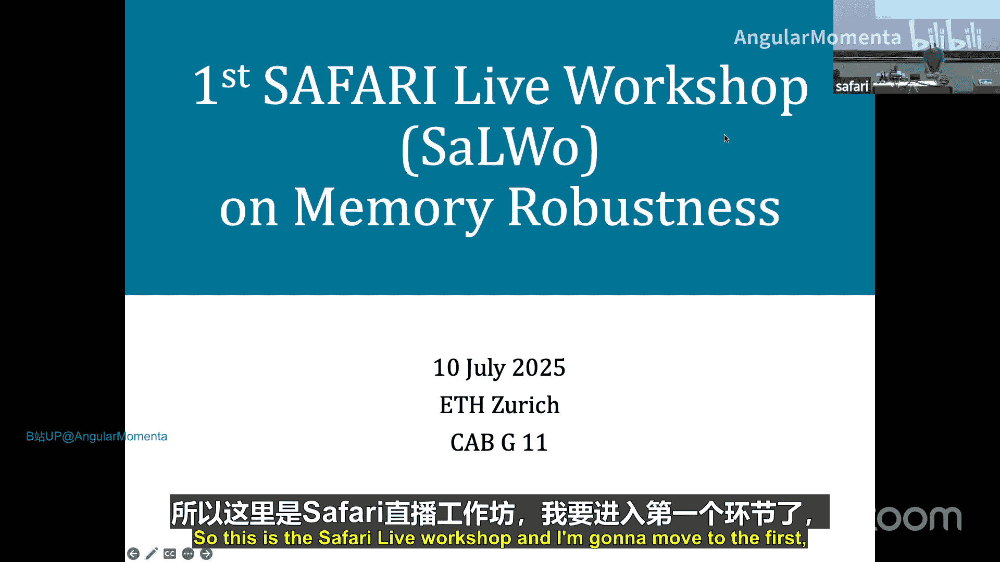

I'm going to move to the first or maybe I can talk about the today's program a little bit。

 I didn't have a slide for that。So today we have several speakers。

 the first one is me and then we have Ismail Haron atbar and Nia in order and they will talk about all of us will talk about several cuttingage research from like past few years they're all about Me robustness today and we will have a break at 945 or 10 ish because we start a little bit late and then we have another break after robustpress talk around like 11 and then we will have a lunch break maybe we can keep it a bit short as all and we aim to finish by around like 5 pm after NiA's talk and we have another coffee break in the afternoon as well。

Okay， oh， okay， so I'm sharing slides， yes。Right。而。

So I was sharing okay， I'm meant to share the program on the website， but okay。

 here you don't see anything。呃。Maybe I can just move with the first talk。

And I guess I'm not sharing it yet。😔，Sure。而。Okay， I think it's what comes soon。Good。

 so the first talk is about enabling secure and scalable systems scalinging。Secuure， sorry。

 secure and sustainable systems， still， I have a typewriter there。Okay， so this is me。

 I' like Alexa and I'm currently a postdoc and a lecturer in ETHR as part of Safari research group。

 I finished my PhD last year and this fall semester I'm going to start as a faculty at CISPA in Ham as part of Hamhols Institute and I' been conducting research for quite some time I joined Safari in 2016 so it has been。

Almost nine years because it was in August and earlier than that I finished my bachelor's in Turkey in Toub University and then did a master's in University Nor and my research interests are contract teacher meorial subsystem。

 hardware security dependability and sustainability， hardware software Corporation。

 testing and verification but the list goes on so I didn't put everything there。而且。

So today I'd like to talk about systems scaling in two aspects the first one is scaling down manufacturing and technology size。

 so this allows us to build our chips dancer and。It gives us higher performance。

 it reduces our energy consumption so everything goes well for better。

 but it comes up with the failure mechanisms and to mitigate such failure mechanisms we had to incur higher hardware complexity into our chips they consume extra energy and they reduce the chips availability so there are also these cons so this is one aspect of scaling the other aspect of scaling chain up systems in a distributed manner so that we can lower the cost of ownership and we can enable dynamic scaling on demand so these are really beneficial things but at the same time it comes with the concerns of security and privacy preventing to achieve their full potential。

诶。So in an ideal world， systems should scale robustly and sustainably as chips get denses and many users share those systems。

So this is my journey towards robust and sustainable scalinging so I started doing research on energy efficiency under in part understanding the memory access latency and memory energy consumption of real chips and later on I focused on this phenomenon called disturbance that I will introduce in Shafale and then we start working on we put more emphasis on research on availability of data and resources and I'll talk about some fisher research at the end as well so I'll directly jump into my PhD research and give a summary of that now so。

The main concept that we need to focus on is memory isolation。

 so imagine that this is your memory and you perform an access to a memorial location and you observe a bit data being changed in a different location that you didn't access。

 you do not want this to happen because it can lead to data loss or corruption。

 it can compromise your applications correctness or it can be used against you to let your private information or even to take over your computer so when such thing happens data integrity and confidentiality the issues may emerge and as a rule of thumb and access to one memorial location should not incur unint side effects on other places。

And unfortunately memorymor isolation is difficult in modern memial chips today and here's why。

 so today we use DM dynamic random access memory as a prevalent memory technology and it stores data in a form of charge on a capacitor and by nature it's a leakchy circuit and it needs to be periodically refreshed and there is this phenomenon called D redistbance when you access a DM cell it disturbs other physically nearby cells and it existsor based charged leak。

 so as a result you lose your data sooner than you should。Here okay。

 so internally inside the D chip we organize D cells in dimensional arrays and internally we access them in a D roogramular so to access data in row2 we need to first open it and then once we are done and we want to access another piece of data in another row we need to close this row2 we do this operation many times we observe bitphilips in nearby regions and this can be used to break mem isolation and it can cause all those problems that I listed before。

So this is a phenomenon that is discovered to be a widespread issue in 2014 in this Philippin Bis paper。

 and then just a year later than that， Google Project Ze exploited it in a system level to take over some computers。

And。When we do fast forward to 2024， we see a paper from like last year's Dsch basically showing that Google did another attack to the state of the arts mediation mechanism that Samsung implemented in their chips and was successful at the end。

 so I just wanted to put this to emphasize that after from 2015 to 2024 a lot of research is done and still we have this issue in 2024。

So you can use raw hammer in many different ways， there are a lot of works in the literature that I will highlight some of them that know that allows you to conduct raw hammer attacks using JavaScript code on mobile devices。

 you can use GPUs to accelerate your raw hammer attacks， you can use network packets to hammer rows。

 you can use raw hammer to leak out some information in a very reliable way。

 you can attack to some weights in your neural nets so that their accuracy can go from。

Around 90% to 10%。Um。And the research so far shows that error correcting codes or ECCC in short are not really effective against raw hammer。

 you can bypass them， and there's a number here for example， from this paper。

 you can induce up to seven raw hammer bitphilips in a data work that requires a really strong ECC that is quite expensive today。

And another recent paper already showed that Rohammer is an issue in DDR5 devices as well。

So with all that it's also quite simple to mitigate raw hammer so what you need to do is if you identify that your row two is being hammered in another words it's aggressiveg row then you just perform an operation called refresh in the physically nearby rows and it fixes the problem so the problem so the challenge here is when to do this refresh I have to do this refresh where to do this refresh and there's a lot of work done on that as well and when we look at raw hammer over years we observe that with technology scaling chips get denser the cells get smaller and they get closer to each other and as a result you need much fewer activations to perform to induce a bit filllip and the cells become。

Increasing the more vulnerable due to this scaling。

 so basically disturbance or raw hammer are major limitations of technology scaling in D technology。

And existing solutions become proively expansive or ineffect going forward。

 and we need more efficient and scalable and comprehensive solutions to the disturbance。

So in my thesis， our major contributions are so our goal is to effectively and scalably mitigatete theary disturbments。

And to achieve this， we build a detailed understanding of the disturbance。

 we looked at its sensitivities to temperature， memory access patterns。

 victim health physical location and voltage。And also we devised novel solutions。

 leveraging insight sizes into DM chips internals and memory controllers。

 so for that we did leverage heterogeneity across D rows in a D chip to reduce the overheads of mitigations we parallel the preventive actions so these are all hardware level mechanisms that we can implement today at low cost to reduce the performance overhead of energy overhead of theserv mitigations and lastly we have a mechanism that' selecteds andafe axises so that we do not have bitphilips in real chips so I'm not going to cover all of these because of time limitations but I'll try to do as much as I can so okay let's start with temperature so for that we use infrastructure this is an FJBS infrastructure called D Bnder basically。

We have an FPG board here did this program with our own design called DM Bnder and it's open source today available on Gitthub and it supports several boards and atbar will talk about it I think。

So we plug in a DRA module and we clamp this DRA module with heater pads from both sides and we control them by using a commercial controller and we have a power supply to play with the voltage on certain power rails on the FGA。

So this infrastructure gives us fine grain control over D command， timing parameters。

 temperature and voltage。And Dam Bnder is available for different standards。

 for different FPGA boards today。Um。Okay， so we conducted tests on 272 DM chips from four major manufacturers that implement different densityities di visions and chip organizations for this study and we did our best in our test methodology methodologyia to rounded chips in the case conditions。

 we basically prevent the source of interference during the test by disab and disabling collaboration events dis and hairtion mechanisms and we finish everything in less than a refresh window so that we don't have retention errors。

And we perform the worst neo access sequence to that day。And we look at the effect of temperature。

 so in this study we sweep temperature from 50 degrees Celsius to 90 degrees Celsius and what we observe is a lower bound and an upper bond。

Of a temperature range in between， we observe bitphilips in a D cell。

But outside of this temperature range， if you go colder or warmer， you do not observe it phlips。

AndWe call this temperature range vulnerable temperature range and when we look at different basically all the vulnerable Dm cells to raw hammer。

 we observe that the vast majority of them exhibit a continuous vulnerable temperature range and。

This is a quite curious observation actually so here's a little bit more detailed data so in this test we perform raw hammer by activating rows for 150。

000 times to get the bit Phillips and we sweep temperature as I said earlier so this is a population density plot of DM cells and on the x axis we have the lower bound of this vulnerable temperature range on the Y axis we have the upper bound of this vulnerable temperature range。

And the numbers in each cell shows the fraction of vulnerable D cells。

So if you look at this particular point， it tells us that 4。

3% of the vulnerable cells are vulnerable to raw hemorrhage。

 only between 50 degree Celsius and 60 degree Celsius， if you warm them up to 7 degree Celsius。

 they don't observe it Philips。And we also observed that different serum cells are vulnerable to raw hammer in different temperature range。

 so as a result， if you want to buy a D chip， put it in your server and you need to understand if it's vulnerable to raw hammer at certain condition。

 you basically need to test it at every possible operating temperature to make sure。

And when you look at the data in a more coarse grain in a D program la。

 so we look at the temperature on the X axis here from 50 degrees to 90 degrees Celsius and on the axis we have the fraction of。

Btphilipps or bitiorate in a D probe and we observe that overall when you warm up the chip。

 the dominant trend is that it makes the chip more vulnerable draw hammer because you have more DRA sales experience in Biphilip and this is an observation that is applicable for three of the four manufacturers that we tried and one of them is showing the opposite trend and this one is Samsung in the study。

 but it's still important which one is that because the more important message here is that based on your DRAM chip design DM manufacturing technology the relation with the temperature is quite complex and you really need to pay attention to that in your test especially so what we observe is empirical observations and this is very similar to。

Model that is called trap passes the charge leakage so this is。Excus name。

This is a plot from this particular paper。That studies redisturbance or raw hammer in a TCt simulation model and they have different charge trap models here and on the Y axis we have the raw hammer threshold so we observe that for different trap models the raw hammer threshold goes down and up for different range basically and this is why it happens as I explained that paper increasing temperature helps electroromo easier so it goes to higher leakage and smaller raw hammer threshold。

But at the same time， it makes traps lose charge as well so that the trap assisted leakage gets weaker so which one of this like leakage paths will be dominant it's not for certain or it's not real like generalizable because it highly depends on device characteristics and it varies across sales chips some manufacturers quite significantly。

Okay。So this temperature studies impact on literature。Sure。对。

So do you there's no way you can determine that while we。Sell by some sort of modeling。

 you have to test every single cell。very much。Soer。ほら。什么的一些。Okay， so the question。

 is there an easier way to determine which temperature range the cells are vulnerable to do the best of。

What we know is that you really need to test every cell at every temperature。

 so we didn't observe any like generalizable trends so for as I said like for three of the four manufacturers we test it we observe that the deteriorate increases as temperature increases but one of the manufacturers observe the opposite patterns so and when you look at like different parameters as well it's hard to find the generalizable trends so。

As far as I know to this day， there is no like a simple analyticalical model that shows the relation between rawhammer and temperature。

在广口。では。Whats the maximum。Reation。但是。で。In terms of AC first， I don't have it here。So。Yeah。

 I need to check that actually。Do you remember of great。My face。No， actually， okay。

 so we can't say okay so。呃。So if you observe bitphilips so for these chips。

 especially we observe bitphilips at activation counts at the order of like 10，000 15。

000 activations or hammers and so these cells observe bitfilip around this range right so this hammer count and then when you go to a different temperature。

 even with 150，000 activations， you end up not seen in a bit filipps。

 so it's like an order of magnitude， I would say yeah yeah。It was。5，6。Correct， yes。Oh。It is， yes。

More research is needed， more testing is needed to find such models。Yeah。Other questions？Okay。

Can someone monitor the YouTube chats as well。Thanks。Okay。

 so a follow up paper from Louise who was a postdoc in our group earlier now he is in Galician supercomput center。

 he found a way of finding some canary cells that tells you which temperature the D chip is at and based on these canary cells rawhammer vulnerability。

 it can identify like the temperature of the chip and based on that it can monitor remote machines temperature。

 so this is an attack that basically spies on a remote machines temperature by using rawhammer it can be used。

 for example， imagine a cloud environment and there are some busy hours and there's a lot of fluid in the system。

You identify like when it happens and then you want to start your denial of service attack at that time。

 for example， so this is that kind of attack that's already a follow up part of this study。Okay。

 so I'll move to another aspect of this study so we tried different memory access patterns and in particular so this is the memory access pattern that is known before the study as diversity as access pattern so you open and close D rows as frequently as possible so that you can maximize the activation count at a given time and instead of doing that we say that we let's activate the row and then wait for some time when the row is active and the idea behind that is that when you activate a row you basically put some high voltage on some metal layer over there and that creates some electrical field because of the voltage difference and we want to exacerbate that and see if it has any effect so we tried this access pattern and we observe that we can significantly reduce the hammer count needed。

to induce the first bit Philip and this has an immediate implication on the existing mitigation mechanisms because if your mitigation mechanism doesn't account for that。

 then you can easily bypass it。😊，And more importantly。

 this study was a preliminary study of this access patterns and later on Haung from our group studied this in a more detailed way。

 more rigorous way， and then it led to the discovery of raw press by him。And。

This is what Rob press does。I guess I can just say that you know as you increase aggressive raw on time on the x axis。

 as you go extreme on the Y axis we have the raw hammer vulnerability and it goes down significantly and it goes down by like one or two orders of magnitude。

 it's huge difference and in extreme cases at like if you wait for 30 milliseconds for example。

 then you only need like one activation to Init Philips。

 and it's a trend that exists in D chips from three major manufacturers。

And when we look at later on Attabart， well talk about this as well actually。

 when we look at HM chairs that are quite popular today for the new workloads like large language models for example。

 they're also vulnerable to raw hammer， they're also vulnerable to raw press and we can achieve Biflips at only like 335 activations and this takes。

😊，Not really long time， actually， it's a really small number。And more importantly。

 when we look at the behavior of the benign applications today。

 even the spec workloads that we keep using for evaluating our architecture studies。

 they reach to this activation count so the benign workloads become attacker and then you need to perform mitigations more rigorous more aggressively and。

The overheads increase， of course， so it's another major limitation against Iran's killing， right？

Okay， so。Maybe I can just skip this。And say that this row press is demonstrated to be something that you can do on a real system as well by writing some code and I guess how long well talk about all these details anyway so I'm going to skip this for now to avoid the reundancy。

But I want to emphasize that after we published WordPress press。

 there are some news articles saying that Samsung and probably some other manufacturers are also concern about this phenomenon and they're implementing countermeasures against those。

 and we will see if they implemented some strong countermeasures。

The last piece of characterization study that I want to talk about is Rouhammer's sensitivity voltage。

 so as I said earlier when you perform Rohammer you put some high voltage on some line called some wire called wordline and then it creates some electrical field around it and then you do this again you do this again。

 many times and then you observe bitphilips so repeat the toggle in the voltage on the word line is causing the rawuhammer bitphilips and what we were curious and we show in a study is that if we reduce the magnitude of voltage on the word line then we can reduce rawhammer vulnerability at the cost of having the DRM cells at a weaker state because when you reduce voltage then you have smaller charge in the capacitors and the channel formed in your transistors are weaker so you need to access them。

S way， but you can reduce rate disturbance and you observe that the reduction is not very great。

 but also not negible。而且。So okay， I have yet another one for the characterization study。

 so imagine that this gray rectangle represents all D rows in your DRA bank and when we look at the 10% of the weakerest rows just identify and cluster them together and say that they need n hammers to experience a bit for。

The remaining 90% of the rows require more than just two and hammer count。

 so you need to double the hammer count for the remaining 90%。

This shows us that Roheer vability significantly varies across the rows。

 and if you configure your solution， your mechanism for the worst case in this study。

 we show that youre basically or protecting many rows and make your Rohammer defense mechanism more expensive。

And there is a follow up work that actually exploits this or leverages this observation to make the mechanisms much more efficient so the key insight is that we have significant variation in rawheer vulnerability across genome row and our TID is to dynamically tune the aggressiveness of this rawheer defenses to the victim ros with the service vulnerability level so that we can perform fewer preventive actions if。

Not more than that is needed for stronger roles。And this is a tanem mechanism that works with existing raw hammer solutions and here is an existing raw hammer solution para probevost draw activation。

 so here is what how power works so when a raw activation happens and then you close the row。

 para generates a random number and then compares this random number against a threshold volume。😊。

And if a random number passes the threshold， then part of prayer until it refreshes the victim rolls。

So we basically get this victim of information， feed it into our mechanism called swear。

And then swear it dynamically changes the threshold， and as a result of that。

 we if we have less vulnerable victim cells， we have a higher threshold and as a result we perform fewer refresh operations and vice versa。

😊，And so S works with many existing Rohemer defenses。

 as long as they rely on some sort of threshold I do， and pretty much all of them require that。

 and we show how it's works with five different Rahemer solutions like para。

 aquaablochmer hydra and RRS。And we evaluate the performance impact of this mechanism and showed that S reduces the performance overhead of existing solutions and significantly improves the system by doing so。

 and it's TM implemented at low hardware complexity either inside the DM chip or inside the processor so。

If your mediattion mechanism is in the memory controller or inside the DrRM chip。

 it can support any of them。Okay， so improve systems available at local without compromising data integrity。

Is it a question？No， okay。 sure。M外天几乐 microphone。Yeah。啊。Okay， how about no。Better。

I believe the channel。This should be hopefully yearable。So in this。

 I think thiss a very interesting analysis of spatial variation。How easy is it to exploit this？

Because you need certainly peru information。And that peru of information needs to be determined through profiling。

Some sort of testing。Yes， Destra， do you already need to determine this information to figure out the lowest。

HC first in the system。For a given chip。So yes and no。

 so if you want to identify the lowest HC first or the raw hammer threshold in a given chip。

 you can do the test in a simpler way actually， let's say you want to test for a 1000 activation count。

 you can just hammer every single row for 1，000 activation count and see if there's a bit Philip。

 if there's not you can try 2000， if there's not you can try 4000 for example。

 you can go like that and during your sweep， the first time you observe a bit Philip that determines your reverse is raw hammer threshold。

In contrast， to leverage this radiation， you need to basically find that Y for every single DRAm row。

Or what we did in the study is a little bit coarser grain than that Basically we tried different raw hammer thresholds like 1000200040008000 like we sweep like that and we cluster the D rows into each activation can group based on if they observe a bit filllip or not so we didn't go really like fine grain in finding the exact HC first of every single D row but we cluster them in like。

Buckets in， in a sense。 so it it makes the testing a bit more complex and more time consuming， but。

Not really like to the extreme as all。And you can choose the granularity of the testing as you want I mean can I think that makes testing easier。

 of course you're not trying to identify the lowest possible。

You're trying to bend their owns into difference。Categories based on HC first， exactly。

And in terms of implementation， now you need to store those bins associated with each row。

 right that's true。So I don't see that you have evaluated peerac here。

 which is the favorite draw hammer solution of everyone these days。Yes。

 so this was published a few years before PRac。True， so if you at probilistic。

 not probabilistic pero activationctuaation counters。诶。

Does that make the implementation of spatial variation？Awareness easier。I believe so。

 so basically to so this is some sort of metadata that we need to store to identify each row bin in terms of raw hammer vulnerability and it depends on how many bins you have of course。

 like let's say you have like only eight or 16 bins now you need to have like three four extra bits for each D row and this per activation count in Pra mechanism already envisions st in around like 1011 bits per DM row。

 let's say inside the DRA chip and the premises that the DRA technology is dense enough so that it's not。

To big of a concern in a sense， I think， so I'm just like assuming this of course。

 because I don't know what they think， but so the praC mechanism assumes that you store like a few bits for the raw hammer threshold。

Sorry， row activation count for each D row so we can add another like three。

 four bits to each row as well to store it and since。P activationation count is a in D mechanism。

And it it already knows like what is the activation count of a row and then it should perform the mitigation operation so it can basically like read。

The bin information at the same time as the activation count and compare it and then perform from the me operation。

 which is refresh very easily。I think it doesn't introduce additional like significant complexity to that。

And when you exploit this heterorogene basically， you don't need to block， okay， yeah。

 I need to talk about that as well。Po activation counting needs time to perform refresh operation so it sends an alert signal back off signal back to the memory controller to stop the memory accessorieses so it hurts performance and energy consumption of course and if you perform these refresh operations less frequent for some rows。

 of course it will send fewer back signals back to memory controller to stop the whole system so I guess it will beneficial in performance and energy wise as well。

No， I think in general， it's a good idea to exploit this sort of variation。That way。

 you can reduce the overhead of all of these mechanisms。

 as you've shown and improve performance and efficiency。 So how another question is。

 how does this interact with temperature so you'll need to。Test。

Both spatially and at different temperature bins。That's true。

 so in this study we couldn't do that because temperature is really complex and it significantly increases the number of tests we need to conduct so we did it for a constant temperature。

And we tried in different temperatures as well， showed some similar variations。

 So it's not like when you change temperature， you have a homogeneous system， but。Yeah。

 so to fully leverage this， you need to also test for temperature and spatial variation together。

He doesn't conduct that in， in a rigorous way though，Okay， maybe that's an idea for future study。

 maybe。嗯。Anybody else？好。But。Another microphone。ok。So you're saying that。For S。

 you have bins and you assign the roles in those bins， right？Y， because of the testing。

 so what if the HC first changes over time and then you need to reassign it。How would you do that。

That's a really important problem and I agree that S is like it's one of the weakness in S because it requires that that information basically to be up to date right for security safety it's a problem depending from S as well。

 because if you don't leverage this， your worst is hammer County threshold can still change over time if that's a concern。

 right？So I think it's a separate problem and to address that we need to invest more and conduct more research on online profil and methodologies。

So that we can keep our information out the state。Does it answer your question？Yes，哎。

I thought that because here you need to consider the。Old rows， right。

 you to make sure that old rows they're in their bins。But I'm not sure if it's the case。

 but once you figure out the weakest cell cells that you show in deeper look right like 10% of them are actually the weakest。

 so for them maybe it's easier to characterize but。In Sar's case， you need to actually have。

You need to monitor all of them like a whole hundred% right that's serious so maybe that could be a difference and also like aging but there's also another guarantee that you know。

Maybe in future like a row from that 90% chunk will be the worst throw after that so you need to test all the rows so Ser's added complexity is that you need to test all the rows for several different hammer accounts instead of just like one or two。

So it linearly increases the testing time。Or testing complexity but。Other than that。

 like the remaining problem is there without Suar as well。Yeah。

 regardless to understand which is the lowest like vehicles do you need to test all yeah that's true。

 yes， thanks， thanks。Other questions？Okay。Can I get the microphone？嗯。は。DidInvest the flag。不是。て这什。

This。Like the。Yeah， so I'm not sure if it was audible， so I'm going to repeat the question so。

So the question is if we found any correlation between the variation in rawhamer vulnerability and variation other problems of theorem like retention time or other things？

So。I spent quite some time so it's not in this paper because we couldn't find in a strong correlation。

 I spent quite some time and I didn't observe anything， it doesn't mean that there's no correlation。

 it's still like an open research question and I think more rigorous studies need to be conduct on that。

Does that answer your question？Okay， thanks。Any other no。Okay。

Let's look at from a different look at Rohamm issues from a different angle。

 this is about compatibility， so I'm going to move back to very high level。

 so in the application level how we access memory is that we deal with virtual memory addresses。

 right？😊，And then when you go to the system level， you translate these virtual memory ad to physical memory ad。

😊，And then in the memory controller you get this physical memory addresses and then parse it into the logical addresses of DM bus。

 basically which channel of DM which rank which bank you need to go， etc。

 and all these transitions are visible within the processor and when you send these logical addresses to D chip internally inside the DRM chip。

 some of these processor visible addresses such as row addresses for example。

 are translated again to physical row addresses， and this is something done for making optimizations in the DM circuitry and also repairs after the manufacturing so it has some insights into the manufacturing quality and also the DM design and that's why this information is proprietaryrietor DM manufacturers do not want to disclose this information。

And with this transition knowledge， when the Roham attack hammers row A， here's what happens。

Let's say you have a mechanism in your processor that identifies the straw A being accessed very frequently。

 it performs the refresh operation targeting a plus1 and a minus1 and this cant fall into really irrelevant locations in your physical ur and your actual victim role can still experience pits and this is an issue and many existing solutions rely on this proprietary information because of the ob in this interface。

So blockham provides， this is our mechanism， provides an alternative approach if it identifies a row A is being hammered。

What it does is that it detects this hammer row and then selective the throttles。

 the axis is targeting this particular row and as a result you can avoid redisturbance bit Phillips in the actual victim rows and you do not need the knowledge of this in the Ram address translation at all。

 so this work was done in 20221。Actually it was submitted several times， I guess starting from 2019。

 it took like two years to get it accepted and then it was published and then an update to DRM standards introduce something called DRFM directed refresh management command。

 so there's no direct reference to this work， but I think this ver already increased some awareness on this issue and this directed refresh management gets this raw A's information passes to DRAM and then inside the DM it identifies which victims to refresh and then perform refreshes on those。

So this is that word blockham and we evaluated the performance impact of blockham。

 so there's something curious here as well， not curious。

 it's very straightforward that in Qtu actually but it's quite important。

 interesting so if there's no rawh attack in your system you basically do not throttle any memory axises because you selective a little throttle and there's a rhh attack so the performance and energy overheads are quite small。

But when there is a Roheer attack present in the system。

 by nature the Roheer attack wants to activate rows quite frequently for large activation counts and bhemer is quite good at identifying this behavior and it throttles those aes so it punishes the attacker basically。

 and it improves the system performance and energy consumption quite significantly by throttleling the attack and opening up more bandwidth for the concurrent runningian benign applications。

😊，Okay， so that was blockham and there's a list of papers in my PhD distation that I didn't cover all of them。

 but I wanted to put a list here but we covered all of them in earlier software life seminars actually there's one live seminar that's focused purely on the characterization mark that I briefly talked about today and also about solutions as well。

 so I want to refer you to those talks and to talk with me for more details。A more discussion。

And I wanted to highlight one more thing about Rohammer today in 2025 after 11 years since Rohammer has shown to be a widespread issue。

 we have quite some interest still in the academia and in the industry to Rohammer so earlier。

Not earlier this month。Late last month， June 21st， there was a workshop called DMsC that was conducted that was held colated with ISA 2025。

 and it was pretty much mostly focused on Ro Ham issue and what we should do as the system builders。

And there were attendees from NVDA Microsoft micron and Samsung。

 so there's a full footage of this workshop available on YouTube so please go and check the discussion over it was quite interesting and also there was a session dedicated to Ro Hammer in the main conference as well。

Okay， so with that before you go。Maybe I have some questions。First， I have a correction over here。

 however was shown to be a major issue earlier than 2014。

But the first overwhelming paper we wrote got rejected。It could have been published in 2013。

 actually， but。we were as delayed progress as they normally do。In this case。

It's good to put it on record one more time。Second is， yes。

 there was a lively discussion in the DMMs workshop。u。Later last month。

And there were actually other people present from other companies like Rabus。

And I'd encourage people to look at that because everything' is online it gives you a sense of the state of the art discussions on Rohammer I think one of the issues is people are too focused on this industry standardized protection methods like PRRA per activation counters but we need probably more creative ways of thinking about solutions and I like blockhammer I'm going to get back to blackhammer because it's a different way of thinking about a solution right a lot of the solutions proposed to Rohammer are proactive refresh。

Or some sort of basically prevent a refresh， let's say。

But black hammer does throtling So how do you see these two things to be combined。

 I there a way to combine them so that you can actually scale the solution too much。Lower threshold。

I will talk about it actually， okay， you'll talk about it， okay， you'll get to it， that's good。😊。

Yeah， maybe I'll ask the next question when you talk about that because it's going to build on that probably。

 okay， okay。Yeah， thanks for the correction as well， I'll fix the slides later on。Okay。

 so that was done in my PhD and then in the last year we also focused more on the availability of data and resources in existence of the disturbance issues and the overheads of the miations。

I'll try to quickly cover them， so I'm running out of time actually， sorry， smile， youre next。😊，Okay。

 so meanwhile， in industry， we have a longer day， of course yes。😊。

industry industry also reacted to the Strhamer research and JDEC。

 the body that defines the DRM standards from the Rohammer task force and the manufacturer' attitude change over time from denial to solution in the early days they were just denying that theres Rohemer vulnerability in DM cells and the words from our group from CAvez group from other groups repeatedly show that even from the system level。

 you can exploit Rohammer vulnerability and mount effective system level attacks。

 so they change their attitudes from denial solution in a way that。1， for example， manufacturer。

 relatively smaller manufacturer， released a patent on raw hammer solutions。

And we looked at the security analysis of that solution as well。

 it's a paper on archive and then we also observed other papers coming up from Microsoft。

 from SJ Hyinex， Samsung， NVDdia。And another paper that I mentioned earlier。

 Google hacked the Samsung solution from 20223 for example。

 so industry is also working on that and there is an increased awareness on the strawham。

 so JDI released two documents that are not helpful to provide some information to system builders and DRA manufacturers to like to talk about ways of rawham mitigation。

 but then later on last year they released updates to the DR5 standard with the first promising update after a decade of Rohammer research and it's called PRC Pro activation content in DR。

And that's the mechanism that we were just talking about with Ho just a minute ago。🤧。

So we went ahead and investigated this Rou Hammer solution that JD introduced。

 and it was presented in last year's the Rams workshop and we show that it is secure against Ro Hammer。

 yes。🤧。And it comes at the cost of， like。Sttoring activation count values use for every single D row in the DM chip and it increases the laency of closing D row quite significantly and it causes around 10% performance degradation for benign workloads。

And it can be exploited by meorial performance attacks and can be。

You can perform a denial of service， denial of me service attack basically by reducing DRAms available to by 94% in extreme cases。

This is how Pra works， so it's called per activation counting。

The tracking of the raw activations and access patterns all done inside the DM chip so you maintain an activation counter for each D row and updated the counter when a row is a closeds basically and to mitigatete hammer basically you need to internally perform prevent refreshers and you need time to borrow from the memory controller to perform these refresh operations and to enable that out they allow the DM chip to send a signal back to the memory controller called backoff signal alert backoff in full name and it doesn't controller to stop accessing that particular bank or rank and as a result memory controller D chip with some time to perform the parameteri refresh operations and it performs the parameter refresh operations and no bit Phils survive okay so so far like the mechanism makes sense right but。

I in detail so analysis show that in particular this city updating the counter of row while row is closed is an issue。

Because it incurs around 10% slowdown in the common case for benign workloads and the reason is that when you close the row。

 you want to close it as soon as possible so that you activate another row serve another memory request right but now you need to update your counter to do that you need to perform a read operation and then in chromatic counter will you and then write it back and then close the row it takes quite some time and it increases the latetencyency of closing the DM row by 140%。

 it's quite significant to increase and as a result it translates to like 10% system scale slowdown and so to address this issue we came up with another idea called Chronus Chrons makes this industry's best solution much better than what it is today。

It basically updates the raw activation counters in parallel to a column axises of D rows。

 and how we do that is we leverage subra parallelism。

And when we do this corona significantly reduces PRx performance overheads from around 10% to 0。04%。

 so it basically mitigateates pretty much all the performance issues of that。

 so here's how it works so in a DRA bank this is a cartoonish picture of DraM bank you have multiple smaller arrays of Dra cells those two dimensional arrays。

 and these subs pretty much work independently most of the time， but they share some common IO。

So they already exist like several many of these subs exist in a Dham Bank。Append a smaller。

 even smaller one on the top。Of course on top on this cartoonish picture， it tell me anywhere。

And we have a row buffer for this， we have a row decoder and we have an increment logic here。

 we did all design in a paper you can find details so basically we store the counter values of these rows。

 not inside the rows but inside the rows in this additional counter sub here so that once we access a row。

 perform a regular access to these regular subase at the same time we can also activate a row here。

 get the countervalue incremented and write it back and we can overlap these latencies they can completely be in parallel。

And by using the summary level paralleluralism， we can reduce the overhead。

 so this work is published in HPCA earlier this year in March and all the implementation is open source on GiHub so you can try it yourself as well。

other work I want to imagine there's a question my lower there sorry。是。Yeah。Okay。そ。第。Yeah。

 I can repeat。And go back one slide here， so here you store counters DM sub right yes and if I just have a access to each row in the one sub I'll need to activate for example。

 the first row of the counter sub repeatedly basically I can hammer。The counters。

Rose in the counter subways so that could introduce some bro hammer bit flips in other counters Yeah how how would Chronos solve that issue Yeah it's it's okay。

 it's in high level it's the issue there's like really common in many vertical ideas like okay you protect some data and to protect data you also store some metadata So how do you protect the metadata and here we need to protect the bits inside the counter sub So。

And you can quite significantly hammer those if you craft an access pattern really carefully。

 yes that's true and to do that we discuss several different solutions basically we can do the same refresh operations here as well basically keep the count of these rows as well and then refresh them。

 another way that we discuss in the paper is to implement the mechanism called rega basically whenever a row is activated in that counterse。

 we have so it's a bit abstracted out here but in this row buffer you have an array of sand amplifiers and then an array of latches over there。

And whenever you activate one of the counter rows， you latch the information and then meanwhile you refresh other rows in the counter sub。

So by doing that you keep all the rows quite refreshed all the time and it tend to reduce the。

Chance of Rohemer。 Well， well， it can prevent Rohemer with Philips and。

I think that the performance overhead of that is also taken into account in the evaluation。

Yeah also like the counter server is pretty small right you can have like similar tozebra like where you add some dum rows between each counter Yeah。

 we also discusszebra okay yeah。I remember that I just you wrote it， okay， yeah， yeah。

 you jump put some isolation because while in regular sub， you have like around 1000 rows。😊。

In the counter survey， you have， I don't know，60 throws，0 rows， sounds like that。Okay。

 any other questions？So this counter sub is actually a specialized sub。True。

 its goal is to store update。Counters and enable mitigating actions。That's correct， yeah。

So that complicates the design。That complicates the design， yes。

 and we need a incremental logic very close to that counter sub yes， it complicates the design。

So how many encounters of A do you have per bank？It's， it's just like one concert survey for bank。

 Okay， and in a bank， you have like。Hundreds of regular subs。Okay， so。

I think still relatively a smaller overhead like。Without this counter survey。

 you still need to store all those counter values， so you need to make the DM bank like larger in horizontal way。

But now you made it like larger in vertical way。 and you can add some extra logic because it's at the edge of the D bank。

 I mean， it can be。 it can be anywhere in reality。 but yeah。

 you can manufacture it at the edge of the D bank and you can。Put some specialized circuitry there。

Okay， it just， it just makes the u now you design two different kind of subways。

 right that's true with Piac， you have only one kind of subway。That's correct， yeah。

But you have also quite significant performance degradation just M Gher Phillip Yeah， I agree。

 I think it could be a good trade off and we should be changing the DR architecture。

As opposed to trying to keep everything the same， which will not lead to any advance if you try to keep everything the same。

Yes， that's by definition， I guess。but people don't seem to realize this very well in research as well as industry。

 if you don't change anything， you don't advance。The other question over here is。

How does this affect TFA？Okay。So TO is a constraint for activation window and it's related to power limitations of chip so now you need to activate two rows。

 one in the regular surveys， one in the counter survey and it potentially increases your power consumption and。

Yes， it's a。It's， it's Chan like。Change the requirement from your power delivery circuitry and with the current circuitry。

 it might。Cool， some issues with TO， but I think it's also subject to change when we do this kind of specialized summary。

And the sub， as I said earlier， while is my question that the cancer sub is quite smaller than the regular sub。

You don't really drive huge bit lines inside it and the additional power consumption shouldn't be as large as regular subs anyway so that's one thing another thing is T4 is so when you look at the refresh operation it already violates all the restrictions that TO introduces and that's because TO takess into account the power consumption of the i circuitrry as well。

 not only the raw activation like the name says for activation window but it actually assumes that when you activate a row you need to read some data or write some data and it accounts for the power consumption of those as well。

 so the limitation is put based on that assumption but if you actually activate like multiple rows and the additional rows do not perform。

Do not use the like global I， then the power consumption is smaller。

So we do not know the details because theam circuitry models are not really informative about those。

 but my gut feeling is that it's not really a major issue， it's not a major limitation。

And we actually did some tests， maybe Isma will talk about it later for processing using D operations when you activate multiple rows how the power consumption changes and we do not observe a quite significant change actually after activate a manroe。

 you already consume a lot of power and then the increase on additional rows is quite marginal。

I think yeah， that's my answer to that question a lot of speculation。

 but I think it's it's an educated yes， no it makes sense。

 I think people have shown that there's a lot of slacklack in PA for the reasons you suggest I'm not sure if PFA specification is that clear。

😊，In terms of what it includes， is it？It's not clear， but when you do the simple math。

 it's quite clear that the regular refresh operation create violate TO。Okay。Okay any other questions？

ok。So this was Chronus。And then I'll get back now it's time for your previous question about using refresh based mechanisms and throtling together。

 so here in this work we focus on thera chips availability in existence of really high rawhan vulnerabilities。

So this is。A mechanism called brakehammer。That throttle suspect threats in hardware so brakeham names comes from the analogy with the brakewater so in oceanfront。

 for example， you have this structure called brakewater that breaks the waves to reach to the marine so that in the marine you don't have like the water really wavy and it doesn't hurt the infrastructure over there and you need a lightweight maintenance inside the marine when you have brakewater I'm talking about the civil engineering concepts here right and it's another good brake hammer basically we break the raw hammer so that when it reaches to memory controller and raw hammer detection or mitigation mechanisms。

It。It requires a relative lightweight to weight maintenance and mitigation so that's the key idea。

 so we detect detect and slow down the memory aes of the threats that trigger many Rohamer prevent actions so here we assume that there's a Roheer preventive action is performed by the memory control or inside the D chip and theres a Rohe defense mechanism already exist there probably a refresh base mechanism because many of those mechanisms are a base and we observe these Rohamer preventive actions from this memory channel and we trace back who which thread triggered them and then we identify a suspect threat based on that as the attacker and then we slow down the memory accesses of this attacker so that it doesn't consume much memory bandwidth it doesn't access the quite significantly and then。

It reduces the number of hammers that it performs。So let me look at。

 we evaluated the performance overhead of this， of course。

 and under attack it difficult to improve system performance and reduces the energy consumption quite significantly and when there's no rawham attack。

 it doesn't affect the system， it just keeps observing the memory access patterns and a lot of doesn't take a lot of actions and this is also published in micro2024 last year in fall and the implementation is also on GitHub and you can easily use it on Arator。

Okay。So this was the thing that I was referring to to answer your questions。

 so maybe I can get to your other questions as well。Okay， so he went through it relatively fast。

 but this works well with PRac as well。Yes， so to make it compatible with PRrac what we do is that in PRrac everything is inside the Dship so we don't have we cannot observe many of the events inside the D chip because this is a mechanism that is in the processor in the memory controller in caches and etc what we can observe is that。

The back of signals coming from the Ramchp to the memory controller and we。

We identify like which it's sort of a prediction of like which thread is causing many of these backupoff signals。

And based on that， we throttle that。So it can work with Piak。And if it's implemented with peer Act。

Performance impact is still low。Well， yes。The under attack impact is also quite low actually。

 because perhapss major performance or comes from the increased latency that I'm talking about in the previous work。

 but the refreshers do not actually hurt performance quite significantly until you go to like real low Ro hammer thresholds。

Yeah， so the headroom for improvement is not really large over there as all unless you go to really low thresholds。

 so in both under attack and no attack for like current systems。

 it doesn't have major performance impact。Okay。Any other questions？不ay。So， okay。

I'll just quickly talk about very high level about my fish research， what I want to do。

 and I'll conclude my talk so the one。Front that I want to push research is hardware software code design for sustainable robustness I don't I guess I don't need to motivate hardware social code design to this audience anyway。

It basicallyically in software you have like lot of insights into software semantics and hardware。

 your measurements are much more accurate and your responses are much more prompt。

 everything is much faster and much lower cost and when you do this code design you get great benefits and it has been leveraged by a lot of work for performance energy and other concerns。

And I believe that there is more to do for security as well。

 so this code design can make security lower cost。And here's an example。

 so hardware levels sensors and counters can quickly and accurately collect a lot of data on application behavior and react to those so there are some examples in literature and。

When we look at software level mal detection mechanisms they have a better big picture so they know like which programs spa those malicious threads。

 which users are using them and they can have more constructive reactions。

 they can flag some functions or they can inform programmers and they can do a higher level countermeasure as well。

 so our key insight here is that system level attacks often try to attack。

Many times and the idea is to provide software level mal verization with lots of statistics and information from hardware level mechanisms so that they can make more educated information so this is a very high level research direction that I want to define。

Another one is data centric robustness so data centric computation we will have a huge workshop on that as well。

 I don't need to motivate that all but it's just like it's known I'm just iterating that the memory access is object moment our major consumers of the energy in our systems and。

And they are used for better performance per drill per area and processing memory and processing storage are two promising competition paradigms。

 but the security aspects of those and how the ATMB leverage to provide better security are not really well studied yet。

 when we look at the best practices of security， they're designing a processor centric mindset。

But when we look at what operations they do， those operations can be done in memory in storage as well and in the academia there are like a few papers popping up recently on that direction as well。

 so I still think that processing memory and storage have a lot to offer。

 so I'd like to look into that as well。And a question。Yes。

 so what does being data centric provide here？In terms of security， is there a benefit you get？So。

 for example。If you take like Intel SGH and the encryption and the isolation that it provides。

So you you need to move data to encrypt to the processor。

 you need to run your encryption algorithm and then put the data back。

So you already suffer from data moment without this and it exists basic and if you move this operation to storage or memory and I'm not talking about cutting edge at this moment because it's like there are already works that exploited you can reduce this overheads and you can improve the energy efficiency of your system so I'm talking about I buy that so you basically improve energy efficiency and performance but what about security is there any benefit you would get。

By keeping the data。In memory。I just to begin with you also like security is about like how many components in your system you can put trust on right so if if you want to be like super secure and you want to minimize the amount of components that you want to trust you can get rid of the。

O chip data link， for example， by doing that yeah， we don't need to trust that basically anymore。

 yes yeah。Now， I agree in general， it's best to not move data because moving data exposes it to potential other observers。

 right？That's true， yes。Okay。So these are just like some recent works and cipher matches。

 I guess people are familiar with that here， so we had a a live seminar on that as well。Okay。

 so there are。呃。So there are a lot of words showing up。

But it's basically a growing field of research and I think there are more things to do here。

And theres also the other aspect security of data centric computation。

 so basically time inside and covered channel attacks are easier when you're near or in memory you have less noise in your system you have no cash or simpler caches and you have fine grain control and everything and you can have larger channel bandwidth with your side and covered channel attacks and Nia will talk about a recent paper that is published last month in DSN that is talking about this so I think like these are really promising frontiers of this field of research and there are more things to do here so I'm not going to cover this slide I'm just going to skip it and yeah this is the other research field that I want to do more research on so better understand of failure mechanism so a generic question is what is the worst case for you。

One system and our failure mechanisms depend on many conditions and can be observed somewhat probabilistically as I talk about the Rohemer characterization before the temperature depend sensitivity was quite。

Quite complex， for example。And the post manufacturing testing cannot practically cover all these conditions because it's expensive。

 it takes time， I mean need better method and infrastructures for having systems more secure。

 reliable and safe and testing is costly because the chip cannot be used while it's in testing and you need to buy chips to test them so unless you're the manufacturer you need to invest a lot on buying a lot of chips。

So this is sort of a long-term goal that I have， I think we need to revolutionize the testing and data collection with providing online testing methodologies that include some reverse engineering tools。

 some testing routines and stuff like that and some attestation needs to be here as well。

 so that we can crowdsource the data collection and we can scale up our sample sets instead of testing like hundreds of chips we can test millions of chips if we can collect a lot of data from a lot of people and a lot of servers but for that there are really like huge challenges of implementing these testing methodologies and reverse engineering tools。

And there are some good examples for offline testing tools in the field。

 and we need more plug and play online runtime testing tools to achieve that。So with that。

 I want to conclude with my first claim， not claim the。

The goal system should scale robustly and sustainably as chips get denser and many users share systems and to do that we need more research of course in the fields that I just talk about and that's the end of my talk thank you very much I can get more questions。

Okay， thanks for the nice talk， here， I have a question on testing。Alright， you mentioned that。

Test the chip in runtime when it's idols。Why doesn't the chip itself do it？

So yeah I'm assuming you're talking about a DM chip， but it could be any chip， sure。

 but let's talk about DM。If the chip has mechanisms to automatically test itself。And find things。

Would this problem be solved like is there such capability？For D Ram chips， I guess yes。

 it can be mostly solve so we still need to collect this information and I mean in practice it's also quite hard to call manufacturers to implement this runtime testing methodology inside theD RamM chip and also expose that data outside so that they can be used for research so for that reason I'm not seeing it very promising but yes。

 like，Ipothetical scenario where they're okay with that。

 I think it's better to perform inside the chip so we can do it more efficiently。

 we can leverage paralleluralism inside the chip， we can hide all the latencies and we can reduce the energy consumption of testing even。

So yes。嗯。Does it answer me your question？Well， somewhat， I mean。

 there's work to be done in this area， so it's a more of very research direction。Yes。

 but who does the testing becomes important， right？I think if the DM chip is more self managing。

 let's say， which someone here may be talking about later。Maybe you can do the testing better。Yeah。

Yeah， that's for sure， yes。I agree that if you can do that inside the chip with the chip。Test itself。

 yes， it's more efficient。 It's a better solution for sure。没有。

But we need to get that testing data out to。To use in research and to like more statistical analysis on that。

There some conclusions。I guess yeah， depends on the type of conclusions that you want to draw， right？

LikeInally， you can do a lot also if you can keep the data inside the chip。

 but then if you don't share it， then you can do the crowdsourcing， maybe。Yes。我是。So， here， still the。

Like a high level goal is to advance the science， right， so we want to publish this and。

In a production environment， yes， maybe it's much more efficient to do the tests inside the D chip。

 fix errors and move on with life， but yeah it doesn't really advance the。Open literature。Well。

 that's a different question， though right？Yeah， with that data is available and how that data is used。

So if you want to improve the efficiency or robustness internally。

 you don't need to publish that data necessarily outside， right？Yes。

 you can build mechanisms inside the chip。for example， change refresh rates of different rows。

Like three us， yes， yeah。But。Okay， so it's， it's to me， it seems similar to。

The kind of study that some cloudd manufacturers are publish nowadays。

 like they collect a lot of logs over some extended amount of time and they analyze like okay what is the reliable of DDR 5D Ram chips versus DDR 4D Ram chips and then they draw some conclusions based on that but then you actually want to understand why those Bi Phils are happening。

 you don't really have like much details because，So that data is collected inside the server and they did some counter measures to keep their server servers alive。

 yes， but it's。I guess it's it just like works for that company or that provider。

 but it doesn't really help us like whole community to understand why those Bi Phils are happening and how can we solve them I mean I think we're talking about different things I'm talking about mechanisms you're talking about the data availability and understanding。

I think both needs to happen for sure， but how do we enable this online testing efficiently is a good question。

I agree， yes no。Yeah， I don't deny it。No， you have a question。

So you're talking about online testing methodologies right。

 and I suppose this testing is to make the system more robust or even more performant throughout the runtime。

 right？Okay， so previously， you said that you need to test a big amount of cells。In a Dem shape。

 in order to understand what is going on to see the characteristics of the entire Dem shape。

But this I couldn't hear that part you need to test all cells in order to have an idea of how the inter chip behaves right。

 but this would play a role when it comes to the aging of the tip if this happens online so if we don't have a separate tip in order to test。

Could there be a way to limit。The number of testing that is needed because online in order to enable this online testing。

 we need to test less cells。So the testing itself also causes aging in chips yes exact problem Yes yes。

 is there a way to limit the testing in order to reduce the sort of aging and this and the time needed as well and the energy spent on the testing side rather than actually using the Dm chip Yeah I think that's a good research question as all it's basically a noob like how frequently you will repeat the test and you can't play with that and see like。

Yeah， what is the sweet spot， but I guess， I have no idea at the moment about that。 It's。

's something to discover。Any other questions？I'm sorry this took much longer than was supposed to。

So I just， it's already a time for configuration， right？

And then we can have your talk after the coffee break。Yeah。嗯，对。Then yeah， see you in like， oh， sorry。

 there's a。What。还没死啊。This is again on online testing and thanks for the great talk。嗯。

Is it really necessary for this online testing to be necessarily only inside the DRA chip because you may want to issue demand requests from the memory controller to certain areas of the DRAm？

That need to be sent。Maybe there's also a need for the memory controller to signal。But's the Dedm？

That okay， you could。Going into， let's say， profiling yourself right now。

 updating your internal counters we can use later。Is there a case to be made for that。

 maybe not specifically for robustness， but for maybe other problems not necessarily relevant to robustness？

What are your thoughts on this？I think that's a good point and I think we should discuss it with SMD itself managing De no。

Okay， so there's going to be another talk more focused on that， I guess。😊，Maybe we can。

 you can reiterate it Sure yeah， thanks。O。Then let's go to configurationfiration and come back by like 10 a。

7 minutes now。So early，10 or five。Time 15， okay？Okay。So we will have7 to 22 minutes of break。

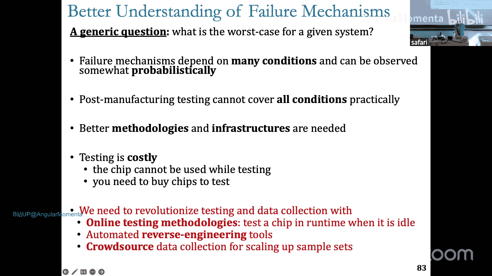

It is here。Oh。我觉得。Something there。

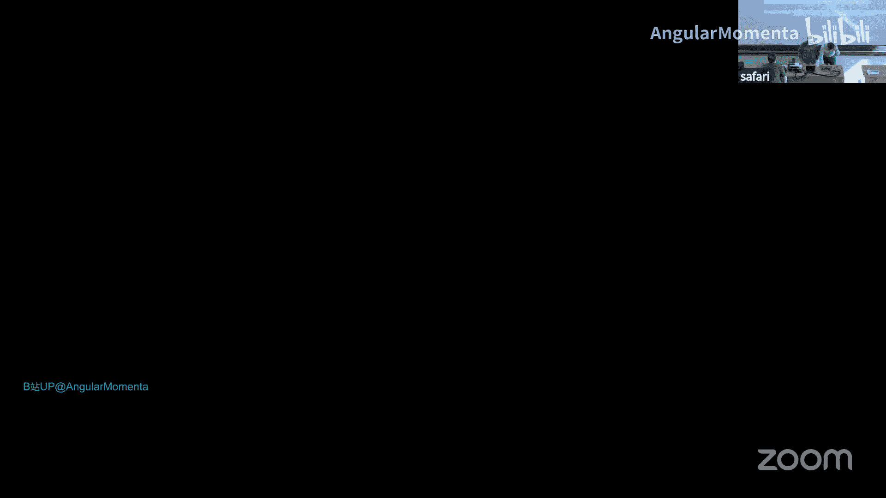

系我到。아 그래도도 없。Only only do should I share the screen， yes。S， is。Oh。So。Is this the correct thing。

Maybe必。Oh。Might have a sc。Okay。啊。Oh， I think okay， okay。Hello， hello， hello， it's fine。

Can you guys see it from back？But actually you have the indicators or the can right。Hello。Yes， okay。

I say everything works well。So welcome everyone， so we carried some of the water and orange juice over there。

 so if you need some， please help yourselves。So we'll continue with second talk from Ism。

 Ismailile Lemial is a second year PhD student in Sfa Research Group at EthHR。

And he works with Professor Arutle， obviously。And his current broader research interests are in computer architecture。

 processing and memory， hardware security and focused on understanding enhancing and exploiting fundamental competition capabilities of modern D architectures。

 and it's impressive that he has at least one paper in each of these already in the second year of PhD。

Yeah。Today he will talk about pot hammer， experimental analysis of disturbance and effects of press in Drm in real D chips。

 go ahead。😊，Thanks a lot for the great introductionai。 Hello everyone。 I am am。 Today。

 I'll be covering our recent work published Deniska 2025， called Pa Hammer。

 experimentalmental analysis of redisturbance effects of processing using DM in real DM chips。😊。

Let's start with an executive summary， processing using them is a promising paradigm to elevate data movement bottlenecks between main memory and processing units。

Prior work that DM can perform many processing using DM operations by activating multiple DM rows in quick succession or simultaneously。

 as broadly referred as multiple row activation。Unfortunately。

 modern DM is subject to red disturbance and proman example for this raw Hams here I thought before。

 and repeatedlyly activating even a single DM row induces bitphilips in other unaccessed rows。

And the problem is no prior work study the redistance effect of activating multiple roles at once。

 multiple activation， and our goal is to understand and analyze how this multiple row activation has an effect on redistance vul in real DM chip。

😊，To this end we conduct an experimental study on 316 of the shelf DDR4 chips from four major manufacturers to study this effect of multiple react。

 which we call Pa Ham。We observed that pot hammer significantly exertta based DM redisturbance。

 causing up to almost 160 times a reduction in minimum hammer count to induced first bitophillip。

And we observe that but hammermer bypasses in DM Ro hammer mitigation employed in EDR 4 and induces more than 10。

000 times morbi flips den rowhamrrh。And we adapt the industry's latest solution to Robhammer。

 per activation accountinging to account for Phammer。

 and we observe that the adapted solution in an average system performance overhead of almost 50%。

So here's the outline of my talk and I'll start with a brief background。

D DM is used as the main memory in many computing systems。

 and inside the DM model we have several DM chips。Within DM。

 we have many DM banks and inside the DM Bank， we have many subways。Within each summary。

 we have two dimensional area of DM cells and a row of DM cells called DM row and they are connected through wordline。

 and a column of DM cells are connected to send sifiers via a bit length。

And there are three major D operations to access data from the era。

First is activate which fetches the row's content into send amplifiers。

 and then memory controlt can issue column as such as read from the row or write the row。

And then in order to access another data in another role in the same bank。

 memory control needs to issue a precharge command tool which prepare the bank for a new activity。

As we see until now， the is just used to store data。

This is because today's computing systems are processor centric。

All the data ised in processor at a great system cost in order to perform a computation。

 we need to move the data between main memorymand computing units and prior showed that more than 60% of the total energy spend on data movement。

APro using DM is a promising program to elevate such data and bottlenecks。

It uses analog operational principles of DM cells to perform computation。

And multiple grow activation is a key technique to realize mainoppa operations such as and and ore。

And we categorize different types of multiple activation into two first consecutive multipl activation。

 short for camera， and second simultaneous multipl activation， which we call sra。

Let's look at the consecutive multipl activation first。The key idea。

 the key observation is violating the timing of pre charge command greatly in of the Shaftir Ram chips activates two rows consecutively。

😊，So here we have a DM sub， which consists of many roles， including source， SRC and destination， DSD。

So if you obey the timing parameters in this command sequence， activate source， perchar。

 then activate destination。We will activate only a single DM at a time。

 by source and then destination。However， we observe and prior also observe that if we the violate this timings。

And。If we grade violate these timings， we can activate two roles consecutively。

And we use this consecutive multi activation to perform AT operation in DM， a row copy operation。

 which is also called road law。So here again， we have the same example source and destinations rows。

 and as we first activate source， which will assert the source verly。And then we wait for Tre。

 which is 36 nanoseconds， and it will fetch the source content into the sense amplifiers and it will restore the charge in the source row。

And then we issue back to back by violated timings per chargege and activate to destination。

As a result of this， we activate destination rooms。Since we violate the precharge command。

 we keep the bit lines at source voltage and also sendsplifier at source voltage and also we keep thesplifier enabled。

And if you wait again the long enough by obeying the timing parameters。

 you observe that from sense amplifier to destination， source content is copied。And another one。

 another multiple activation technique is simultaneous multiple activation。

 the key observations activating two rows include succession in of the shelf the Ram chips simultaneously activate multiple rows in a sub here we have one subway sub X which console many rows including row A and row B here we have our usual command sequence activate row A per charge and activate row B again if we obey the timing parameters we will only activate the single row at a time where if we grade to violate this timings we will activate main rows in the sub at once。

😊，And this is because back toback activation commands with violated timings assert many more signals in the hierarchical row decodder circuitry in the DRA。

 and you can check for hypotheses and how this row decoder circuit verbs from our previous work。

 which I will talk about in two weeks in the third session of our sallo。😊。

And one example of Sra is realizing in D majority of three here we have a DM server again。

 which has A， B and B rows， three rows。And assume when we issue our commence sequence with activate per and activate valid timings。

 we activate three roles simultaneously。Let me issue this。

It fill us three rows word lines at the same time as a result of this。

 three rows with pertrb bit lines simultaneously。And due to the charge sharing principles。

 sand splifiers will sample off the majority in this case is P。😊，But unfortunately。In D we have。

Phenomeon called red disturbance， even activating a single DM role disturbs the data integrityte of other and excess roles。

A prominent example for that is raw hammer， where we keep repeatedly accessing a same DM row causes bit flips in nearby rows。

 we call likegressor row as the row that we hammer and we call victim role as the roles that experience bit flips。

So this phenomenon brings us our papers problem and goal。

No prior investigates a redistbance effect of multiple flow activation。

 even a single DM re activation causing bitformps， and our goal is to understand how this multiple flow activation affect the redistance vulnerability in real DM chips。

😊，To experiment with real DRM chips， we use the real DRM chip testing infrastructure。

 it is built upon DM B which enables us to have a fine grain control over DM commands， timing。

 temperature and voltage。To test a lot of DM and understand how memory works and understand how the other failures。

Happens we have a laboratory for understanding memory。And we test in this study。

 we test a total of 316 DDR4 chips from four major manufacturers。

 and we cover different tire visions and chip densencies。

 you can think of them at different rear architectures。And now let's move on to our first analysis。

 redistance effect of consecutive multiple activation， recall that co for short。

 activates twos consecutively。So to hammer using this Com access pattern， we use two versions of。

Hammering first is double sided very Sandic a victim row here what we do is that we copy one row to another to Sandic victim row。

And the other one is single sided， where we keep hammering onero indu grid flips in nearby roads。

But here in this access pattern， since we use two rows as a。

I guess sir what we do is that we copy from one row to another where they're really far away from each other。

In a sense that we do a single side that in both cases。For source and destination。

So to characterize the redistance effect of cora， be careful sweep， raw addresses。

 source and destination， the timing parameters between precharged to activate command。😊。

And the data pattern in several different temperature levels。

And to enable it to read disturbance vulnerability of D chips。

 we use a wide lead metric called HC first， which is the minimum hammer count required in this first bitfi and lower this verse here we have a scenario of double sided。

😊，Commera pattern very which a victim row and one hammer consists of one co operation。

 basically activate source， obey the timing parametermeter， issue per charge， violate the timing。

 activate destination， and within between each hammering we obey the timing parameters to safely issue per charge command。

And then after enough hammerming， we record the bit flips in the victim rough。

So let's look at our first result where we compare against double sided co con to multiple activation versus double sided row hemp。

On the x axis， we have manufacturers， four manufacturers that we test， and the Y axis。

 we have the lowest HC first observed from the manufacturer。And the hue。

 the colors of the bar will shove the technique， either grow hammer or cora。

And we observed it for SK Hyx。Double side hormone decreases the lowest HC first by almost 14 times compared to double sided draw hammer and this。

Trend， this reduction trend is consistent across all tested manufacturers。And for another analysis。

 we investigate each victim role individually。Here in the Y axis we have the HC first change。

 HC first change。When we do a double sided co compared to double side row hammer and y x axis we have the DM role sorted by reducing HC first changes and each line will represent the manufacturers。

To understand this plot better let me walk through what that means to axises。

 so here from P1 to P00 represents 99% of tested victim rows。

 similarly P50 to P00 represents 50% of tested victim roles。And for the y axis。

Negative HC first change means co reduces HCT first compared to double sided throw hammer。

And for example， HC first change of minus 50 means， for example。

 for a victim row row he H versus 100 while common AC versus 50， I hope it's clear。

So we observe that more than 99% of tested victim roles experience lower HC first。

 they conclude that double sided coa decreases HC first for a large fraction of ros compared to double sided row hemp。

And based on these two experiments， low St first and also testing each victim ropes individually。

 we derive a key take of it， co exerrb based theor's vulnerability to read disturbance in all four major manufacturers。

And that was the cora now， let's move on to our second analysis， redisturbance effect of sra。

 simultaneous multiple activation， recall that sra activates multiple DM rows in a subway simultaneously。

And to characterize the redisturbance vulnerability that's caused by sra， the careful sweep again。

 the same things， raw addresseses， timing parameters， data pattern and temperature。

So let's take a look at our first result here， double where we compare double sidedciimra versus raw hammer。

And the x axis we have the sultous activated roles and the y axis we have the lower sex first， again。

 minimum hammer count induced first pit loop。😊，And we observe that from raw hammer compared to raw hammer when we activate four roles to Sand victim row。

Lous HC first decreases by 159 times compared to double sided draw hammer。

 and this trend is consistent across all tested number of simultaneous activated drops。And again。

 when we investigate individually each victim roles， we observe that again。

 more than 99% of tested victim roles experience lower AC first。

And it plea more than 25% of tested victim roles experience more than 99% of HC first reduction basically as an example。

 while the raw hammer induces a first bit flip by。100 timer count while signs with one。

So we conclude that double sided assignment significantly decreases HC first for a majority of rows compared to double side rowhaps。

 and again based on these two experiments， we derive a kta that s drastically exerts a base theorem is vulnerable to three disturbs。

And we also look at yes， sorry。Yes， so I have a question， yes。

 it's obvious that it's exacerbates withance vulnerability for the vast majority。

But when we look at the AC first change in the leftmost side of that plot， like the first personile。

I see while it was like above zero。Yes。How do you explain it。

We are checking each victim role and the cells probably differs。

 this is because we believe that we hypothesize that the underlying phenomena for synra is different than rohab so basically the weak cell or rohe is not necessarily the weak cell for sya so。

Some roles， some victim role， are not that weak against S， while weak against Roham。

That's what we observed actually so but most of them are。Let's see。More， let's say vulnerable to s。

 but but the observe is that the cells are different actually the HC。

The first footlet that we observe in error。But it it seems like。No。

You have like a similar activation， so let's say you observe bit for the pet and it's hammer count like and hammer count and when you do sra sra。

 you still activate those rows for n times。But you don't observe bit lipss。Isn' that the case？

For the。APo of H first change hum be yes， yes， so for for post of H first change means that row hammerrrh。

 for example，00 means row hammer H versus 10 s H versus 2。So you need to do too many times of s。

For natural。Yeah， but like in the circuit level， you still activate those assert those word lines。

 right。What what I'm trying to say is that the underlying phenomena is different so。

You activate them at the same time。But in row hammer， you interleave， right。

 you first activate one eyegcerole， you precharge， you activate another eyegcerole。

But in time you activate both of them at the simultaneous sort both airlines and some effects cancel each other could be could be。

 and we believe that I sve in the impact of a data pattern。

 there's some significant differences between Roham and I believe the most important one is the bitful of direction。

Okay， thanks， thanks。Harsh as a question。So one question about the evaluation here。Does this include？

The rows， the the cells that are successful in computing， S and camera。

Or do they include all the cells in the row that you have and you check for the first bit fliplip in all the cells？

So what you mean is that you test the rows， the cells that are capable of doing s， yes， yes， yes。

 so it's very similar to what we have done before in other works that we just activate per chargege activate and then ensure sure right to see whether those rows are activated or not。

And then we compare against if this cell also activated。To double check basically。

 because there could be some issues， as you said。A good question。

So if Sai is reducing the AC first this much。So does this mean that if you have a random number generator that exploits multiple reactivations at the same time。

 right？Would generating random numbers in this way exacerbates the bit flip so much that Dm would be。

Very much unreliable。So my question is that if。This observation does this。

Neggateates the possibility of having。😔，Multiple simultaneous rule activation as a viable means to generate random numbers。

 two random numbers。So you're saying that this this effect could interfere with generating random。

 so we can still generate the random numbers by doing multiple simultaneous activations but。

This observations says that your data integrity would be very much less。

 so that means either we generate random numbers using， let's say quack like mechanism。

Or we keep the data integrated in the D so both of these cannot be done at the same time you can have both okay but so you need to take some countermeasures right so i'll discuss one of the mitigations that we adapted but in the paper we discuss a lot of them so for example you can cluster where you activate the roles right and you can put some isolation roles so that they won't affect other roles basically you need to move you will have us let's say dedicated area for this and then。

This could bring some new things so for example， you need to copy that increase the basically taking measurements to contain the effect rather than。

 but if we keep it keep the substrate as is then the the yeah that's。That won't be good。

 but the issue is that so we are doing it in real DM chips with the real DM chip constraints which are not designed for this purpose right so actually in order to do this let's say statements we need to have a let's say put enabled chip so that we can test whether this is present or not。

 but we believe that the underlying phenomenon is there。

 the real the DM chip is there so this is like a。More like a be careful when you're gonna do that。

 you need to take this into account。 Okay， but for sure， that's， that's one of the issues。 Yeah。

 you cannot just blindly do things。 You need to take this redistance phenomenon into account。

 Make sense。 Yeah， it's a good question， thanks。I have a follow up， yes。

So I know that you tried a lot of different combinations。

Did you actually like did you actually do something like Varaho said？

Let's say generate random numbers with using qua TRNG on commmo chips。

And then see like if what kind of pitfalls we can observe in by cells did you look at that So quack basically actually activating furs advanced right so here for example here is the the fours So it's like what your question is it's a bitter rate。

I will。I just say it， for example， in order， for example。

 I want to have this much of random number generation so I need to do this squ operation for this many times。

So the issue is we get the deterrate。It's normal row hammer where you do like 100000 hammer count and you check the pit rates right so we did this it's the number is a bit funny it's like 99% of the rows that like when you send the widget。

So because as you can see here， like the lowest safety first year is 26， right？

We didn't know that when we tested。 like it was just， yeah， we have Ro hammer。

 Let's have a like the same baseline， hundred thousands of。呃。Hund00 of activation for Ro hammer。

 hundred0 thousands of activation for sra， we compare。

 but yeah it also introduces a lot of bitfullips that。

More than like significantly more than Roham in that sense as well。People like this in the。

Extended version of the papers so less hammer comes， yeah。So you。

 you showed that 26 activations can induce bitlip right。 Yeah， so ideally。

 we want to keep it lower than 26 activations And let's say we want to generate random numbers using qua R energyng what kind of random number throughput we would get by like 2 and6 activations So。

The good thing about。But。This is。No， this 26 is the lowest that we observe。Yes。

 here is all victim row and we compare against minimum， but you can see like again。

 more than 99% of reduction。So the good thing is multiple row activation is that now you have your random data in your sense amplifier。

 which is the ro gra alert the8 kilobyte of data。I mean。

 the enthtropy could change depending on the road that you use。But。

I don't know the number like on top of my head that how many， let's say。Activations do you need。

 But even in a single activation， even in a single quad， you can get many， not many but。It's。

At least。A tos and bit。Something like that， but I don't recall the。

 let's say the number because we were also testing with 2，4，8， 16 and 32。

So would it be correct to assume that in coming years。

 you wouldn't actually do the co operation many times during those？

To the extent that it will induce Biphilips。For just Qq maybe maybe but maybe your random number your application needs a lot of random number who knows sure yes。

 but so the s is not just for quaq theory' not just for generating random numbers for example。

 SDM MDM or even other verbs that uses processing using DM to perform let's say artmetic operations right and for example multiplication or over there is exponential in the paper we say that which you see that like in8 bit of addition as far as I remember from SDM paper you need more than 600 s and po operation8 and AAP so it's a very common case and 2N6 is not that much so if you just really use every row you a bit in trouble then if you want to full leverage but you have it processing using DM。

I just there a little more questions coming into that。

 but I assume that you will talk about those later on right but the CD operations。No， no。

 weeks two weeks two weeks from okay， maybe we can't come back to our camera' discussion at that time。

 Yeah， any time。😊，Yes。Any more questions？Those was very good。おで。These are purely raw hammer。

 I have row press results in the backup slides I can show them later。

 but yeah it's it's also worse than row press as well like when you call when you not hammer with Smer but press with s or co and also you observed pressing is more actually more effective than hammering。

I remember。It媳 for place。Yes。What happens if you do op press？To us。So you go down to what？2。

Two activationctuas， basically two multiple activities maybe it's good to show that Yeah。

 let let me find that one。那其个。It's not that much。So 90 F， its it's2。Let's terrify。Yeah， oh。

9 tiF9 tiF but even in TF， you can go to two， four even in four Ts， that's 10，10。

 they said the lower bound is 10。Yeah， okay。So， it's。

I didn't go far that like I don't know like one millisecond or something。

 but probably you will go to one also。You go to1 millisecond， so basically， for example。

 if you're activate， if you do quack。And then you say that， yeah， I don't need to picture。

 I'll just read or whole of。 Basically， you will probably maybe induce with flips， Yeah。

 less than 26 activations。Okay。对。Thanks， good question。Any more questions？能。嗯。问问在。也许。

So one thing maybe I should notice that as you can see here it' it's up to 16 rows， interestingly。

 I don't know why。Normally we can activate up to 3 to2 rows at once， however。I don't know why。

 but let me do to a tutorial of activation。We cannot send the a victim wrong。

That's another interesting point that like it's just row decoder circuitry activates roles in a different fashion that it won't send the vi so we don't have a so here since we are working with real DM chips we don't have a control over which roles are we going to open simultaneously so it's just basically based on just the row decoder circuitry that we have。

Luckily， but maybe unlikelyily， we found that we can sandwich which up to 16 rows。

 but when you go to 32 you cannot do that。But it's maybe because of the roles。

 because of the models that we test because row decoder circuit changes for like it's different for each different model or D architecture。

Yeah。It was a bit funny when we were testing it。Okay。

 so impact of data pattern here we have tour of activation， basically tour of activation sra。

 where you just have two rows， a1i vector。And X axis shows the aggressor data pattern and victim has the negativegd data pattern。

 for example， aggressor roles are if aggressor roles are inized with all ones。

 victim roles are inized with。All zero。And the Y axis show they see first distribution。So here。

 I would like to highlight the difference between all zeros and all ones。

 basically all zeros in aggressor data pattern means that your victim are in lives with all ones。

So initializing victim roles with all zeros increases the average HC first by 158 x so and that shows that the dominant bit of direction for si is 1 to zero。

 as you can see here is that like it goes more than a million。

Actation if you initialize your victim roles with zero and initialize your aggressor with one on the other hand。

 for all hammer， the dominant pitfi direction is zero to one which prior have shown and also we shown we we also observe in this。

Papers so and this is consistent across all tested number of activations so。

This shows that sr significantly affected by data pattern and directional of sr and raw hammer bit Phillips are opposite。

 so this suggests that yes。呵。😊，So when you talk about ones and zeros here。

 are they logical ones and zeros or are you reverse engineered through an antice these are a physical basically for both throw hem rent so from high to low it flips。

Yes， okay。Thanks。Yes， so it's， I guess the dominant before direction is a bit similar to Ro press。

 maybe， but how will talk about that more， but yeah， it's even we do just hammering。

 not just pressing， the dominant before direction is different。

And we hypothesize that this is one of the reasons that we believe the underlying phenomena is different than hammer。

Yeah， it' it's a bit different the average of HC versus。Yeah， around 100 case。And yeah。

 so we saw that this comradedes si multiple activation has a severe effect on in DM right so it exert the base redisturbance vulnerability alert lot。

 so what should we do？To mitigate this effect。So we took a two step approach。

 we first analyzed the effectiveness of existing in the Ro hammer mitigation。

 employed in DDR4 against Pohamama， and second we tried to adapt row hammer mitigations to account for Poham and see their performance overheads。

So let's see the first one。So in DDR4， DDR vendors equipped their DDM chip。

With a proprietary mitigation mechanism known as target roll refresh TRR。

And the key idea is that tira refreshes nearby rows upon a detecting an aggress rope here is assume we have a memory control and tira coD ramp chip。

😊，Assume that TR detected row two as an aggressor upon a refresh， tier induce refresh。

 TRR will refreshes the nearby roles， basically row1 and row  three。

Prior word showed that this is not enough to mitigate raw hammer bitphilips。

 but we would like to understand how like compared to raw hammer， how the effect effect is severe。

 like for corade s。So。We test the real DM chips again from one model。

 we reverse engineer the TRR mechanism over there using prior QTRR and for O hammer here we have without TRR results in the x axis you have number of aggressors。

 you can think of different excess patterns to trick TRR mechanism and the Y axis we have the total bitfs and the first case tested access pattern induces more than 10。

000 bit phlips。And with TR， it's reduced drastically。

the data access pattern is different and it induces less than 60 B flips for cora it's very similar to raw hammer it induces more than 10。

000 bit flips without TR， but in the presence of TR reduce the bit flips are reduced greatly it's still higher than row hammer it induces up to 60 bit flips and on average it induces 1。

1 times more bit Phils than row hammer in the presence of TR。However。

 for some rates a bit different without TR， you have around 240，000 bit flips。But with terror。

 it's still thereaf， we observed。The verse case tested exaceatory induces 180，000 bit Philiplips。

 and on average it induces more than 10，000 times more B Philiplips than Rohamm。

And we believe that this is because so TR registers the activation activation command and the。😊。

The raw addresses that is sent with activation， but in sra。

 when we issue just two activation we activate more than two rows right like4，8。

16 enter2 as you can see here， for example， two is。

2 lo compared to 48 16 and 32 so this is one thing basically here I can not handle internally。Opened。

 activated other roads， more than two。And so we see that it's not effective。

Less effective than raw Ham for。To mitigate multiple activation bit flips。

 so we try to adapt raw hammer mitigations to account for partham and we chose the popular one pra。

So we took again two approaches here at naive approach where we just reduced raw hammer threshold to sr's lowest observed threshold。

 so that means that if your row hammer threshold is 4000 and sr's threshold is 20 now you reduce your threshold to 20 to account for pot hammer bitfips and the other approaches increase pre counters based on the vulnerability caused by the operation row hammer cora and Simon。

For example， upon an activation you increase the counter by one， however， if you issue a s operation。

 you increase the counter by 100 or 200。😊，So to test， to evaluate the performance overheads。

 we use a cycle level DM simulator remulator2， and here's the system configuration。

And we has 6054 multi program workloadat mixes。H mix is composed of four workloads from five major benchmark suites and one synthetic word load that periodically performs back to back processing using the re operationss。

 basically in our system， we have four core that runs benign workflows and we have one more core Pm core that issues just processing using theM operation。

And here are the results and the x axises we have the period of performing back to back s and co operationion from left to right。

 you can think that the po intensity performing this operation。Increases， for example。

 125 means DM performs po operations in every 125 nanoseconds。

And the Y axis we have normalized weighted speed up， normalized neuro hammer mitigation。😊。

Here are the results， and you observe that the weighted counting。

 the a bit optimized version of Prague great cloud platforms the naive version until two microse。

However， Pra weighted counting increase an average performance overhead of。

Almost 50% and in the case for 125 millisecond， it induces almost 99% of performance overhead。

We believe that we need more solutions to mitigate pot hammer bit flus， yes。

So I'm not sure if you have this information， but let's say I'm doing some metrics multiplication using SiDRA。

 so where should be my period on the H axis。So呃。Don't know。 So this is the。

 the issue is that here that。We don't have like cores and pimunus at the same time they're accessing the same DM module right so in S DM's case you will just dedicate a DM module for just S DM for put operation so it should be I don't know 50 nanosed which should be like TRC basically。

But， yeah。So yeah， every 15 hour seconds I say we do the。Similar operation。 But so how many times。

I do that， though， So a multiplication， it's， it's too much if you you're going to go with multiplication and if you're。

Because it fits ce， you need to do it every time and addition。

 even addition takes a lot of time when you go higher bit fits。

 so multiplication is just exponential it's too much。It's like O and good。

Compar to and for an addition， for example。Okay， yeah yeah so it would definitely induce some bit Yes。

 yes， so you need to be careful even if you just dedicate the era model for Simonran common operations you need to。

Definitely needs let's say， intelligent mitigation mechanism。😊，Okay。Harsh has a question。

So one question was。You described that。With weighted counting。

 you would update the pre counters based on the kind of operation that you perform。Yes。

 let's say by 100 or 200 depending on the kind of operation， yes。

But how would you describe this information because when you do similar comm you just perform act react what's the stimuli that the track counter should take do you think about this or what do you have the word thoughts so for this analysis for just mitigating it B assume assume part of the chip so basically you can issue sRA and comm operation is not just act。

It's not like for the real D ramps， but just for future put enabled real D ramps like as command basically。

 yeah basically just you issue sign of it， but you give controls you're going to open basically if you you can just give similar to activation。

 we modify the reator to just yeah give this roles and then reator just will act。

Basically something like that thanks yeah。Any more questions？我法。不需要。Yes， yes。不是。依然。

App period act without crhns， for example， yes。Yes。😊。

It has already some performance impact how does that performance impact so what fraction of the performance impact。

Is coming from。The let's say。Poor peer act specification。In DDR5 versus。The reduced HC first。Okay。

 I think it's when we look at the let's say leftmost where there's no intensity of put so it's this is just I think just the pra overhead。

 but I think here it's just almost 99% so it's safe to say that maybe 90% of this overhead is coming from just pot operations。

Maybe with Chronos， we can elevate this 10%， but I'm not sure about the when we have this much intensity of put。

Probably we will have again more than 90%， this is my thought feeling Okay。

 and you expect other solutions。Other existing solutions to have similar overheads。

Exing solutions to Roham， yes， I think so。Because so PR is supposedly in low thresholds it works better than others so even so even when you do rated countings。

 assume that you do sR all the time， basically your threshold is 20 so the other mitigation mechanism I guess suffer a lot。

 I believe more than praG in this case。Maybe not for the leftmost part。

 but the right most part again， maybe more than pre。Okay。I mean。

 it makes sense so in this graph or figure。How do I think about HC first？

So for pra naE the HC first or AC first are different so sorry for prana AC1 is not different it's just 20 but without any processing using ther operationsions or anything for pra counting so your threshold is set to 4000 but each activation increases the counter by  one while hormone operations increases by 10 Simon operations increases by 200 okay。

But that all of them are based on the empirical results that we have from realD chips。OK。

So you talked about how， for example， 32 activations do not affect any sandwich。

 so there is a limit to which rows are affected when you're doing this sort of simultaneous activation。

So one solution would be to not use the affected road。Would it。

P so once you're saying that I'm going activate this this rocks all the time。

 so I'm not going like access the other rocks， basically enough use them exactly we're not going to use the affected roses as in real Drm chips you couldn't even control whether or not where these rows weres So yes。

 it could be on potential solution And the question is。

 would the capacity overhead be what is the number of these sort of affected rows。

And could this be a potential solution of not using the rows while the operations happen？

So for example， if you're using 16 rows， so in the paper we discussed that you can modify the DM chip similar to MbitT that you will have a just complete region in a sub。

 for example， over there it was just three， but you can have here like 1632。

And assume that diverse K 32 that you have a great let's say， reliable majority operations。

 so for each sub should be at least 32 and you will need to add some isolations。After that。

 I don't know how many roles but。When you check the JX standards。

 it could be plus1 minus1 plus2 minus2 and plus four minus4 so up to four rows。

 you can think of that in the JX so basically 36 rows。

You need to just make themline or just dedicate for just compute regions。Every 36 rows for a sub。

 which subs ranges between 500 rows to 1000 rows。Okay。

 so it it could be a potential solution to basically not use these rows and create a buffer essentially yes。

 okay， you can do that but。Maybe you don't want to sacrifice your storage as well。

 maybe you just want to do ad hoc like directly into computations that or you want to use multiple robes at the same time to perform operations。

Yes， makes sense， yeah。There's one more， I have a follow up to that actually yes。So for Simonra。

 that makes sense， but for Comra。To perform in the operation you need to copy right so you need to do that operation with any row anyway in the sub route no yeah okay。

 yeah thanks， yeah， so it increases the copy operation if you're not to so if you dedicate the region。

So it increases the comb operation that you use， it's not severe as s。

 but still much lower thanham 10 times less more than 10 times。Theyd see first， I guess。Yeah。

 I have one more question about the access patterns that you use for the pad operation。

Was it arbitrary to choose back to back simran camera？

Or was there a specific reason could you have done just one of them or could you like could you have described a pattern where you do similarim across all banks specific to one bank。

 what particular pattern do you use for this particular this is just an analysis of just one access pattern right so but the issue is that so there is no scheduling for using at the same time pot chips or like units that issue pod operation and units that issue normal like accessing right so there is no scheduling policy over there so we don't know so here what we did is this just yeah let's see if what you would like to do is probably will just copy and then you probably do some operations right。

So we just try to test that to see what happens。 That's why we speak。

D the intensity that's because there is no consensus on how to schedule things where to use them in the which bank or should we。

 for example you can you may dedicate a bank for food operation while accessing other roles in for just accessing them right for just reading and writing so that's why we had like issues that how should we like investigate this like analyze this because there is no like methodology or benchmark or anything there are some synthetic benchmarks that we actually use from Dm's open source code that we just took some benchmarks over there from addition for example we just check and that's why we sweep like this。

It's just basically the show of the demonstration of what could happen depending on the intent Yeah。

 like did you use recruits。From the main medium artifact。

 at least so we have some representative of what this could lie in。

 but I agree with you in the fact that。Because there isn't any existing infrastructure support for this。

 you can't red describescribe what's the correct way to do this。Yeah， I send。Any more questions？Okay。

 so deposit for this one。 and， but we have a lot of content in the papers。

So a lot of characterization results， I show you like three figures。

 but in the paper I believe we have 22 23 figures that we analyze temperature， spatial variation。

 timing parametersters， access pattern， data pattern， aggress or on time。And so on for both。

And the combined access pattern of raw ha processing using the operations。

 basically you do first comm or s and then you do raw H and we compare against just purely doing raw hammerran how much HC first changes and we observe that the combined pattern。

With raw hammer with pot， it's more effective than raw hammer alone and it reduces HC first by 1。

6 times on average。And we have a lot more details and analysis on mitigating Pohammer。

 we discuss how modifying DM chips could help mitigating it。

More details on product adaptation I'll show you just two of them but we discuss what is the challenge over there so for example use simultaneouslyult activate multiple roles right so you need to update multiple counters at the same time as well how are you going to do that？

And what be the this is a bit power efficient solution， what would be the area efficient solution。

So to adapt prep， which incur higher performance overheads。And a lot more。

So our paper is available on archive which still and keep expanding it。

 you can check this link and the I think slides are also online。And let me conclude my talk。

For this paper， so in this study， we extensively study the interaction between redistance and multiple activation based processing using DM operations。

And we characterize many DM chips， 316 DDR4 chips from four major manufacturers。

And we observe that pot hammer significantly exert the base the redisturbance vulnerability。

And it bypasses in theM roll hammer mitigation and induces much more bit Phils than roll hammer。

And we adapt。Inor's latest solution to raw hammer peractating accountinging for Po hammer。

 and we observe that the adapted solution incur almost 50% of average performance overhead。

And we hope that our findings guide system level and architectural solutions to enable redisturbance。

 resilient future po systems。That was it and I'm happy to answer your questions more。

So should we kill Siderra？Not yet。No。W you need to think about more while when we design new chips in the future item。

 if you're going to enable this po which has clear benefits that is shown before from a lot of works。

 right？So this should be taken into account， but I think this shouldnt scare people that we should find more and more capabilities in DM chips so that。

The the advance， basically DM。 And this should be also in a parallel。

 We should also find more and more intelligent solutions to mitigate pot better than what we have done here。

 But we what we have shown is that I think it's just again。

 just be careful and it's not easy to mitigate its just， it's not just like， yeah。

 Ill just adapt this you you we should。Think about it more。And I guess， yeah， we should。

Investgate both both computation capabilities in the chips and both the security of it。

 robustness of it yeah。So the the the results that we see it it's coming from double sided sandwiching right。

 so is it possible to。Let's say profile this vulnerability of given DM chip beforehand so that we lay out the data in such a way that when we are doing operations in run time。

We can kind of contain these effects。So the issue is that， as I showed like。

More than 25 of 25% of tested victim roles experience more than 9，9% of H first reduction。

 So you don't have a lot of roles to。I guess like， yeah， I'll just do these operations here。But yes。

 I believe we should test again beforehand， maybe online again because this could change time so something'm saying like the the the numbers that we saw it's coming from。

Dole doubleub sided。If we ensure that we are not doing double sided in the run time。

Does this help reducing this or increasing this hammer count a bit？

So the answer that if you do with single sided， for example， compoundr。

YeahBecause that that's something that is in our hand if we。Change the data layout rate。Yes。

So does that？Relaxes the situation or it's still bad， I think it might be still bad。It helps。

 but it's still worse than Roham， so basically this is， for example。

 single side common versus single side row hammer and you can see it can go like 7000 to 4000 or like 10。

000 to 7000。 and let me check for Sam Raysville。So for example， this is from some some chips。

 it goes from 62，000 to 54，000， it's not that drastic as double sided as you would expect because。

It should be very similar to raw hammer right so you're not sandwiching them at the same time you're just activating but activating multiple of them。

 but now when you do this， now you have a lot of victim。

Well so assume that you will have 32 roles that you hammer at the same time and each of them will have two of them at this and if there's a blast reduce。

 they will have four victims you then you will need to refreshfursh your whole sub just for this so it also has advantages like that。

 but it also has disadvantages compared to。Yeah I think we should put that number I mean definitely's it's getting lower than 62k for you know single sided row hammer but we should probably put this 56k number in a like a context of like for example what did I say like how many of these operations we need to do a matmal light so that would if this is coming on the same ballpark then we know that how much flips we can expect。

But this is true for benign applications， what if you have an attacker on that system？

It could leverage those things right so in most of the raw hammer papers that we investigate we also。

 for example， in brake hammer on block hammer most of the time we assume attackers over there as well so in beign maybe it's。

It's good， maybe it's for help， but I don't know how many activations you will need。

 you need to do the math。But in a presence of attacker。

 its it could exploit this operation as this well right。 Yeah， that's true。 Yeah， so even in beign。

 is it actually easy to avoid that double sided scenario because you perform good serial operations and let's say you add up like to8 bit numbers。

You go with the lowest order and then the next one and then the next one。

 and every edition actually sandwiches some rows in between now。

But what is saying is that like assume that you have dedicated some roles that you're not sandwiching。

 you're just， for example， copying the data these like to make it a single site。

So it's an assumption that you don't have， you're not saying theingarrow。Would that help。

 that was the question。On that sense， yes， but as you said， yeah， maybe it's inevitable。

For that many， that intense verticals。But yeah， we need， we need， I think。For this study to evolve。

 I think we need more like scheduling， more like programming for processing using D so that we will also understand the needs。

For that so those are all and like questions right so do we need 54000 activations maybe maybe not but unfortunately in the literature we don't have the sensory yet。

Any more questions？Then， yes。该别去。When you're processing using memory operations and commodity， yes。

 theM chips as they are designed today， and they're not designed for doing these operations。

 yes clearly。So it's good to characterize real chips and show results I think it's really。

Good more and more studies like this。But。If D chips are designed for doing these operations for real。

Going into the future。How do you expect these learnings to transfer？To those chips。

 which will hopefully be designed in a maybe different way。So。

I think the fundamental issue is there still in order to do computation。

 you need to activate multiple roles at once。So。If we are not careful or the manufacturers are not careful for designing it。

Once you send the witch them， it's。It's it's almost the same， I don't want to overclaim it。

 but we believe that the underlying phenomenon is coming from actually Sandovicin and activating those roles at the same time。

 not it could depend on the access pattern as well like because we are violating the timings and we don't know what's going to happen。

We believe that like we have the timing sweep as well in the paper。

But we believe that the activation of these two at the same time。

 these two aggressors is the let's say， the root cause of this reduction。So。

Right now on top of my head， I don't know what could be the answer。

I'm not sure if we can avoid this thing， so basically maybe the ambit web over there when you have like separate complete region definitely helps maybe we should design。

Like that and maybe we should be careful while implementing Ro load so that copying from storage the compute region wouldn't cause this much of an effect maybe we can avoid by combining what we learn from what we shown from MB and then what we learn from this rock load so that we combine them to design our DM chips to avoid such8 first reduction maybe that could be an answer for future I like that actually I think that's good for thinking about future work how would you design theM to do computation while avoiding as much as possible。

These issues that get exacerbated。If you do computation without changing anything in the， yes。Yeah。

I have another question， which is。Maybe moot if you had design the ear carefully， but。呃。

This could be a reliable tissue。 How would someone exploit this？As a security attack。

 or do you foresee？This being exploited as a security attack。Could， could be。 I don't， I don't know。

So。The effect is there， and it's very easy to exploit。 I would say， compared to raw hammer。

 where you need to。Do a lot of like hammering and make sure that you're sandwiching。 So here。

 even you're not sandwich witching， it's even reduced。 So maybe it makes things a bit easier。

For attackers as well。And also， I believe。Like for example。

 the power sub channel could be there as well because we see that in the other paper that I'll discuss in twoV that。

It increases the power consumption so that you will understand if you activate one row or 32 row。So。

I think there there are some things that security people could exploit here definitely， but yeah。

 in going future， we should definitely be careful about those side effects， I believe。

 similar to what happened to Pra。Okay，So because we're talking about processing using D wood as an execution model because。

There's no established execution model could we create an execution model that is aware of this。

 so could we avoid the security part the of the equations， the reliability we cannot avoid。

But can we avoid the security part by essentially trying not to sand its of another user because we could have the control and we could use pressing using the operation in any way？

Or form we would like， right？ Yes， So could we create an execution model that。Tryries to avoid this。

And yeah， that could do that like it could like just dedicate just to one computation to someone。

 just one user。Or just like similar to what we did， like just giving one bank to another。

 you only one user similar to that we can do that similar things here as well， like just。

With even less with even less constraints because we just need to constrain the sandwiching right so we could coexist in the same bank。

 but we could not allow sandwichwiing and selecting two specific rows that would potentially be。

Yeah yeah I believe similar to hammer control measures。

 you can apply those things here and for the uniqueness thing， as I said。

 like maybe giving the compute region to just only one dedicated to just one user for just in a sub。

Could help as well for those kind of things。Okay， yeah。Thanks。Okay。Any more questions？Okay， okay。

 thanks this Mike， Yeah， thanks。We can。Yeah。Thank to speaker。

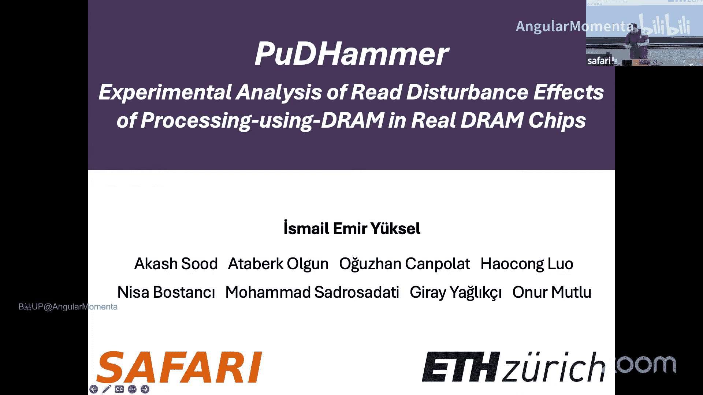

Okay， so now it's 1130。The plan was to have a lunch break at 12。But I guess we can stay a it longer。

And listen to howson's talk as well， it includes three papers。

 so it means that maybe we will go to lunch break around like 1245 or something like that。

So I'd like to take a vote on that， so should we take a break an hour after has on talk。Okay。Sorry。

其他的可。ちと。哎。不道。Okay， there are no hands raising。Option one after House one talk。Okay。

 this is the majority already。 So let's see how on here。On第。呵。😊，I welcome。Okay。What。

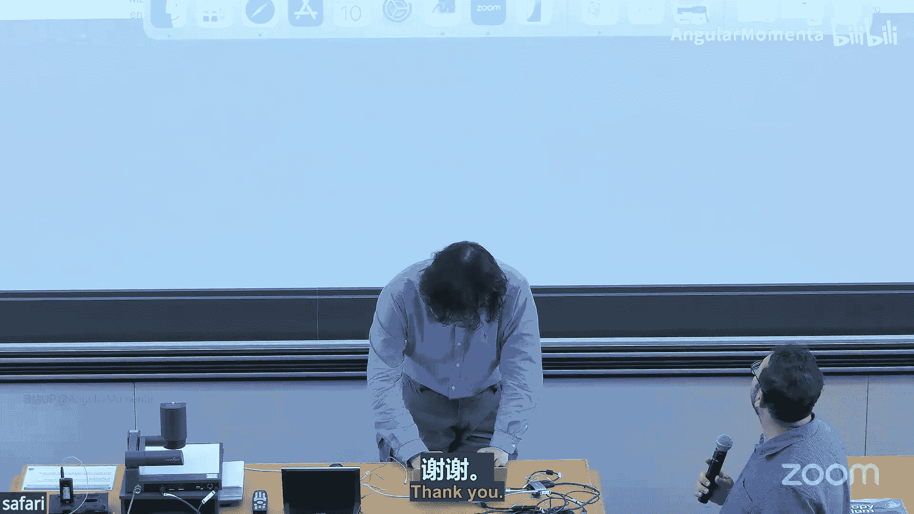

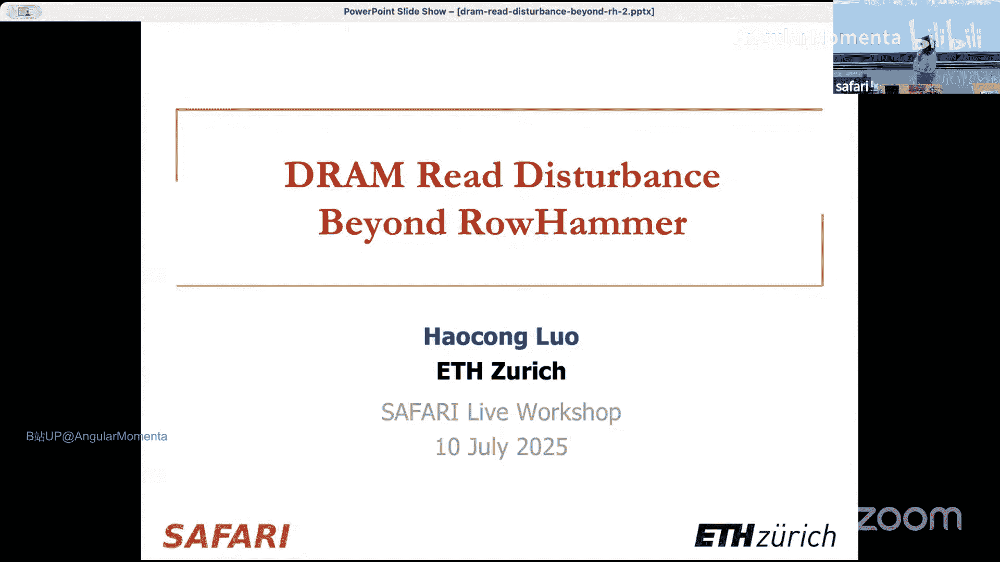

Could you get。Yeah。

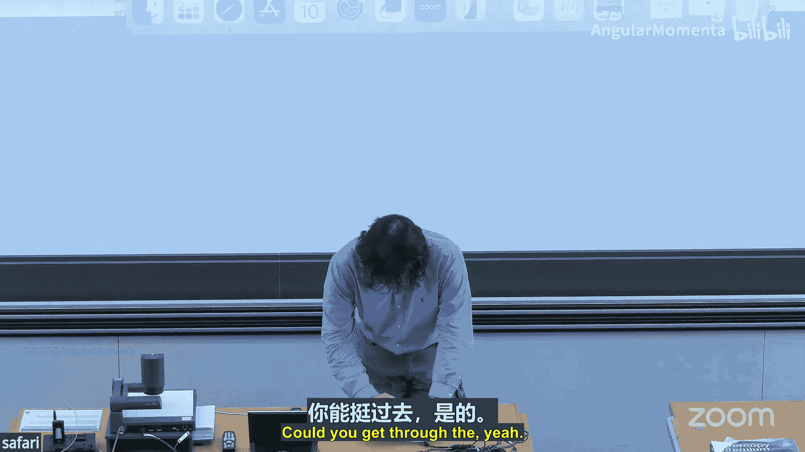

Yeah。よや。crt sharing post， no。

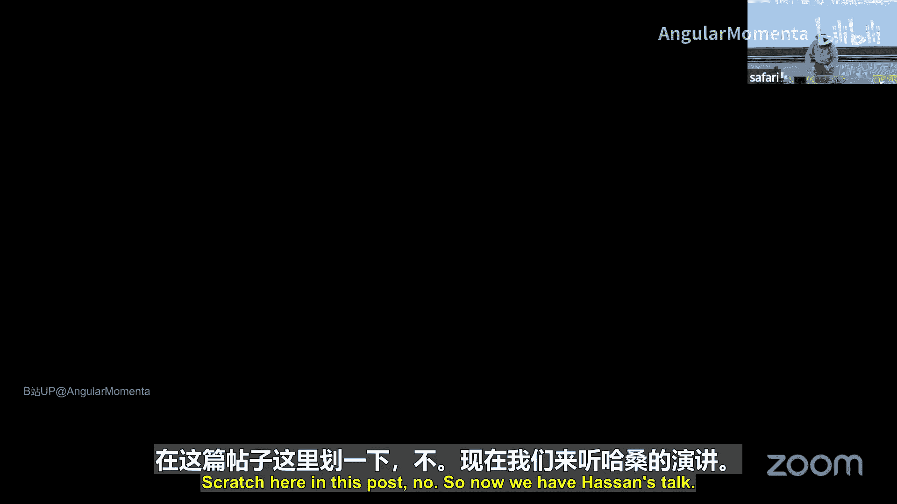

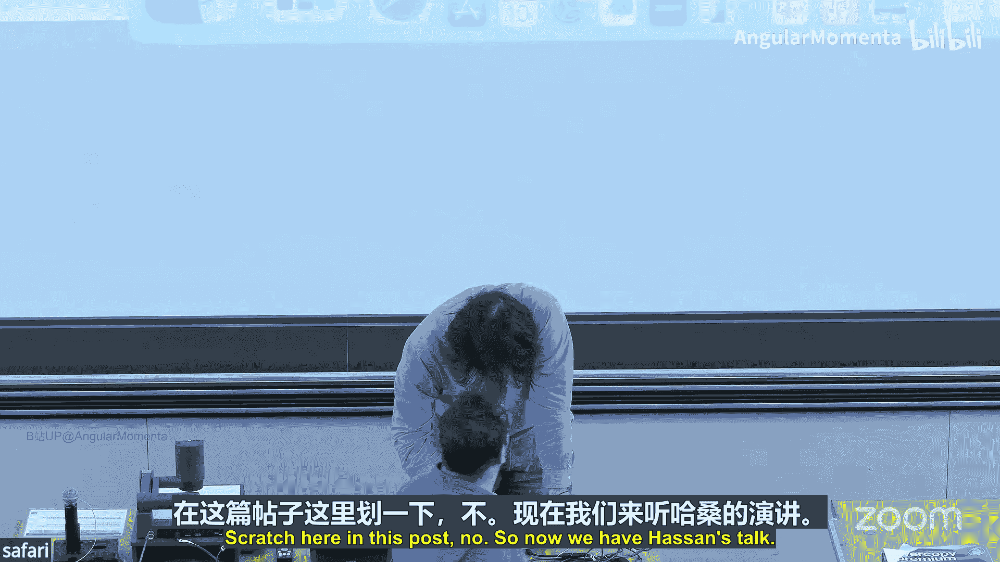

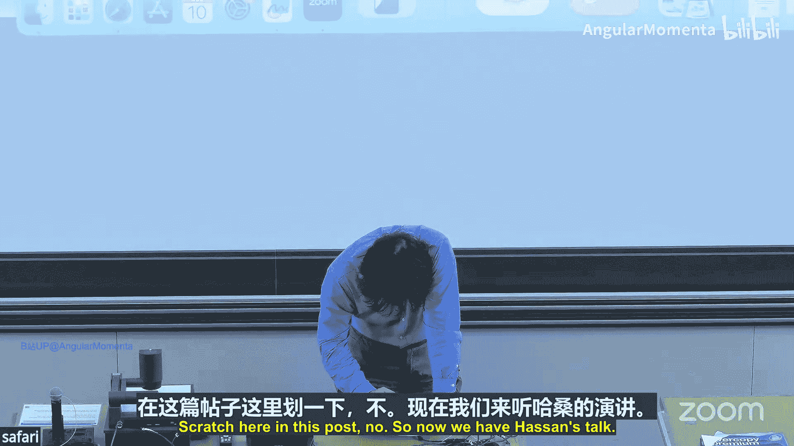

So now we have Hason's talk， Hason Luo is a PhD student in the Safari research group。

 his current broader research interests are understanding and improving the performance and reliability of DM based me systems。

A huge part of it is meorial waslessness。And he has some other interests as well， such as a。

 BVH traversals to enable high performance pathways。

 rendering algorithms and designing efficient memory architectures and systems for large language models。

 but today we will talk about the disturbance beyond raw hammer， not about large language models。

 I think。老嗯。呃，你错。Hello， yes， okay， same everything good。Yeah。

 so hello everyone welcome to the talk I will talk about。Three papers that。

Involves D reader serts beyond。第一。No。This this thing。Yu。😔，O。Yeah。

 I will talk about D reader disturbance beyond Rahammer。So here's the high level summary of my talk。

 I will first talk about Ropress it is another widespread D redistriance phenomenon that is different from raw hammer it significantly reduces the minimum number of aggressor activation needed to induce bitfips or ACmin by orders of magnitude and then I will talk about combining rawhamm and row press where we show that hammering one aggressor row and pressing the other in the double sided axis pattern achieves similar ACing。

Then double study theroppress while significantly reducing the time to induce the first bitfib finally I will talk about inconsistencies between divisible study and real chipization results of DM redisturbance so in this paper we study the DMisturance bitfips characteristics we find that these characteristics observed from real。

From real trip categorization， experiments are not fully explained by existing device level studies using TC simulation。

So first I will talk about WordPress press。So。In this paper we demonstrate in analyzes Ropress a new redisturbutance phenomenon that causes bedfps in reium chips。

 we show that Ropress is different from the raw hammer vulnerability。

 we demonstrate that Ropress is using a user level program on a inter system with reodium chips and finally we provide effective solutions to Ropress。

First， I will talk about some necessary different background。

ADMSD preent technology to implement main memory， DM cells stores one bit of information in a leak capacitor。

 and DRM cells are organized through DM rows。Risturbance in DM breaks the fundamental security property of memory isolation。

 a prominent example of this is raw hammermer， where repeatedly opening or activating andclo a DM row many times causes raw hammer bitfips in adjacent victim row。

So here we ask the question are there other redisturance issues in DRAM。

 so Rohammer as for the time of the publication of the paper is the only studied widespread redisturance phenomenon in DRAM and most mitigation works on Rohammer。

 they work by detecting a high row activation count。So it bears the question。

 what if there's another redisturance phenomenon in DM that does not rely on a very high activation count。

 if so， then like we can just bypass all the mitigations very easily。

So now let's talk about row press row press is a redisted phenomenon that if we keep a du open for a long period of time it is enough to cause Bifps in adjacent rows。

 doing so does not require many row activations as row hammer and in extreme cases we find that like activating the aggressor only once is enough to induce Bifps in the victim row and now let's see how this is different from row hammermer in more detail。

So呃。Instead of using a high activation count， Rpress just increases the time that the aggressiveg D row stays open。

We observed that in extreme cases， if we let the DM row open for a very long time， 30 milliseconds。

 then like only one activation of the DM row causes bitpsps in a victim row。

So now let's talk about how we characterize drop press in realdium chips。So first。

 the two major takeaways of drop press characterization from our real chip studies is that first Rpress significantly amplifies Dm's vulnerability to redistribance and second it has a different underlying mechanism compared to row hammermer。

So first I will talk about our work categorization methodology。

We use an FEG based DDF for DM testing infrastructure， it's developed from soft MC and DM vendor。

 it allows us find grain control with the DurM commands， timings and temperature。

We test 164 DF for DM chips from all three major Dm manufacturers。

 we cover a wide range of Dm diet densities and revisions。

So the key metric we are looking at is the minimum number of aggressor activations to induce at least one bitfi in the victim row or AC min and here we first start with a single sided axis pattern and which sweep the aggressor on time from the minimum value of 36 nanoseconds or the data sheet T values to 30 milliseconds so here is a figurative illustration of the axis pattern and here we use the checkerboard data pattern。

 we set the D temperature to 50 degrees Celsius and we use a bisection based algorithm to measure ACmin。

We have more sensitivity studies in the paper。So the key characteristics of rowpress。

 as we mentioned before， is that it significantly amplifies DM's vnerability to redisturbance and it has a different underlying mechanism compared to row hammer。

😊，So let's now see how it amplifies DM's vulnerability to redistbance。

We find that lowpress reduces ACc by one to two orders of magnitude in extreme cases activating the aggressor only once that enough to induce bed flipps。

 and it gets worse as temperature increases。It is different from Ro hammermer because rowpress affects a different set of cells compared to Ro hammermer and retention failures。

 and it behaves very differently as we change the x fat and temperature compared to Ro hammermer。😊。

So first， let's see more detailed characterization results on how WordPress press amplifies the redisturbance。

So here we plot how ACing changes as we increase the aggressor on time or tearr gum here we show the a result from an exemplar。

DRAM here we plot ACing on the Y axising log scale and aggressor on time on the X axis。

The a band around D。Data points show the min Max of the AC mean values we measure。

And when tearagonng is 36 nanoseconds， the axis pattern is identical to raw hammer。

 and as we keep increasing tearrgng， the attack pattern becomes slow press。

Here we highlight two aggressive long values on the a axis， T， IEFI and nine times of that。

 these are the potential activation time upper bounds as indicated by the JDG data for standard。

Here we also highlight ACing equals1 on the Y axis。

 We see that like at the extreme activation time of 30 meisecond。

 we can induce bedfips with only one activation。We observe that as aggress on time increases。

 ACTem means significantly reduces。Here we show the results from four different D diris and densities from manufacture S。

 and here we show the more results from the other two manufacturers。

 we find that they all behave the same， so we observe that on on average across all the。

Dimes from all manufacturers amin is reduced by 21 x on average when tearg increases from 36 nanosecond to 7。

 microsecond if Tagon increases further to 70。2 microsecond ACcmin can be reduced by 191x on average。

 so we conclude that compared to row hammer row press significantly reduces ACcemin as Tg increases。

Now let's look at how temperature affects low press goodfips。

So here we show the ACmin of ropress measured at 80 degree Celsius normalized to that at 50 degree Celsius。

 so we highlight the ratio of1 on the Y axis， so any data point below one means that it requires fewer aggressor activations to cause bitfips at 80 degree Celsius compared to 50 degree Celsius。

So we observed that when aggressor enzymezheim is 7。8， micro secondcon。

 lowpress requires about 50% fewer aggressor activations to induce bitphips at 80 degrees Celsius compared to 50 degrees Celsius。

So we conclude low press gets worse as temperature increases。

Now let's take a look at how rope press is different from Rohammer。

So here we study the cells vulnerable to lowpress versus the cells vulnerable to Rohamine。

 we define the cells vulnerable to lowpress or Rohemer as the cells that flip with the minimum aggressory activation count。

 and we define the overlap between these two kind of cells as the number of cells vulnerable to both rohamine ropress over the number of cells only vulnerable to lowpress。

So here we plot this ratio on the Y axis and the axis shows the aggressor on time。

We find that on average， when aggressor enzymehe time is larger than 7。8 microsecond， only 0。

13% of DM cells vulnerable row press are also vulnerable row handling。

So we concluded that most us vulnerable to draw print are not vulnerable to draw Henry。

Now let's take a look at the directionality of Ropress and Ro Hammer Bifords。

Here we plot a fraction of one20。Bitfips under the Y axis over the total number of bitfips we measure。

AndSo we find that for Ro hammermer， the majority of the Ro hammermer bitfips are  zero to one。

 but the majority of the ropress。Bfis are 1，2，0。 So we conclude that droppress and Ro Hammer have opposite bitfi directions。

Now let's take a look at the effectiveness of single sided versus double sided WordPresspress access pattern。

So here we showed the difference between the AC mean of single sideed and double sided row press。

 we highlight the difference of zero on the wire axis。

 so a data point below zero means that it requires fewer activations to cause bitfips with single side row press convert to double said Pro press we observe that as tigon increases beyond a certain level。

 single sided row press becomes more effective in inducing bit。Bitlipps compared to double sided。

 this is very different from row hammermer where double sided row hammer pattern is strictly more effective compared to a single sided row hammermer pattern。

Yeah， we've already seen this temperature figure。Before。

 so here we also find that lowpress gets worse as temperature increases， which is very。

 very different from raw hammer， as you can see like as tiagonong is close to 36， nanoseconds。

 the AC at 80 degrees Celsius and 50 degree Celsius are almost the same for raw hammermer。Yeah。

 now let's look at the real system demonstration of low press， yes。我我是。关类上。嗯。

The that competing effects no。That's why you see here。呃，审话是。Plaship temperature。

You mean for Ro hammer。underlying。That it the。呃This relation。嗯。We have best。I don't have。

 I don't have a very， very comprehensive answer as of now。 But maybe one of the reason is that。

Let's say诶。Yeah so I'm not sure like if if I can say it because like it's live streamed yeah。

 that's okay don't say it that so there's some hypotheses basically but okay。

 so there's more work to be done to explain this effect so it can say it that way yeah maybe like we can see like like a comprehensive answer to this kind of question is not always easy as third paper that highlights the inconsistencies between TA study and。

😊，Caterization highlights so yeah there are certain more things to be studied and more works needs to be done in this Yeah。

 that's fine I think basically we don't quite understand exactly at least and publish literature why there's such a relationship yeah but we need to understand it more to model it better and maybe solve it in different ways Yes。

 yes okay。Okay， yeah， thanks Ho for the question。So now let's look at the real system demonstration of low press。

So we use a real Intel processor and a Samsung D for D module that already has the industry's TR Ro hammer mitigation in it。

The key idea of our real system demonstration is we can keep a DM row open for longer periods of time by keeping on accessing different cash blocks in the same DMM row。

So here is a simplified pseudocode of our proof of concept。AProgram。

Where this nu reads a variable just controls the number of cache lines we read from the aggressor row。

And yeah， if we just read one cache line for per aggressor row。

 then the access pattern is the same as row hammermer。

So we test this on 1500 arbitraryrrly chosen victim row on that real machine。

 And here we showed the total number of。Bit flips and the total number of the victim rows that shows bid flips on the Y axis and the number of and the different numbers of cash blocks accessed per。

DM row on the access axis。 So we find that if we increase the number of cash blocks we read per aggressor。

DraM row， we both have more bitfips and more DM rows vulnerable to redistribance。

 so we conclude that leveraging row press， our user level program can induce bitfips when sometimes row hammer cannot。

Yeah， now let's talk about how to mitigate WordPress press。

So we propose the methodology to adapt existing row hammer mitigations to also mitigate row press。

 so the key idea is that we will limit the maximum row open time or TMRO at the memory controller。

 and then we will just configure the row hammer mitigation to account for the reduction in ACM caused by row press。

So we evaluate this methodology by first adapting to existing rawheim mitigations graphene。

Couner based one and paraa probabilistic mitigation。

 and we call the adapted versions of graphene RPRP and Para Rp。

And we use we evaluate this in a cycle levelvel du simulator raulator。

 and we run 584 core multi program workloads from spec TPCH and YCSB the metric we' are looking at is the additional performance overhead of graphene RPp and paraRP over their original versions and we measure this by weighted speed。

So our key evaluation results show that。By applying this methodology。

 we can mitigate WordPress press at a low additional performance overhead。Now。

 let me conclude the row press paper。In this paper we demonstrate and analyze row press a widespread redisturbance phenomenon that causes bitlipps in realDm chips。

 we characterize row press on 164 DD4 Dm chips from all three major Dm manufacturers and we find that row press greatly amplifies st redisturbance by significantly reducing the minimum activation count to induce bitlipps that want to orders of magnitude in realistic conditions and it has a different mechanism compared to row hammer we demonstrate row press using a user level program on real x86 machine where it can induce bitfps where row hammer cannot and then we also。

Provide effective solutions to WordPresspress。We's slow additional performance overhead。

We have more categorization and evaluation results in the extended version of the paper and all the source code and data fully the open source and artifact evaluated and yeah here's the end of the talk for WordPress and I'm happy to take any questions。

诶嗯。No questions。 Then now move on to the next paper。

 where we try to combine row hammer and row press， yeah。Okay， but he ask questions。

 I will or maybe your eyes is going to ask a question， but he doesn't have that。Mi克phone。

So you showed a proof of concept。With。Some Intel machine。And the Samsung them， yes。

 just to demonstrate that you can。Get real press。Bit flips。呃。How easy is that to exploit？

Well you get bit flips in a real system in general， yes。You mean how easy it is to get。Yeah。

 basically there are multiple things that need to be in place probably right the memory controller should keep their own open。

Yeah， so the row policy of the memory controller should。

Let's say be ideally be the adaptive open row policy so that you can manipulate the row open time with the different number of cash blocks access and the number of prior row hits in a bank and second you also need to reverse engineer the DM address mapping at the memory controller so you can have an accurate double sided pattern and the third you also need to figure out if you have ECC and first you need to figure out the inDM row hammer mitigation techniques so for example here in this specific Samsung module we know the TR implementation beforehand so we can place the dummy row activations appropriately。

MmhYeah。Nice see and also you need to synchronize with refreshers so you need to do all of those things that yes。

 we do you normally need to mount a arrow hammer attack rate Yes， yes okay。So yeah。

 I was safe to successfully mount a real system attack。

 Theyre like these many layers from hardware software that needs to be considered。

 But people have shown that you could actually do that。 Yes， yes， and。

Later after this paper was published。For a role press。I think in the latest like MCC paper， they。

They replicated this a result， but I don't quite remember if like they mounted and end to end the attack。

 but I guess like if you can have what is the MCCC paper it's from Ka group like they。

They build like a cheaper version of the signal analyzer than they can but I think Daniel Gr and Jononas。

They had a paper at dimwa where they had an end to end attack actually yeah yeah。

 that's that's their access factor is a slightly different where they only have one ag role Okay。

 so it's a single。Yeah， it's more likely a single sided attack。

 but still they can have some increased ti extra more。O。Thanks so a quick question as well。

 did you look at how the Biphilipps are distributed in a column or in a quaard。

 let's say because you mentioned ECC what kind of ECC is capable of like mediate raw press bitphilipps so we try to use the rope press pattern and hammer op press as many times as possible within the refresher window and by doing that we see let's say。

A lot of。In some cash lines， there are like many more than two bedps。

 so completely mitigating WordPress press using ECC。

May not be straightforward or it requires a lot of area overhead yeah。

 but I don't quite remember the exact numbers， but I I think it's like more than 7 beds in a cash transfer so it's a lot。

Yeah， thanks。一嗯。Okay， now it works so what I got from the talk is that if you keep the row open for a long while。

It results in big flips， but why does it result in bit flips？😊。

So you're asking why does keeping your camera open longer so this is an observation like I kept my ro open for a while and then bit flips happened。

 but what caused those bit flips？I see。 So。We have to differentiate between the single sided and the double side of pattern。

 So maybe we's start with the single side of pattern because it's a bit。Easier。

 so basically if in a single side of pattern， if you keep the diameter open longer。

 you amplify another kind of leakage that is different from Ro hammermer and this let's say other leakage mechanism it basically scales with the。

Roow open time， so the longer you leave it open， more leakage it introduces in the victim cell。Yeah。

 and for the double sided access pattern is a bit more complicated， so initially as you increase。

Tigagon because you have two aggress rows， the increase in the tiagon of one aggressor row is the increase in ti off of the other aggressor row and then you have like kinda like two compound effects。

So。For a single aggressor role， if you start to increase ti off。

You will reduce AC mean because you are， let's see allowing the charge trap assisted Ro hammermer mechanism more time to。

Lets it take effect like those electrons that migrate has more time to go into the。

P themselves that's one effect。 And the second effect is just that yeah。

 as you keep the di open the like the longer time yeah。

 like the mechanism that scales with row open time also plays a role。

 So that's why we yeah like these two different components constitute what what we observe for double side row practice。

And can you go back to your side where show in the beginning the activation activation count is very high and then it starts to drop。

Can you go back to the slide of where you're actually demonstrating it empirically？Yes， this one。 so。

In a real system， what is the average timearrow is actually open when you're running a practical application？

So here you actually change the row open time。Based on your simulation like you decided what it should be and then you got these results but if you take a real system and you want to say in my application or set of applications on average how long I keep the row open so where would that point be in this graph I see so in in the row press paper we didn't measure the actual row open time in a real system so we can kind of use like the different number of cash blocks accessed as like a proxy for that so let's say if you access 64 cash blocks then ideally your row open time would be 64 times tccDL so maybe about。

😊，I'll start。But。也是。TCCTL is like6， right。So about 400， like less than 400 nanoseconds， yeah。Also。

 there's like a recent paper， MCC， they replicated the WordPress press code and their measurement shows like a 300 nanosecond。

 so maybe like the memory controller rope policy also plays in row here。Yeah。

But then it's more towards the left side of these graphs。Yes。

 that means in the rail system it's very unlikely that row press will be seen。

 but there is a single sided and in real system we do a double sided So for the double sided。

A results， you can refer to the full version of the paper for simplicity。

 we didn't have the double sided a seeming figure in the presentation， but the trend is the same。

 And yeah， I think you asked a very good question。 So。Yeah。

 the only difference that the double sided rope press is computer single sided rope press is that。

Yeah， so here you observe that as we initially start to increase tear Gm， A C mean almost。

Doesn't change， but in double thought it will change so。Yeah。And that is actually， yeah， as I said。

 it's like the ti of this thing。Yeah， we can discuss more offline if you're interested in these things。

Thanks。question I think his point was about benign workloads's behavior。

 so could you also point out what the adversarial workloads can do in terms of T on here？

I think our current system， our robust press real system code is that adversarial， yeah。

 so what kind of teagon do we observe there？We didn't observe this in the row press paper。

 so if you used the number of cash blocks accessed as a proxy for that then you can assume the roll open time to be the number of cash blocks accessed times TCDL plus tRCD so that's about 4003 to 400 nanoiseseconds I guess yeah again it also depends on your row policy right like if you have a simple open row policy。

I mean like the naive open role policy again you can just keep it open of course if you have a close row policy or like adaptive open policy it will get complicated so I don't think there's a single good answer to this in the real system like there's just so many things involved yeah。

对。So howong you said that T Go has a important floor at the beginning， right for double side。

 What if I do a raw hammer， but with the same T Go。

Basically do tear and after per charge give enough time for tear off it it also reduces so for double sided。

 right？The increase in one aggressoror tearergon is the increase in the other aggressor tearer golf。

Yes， so yes， so yeah， this effect already exists for row hammer， but if you do row press。

 it kind of makes it even worse because of you added the effect of like longer row open time as well so。

Yeah， okay， thanks。Maybe one last question you report these from DDR4 devices Yes。

 I remember I I did for HM to some similar study and I like with DDR5 so far。

We didn't have the proper infrastructure yet to characterize DDF 5 chips。

 but based on the observation that there's no fundamental change in。Physical Damm。

Device layout architecture， I would assume the fundamental issue would still be there and it make it worse because like they keep reducing the feature size。

But。If we are thinking about like real system aspects。

 the introduction of on the ACC may complicate the observation of the Bfips yeah。Thanks。

 thank you for the question。哦。OK呃。There are no other questions。

 then thank you very much for the questions。And we'll move on to the next paper。So in the next paper。

 we try to combine Rohamm and Ro press。So yeah， our paper and experimentalal categorization of combined Roham and Ro press redisturbance modern neuro chips。

So， yeah， I guess to save time。 I will skip the。The background， Rohamm and Ropressz。

 you've heard about this in the previous。Paper presentation， so yeah。

From the previous presentation we know that like Roh and Ropers have different error mechanisms。

 so like what if we combine them， so let's say we have this kind of like double set pattern we hammer one aggressor and press the other aggressor like what would happen。

So our goal is to experimentally characterize this combined pattern and to do so like we characterize this pattern on 84 RioD4 Dm chips from all three major manufacturers。

 our cure results show that if we use this combined pattern。

 we take significantly less time to induce the first bitfi compared to the state of the art double at robustpress pattern by up to 4 6。

1% faster and the initial benefits are different across Rohem and ropress in this combined patterns。

 so we making hypothesis that like the redisturbance caused by Rohem from one of the two aggress rows in the double set patterns much more significant than the other。

Now let's look at， yeah， I guess I'll skip the background just to speed things up。And yeah。

 we will just directly go into the ta pattern。So first。

 let's talk about some like the baseline patterns that we compare with the conventional single sided and the conventional single sided row hammermer or row press side where we just have like one single aggressor row we let the DM if you let the aggressor open for longer。

 then it's row press otherwise it's row hammer。And the second baseline conventional double said it。

 Roh and Ropress pattern where we have like two aggress rows sandwich and a victim row and they are both hammered oppressed。

 so the thing here is like the conventional pattern has the same aggressaround time for both aggress rows。

SoNow the pattern that we test the combine pattern， we hammer one aggressor row and press the other。

 let's say the upper aggressor row has the tieragon equals T rest 36 nanosecond and the second aggressor has a tieragon larger than 36 nanoseconds。

Yeah， so we test it with DM band gives us fine green control of D commands and timings and the key metrics we're looking at is first time to first bit bitfi。

 this is just like the walk clock time to induce at least one bitfi using those different access patterns。

 the lower this metric is like the vulnerabilityil is。

 the second is ACing it's like the total number of aggressor activations needed to induce at least one bitfi。

 the lower it is then the worst vulnerability。So yeah we test many different chips from different manufacturers covering different densities and revisions and for each module we test the pattern on threecate your modules in a bank you check about pattern and we repeat everything three times so now I see the major categorization results and first let's look at the time to first bit flip。

So here we show the time to first bit flip from one exemplar Mo from manufacturer S on the Y axis agress around time is on the x axis and this a blue line shows the result for the combined row hammermer and row press button that we test the arrow bar shows the the minm value we observe。

 So when tiagon is 36 nanoseds just like grow hammermer。

 we highlight the two potential row open time upper bounds on the X axis。Yeah。

 sorry it's the standard。Dation in in this region， not the main Max。

 And then this green line shows the time the first bit。Bitfi for the baseline one。

 single sided row press or row hammer。And then this orange line shows this for double set row press and row hammermer。

So we observed that the combined pattern reduces the time to first benefit by 78。

9% compared to the conventional singles set the pattern。

 and compared to the conventional double set the pattern， it's still 37。6% faster。

And here we show the results for all the modules we test from all three different manufacturers and they behave the same。

 so we conclude that redistance bilipps can be induced in a smaller amount of time by combining Rohem and Ropress。

Compared to just using WordPresspress， now let's look at AC Min。Yes， sure。

SoOn the previous slide you highlighted that point on the X axis。

 can you talk a bit about the relevance of that point？

It''s chosen to be like somewhere like around like a realistic row open time that you can achieve yeah。

Oh。Okay thank you for the question and now let's look at AC mean again we have ACme on the Y axis it's in log scale and the blue orange and green lines just shows the AC mean for the combined pattern。

 the double sided baseline， the single sided baseline。So， we find that。Compared to。嗯。

Compared to the single side it。Ro press， the combined pattern reduces。A mean by 40。5%。

And the double sided row press reduces AC M by 48% compared to single sided。

And this is like this trend is the same across all the ships we test。

 so we conclude that as T initially starts to increase the combined Rohe and rowpress pattern。

Just need slightly more aggressor activations to induce at least one bitfi compared to the commercial or double sided row press pattern。

But it can do everything in a much smaller walk clock time。Yeah， so if things。

 if we put these two results together that the combined pattern can induce BFip in a smaller amount of time and if ACM is like roughly the same as the conventional doublesided lowpress pattern。

 then we hypothesis that asgon increases， the redistance effect caused by lowpress from one of the two aggressor rows in a double such pattern is much more significant than the other。

That basically explains that like why you don't need both rows to be pressed to induce the Bfips with fewer。

 let's say， activation counts。Yeah， now let's look at some further results， the Bifi。Direction。

 so we find that as Tagonng increases the directionality of the bitfips caused by the combined Roh and ropress pattern changes from 0 to1 to 1 to 0。

And we hypothesize that this is because for large check values。

 the redisturance effect from Rpress becomes dominant compared to Ro hammermer in the combined pattern。

And now we also look at the overlap between the combined between the benefitsfis caused by the combined pattern and conventional roh and rope press。

 So let's say yeah， we have the。Bitfips caused by the combined pattern some the bitfips caused by conventional patterns and the intersection of them is the bitfips caused by both combined and conventional patterns and we define the overlap as the number of bitfips caused by both patterns and over the number of bitfis only caused by combined patterns。

 So here we show this like ratio on the y axis and the upper row plus that show this overlap for single sided the lower row showed this for double sided and we。

Observe that the combined pattern induces different BFps compared to conventional single and double setd access patterns。

 as you can observe like the drop in the overlap for the double set pattern and the initially very low overlap in a single set pattern。

Yeah。And to conclude so in this paper we experimently characterize and demonstrate the combined redisturbance from both rahiinroppress in reodeium chips。

 we experimentally characterize 84 dDR4dium chips from atramium manufacturers we find that the combined pattern takes significantly less time to induce the first bitfi compared to the state state of the ropress pattern and the initial bitfips are different so we put forward a hypothesis that the redisturbance caused by ropepress from only one of the two aggressor rows in a double set pattern is dominant。

有。So we also hope for some future work， so we need to test more and more importantly。

 examine the device level mechanisms of Rohamm and Ro more to verify our hypothesis and further our understanding of。

The landscape of Dham redisturbance。Yeah， so here's the end of this paper presentation and happy to take any question。

Yes。my people。Thanks。So you combine Roham and nopress in some ways here， yes。

Are these the like worst possible ways？No， it's a straightforward way to combine them。And。Also。

 there's some intuition behind it because some prior device level study shows that different aggressor wordline relationship with respect to the victim cell。

That is to say whether the ag wordline is a passing wordline or neighboring wordline has different underlying error mechanisms with respect to redisturance so。

By assigning different。Hammering oppressing patterns to the two different aggressor rows。

 we have a let's say just as an intuition to kind of， let's say exrbate this difference in the。呃。

D vast level。 So if let's say if we interleave the。Hammering and pressing in a single aggressor row。

 So the intuition is that like because Roja and Ropress。

 they have like different bit of directions then like you're canceling out each other。

 I think yeah like we've also like some done some like very preliminary initial test。

 they don't seem to give like any interesting results。 So yeah。

 that's why we go for like this double sided Nice see yeah。But there could be basically better。

Better in the sense that it could induce more bit flips earlier better patterns yes so I believe that if we have a very comprehensive and rigorous understanding from the device level。

 we can just construct such pattern in a principled way yeah。Yeah。

 but that device level understanding doesn't exist at the moment。Yeah， it's not there yet， so yeah。

But that device understanding kind of depends on the experiments done at the higher levels， right？

But。So so yeah， I think we will talk about executive this in the coming paper presentation。

 so it turns out that like the maybe the existing device level works， they are， let's say。

 their modeling may not be comprehensive enough to capture all the effects that happens in a real chip。

So。Yeah， yeah it's。If there's still more work to be done in this direction， yeah， okay。Anybody else？

Just to understand what exactly the worst case patterns being。

 are you talking about what data should be written in the aggressor rows or are you talking about。

There should be two aggressor rows where you' are pressing and the two aggressor rows where youre hammering what exactly do you mean by worst case scenario I see that's a very very very good question so。

I think there can be multiple aspects to， or like multiple ways to define what's the worst case。

 Let's say if you start from an。Let's say。Just like a。Like a scientific understanding of the problem。

 Then maybe you can define it as like the smallest AC min。

And may like if you want to think about it from like an system level or mitigation level。

 you may want to define it as like in like。inducing the benefits in the shortest amount of time and or like if you want to let's say define it from like a reliability level。

 maybe you want some statistics that just like yeah across all the data patterns。

 all the access patterns， all the environmental parameters。

 what is like the highest time to first failure that sorry the lowest time to first a failure that you can observe so。

Yeah， I think it's。I don't think there's like a single definition on what is the worst case pattern？

So it's more important to， let's put it into context so that then you can find the most appropriate definition of the worst case。

Yeah。And the way you combine row hammer and row press is that you are hammering one row and pressing the other row Yes is there any other option What is there any other option of combining these two any any other way Yes。

 let's say you you can like just arbitrarily interlea hammering or pressing on the same on the same aggressor row Yeah。

 that's also another way to combine them。Yeah。Does that make sense to interlieve because from what I understand from this？

Based on what I understand from this presentation for a given double sided access pattern。

 one aggresscero is better to hammer and the other one is better to press so does make any sense to interlieve them like hammer and then press and then hammer the same aggressce row。

Haven't tried that。 Maybe it is。 But seems like one challenge is that like this， like the。

The search space of this pattern is just like too huge to correct。

Let let's say do a fussing essentially。 So that's why I'm let personally。

 I'm inclining more to let's say， yeah， we start with these observations。

 we build a fundamental comprehensive rigorous device of understanding then we can just principally construct a worst case pattern。

 I would think that that might be more efficient， assuming we can have a comprehensive device of understanding than。

Yeah， that would be my personal， let's say， preferable way。Approach， let's say。

 towards finding a quote unquote worst case pattern yeah。Good you think。Yeah， please。所。哦。Yes。

So I still need to do a little bit more reading on how this works underdo so my understanding is a bit cloudy。

 but in the last paper you mentioned that there's still some things that we need to know about the system to be able to make this attack very effectively so like the arrangement of the attack because of the mitigations that exist and stuff like that so wouldn't now that we can because we can reduce the time until the first B flip is it now not kind of viable to irrationally try a random access patterns like。

A lot of times and then just hope that we end up getting lucky because it's kind of a bit， you know。

 of a huge handicap to have to know a lot about the system before attacking it。

 and so what bandwidth Yeah， that that's absolutely true。

 So like you can do a fuzzing or the real system So if you check the blacksmith paper。

 they are kinda do like they're doing like a fuzzing issue thing it's just that like if you know more about the system。

 you can significantly reduce your search space Yeah。😊。

And can you so what's the bottleneck that doesn't allow me to just do like a lot of access if it's CPU like computation can can like do the existing extensions。

 for example， like endO2 or PCIE like is there some way that these connections have enough bandwidth that I can somehow access you know。

 a lot more volume like for example， you know these accelerators for the for the GPU that？

Like can do a malicious one， for example， somehow trigger more like access I think that's a very good research topic in the security domain like how you find the highest memory request injection rate into your memory controller and there are many interesting works there that uses let's say。

Are the components in the system other than the CPU to to initiate memory requests， theyre like。So。

 people have。Don Rohammer with DMMA with Nick with。Yeah。

 I think a more interesting one would be using the cash coherence protocol of the CPU to hammer so all of these like yeah they they have let's say different ways of accessing DM they have different。

 let's say。Request in injection rate。 And there there there even works that studies like which kind of instruction and。

Like access pattern in a CPU gives you the highest， let's say， activation rate。

I think like there's a work from Microsoft that they showed that like like in some CPUs。

 if you just do see flush without accessing， you are also hammering the D it may even have higher activation rates。

 so it's very。Yeah， they like a lot of things in the system that you can。Play with to。 do this。 Yeah。

 Thank you yeah。Okay good yeah thanks everyone for the questions so now we are at last part of the presentation where we talk about the inconsistencies of the DM redisturbance bidfb characteristics between the real chip。

Cterization results compared to the existing device level studies using TCA simulation。Yeah。

 so now I will present this paper withvisiting DM redisturbance。

 identifying inconsistencies between experimental characterization and device level studies。

So as a summary of the paper， our goal here is to align and cross validate the experimental characterization of DM redistance。

 thereshamroppress。Against the error mechanism modeled by existing device level simulation so here we face a challenge that there's a gap between real chip characterization and device level mechanism due to lowle DM layout that is true in N cells so our key methodology here is first we extract the key device level redistance mechanism from prior works。

 then we reverse engineer the true and enter cell layout of realDM chips then we perform real chip characterization results that directly match the access and data patterns the device level works use。

So we find the following key inconsistencies first for double set row hammermer。

 experimental characterization shows bitfips in both directions。

 while device level studies suggest only one to0 bitfips will happen the second for single set row press experimental characterization shows overwhelmingly one to zero bitfips while device level mechanisms suggest that both kinds of bitfips should happen。

Yeah， again。I will skip the like the parts that we've already seen。

 but I will keep the parts that we haven't seen so as a necessary background and true and anti DM cells。

So the the DM bit line sentence amplifier is a differential amplifier， so it has two ends。

 bit line or bitlam bar， a DM cell can represent a logical one by storing either positive and negative charge。

 depending on if it's connected to bit line or de complementment bit line bar。

 let's say if a DM cell represents a logical one by storing inos charge or let's say like if the capacitor voltage equals the DM core voltage。

 we call it a true cell and an entire cell if it uses like VS as to represent a logical one。So， yeah。

 and I will skip Roham and Ro press。And yeah， now let's take a look at the summary of existing divasal studies that studies doM redisturbance。

So we extract the following key characteristics of device level DM redistributance mechanisms。

 first double set row hammer should only induce 120 bitfips。

 second single set row press should induce both 120 and0 to one bitfips。

So as a relevant background here is like how more than6 f square D is actually laid out。

 so on the left side we have like the top view of the physical layout of a six F square DM array。

And on the right side， we have the cross section of one active region。

 It's the side view that contains two g cells， cell1 and cell2。

And we mark up the relevant components in the cross section as well as we mark it up， yeah。

 we mark up the same thing in the top view， so for this accuracy and the two cells。

 we have the respective word lines for cell one， we have wordline one cell two， we have wordline two。

We also have two very two other wordlines that are physically adjacent to this active region。

 but they don't form any connection or transistor with this active region。

 so we call them passing word lines and we also have like the passing wordline on cell one side is passing wordline one and the cell and the passing wordline on cell two side is passing wordline2。

Or PWL。Yeah， so now let's take a look at the key error mechanisms that prior workss study。

 so the most important ones call trap trap assisted electron migration mechanism so basically let's say theyre like due to the fabrication process there will be charge traps near the let's aggress wordline interface and。

When the aggressor row is open， these traps are charged with electrons， when the aggressor is closed。

 these electrons are emitted and some of them migrates towards the victim which constitutes off leakage。

 so if you keep hammering open closing， then you are just like pumping electrons into the victim。

Yeah， so。Also for double sided Ro hammermer。We know that like it's much more effective than single seted from the experimental characterization。

 The reason for this is that let's say in a double sideed row hammer。

 we have two aggressor rows sandwich in the victim row， so。

One aggressor role will be neighboring wordline NWL here and another aggressorial would be the passing wordline PWO here。

So when we keep hemorrhid them like those， when one aggress is open， the other is closed。

 when the ro is closed， the other is open， so let's say， yeah。

 when NW is closed as we talk about before the electrons are emitted from the traps。

 in some of them they migrate towards the victim， but in a double side of case。

 the passing we line is also also open， so the electric field from the passing word line attracts more electrons towards the direction of the victim。

So this causes an enhancement of the electron migration。

Into the victim causing more leakage and also as we also briefly talk about in the lowpress talk because yeah when the passing wordline is open。

 the neighboring wordline is closed， it's closed for a longer period of time which allows more time for electrons to be emitted from the traps which also causes more leakage so these two mechanism enhances double set row hammer and because both of them injects electrons into the victim so it should enhance one to0 bitfips。

And some of the device level works even say that， yeah。

 the zero to one benefits are eliminated completely。

So we conclude that double set Ro hammermer should induce one two zero bitfips。

And now let's take a quick look at the di error mechanism of Ropress。

 so the prior works show that yeah。The two different aggressor row types have different error mechanism。

 let's say if the neighboring word line is the WordPresspress aggressor row。

 then when it's kept open for a long period of time。

 it's strong electric field just like weakens the victim word line control of the channel so you increase the leakage in the victim channel。

Causing zero to one bit fliplipps and if the passing word line is the aggressor。

 then if it's kept open for a long period， it strong electric field just like draws electrons towards the victim from like other places in the substrate so this causes one to0 bit fliplipps。

Yeah， so the key characteristic here is that likeing inside Ropress should induce both 1，2。

0 and0 to1 bitfips， depending on like which aggressor type your aggressor wordline is。

Relative to the victim self。Yeah， now let's do the real chip characterization that aligns with their access and data patterns。

So again， we use DM Bnder and we test like a wide range of DM cells from all three major manufacturers。

 And in order to to fully align with the。The vessel works we do reverse engineer entire cell layout so yeah the reason we do this is because like the internal Dm architecture is opaque to the memory controller so as a result like if you are observing from an anti cell then the actual bitf direction is the opposite so to align our real chip observations with the vesselal studies we have to fully understand like which types of cells we are testing。

So we use a retention failure based reverse engineering methodology。

 this is like because the following reasons， so prior works show that major DM retention leakage passes。

 junction and GIDL， they look towards the access transistor substrate which are negative biased。

And prior works on experimental characterization of DmM retention failures assume DM retention failure only contains 120。

呃嗯。It flipps and they leverage this to reverse engineering insurance its our layout and we take the same approach。

 so our reverse engineering results comes out consistent with prior works。Yeah。

 so now let's take a look at real chip characterization results。

So first I will just summarize like what are the inconsistencies that that we find from this study the first inconsistency is that it's about the double side Ro hammer bit direction so real trip cutization shows that we can induce both U to1 and 120。

Bitfips and the AC Ming of0 to1 bitfips。It's like。Smaller than one20 bitfips， however。

 the device level mechanisms say that yeah， you should only induce 120 bitfips for double side the row hammermer。

 The second inconsistency is like the double side the row hammer bitfi count so our real trip categorization shows that。

Only with a sufficiently large hammer plant。 you will observe more 1，2，0 bitfips than 0 to 1。呃。

B benefitsfi， but。The diverse law mechanism again says that a at Ro hammermer enhances 120 leakage。

The third inconsistency is about the bitfoot direction of single set Ropress。

So our real chip results show that we observe overwhelmingly120 bitfips with rope press。

 while the vessel mechanisms say that yeah boths kind of bitfips should happen。

So now let's take a deeper look into these results。The first yeah。

 about the bit flip direction of double Rohammer， we use a double Rohammer pattern and for the data pattern。

 we have all physical one or zero in the victim rows and the aggressor rows always have the opposite value。

The key metric is it's first the minimum aggressor roll hammer account to induce at least one bit in the victim row。

Here we show show the achieve first measurement from one example。DM die from manufacture M。

 So here we show the distribution of Se first。Over all the rows that we test on the Y axis and on the x axis。

 it just shows that like the different bitfb direction。

And we observed the same thing for all the module， all the chips from all three manufacturers that we test。

So we find that。嗯。On average， the E first of0 to1 is like 24。

7% lower than the E first of120 and yeah even even。

Before this like we already see that like double said Rohem can English both kind of。本呃。Bfis。Yeah。

 so the takeaways from this study is that double side row hammermer involves error mechanisms for inducing both zero to1。

 one20。Bed flipps for Rohmer， the observed error mechanism for zero to one， bed flipps is initially。

It's even initially stronger than that of 1 to 0 bit traps in the most vulnerable。

Derm cells and these are like like essentially like the the opposite of what the。

The vessel mechanism shows。Yeah， now let's look at the Bif count of double set row hammer。

 we use the same axis and the data pattern and the metric here is the per row bitfi count after hammering each aggressor row for a sufficiently high amount of times 500 k for each aggressor row。

So here we again show the distribution of perp row Bfoot count only UY axis。And you see that。

If we hammer for sufficiently high amount of times， there are indeed more one，2，0 bit。

B substantial 0 to one。Pitfi。This seems to like align with the divas mechanism。 But then we。

Then we look at as we increase the hammer account from the minimum to the maximum。

When we start to observe more12，0 bitfips。Compared to0 to one bit bitfips。

 So here we define a metric。It's called HC120 exceeds0 to1。

 this is like the minimum hammer count where we start to observe more 120 bitfibs than0 to1 Bfibs。

So here in this table， we compare this S120 exceeds0 to1 metric with's the SC first of0 to1。

And we find that on average， you need to hammer four times。Of HC C。First。

For you to observe more one you0 bit。Bitfips stands0 to one bedfips and like in extreme cases。

 like you need to have like 7。5 times more。So the take away from this study is that。

For example at the rawhammer， the observed error mechanism to induce 120 bitfi。

Are only stronger than that of 0 to1。B bitwas， only if you hammer for like a really。

 really large amount of times， like on average four times then your E you first。This is， again。

 also like。Different from the device level characteristics that like double at Roham enhances one who is the。

呃，bitfips。Now the left in consistencyistency。The bit direction of single sided row press。

So we use this single third ropress pattern and we do it at boths the upper and the lower aggressor row。

 like these are like two separate experiments and the aggressor row is kept open for 7。

8 microsecon per activation。And the data patterns the same as and again。

 we look at the per row with foot count after activating each ag role for a sufficiently high amount of times。

And we see that like there are no zero to one bitfips even。

So across all the chips we test only in one module， it's manufacture S 8 Gabit E die。

Only in this case， we observe a single zero to one bitfi。All the other modules。

 all the other rows we observe00 to one。Pant。So this。

 the takeaway is that like for single study Rupress。

 for both the neighboring wordline and the passing wordline。

 the observed error mechanism for inducing 120 Bifips is much stronger than that of0 to1。

Bit Phps so that like we can only observe 1，2，0 bit Phps within the refresh window。

This is also different from the vessel works that says， yeah。

The two kind of aggressor rows will induce。Both kind of。Bit for directions。

So let me summarize the inconsistence find， so we find that both the Bif direction and the Bif count of Dased Rohammer。

Is different。 And the single side ropepress bitfi。Direction also differs between real chip characterization and device level studies。

So based on these， we put forward some hypotheses。There are two possibilities to。

Let's say explain our results first， it's possible that the retention failure based to an antill reverse engineering methodology is not always applicable in modern die chips or the current device law explanations of DM redistriance is not comprehensive enough to capture all the possible factors。

So。One hypothesis is for like the first possibility。In modern dream shifts， like our。

Are there like other major retention leakage passes that does not leak towards the substrate。

 so it's like the die electric leakage in a cell capacitor。

More like dominant if so like then that leads towards the bit contact。

 which is video over two and yeah like some prior show that like this is becoming more pronounced in modern D because the process keeps shrinking so this is a possibility。

Or like if we think more about the device level mechanism side。

 maybe the existing device level works， they are making some oversimplified assumptions during the ass simulation。

For example， prior works that study the trap assisted electron migration error mechanism。

 they only focus on accept like traps。Are donor like traps not really not causing any non trivial leakage。

And maybe the device level simulations， because they only focus on a few isolated structures and components。

 for example， just a single active region to capacitors for word liness and the bit。

 maybe by doing so， they are not modeling the redisturbance mechanism that comes from decoupling of other components in the array。

 maybe those like there are other things that becomes first order when you put everything in the context of a Fdium array。

And well， there's also like another possibility that maybe our real trip characteruterization results are heavily skewed because maybe the bit line sense amplifier has the asymmetrical sensing margin of reading a one and reading a0 is also possible。

Yeah， or like。There can just be like two different sets of redisturbance vehicleage mechanism that affects different sets of。

Doear themselves。Yeah， so let me conclude my top， so in this paper our will goal is to align and cross validateate the experimental characterization of DM redisturbance Rohi and Ropress with the error mechanisms modeled by the level simulation and during this process we bridged the gap between characterization and the studies due to low level DM error layout。

So we find the following inconsistencies that the Bifi direction and the Bifoot count of double sided Ro hammer differs between real chip characterization and device level simulation and the single sided the singled Bifiip direction also differs from real chip characterization and studies。

That's the end of the talk。 And I welcome any question。不。Yeah。Anyy Christmas？

So how do you resolve these inconsistencies？So we work with the groups。

 we align over observations and methodologies。Hoping we can identify the missing parts and come up with more comprehensive and more rigorous simulation setups and methodologies Okay I think that's a great approach and this can open up better collaboration across the stack which usually doesn't happen between system level and device level people。

Yes。So I'm curious if you have any plans， more concrete plans on investigating if this true anti cell layout riververse engineer methodology is correct or not。

I tend to believe it is correct。 We like， we have some correspondence with the。

Like some device level people we can discuss offline。有。But like as a side note， let's say， yeah。

 we assume the retention failure based reverse engineering mechanism is correct。嗯。

But we still have to keep an eye on the potential of the leakage mechanism that may rise up like as。

 as one of these hypothesises shows。Yeah， here， let's say like。Just like you ICE T 22 paper。

 they find out that because modern。DM process feature search is so small。

 then the pattern alignment becomes a big issue。 Let's say if your capacit pattern sometimes like it misaligned some conductive bridges between the capacitor and the bit line may。

 may be formed。 and that's a leakage pass。 And this leak leaks towards the bitline。

 So it's we over two， not negative。 So。Yeah， I can guarantee。

 but we need to keep an eye on these things， basically。Yeah， which yeah of that makes sense， thanks。

Other questions？Okay， then let's thank the speaker Okay， thank you。

Now is it time for the lunch break。

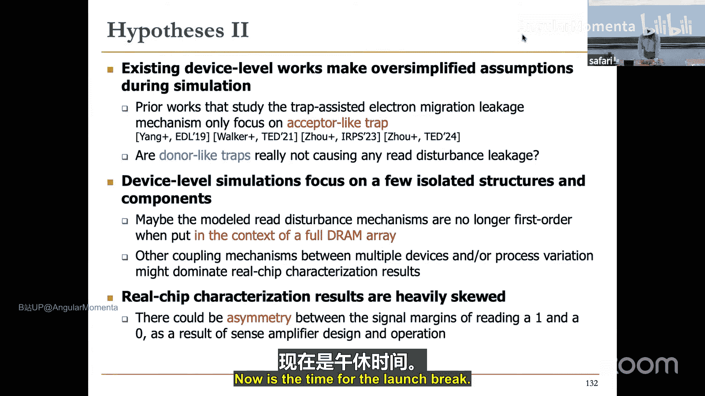

We don't have any lunch catered， so you will take care of it yourselves。And。

I think it's reasonable to come back at 130。Anyject， okay no。Very。Okay， let's make it 2 pm， one hour。

这方。Well， four to five， okay。Let's start again， that's 145。嗯。😊，对大过。Yeah。

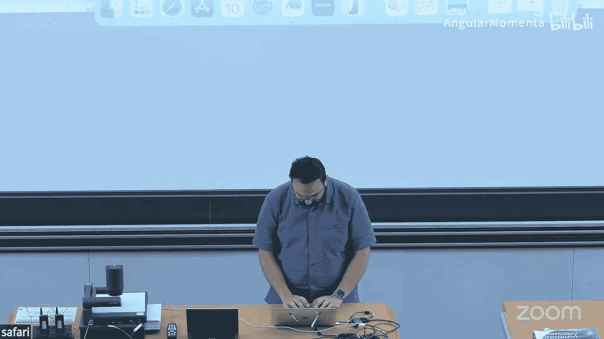

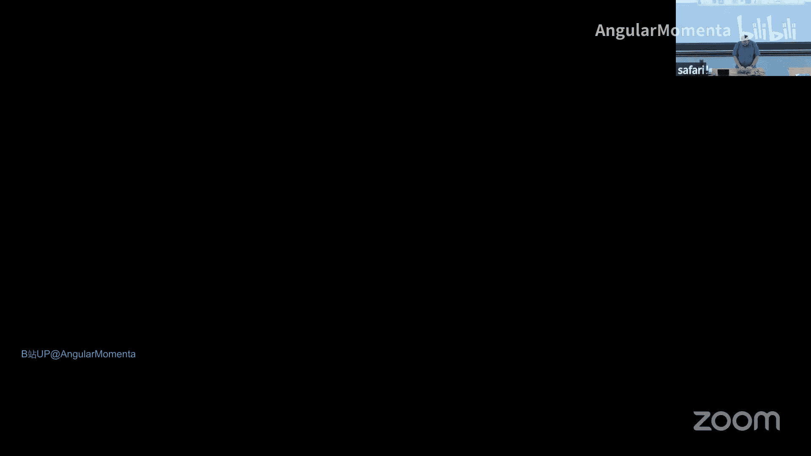

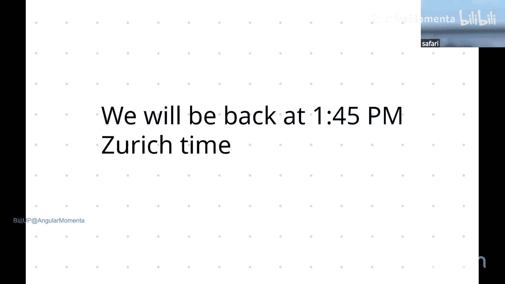