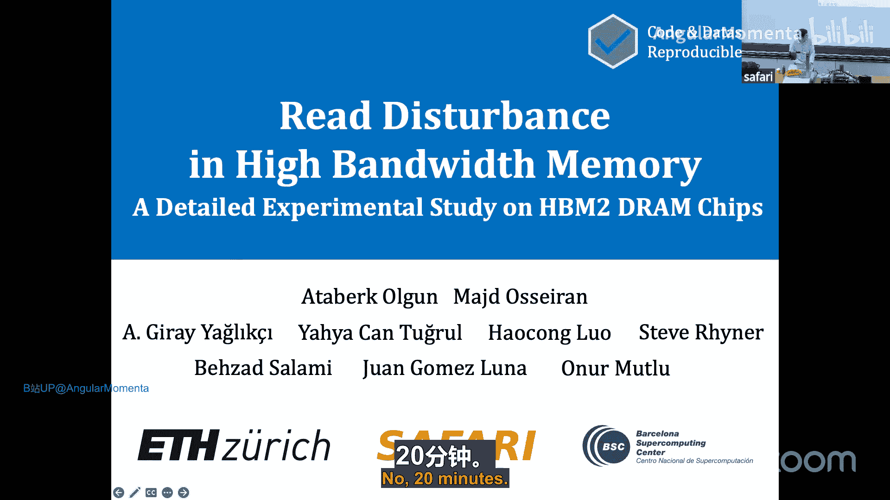
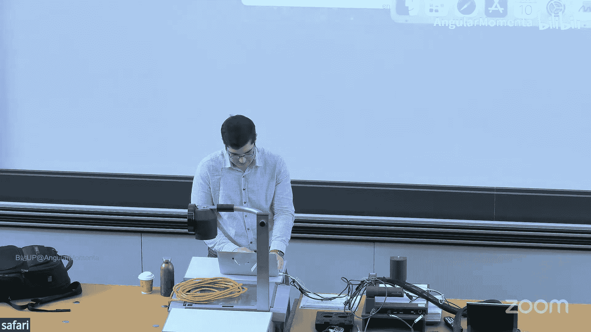
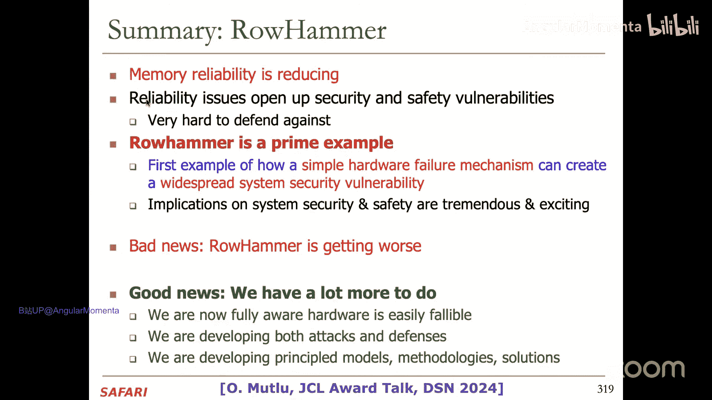
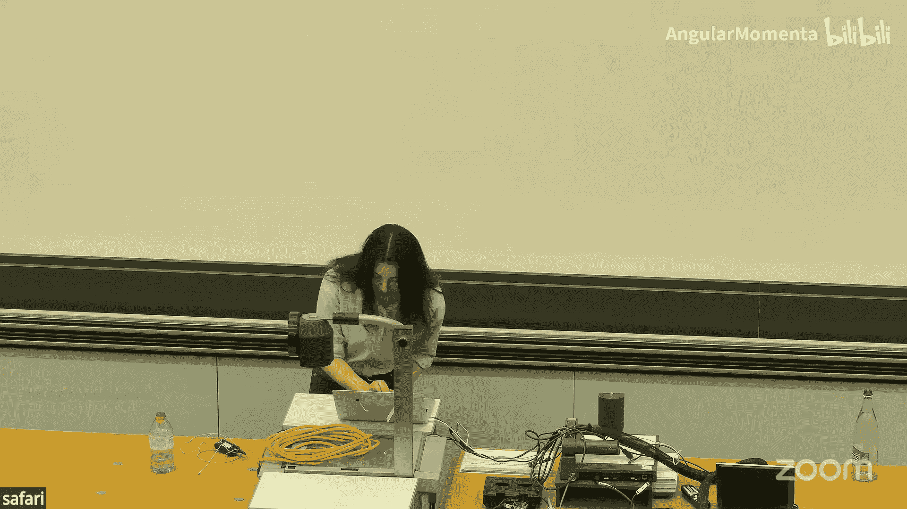

# 【苏黎世联邦理工学院】2025年首次SAFARI直播研讨会 ｜ 1st SAFARI Live Workshop (SaLWo) 2025 p05 04 内存稳健性：首届SAFARI在线研讨会 (SaLWo) 2025（第一天）_part001 -BV1RYquBGEDu_p5-

，Do Mr。 one of these microphones have seen them？A really。Yes。有好电有。And can people hear me？嗯。

Am I connected to the room audio？Okay。Okay。That's good。是。Testing， one，2，5，4。对。Can I have some？It。

Thank you。What's this much？对。所以个。我事是。I'll skip myself introduction。let's get started？

We didn't get chocolate。觉得个加的。同师收没。Yeah。20。我是S2。感じ。Okay， welcome back， thanks for coming on time。

So we have Atarti talk now， Atarti Oloon is a fourth year PhD student。

And he is also a Safari member and his broad research interests include design and secure。

 high performance and energy efficient memory systems。

 especially with we in the disturbance vulnerability， surprise surprise。

 it's increasingly difficult to design memory systems that satisfy all three characteristics。

His current research focuses on deeply understanding and mitigating the Roham vulnerability in modern systems。

His graduate work has been recognized with several honors。

 including induction into HPCA Hall of Fame。Congrats other， thank you and we are curious。Okay。

You are curious about what you have say thank you very much for the introduction so this talk is titled experimentalmently Understanding and Efficiently Mitigating theD Disbance it's a collection of four and a half research papers or five research papers。

😊，It's going to take， I don't know how long， but I have to go over around to 280 slides。

One and a half hours is the time I've been given right now so I need to go over to 200 data slides in1 and a half hours now this is me Gi I already introduced me and my research interests so I'm going to skip this and briefly remind you about the memory about memory isolation we want to have this key property in our systems whereby memoryax should not have unintended side effects on data stored in other adddities this is a fundamental property for robustness and breaking that can cause terrible issues as Gi I described earlier today。

And it's difficult to satisfy in modern memory chips。And these chips are used everywhere。

And the reason why we cannot satisfy memorized delation in modern chips is because these chips are prone to disturbance errors。

 which we have seen examples of， and you already know about raw hammer errors。

Appear when you repeatedly activate and precharge an aggressor row。

 these row hammer errors appear as bit flips and neighboring rows。

And we call the repeatedly activated ro a row and the roles that have pitfps victim rows。

Now I won't go into the details of why these errors happen so I will be skipping a bunch of slides right now we've already seen seminal work that showed draw hammer bit fliplips are widespread back in 2014 or 2013 and many researchers exploited these bit flips。

To break the security of our systems so far in many different ways。And you see some examples here。

One thing that keeps coming up， I think， is that error correcting codes。

Are posed as some sort of mitigation or remedy to redisturbance failures or bit Phillips。

 but many research papers have repeatedly shown that ECC。Cannot completely eradicate。

 read disturbed Biflips and we show it multiple times in our studies as well。

 and you'll see some example real data showing the uneffectiveness of VCC against these sort of failures in my slides。

So that's a sort of like to summarize all of this very quickly， okay， I'll be skipping some slides。

 as I said。Memory reliability is reducing this is one of owner's slides from his award talk at DSN。

 Ro Hambi Phillips are hard to defend against。The bad news is it's getting worse and the good news is we have a lot more to do with architects。

 we can come up with solutions to this problem or we can come up with new methodologies。

 new experiments to understand this problem。And my work is in the line of。

The developing solutions models and methodologies to understand redistance in the M chips。

So I'll start with variable read disturbance。This is an experimental analysis of temporal variation in D redistbance。

You see a typical DNA based computing system here with a CPU and a D module with multiple chips。

And we already know how the chips are organized， you have many banks in a chip。

Many subways in a bank and many sell in a subway。And you have DM rows and D columns or bit lines that are connected to a row buffer。

So in those disturbs， we already know you repeatedly activate and precharge a D row and induce speed slopes and neighboring rows。

We already know we call the Agaa row， the repeatedly activated row and so on。

And we've also seen about row press where we inflict registered bit flips by keeping a row open for a long time。

 not by repeatedly activating necessary。And priorworks proposed many solutions。

 many techniques to mitigate redistured Biflips， and these are valuable， each of them are valuable。

 I think， because they come at different reliability， performance， energy and area trade offs。

Regardless a common operation pattern across many different solutions that they take an action before a bitflip manifests。

 for example， they refresh a victim role and to do so they must accurately quantify the amount of disturbance a role can withstand before the row experience as a bit fliplip and this is typically quant by time intensiveestive testing for redisturbance bitflips。

😊，And the redisturbance threshold or RDT for short quantifies the amount of disturbance a row can withstand before it experiences the first redisturance bidfall and this is typically expressed in terms of an activation count and you've seen this in different forms today it what called HC first and AC in different research papers in this research paper we called it the redistance threshold to have a more sort of。

General name， let's say。So now I'll try to illustrate why it's important to accurately identify the red disturbed threshold value。

😊，The x axis here shows increasing redistance thresholds values in arbitrary units。

 and the Y axis shows performance and energy overhead from your mitigations and again。

 arbitrary units。So this is a curve you would expect to see basically as the read threshold becomes smaller。

 the solutions or mitigation induce more。😊，Performance and energy overheads。

And for one example of that is like if your red threshold shrinks。

 you will issue more refresh operations or issue refresh operations more frequently and you will interfere with demand access more frequently。

😊，So if you have this ground root redisturance threshold value， and that's for example， 1000。

 you want to configure your solution with that exact redisturance threshold value。

 why because if you configure it with a higher value。

You cannot mitigate Bfis and your system is no longer secure。

 so basically arrow has been activated 1000 times。But your defenses were configured to mitigate Bifilipps at 10。

000 activation count， so you couldn't mitigate the Bifilip and now you're subject to all those sorts of attacks that we've discussed earlier。

Not well earlier today。And if you're overly conservative。If you have a very low threshold value。

You incur unnecessary performance and energy overheads。So in summary。

 we must accurately identify the Readserv threshold。

To securely prevent pit floatps that low overhead。And our work tries to answer a key question about the redisted threshold。

 that is how accurately and efficiently can we measure the redisted threshold of each DMM row and we record more than 100 million redisted threshold measurements。

Across many rows and many different Dm chips。 And we find that the redistored threshold of a Dm row varies significantly and unpredictably over time。

The largest threshold we observed for a DRO can be 3。

5 times the smallest we observe for the same row across many test iterations。

And A row's smallest redistured threshold value may appear after a whopping 94。

000 measurements that took us at least two weeks to conduct。

And we call this new phenomenon variable redistbance。

It has implications for system security and robustness because the research threshold of a role cannot be quickly and accurately identified。

😊，And we evaluate guard bands， the use of guard bands for these thresholds and air correcting causes as a solution for VRD induced use B Phillips。

 and given our limited data set of Bifilip locations。

 we find that relatively large guard bands in ECC could prevent VRD induced use B Phillipps at significant performance cost。

But we think that more data and analyses are needed to make a definitive conclusion and our results。

 I think called for future work on understanding and efficiently mitigating redisturbance pitflips and VRD。

This is the outline for the rest of this talk， this part of the talk。

 I'll continue by motivating our study even more， but you can cut me at any time to ask questions like how we conducted this workshop so far。

So redistance with flips happen in more DMm cells with fewer activations as Dm technology scales。

 we see more than 10 times reduction in redistance threshold between chips manufactured seven years apart。

 and we say therefore that DMm chips become more vulnerable to redistance with technology scaling。

This， in turn causes existing mitigations to become more aggressive。

 and in turn they induce higher overheads。Moreover。

 prior works assume that the ground through threshold can be identified。

 and in our work we challenge this assumption。And we see that no prior work studies。

 the temporal variation of data redistance and its implications for future solutions。

 so our goal is twofold。First， we would like to answer two research questions。

Does the Readserv threshold change over time and if so。

 how reliably and efficiently can we measure it？And second。

 we would like to analyze implications of temporal variation of redistance for redisturbance solutions。

😊，So to HUR goals， we experimentally characterize DM chips， you've seen this many times。

 we use the DMM testing infrastructure to test DDR4 modules。😊。

This infrastructure provides us with fine grain control over EM command。

 timing parameters and temperature。And we have also the like another version of the same infrastructure that we used to test high bandwidth membership chips。

We test many chips from three major manufacturers， spanning various dye densities。

 data visions and chip organizations that you see here。

And we carefully use the rigorous redserv characterization methodology as done by prior work where we prevent sources of interference and use the worst case a double sided draw hammer redserv access patterns。

And the bottom figure here depicts one hammer， so opening and closing， you see it here， yes。

 opening and closing。😊，The two neighbors of a victim Rove constitutes one hammer。

 at least the way we define it in this work。So I'll describe the major results。

Starting with this key takeaway message， so we find that the redisted threshold of a role changes randomly and unpredictably over time and this makes accurately identifying the redisted threshold very challenging。

 this is the most important fundamental result we have。😊。

So we plot the redistbed threshold values observed across many redistured threshold measurements or samples or observations。

 basically as measurement numbers increase， we go forward in time per se。

And this is an example point in the plot describing a measurement that yields it insert threshold value of 37。

000 is hammers。😊，This is real data， by the way， this is RDT measurements， five of them across time。

 and this is across 1，000 measurements。To we will expand the X axis further and we want to make sense out of this plot so we compress those series of 1000 measurements into。

This form this box， this circle shows the average across 1000。

 and the error bus showed the range of values in those 1000 measurements。

Now this is the data threshold across 1100，000 measurements for one DM row that we tested。

 we tested many of them， this is just one of them。😊。

And we observe that this for this series of redisted threshold measurements。

 the minimum Rity appears at around 17，000 measurements。😊。

That's like four or five days into repeatedly testing this role。So this。

 we believe is a key result that demonstrates the variable redistance phenomena。

And we also investigate the distribution of observed redistured threshold values。

 here we show a histogram of BRDT values where the bar's height indicates the number of measurements that yield the RDD value you see on the x axis and observe that the redisted threshold of for row takes various different values across 100。

000 measurements。😊，And we show data for one tested draw in each of six tested DM chips here。

 so six different rows here。And this observation is consistent across all tested chips we have。

Similar looking distributions to what I show you here。

But I don't put all of those plots in the slide， so I refer you to our paper for those。

But I'll be happy to take questions also。We have one question。と明た。We have one hypothesis。

I need to go to slide number 300， something I'm going there。No。12 PM，12 AM。And then PM and then PMm。

So。It's a bit difficult because this has not been shown before in by device level studies。

 like the underlying physical phenomenon， we have a hypothesis explaining that。And again。

 I'm not sure if I'll be able to explain this very scientifically。

 but theres these bullets summarize it so electron migration and injection into a victim cell is one major mechanism。

Relying physical mechanism， and it's assisted by charge traps in the active region。😊。

So charge traps apparently or。Hypothetically。changenge their states。

So is the state of the charge traps， look the distribution of the state of charge traps affect。

 let's say the amount of charge leaked by one hammer or one press。

And those state changes happen randomly。Physically random happen。

So that's the best hypothesis we have。if you know about variable retention time。

 whereby retention time of cells also very randomly unpredictably over time。

 this hypothesis is very similar to the underlying physical phenomena that explains VRT。Yes。

 one question。So you showed this。RDT plot for over 100 k measurements for a single row right yes？

And our DT values in the beginning were high。 they followed the high pattern and then they。

They got lower basically and I was wondering， is it safe to assume that each one of these measurements are totally independent and nothing carries over from one measurement to another。

 so row refreshes actually reset everything。Yeah， yeah， I mean， it should as far as we know so。

Nothing is carried over。From one generation to the other or nothing different is carried over。

 let's say。HSo this these two patterns don't mean much then right。

 so there wouldn't be in what sense。Like。At large scale， over 100 k measurements。

 we couldn't say there is some degradation， for instance， like physically happening yeah。

 so basically the readerserv could go back up again like the mean the reduction in mean you see here。

Is not permanent Oh， I can say that there's other data that shows that。Okay。

 so there seems to be at least from what we see in this paper and we're still working on this right we're doing more experiments。

But what we had with the data in that paper， there seemed to be some sort of。

Let's say this is broken down into two effects that we don't know， one effect。

Causes these large like swings in the mean or the whole distribution。

Like this' jump from here to here。And there is another thing that causes this noise。

Both are seemingly unpredictable， but these big jumps。

 we don't have much data on these jumps because it just takes too long to get yeah。

So it's a large scale effect that can be observed over a lot of measurements， I see。

Are you do you have any other questions？Is there any chance that this is periodic by any way so the smaller ones are definitely not well definitely not would be an overlay we did we did try to study like we did a time say very。

A simple time series analysis。For the predictability of these。诶。Values。

So this is the auto correlation function， which。Would give you a so the zero values see here。

These would not be zero， let me put it that way if there was some overlap between shifted series of RDT measurements。

So like you take 100，000 measurements。And then you shift that measurement by one to the left。

 let's say， to see if there's an overall app and then by two by three by four all the way up to 25。

000。And there is no。Correlation。As far as this is。Yeah。The bigger ones， maybe。Maybe。But。你感见。Yeah。

You previously stated that you saw， for example， a specific threshold being reached after 47。

000 accesses， 94。94000， even。So this sort of periodic behavior or this time behavior may be way more way bigger than。

The sort of shifting by 25000 a。 yeah， I mean， sure， like bigger ones， Yes， I agree， I mean。

 this the problem there is even if there's some sort of repetition。

 we didn't see it and like like you would be able to tell by eye like okay， maybe it's an over claim。

 but listen to me first I'll explain myself。 So these big shifts don't happen much。

 So if you plot them like this if there's some sort of repetition， you should be able to。是。

And figure it out Yeah， but but I suppose even if there is a periodic behavior。

 it is so unpredictable in between that maybe you cannot have very accurate。Estimate yeah， yeah。

 but these shifts don't happen my it's like for this is one row。I have data for 20。

 I think 21 rows like this one with 100，000 measurements， so we didn't test many roles with 100。

000 measurements in this study， just 20 or so of them one row in each year basically。

And these big shifts either don't happen too much as in zero， such big shifts or happens once。And能。

They may not be related to themselves， but is there another feature that？sortrt of。

Points to them Well， everything else across these situations。Are the same。

Unless someone breaks into the lab and does something in the lab， how you thinking yeah？

要不 another question there。By the way， when I'm looking at this part of the room。

 I don't see this part this part， so if you have a question， please let me know。So if it's blinking。

 it means it needs time yeah。Yeah， and then no like there some sort of calibration going on like when you shake it too much or you。

Yeah， move the microphone goes out of sync。So one question I had was。

How long of testing you said it was about two weeks of testing to get to the least RDT measurement。

Was this continuous testing over two weeks， yeah？Like anything else， just this throw。Ok。

Because then that's very prohibitive to explore， you can't do something online， right yeah。It is。

It's one of the points of the paper。ふ。😊，You probably don't want to measure re threshold for 100。

000 times。嗯。😊，I we bought the D chip for some purpose。Other than testing。对。Main dichotomy， I think。O。

😊，We have one question there， one question there。All right。

 so I was wondering you don't see that jump in the minimum observed values right there's kind of this consistent interval So I was asking what does knowing the exact RDT tell you that the minimum RDT doesn't already tell you isn't isn't it like intuitively or naly like doesn't it already seem very suspicious that a victim row has two neighboring rows and they both have or hammered 34000 times and at the same frequency probably like I don't know so。

Wouldn't we already like is it easy to mistake legitimate memory exits for the minimum cases like the 34000 maybe I didn't understand your question actually can you can you maybe yeah I'm sorry so。

So we are trying to detect whether something is you know using the redistance threshold we're trying to detect whether something is an attack or not right or like we were trying to see how this value you know when a row being accessed is is prone to bit flips or not right Yeah so basically if you look at this I think you could say。

Right， the moment you see this value， set your defenses to be triggered but。

You don't know if that value is smallest yet。And that's the whole point。If you。

 if you think about it without。Understanding this variation。We cannot really make any judgment。

 even even with a lot of analysis， we still cannot make a judgment about。

The minimum absolute minimum redistance threshold valuearrow will ever have。

So I cannot say confidently that this value will be the smallest one observed across。

One billion iterations。SoSo is 34，000 hammers something out of the ordinary for like a normal program or does it happen that a normal computer program can have like this many accesses as quickly？

Yeah， it could have it， I guess we don't do this sort of analysiss in this paper like how many times your program ends up activating it at Grerro。

34000 is definitely within spec， so you can do 1。5 1。4。I might be wrong between 1。2 and 1。

4 million activations in a refreshment know before your victim is refreshed。

So basically you can do up to this could go up to 1。

4 million and then you could call it standard operation。Okay， well， if you want to add something。

So I'd like to referse the question in a different way。

 Maybe I'm going to manipulate it a little bit， are you done with your question， okay。

So what if okay， let's raise the question this way， so you observe a lot of variation in RDT。

 but the mean value is around like 34， 36， 35，000 activations mean or mean。

Doesn't matter like on average， like it's it's in the in this spell like from 332000 to 42000 is the range right Yeah。

 so what if we configure our Ro hammer defense to work at 1000 activations So do we really care what kind of variation we observe here。

 Yeah， I'll get to that actually， but maybe get to that faster you can use what you're saying is basically it's use some safety margin。

This point， right， like we characterized our D chip， we didn't find any value smaller than 10。

000 and I'm going to I'm willing to use a value as small as 1000。Yeah。

 also he mentioned the behavior of the benign workloads， right。

 so let's say benign workloads if they don't hammer or more than 1000 times。

What if we just set the defense to 2000？Or something like that Well。

 you can set the difference to2000 is still good like okay。I won't make scientific claims。

 I would just say based on experience and reading a lot of papers， 2000 draw hammer threshold。

It's something you can deal with relatively efficiently today。

So if you talk about specific numbers like this， I would say go ahead do it and you know like。

In the end， you would still not know if you're going to have a value smaller than that。

You cannot say that， I think， based on what we show。

 that you will never have a value smaller than 2 k。For any test and if you if you go。嗯。

Look at the scaling。Of redisturbance bit flips。 You will see that the redistance search keep getting keeps getting lower and lower。

 At some point， you will hit， you will have to hit with that safety margin， even smaller。Tresholds。

 so maybe today's DDR5 chips， which are unfortunately not。

Tested for redistance threshold like this rigorously because of a lack of。Testing of structure。

 we don't really know they re threshold values， there's certainly higher density chips and we expect grow hammer to be worse in those chips。

So if you apply the same method。Of adding a safety margin。

 you might end up with a very low registered special value and at that point。

Your overheads are considerably high。For defenses。So， we showed this。

We look at a bunch of defense mechanisms， these are different defense mechanism graphene， PraC。

 PA and Mint。We see that the 50% RDT margin， which you were talking about the 10x margin， right？

500% margin。Even a 50% margin at low enough threshold can induce 50% overhead system performance overhead。

This is overhead from preventventive refreshes。So your activation account reaches a threshold and you refresh the victim row。

And this is the old had you pay。Do the interference。That's demand request。So。

If you rigorously test your ship， maybe you test your ship for 30 days。And you found 10。

000 to be the smallest digital threshold， you can apply a5x guard band。

And you can take my word for it that you won't have that 2 k RDT value appear after that much testing。

 but。I wouldn't take my word for it， I would do my own study。诶。It's complicated， I think。There's no。

Certain answer。With some input from manufacturers and maybe Fabs， we can know better。

 we can actually understand the physical phenomena that lead to these and model them。

But D industry is not really open to that sort of thing。So， we're left with。

Doing these sort of tests。啊。That's a very long answer， but I hope it was coherent。

 so if you have any questions about that answer I'll be happy to take them。Cool。One more question。

 already。So we're taking this to 12 am。是。So you said if the threshold is too low。

 the performance overhead will be unnecessarily high。

 who pays that overhead is it the victim or the aggressor？😊。

Who determines the overhead you sell or this overhead is for which application the aggressor application or the victim application？

嗯。Well， these for victims， we don't have any。 so in these in this study。

 the the numbers I showed you， they don't have any。呃。Application that's trying to do raw hammer。

All of them are just basically memory traces from spec workloads and other benchmark switchs。

Beennign workloads， benign workload mixes。But the threshold there are low。

And following up on his question， so if you set your threshold to 5000 and benign applications never reach that threshold so you don't have any performance overhead。

 is that correct？In that scenario， yes， if that would be the case yes until you have some。

 I guess there's。Well， like basically there's a there's a line of work that shows row hammer defenses can also be used as。

Sort of。Agents for denial of service。You can create an interference。

 even if you cannot create the flips。You can can have the defense mechanism perform a lot of time taking。

 refresh operations。Yeah， but at 5000 he threshold， the intensity will be low at 200 very high。

Harsh has a question。Yeah， so back to your slide with 100 k measurements。Yeah。

 this also has soundedk。So let's say I'm limited in terms of time and compute resources or something like that。

 and I could only do 10k measurements and I do not capture the global minimum right。

 the absolute minimum RDT in that can I then like not basically offload that to ECC or something else and get away with small overheads for correction looked at that also like here you could do that I guess find the minimum of 10k you already hit the minimum this specific example yes。

 but specific examples maybe are misleading us at this point because we haven't looked。

99% of the data I was going to show you guys is still questioning me in the 061st slide we have like 200 more slides to present anyways ECC can correct some of these errors yes。

😊，In fact， I mean， from our experimental data， okay， is this what I want to show you？

Where is it here。Okay。We tested with a 10% guard band， which is relatively small， so what we did is。

😊，If you measure the red discerner threshold five times for a row， this is across many rows。

 I don't know the exact number at this point。And you find the minimum across those five measurements。

 and then we apply a 10% guardman， so if we found 5，000 there。We apply 10% gar。

 so that brings us to 4500， and we repeatedly test for 4500 hammers。For a very long time， again。

 I don't have the exact number of times here。And he collected。

This histogram this shows you basically in the number of unique bitfilipps in a row。

 even after applying that 10% guard band。So you see a lot of rows with one bit flips。

That can be corrected by ECC， no doubt。Two and more depends on where the Biflips happen。

So if you have two bit flips happen in the same E code word most。

Fringingd to use DCCC can only detect it。Definitely not corrected。嗯。If it's in the same chip。

Chhipkill can correct up to。And bit fliplips。Shipkill can basically correct。

The disappearance of one chip in like among， let's say， nine chips。

It's like that level of redundancy， but these bitfps happen across ships so you can。

Reason about that。So short answer is ECC is not still not， I would say， a reliable solution。

For redistance bit flips， even when you apply guard bands。Har oh。

 I don't want to take too much time in case you're going to discuss profiling approaches or directions。

Then I will delay my question。Profiling。Profiling in the context of4DT。I mean。

 everybody does stop a on R， you mean like how we find the mean how can we find potential directions。

 maybe I think how can we find it like my next research paper， hopefully then we don't talk about it。

I'll talk to you in a first。The good question I think to ask is this is we're looking at the whole population of rows in this study。

 but what about the ones that have already the smallest threshold values？

So that's the next thing think one question I could ask what the characterization is。

Do you see similar results across。Like consistent results。

 correlated results across chips the same di revision。That's a good question probably no。

 let me just try to remember。Same di does not show similarity。嗯。But we have this observation。

It tends to worsen you will understand this better when I I'm sorry again and we're but this shows you basically with increasing diversity density and advancing or advancing DM technology notes hypothetically there's。

😊，There's something to be taken with a grain of saltalter because we cannot be 100% sure from information available to us which one which module is more advanced than the other。

 but we know which is the higher density city than the other so with higher density and advanced technology the distribution tends to worsen the gap going along that direction asking questions what one specific di duty consistent results across different chips。

Different chips spinning different instances of these chips yeah we don't have I don't I don't have that kind study no yeah。

Yes。呃。We were， I think we were here。No。We were here。Okay。We have another question， perfect。好。

Data parent。Yes。What is the data pattern for the rest of the rows other than the the ones explored。

 is it zero is zero in this one？Well honestly you're asking me a good question。

 I don't have it right now off the top of my head for this for this data I don't remember。

 I mean for the I'm going to show you next， we have the methodology slide。

So I can only try to remember， so these are the data patterns we tested， right？

But the ones I've shown you so far。It's definitely in the paper。 It's either one of these。

For the rest of the row， it's。One of the basics showing you that。

 not we don't initialize all of the rows with every test like every experiment。

 we initialize the neighboring eight， well 60， well， eight rows， so victim row。

 four rows above the victim row， four rows below the victim row in logical ladderer space with these data patterns。

And the data I've shown you uses either one of these， I don't know which one。Okay， no hands。Yeah。

I already described this a bit but we analyzed the predictability of the next reded threshold value given a sequence。

😊，Past measurements。 And we find that this is。Likely unpredictable we did two things first we look at the histograms。

 the distributions of these values and they resemble prominent random probability distributions。

 so some underlying phenomena yields this some randomly distributed phenomena yields this right that's one hint thing that hints this could be unpredictable and we use the other correlation function I shown you earlier to try and identify repeating patterns but we cannot。

😊，Distinguish any repeated patterns。呃。So yeah， I mean， for more details。

Please read the paper or we can discuss offline， but with the paper next to me。

 I cannot give you any more than what I gave you in the。And the question earlier at this point。O。

Yeah。So now we will take an in depth look。At VRD and we will look at many D rows and we will sweep many test parameters。

 so that was just one row and under one test condition。So we use four data patterns here。

 three temperature levels and three different aggressor one time values to investigate grow press and variable redistance。

 and it has many rows in total across all chips， but we measure the redistance threshold 1000 times for yeast testo so some we had to reduce so that's the number of measurements。

え。And this is due to time constraints， really。And yeah。

 I have here an aside how long it would take if and what the distributions would look like if you were to test for more than a million times。

 it's good to think about as I present you the result。

So these are the three key takeaways from this in depth component of the study。

First is that all DM rows exhibit variability disturbance， to different degrees。

 but there was no row that was not subject to variability disturbance。

So here we show the coefficient of variation and the distribution of 1000 redistance threshold measurements of each tester drop。

😊，I will explain what this means so this circled tiny pink dot you cannot probably see it if you're too far back stands for the D move with the smallest coefficient of variation in its distribution and that means。

For the purpose of this talk， that can mean basically its redistbeded threshold values are very close to each other。

So the distribution is kind of small。And we showed the rows sort of increasing coefficient of variation on the x axis。

And this is the whole distribution。We observed that all tests of row exhibit VRD。

 no row has a zero variation in its threshold measurements。And we highlight two points in this plot。

 the median row and the row with the greatest variance in its redistance threshold distribution。

So this is looking at those two roles， but they've expanded on measurements on the x axis。

So these are 1000 successive measurements and for the median row this is the one on the left。

 we see that the maximum observatory the certain threshold is 1。2 times higher than the minimum。

And for the other row， the row with the greatest variation。

It can reach a relatively high factor that 3。5 times。

So the biggest or the largest reddeed threshold observed for that row is 3。5 x。

 the smallest observed for that row。And do you have any questions？Okay， cold。

 so that's a big number and big variation。The second takeaway is that relatively few measurements are unlikely to yield the minimum redistbance threshold of a row and here we're trying to answer this question so how likely is it for us to find the minimum observed redisturance threshold across 1000 measurements using only n measurements where n is smaller than 1000 if we use Monte Carro simulations and plot the probability of identifying the minimum redisted threshold value or varying n for all tested rows。

😊，So n equals one measurement here。😊，Has a very low probability of yielding the minimum reded threshold value across 1000 measurements。

 it's only 0。2%。And we observe that this probability increases with n。

 it goes up to 75% for the median row， but it does not reach 100% again for the median row for even for n equals 500 measurements。

嗯。So this is one major result again。If you have any thoughts。

 take no cool and to gain more insight into variable disturbance。

 we devise another metric and this is called the expected value of the minimum reserveised threshold it's to quantify how higher of an RT value we expect to find with n smaller than 1。

000 measurements。So I'll describe this pictorially。😊。

This line depicts the minimum red threshold value across 1，000 measurements。

And these are five random samples from the set of thousand measurements and the minimum across those。

😊，And the metric we're devising here quantlifies distance between these two minimums and these five samples are taken randomly and the five the number will change also very that's n。

😊，So we plot this new metric on the y axis and the probability of finding the minimum。

RDT on the X axis， that's the previous metric。Each point on the spot stands for one D row。

And this point it is showing you that there is a role where we expect to find a redisted threshold value using one measurement。

 and that value will be 3。2 times greater than the one we would find if we were to test for 1。

000 times。Okay， it's went a bit too fast。So a good way to interpret this plot then based on that is that we want to have a small yx value。

Small Yx values indicate tight third read the term threshold distributions and you want your distribution to be as tight as possible if you want to。

I don't want to use the word predict， but at least predict what the lowest value or based on one measurement。

You can predict that the smallest expected value will be not so far away。

So we want something like that。So this is the full plot。😊。

And we highlight the row with smaller than 0。1% probability of finding the minimum RDT。These rows。

 for these rows， the minimum read threshold value appears only once in the series of 1000 measurements。

And they can now up to 1。9 times expect the normalized value of the minimum quantity。So。

Very wide distribution and the minimum appears only once in a series of 1，000 measurements。

And we conclude that the minimum red threshold across 1。

000 measurements is significantly smaller than the one expected to be found by n equals one measurement。

And with increasing n， we expect to identify a redistbed threshold value that's closer to the minimum value across 1000 measurements。

 so these blue dots show you the new device metric for n equals 500 measurements。And finally。

 data patterns， temperature， aggressor at one time all affect VRD。

 and I think I'll go over them relatively quickly because we discussed some of these already。Yes。

Not this slide。Should I go。第个。我在其日。Yeah。No不。我。你 know好。话。你也。い感で。我又在。我开始。我们在这里。This analysis does not。

 I think， cannot answer that question， we cannot answer that question without testing one billion times。

I mean， you could say something about basically， I've seen that the distribution for this role looks like the reder threshold looks like this。

 like imagine something。You could say that that distribution will remain。And。

Based on that distribution， you could make some statistical inferences。

That distribution seems to shift。And it seems to happen rather unpredictably and more wildly。

And less frequently。Which is。Terrible。Yeah。😊，啊。We can come up with models that will have some predictable capability。

 prediction capabilities but。The I'm trying to do this actually right as part of my next work。

 but it's terribly difficult to。basically answer a question like that。I honestly， at this point。

 I don't know how you've answered that question。Like I have a model based on N measurements。好。

Accurate is that。Moving forward， like。Youve got to keep probably testing and update your models。Yeah。

 no。好这。Yeah。とが。We have to go forward。Not back。3月。这是。嗯。嗯哼。好吧。办法了。Okay。From 50 to5 I mean。

 I didn't look at intermediate points that I wouldn't be able to say， but the jump from 10 to 50 is。

5 x the jump from 50 to 500 is a numerical value is 10 x， so it's like。哎哎哎。Yeah。

 so I don't think the median jumps by 10 x。 No， there's no way I well。There's some way。

 but it's unlikely so。This is not completely unexpected。I see。

 so I cannot answer that question right now confidently。Very good。So that。

Maybe it's it has a straightforward answer， maybe others can see the the answer at this point I can I' would rather do some yeah it may be good to do that analysis yeah something else。

Okay， cool， now we can move forward yeah unless someone has a question。No hand。嗯。Oh， yeah， I too far。

 There you go。So some observations about data parent， I guess through one time temperature。

So we show the expected normalized value of the minimumity that's the second metric with device。呃。

For four tested data patterns。And we observe that the distribution changes with the data patterns here we show the median values。

To quantify that change。So， theres some。Da has some effect on VRD distributions。

And across all tested modules。And manufacturers， there is some effect and no single data pattern causes the worst distribution。

According to this analysis across all tested ds so some data tend to have。Um。

Then they yield diverse distributions in sumdms or some chips。Some others in some other chip。

Here we show the effect of aggressro one time， we see that the distribution distribution changes with aggressro one time again a rather straightforward observation。

 it can become worse or better with increasing one time。

 there is no single relationship that we could identify。So you can see that in some cases。

Has a reducing effect in some other cases。Some sort of increasing the redisted threshold distribution。

You look at the effect of temperature as well， but we don't investigate it too much because from a。😊。

嗯。From a simple look。The distribution things tends to change the temperature。

 but there's no clear relationship again。So these are the sort of。3。

Takeaways from the sensitivity study。And I want to show you this also。

 I kind of highlighted this earlier but。Here we look at the effect of diversity density and divis we plot again the same。

Metric over the y axis。Here we show three different data visions and dye density combinations。

And we observe that the reader sort threshold distribution versions。With increasing data density。

 so when I say distribution version， it means that we expect to find a larger disturbed threshold with less than smaller than 1。

000 measurements。😊，And we consistently make this observation across all tested modules。

So the distribution is becoming worse。As diversity。No technology advances。

 manufacturing node technology advances。The auditity distributions version。Okay。

 that's all about the sort of experimental study component of VRD like that's all about redesed threshold values themselves now we'll move on to the。

Implications we thought were important for system security and robustness。

 implications of variable redistance。So I'll summarize these security guarantees provided by defenses or redisted mitigation techniques rely on accurately identified redisted threshold value。

 and we show that accurately identifying these values is，Extremely challenging。

And we evaluate a short term solution that is to combine a garment for redisturance threshold with error correcting codes。

 and given our limited empirical Biflip data set， we show that this combination could prevent VR use bit flips at some performance cost。

 non negligible performance cost。😊，And our results call for future work。

 we think that it calls for future work on online redisturance。

Profilling a runtime configurability disturbance mechanisms。

 and we will hopefully motivate that in the next slides。😊，I'll again stress an important caveat。

 the results I presented in this s slide and I'm going to present in the next slide are based on only a limited number of fe threshold measurements。

And I think you can be pessimistic about this and say that more threshold measurements could yield worse results。

And it's good to think about what millions of or billions of。

Or more registered threshold measurements could yield。And that was the summary。

 so let's dive a bit deeper and explain why it's difficult to identify the minimum reserved threshold value。

😊，The variation in redisted threshold can reach 3。5 x and it may not be bounded。

 this variation is not guaranteed to be bounded。The distribution in redisted threshold value values is affected by many parameters and comprehensively testing for redisted threshold values is time intensive。

And。One number to quantify that basically if you want to test the red search of each row in a bank of 256 k rows。

Only once it can take 39 minutes。And you have 32 banks in a DDR5 module。

 so testing all rows once already takes hours。And in fact。

 we show that if you want to be even more comprehensive。

Testing a DM chip can take tens of hours if you want to measure the registered search field multiple times。

But only under one。Test parameters。set。And in the paper we have。

Much comprehensive more comprehensive enough for testing times， so I refer you to that。

If you want to see some very large numbers。Like your。Yeah。

Because it's so time consuming to comprehensively test for disturbance with Phils。

You as a system designer， might measure the redistserved threshold a few times and then take the minimum across those measurements and then apply a guard band with hopes of covering the absolute minimum across eternity redisted threshold value。

😊，So this plot shows you the probability that。And measurements displayed on the X axis。Plus。

 the guard band we show above will cover the minimum redisted threshold value across 1000 measurements。

So we show both the average value across all test the rows those are the circles and the minimum across all test the row that's the bar。

 its a bit of a different plot， but hopefully this is easy to understand。So the pink part。

 what it means is that there is a role。Where you don't expect to find the minimum redance threshold across 1000 measurements。

With 100% probability， even with 500 measurements。So， this is。The full thought。And。

We observe that a large guard band does not guarantee that you will identify the minimum redistured threshold value or identify as in the minimum redistured threshold value will not appear within the guard band you applied。

So we conclude that gars alone are liking and noteffective。

Because some research threshold values is my SK， you could say that I will increase the garbage band even further。

😊，But 50% guard ban is quite large already， right？Again。

 if you say that you want to increase the guard even further。

 this is another reason why you probably shouldn't do it。

Large gars can introduce significant performance overhead。呃。With the previous reason。

 combined with this reason， we don't recommend using guards alone。

And we value air correcting codes as a complementary technique to using a guard band for redistured threshold and I've described this already so Ill。

I'll take questions if you have any。But the Bifilip rate we observe suggests that widely used ECC schemes。

 relatively cheap ECC schemes today。With 10% guardment for redistbuted threshold is likely unsafe。

And that depends on how the Bi Phillips are located in the end。Using a guardman of 20%。

Or larger than 20% yield only one unique bit flip in the row。And the bits of patterns we observe。

Could be prevented with larger than or equal to 20% gar combined with these ECC schemes used today。

But we think that more detailed analysis， likely following a large scale study is needed to make a definitive conclusion about the effectiveness of guard bands and ECC。

And I could potentially disclose that like with further testing after the publication of this paper。

 I wouldn't trust the 20% cardpen so much anymore。明白。It's all about， I think。

 how long you allocate to test， yes。Then how much of guard band do you thrust right now 30。

 I increased， I bumped up to 30% okay？It might change tomorrowrow。 It could be 40。 I don't know。

Because you test more and more guardments should go up higher and higher。

 it looks like that so the 20% so this was limited testing right so we I think。

We did this in the rebuttal timeframe， so we submitted the paper with seal you。

 this was one of the things we wanted to address。We tested for a week。

 less than a week or so we did this ECCC experiment then basically in a short time and though。

And that short time， and though we couldn't apparently cover all the bit folksps we could have possibly covered。

Which is reasonable and which will increase， I think， that more testing。Doing more testing now， yes。

 as we speak， yes。Okay， should I know no it's good to do more testing so how do you know that the new bit flips you get are not due to some other effect？

Some of the effect as in my。I cannot think of any other effect right now。

 I don't know some sort of aging。OhAging is always a。

I think aging something should have like we should have something about aging now。

Because it's difficult for me to reason about aging there's no。D disturbance。

Like there's no work that shows how redistance would behave it。Aging， so I cannot really。

Make any scientific comments on that， I think。That that is true for VRD also at the low levels。Yeah。

 it could be yeah， one thing I could say is if there is a threshold value。

 it reduces to some value and goes back up again。Maybe that's not exact you could say that that's not aging you could also say that that's aging I don't know what to say about aging or is that what's happening in all of the cells that you keep testing？

So I've not seen so far something that permanently have a reduced reduced threshold。

It's more like variable retention time， really。Cells seem to have multiple states that they can be in and we don't know how they choose to be in one state or another。

Yep， okay。I think it's great to keep testing。Good to see what happens。

It's good to update also to the the numbers in the paper yeah yeah get we get more data。啊。Forone。

 yes。So you said there is not a permanent trend at large scale swings right。

 but you also mentioned a second swing that's more local within those higher level trends this smaller swings within segments let's say so do you see like permanent trend over there are those local swings getting more noisy for instance。

I haven't looked at it in so much detail。 The visual inspection， no， maybe。Some I mean。

 some significant change happens。But I cannot see visual by inspecting the distributions。

 but I haven't looked， I haven't thrown statistics at it。For this specific problem。One more question。

So have you heard about this paper called Ata whoga the Test Time Award？

For the de time so can we apply a similar solution here。

 let's say we have a more capable error correctness scheme。

 maybe we can even use a message authentication code like CSI Ro hammer and then whenever we see deterrating increases we can increase gar bands。

So maybe looked into that， maybe you can do this。Yeah I think multiple people are looking into it。

 so I don't recommend more people to look into it。Okay。That's。I mean， people can， of course。

 look into whatever they want to look into。Yeah， but the idea is， should I describe。

 I don't know if I should。You just described it， so makes sense， yes。The issue is。

There's not enough experimental data， I think yet。Which is something we could close。

Like a gap we could close this。Because you don't know if。Like I've shown you this。

That you could do something with this data。But。Then I told you， you know， like， okay。

 this seems to be outdated， right？I think that's sort of a study needs to really。

Have a lot of experimental data backing it up。What we presented in VRD might not be enough for that。

O。There are other things in the paper that I didn't cover。Like well。

 I covered the hypothetical explanation to some extent。

We also look at the effect of three anti cell layout and we didn't。Observe a significant effect。

From the presence of two versus anti cells， at least in one module。So we don't conclude anything。

 it's just a preliminary study。Um。But it looks like。That might not be an effect。

Reiness service mitigation evaluation methodology probil。Errs at the first observed Bifoot pre。

 we have a error rate estimate based on our empirical data。

That shows you how likely uncorrectable errors are to happen， for example， if views sec that。

And so on。And more data on redserv testing time and energy consumption。

 these are in the extended version in archive。In the conference publication。

 that's specifically the fourth fifth bullet。And some more detailed information on tests and modules and chips。

So you can find those details in the paper and I'll conclude VRD。

So we demonstrated variable redisturance showing that the redistance threshold of a DM row changes unpredictably or across like over time。

 we show we are these interesting characteristics through detailed experimental characterization。

And your idea is implications for system robustness and security。😊，First。

 we evaluate short term solutions against VRD， given our limited beautiful data set。

 relatively large guard bands and ECCC may prevent VRD induced failures。

 but we think there's more data and analyses needed to make a definitive conclusion。

And working on that， I would say。So we call for future work on efficient solutions for VRD and future work that will develop our understanding of the inner workings of variable redistance and redistance in general。

An extended version of the paper is on archive and that's it for VRD。 so if you have any sort of。

Questions about where they can take them again now。Laterter is also fine。It's 3 pm。

Do we have anything scheduled？Now like the coffee break， I don't know when the coffee is out there。嗯。

So maybe， maybe we can go there then。And then come back， when we come back。

 you will cover what read disturbance in Ha Abaus。And self mening gear。Very good。

Or maybe a selection of those three。😊，I think it's a good time for coffee break， yes。

So we will be back in 15 minutes。3，50。30 minutes up to you guys， okay。20， you can disk okay。

 20 soll 2。5。We'll be back in 2。5 no 20 minutes， it sounds like VRD。

Yeah。Variable time determination， VTD。

好多啲。Share the whiteboard again。

Oh， no。好 no again。嗯。On YouTube。IsIs it fun？完毕。Okay， I'll continue so。The next part of this talk。

Is I'll be covering redistance and high bandwidth memory。

 a detailed experimentaled study on HBM2 DM chips， and this was published in a dependable Systems and Network conference in 2024。

So。Introducing this work in a different way， this is a non exhaustive list of。Back then。

 recent work that demonstrated redistured Bifps in commodity DM chips on a timeline not to scale。

 and many the LPDDR4 and DDR X chips， old and new are vulnerable to redistured bitfps。

And in our work。We ask an answer， what about redistservance and new high bandwidth memory data。

 does red disturbservance exist in high bandwidth memory and if so。

 how does it look like in high bandwidth memory？So our goal is to experimentally analyze how vulnerable modern high bandwidth membership chips are to row hammer or redistance。

 and therefore we experimentally characterize six HBM toD EMM chips in two different FPG boards。😊。

These are the four key results from the 23 new observations we make in the paper。

 we see that the redisted vulnerability varies across 3D stacked channels and data roles in each channel in high banded memory。

😊，On average across all tested DM rows you may induce 10 bit flips with an activation count fewer than twice the activation count needed to induce the first bit flip and this will make more sense as I describe it to you in more detail。

We showed that row press is widespread across the tested HM to DMm chips。

And we completely uncover the inner workings of an undisclosed onDMD or hammer mitigation technique in one of the tested chips。

We draw several implications for redistance attacks and mitigations。

 and we hope that our work inspires and aids future works and all data and sources for this work are open source at the link below。

This is the outline for the second part of my talk。😊。

I'll give you a short background on high bandwidth memory Dem specifically。

 so we already know about DM， but HM is a bit different。

High bandwidth membership chips are exhaustively used or extensively used in important system infrastructure today。

 you may know some examples to these， several popular machine learning applications of today rely on high band memory systems。

And a typical high remedyM system consists of a compute chip and on multiple HBM2 chips。

So I'll use HM2 and high bandwidth memory interchangeably。In this talk。

 so all of these chips are integrated into a single package to form the HVM2 system。

This is a different view of the same system， the FPGA and the HBM chips， HBM2 chips in our case。

 reside in the same package and are connected by a silicon interposer。

The memory controller in the FPG communicates with the buffer I in the high bandwidth memory chip。😊。

Over the HM interface。The HBM chip contains multiple 3D stack to DMMDs。

 and each DMI contains one or multiple channels。And there are high speed through Sil Ys that connect the channels to the buffer dye。

So let's look at， I mean， let's look at what's inside the channel， but you already know about this。

 so I'll skip this， this is a regular Dm chip basically。Almost。

With some subtleties like pseudo channelsnel， but that's not so important for this talk。

So we'll look at itself it's leakage and redisturance in a bit more detail I really like these slides i'll go over them even though you already have the idea but。

😊，Each cell encode data in fundamentally leaky capacitors is a simplified diagram of fedum cell。

 the capacitor in red stores data and the access transistor the terms of the cells being accessed and the important thing here is basically stored data can become corruptive if two more charge leaks。

😊，That's to say the capacitor voltage degrades too much。

So this is a simplified diagram of the capacitor voltage over time。

We see that the voltage decreases over time in an exponential decay like that。😊。

And there's a threshold women。Under which we can no longer guarantee that we will read the data that was originally stored in the south。

😊，嗯。So as long as the cell' voltage remains above this slide， this is a retention success。

 but if your voltage drops below women， it's a failure and in order to prevent those failures，😊。

We issue period refresh operations。to make sure the charge in the cell is restored and we refer to the interval between these commands as the refresh window here。

 although maybe the more there's a bug in the slide that the correct term to use here will be refresh interval。

So if you look at the same cell or the diagram in context of a redistance attack。

If you issue enough activations to a nearby roof。You can accelerate charge leakors to the point of failure before the next refresh operation。

Is issue。So the moment if you see here by the time the refresh operation appears， it will read。

 quote unquote， read the incorrect value of the cell and restore that value back to the cell。

 so this is a bit of it shouldn't happen。And this is one way of looking at registereded pit Phillips。

 I think it's nice， that's why I wanted to cover it， even though you know already at this point。😊。

All about red disturbance。So I'll introduce the testing methodology we used in our analysis and surprise price。

 it's the vendor。We adapted it to work with HBM2 chips first time for the first time in this study。

And we open source that at the link on the bottom。So all data vendor set up are open source。

So to talk about this a bit more。😊，This is an FPJ board that have an HBM2 chip that has an HBM2 chip。

We control the heating pad and the cooling fat。This is the cooling fan using an aduino temperature controller to keep the the。

The main function of the temperature control is keep the temperatures stable。

And this setups gives us fine grain control over the commands。

 we can issue them commands with a small latency of 1。67 nanoseconds between each command。

And I'll take some time at this point to。Describe Dams like inject D into my talk。

 Dm is an extensible and versatile FPG based infrastructure to easily test state of the art D chips。

I'lltivate I'll try to motivate D first， so there are many factors that affect D reliability and latency and we cannot properly model these and we need to perform experimental studies of real D chips to understand such phenomena。

And there are open source Dm testing infrastructures that allow us to conduct these experiments。

They're publicly available and freely available so you could start using these today and they're relatively low cost you only need an FPJ board and a few DR modules which is。

No relatively cheap compared to。Doing this may be in a specialized circle using a specialized tester。

However。They have several limitations。😊，That essentially make it difficult to use them as flexible。

 accessible and accessible platforms。And the M's goal is to overcome the limitations of prior testing infrastructures that gives the user the ability to test any combination of D commands and timing parameters。

And it's very easy to use to conduct experiments on real D chips。Because。I mean。

 one reason is we provide a simple C++ API that the user can contract their test programs with。

And data manages hardware design， which is not as popular as its software API。

Is actually modularly designed and it'。Easy to extend to。To support different FPJ boards or。

Different standards。So these are the prototypes that we support out of the box we have we say five here but it's I think correct number is six and I always forget updating the slide we have six out of the box FPG prototypes two of them are HBM2。

Three of them are DDR4 and one of them are DDR3。So in the paper， in the erame's paper。

 we evaluate the using three case studies。All to show that it supports many different types of experiments flexibly。

呃。I mean， in the paper， we had to do this， but I think。Damer like all many other works， okay。

 I will cover them， so there have been many works that use Der to uncover new phenomena or test GLDM chips that speaks to the platform's flexibility itself。

In a better way， I think， but so in the paper we have more details about data design。

 it's API programmer interface and the details results for the  threeK studies and some future works and plant improvements。

And it enabled a lot of research， which I'm proud of。And it also。

 so it's not just us who did these like this is basically an exhaustive list。Well， at this point。

 it's an nonexhaus list because it's cut at 2024 of research papers that we use data Bennder in some way。

And。There are even more from other research groups。That the and its prior versions enabled。Well。

 I would highlight the WordPress press， but WordPress press already presented so I'll skip that is that the stop to date？

😊，This one， yeah， not sure。 this one for sure， it's not up to date， yes。

The other one's probably not up okay， probably not be good to update it， yeah， yeah。😊，嗯。Yeah， so Ro。

 you already know， Im not going， I'm not going to talk about Ro。So in summary。

 the is the first publicly available DDR for and HBM2 characterization infrastructure or testing infrastructure。

 it's flexible and easy to use and it's available on GitHub and we hope that it will continue to enable many studies and ideas and development of methodologies in the design of future memory systems。

😊，So that's it for the vendor， I'll make a comment， can I？

So I think it's great that you presented the vendor。Because this and the predecessor so ofempC。

 and it's unnamed predecessor that we has enabled a lot of research。And a lot of discoveries。

And this infrastructure， building this sort of infrastructure is extremely important to the cutting edge research。

And unfortunately， this sort of infrastructure is not valued。By these top conferences。

Because the amend was submitted how many times to。Top venues， three， four。Three。

 four sounds reasonable check， but yeah， I mean around that so yeah。

 people don't seem to find novelty in these infrastructures。

 even though they enable a lot of research。Yeah， I think this probably points to something wrong with the mindset of these top conferences。

I'm not asking a question， it's a comment。I agree， yeah。Qu， there's a question， maybe somewhere。

 okay， go ahead。哦。对算。Maybe wait because it'll hold is half Fa day。ありがとうございます。

You the population density is higher on thatYeah， for has a mic， but I we realized too late。Can you。

 can you maybe wait a bit。Okay yeah so how do the other groups work on top of Dam vendors so you understand correctly like harder infrastructure right so how do you provide access to it or is it just like open source the API and then they build the infrastructure and adhere to the API Yeah so everything about theam vendor like is open source so you just need an fP board just is maybe unders the requirement but。

I would say it's easy to get into in terms of。Resources like it's it's an FPJ board and once you have that FPJ board。

 you need a desktop machine which runs Vivado。And once you have that。

 you can download the Giub repo and you can run a script literally you don't need to do anything else that will compile the remember for you if you're not satisfied with the prebuilt downloadable build stream we provide and then you can run your experiments very easy to get into once you have the resources。

😊，Thanks。嗯。And the resources are。3，4K US dollars， the cheapest one。

But you have to build like a similar infrastructure is the one we see on the slide right yes so for this one。

The temperature controllers。Is I believe not open source to the design。also， maybe you know better。

We don't open source the temperature controller component。Of the Amen， right？It talk。Yeah。我今对社会共程。错。

No， no， no not about novelty but about like reproducible。

 I mean if someone if someone's very interested in building they is set up looking exactly like this。

 we would be happy to provide them with designs。不好。Yeah， yeah。What's。It also receives like。对。

There are some other。That also uses the。Yeah， yeah， that's not。It's not to。嗯。😊，你。

Cheap also than the board。嗯。Okay。So we'll continue with HM redisturance。

I described this slide so we'll continue the testing methodology we use again as the methodology used by many other prior work for characterizing the redistbance vulnerability in the DJ。

And it's the same methodology we use in meRD。I won't describe this in detail again。

We have two metrics， we measure two metrics， the first one is a bitteriorate。

 it's the fraction of cells in a different row that exhibits row hammer or redists bit flips。😊。

And for this， specifically we use a hammer count of 256 k。We say that the redistance。

Vulnerability worsens as this big metric becomes higher， so there are more bit flips in error row。

And the second one is the minimum hammer count needed to induce the first bit flip in a row in a victim row。

 and as this metric becomes smaller， it means that you need a shorter time to induce the first bit flip in a DM row。

And we use the data patterns depicted in this table to initialize data rows prior to performing G hammer。

Or disturb disturb tests？So I'll explain how data gets laid out onto DM rows based on。

The first row strip zero data parent。We filled the victim row with all zeros。The a is with old ones。

And seven other rows neighboring each aer row with all zeros again。

So this is what happens when you change the data pattern from row stripes zero to checker zero and we use these four data patterns and we also determine a worst case data pattern for each DM row as the data pattern that causes the smallest。

H C first。Or smallest minimum hammer needed to induce induce the first bit flip。For that role。

And this worst case data parent is always one of these four tested data patterns is not something that you don't see here。

 it's either one of these four。😊，Sorry， so I'll show you the results of archization study。

 starting with an analysis of the spatial variation of redisturbance。😊。

We make three key takeaways from this component， this part of the study first。

 different 3D stack channels exhibit different redistance vulnerability。Second。

 DM rows near the end and in the middle of a DM bank experienced smaller bit error rate than other rows。

 and third the activation count needed to induceuce the first bit flip changes with the data pattern and the physical location of the DM row。

I I'll start with the first one， and this figure depicts the bit error rate on the y axis。😊。

These are distributions， bi distributions across tester drills。

And the data patterns we use on the X axis。And different boxes show you the distribution in different channels。

So make two observations from this。We see bit flips in every tested D row in all tested channels。

 which is what you would expect to see at this point。

And we see that the bitter rate varies across channels。

 and we identify groups of two channels highlighted here in different colors。😊。

That have different bit error rates compared to other groups。

This is a larger version of the figure that shows more data patterns。

 we see that the data pattern affects the better rate distribution and we observe up to around 247 bit phs。

 that's the maximum number of bit flips we observed and across all tested rows。😊。

In these rows are eight kilobits。This is different from DDR4 DDR 5 at's 256 k hammers。

So this is a different version of the same figure that shows data from multiple chips。

Uing this time we're using the worst case data pattern。

 and we observe that the most vulnerable channel IDs are different across different chips。So。

In one shape， if you found the worst。Cse hammer Countys not necessarily you're going to find it in the same channel in the other chip。

Yes。This one。啊，来。This one。그게 beat me对。不。So。Let me see。

Do you want to show something I was going check the what each data parent actually is Okay， okay。

 so I mean， I can I can go back once you。 Yes just so I just want to ask that like。嗯。

It's the difference between the number of。嗯。Bit flips。

 let's say between the checkered and the row strip pattern。

 is it caused by the different numbers of zeros and ones in the victim row？😔，Because， like。

Let's see if we hammer for a sufficiently high amount of times。

 then like we will have more one20 to0 to one。I think that could be the case， but。For row stripe。

 either one of them， row strip is zero or one， you don't have。Once， right， I don't know which one。

 but okay， it shouldn't be that the bitful direction is the。

The bits of direction does not seem to explain this situation， least it's not straightforward to me。

I see。 I see。Yeah， maybe we can also discuss this in more detail offline because I mean if it if the Bifi direction was in one way。

Then you wouldn't see bits in either row type zero or one no so there should be both bit flip directions。

 but there should be more one20 to and0 to one if you hammer， let's say for enough amount of times。

Yeah， so let's say but then we should see a big bigger difference between row strip 1 and0， right？

With that。Reasoning what's the hammer count here， 256K？So， that's。

Like and the minimal memory count for this across everything I tested was 14 k。

So these are a bit resilient， I。Which， so for the for this test， the hery account is 1452 okay，26 k。

 and it's double sided double。Yeah， so it's like close to this 22 millisecond refresh。Window。😔，Yes。

 yes。 Okay， okay。It's a bit interesting because。Maybe that's another difference between DDR 4 and HM2。

😔，Because like， I would。Okay， let's say for row strip 1。I assume the victim has one。

And aggressor has zero， is that the case？Yes， seems like it。 okay。嗯。

Yet the better it isn't significantly higher than。😔，The zero case。嗯。有。I see。 I see。 Yeah。

 maybe we is， we， we discuss in more detail offline。 Yeah， thank you。

So it seems like the data pattern has an effect in。Two questions， the first question is。

 is there a fundamental explanation on why well is the case？

Or any intuition and there are some device level papers that show for a certain row hammer or redisturbance access pattern you would expect to see bitovs in one direction versus the other。

呃。And Ar song presented a paper that showed the discrepancies between that and real life。So。

I wouldn't say we have a comprehensive explanation for all of these yet and the second question is。

Would it be， would it make a huge difference in the？

India error rate would it be interesting to assess essentially of data patterns that maximize or would it make a huge difference if the specific data pattern。

 especially in the aggressor which can control that would change this threshold a lot and it would essentially go through the defenses that。

Take variable refreshers rate yeah。I mean， and it's could this be a case。

 could this change I think you would want to look at HC first for that arbitrarybit rate so it's for HC first。

嗯对。So this is now showing you the redistserved threshold。

 Y axis is redisted threshold and different data patterns， if you look at the minimum values。

I don't know if it's quite clear。They're about the same across， different data patterns。

 So it's not as likely to create an outlier that yes， yes。

 but bitter rate is affected more significantly。没。对的。No explanation， a lot of data。Well。

 some explanation。Okay， we've covered this， any questions？Can not see any， okay。呃。

So this is a bigger picture of the previous plot， right you have more data patterns。

And for more chips。So basically， we see that the bit error consistently varies across channels in each。

Test the chip for each data bar。's just to show that。

We also look at variation and bit error rate from a different perspective。

 so this part will show you the mean bit error rate and the variation and bit error rate across all rows。

In each test bank， so as we go left on the X axis。The variation in deter rate decreases。

 meaning that the deter rate of rows in the DM bag。ItBecomes closer to each other。

 becomes closer to each other， so this' one this is one example bank。

And where it resides on the plot， so we use different shapes to indicate which pseudo channel and different colors to indicate with channel in the bank this sorry which channel the bank comes from So therefore this point on this plot is in channel6。

And pseudo channelnel one。We plot one point for each bank in all channels。And pseudo challenge。

 So this is the complete plot。The first thing you see here is。There are two clusters。嗯。But。

Before that， we see that the banks in the same channel have similar variation and their error rates。

So I highlight two different banks in the same channel as an example。

 and to visualize this observation。These are two different lines that show the distance between two banks。

From the same channel and two banks from different channels。So this one is from the same channel。

 different channels。So the points for banks in the same channel again are significantly closer to each other than banks in different channels all that is to say is bi rate varies similarly。

Across banks in the same channel， then across。Banks in different channels。呃Yeah。

So I'll move on to the second takeaway， which。The Dm rows near the end and the middle of the Dm bag。

Experience smaller bit rate than others。So this plot shows the bit error rate on the y axis。

And row addresses on the X axis and different lines show you the better rate for different channels and as we go right。

The row address is increased such that the rightmost point in this figure corresponds to the last logical row address in the bank。

 and we display only the last four subs in this figure and the dash vertical lines indicate reverse engineered sub boundaries。

And this is the last subway， basically， this red one。

So this is a bigger figure that spans all rows in a bank in chip1。

 we observe that the deter rate is substantially smaller in the last and the middle subase compared to other subs。

And we see that the bit error rate goes up and down as row addresses is increased within each sub。

So the bitter rate is the highest in the middle of a subway and lowest at either end of the subway。

And we have some hypotheses that explain this， but I'll cover them later。

So this is the same figure for all chips so we have observe this behavior in all chips it'。

It's not coming from a single chip， it's not an outli。

And now I'll make the third takeaway very quickly that's about the hammer count。

 so this plot shows the HD first distribution， we covered this a bit so I'll go a bit faster。

The important thing here is we observe that H4 is as low as around 14，000。

 and that means you can induce a bits flip in around 1。3 milliseconds。😊。

And we see that the it first distribution depends on the data parameter we use to initialize the E ruless。

 The minimum values might you know be similar， but the。

Total population or the distributions are still heavily affected by the data plan。

And this variation exists across channels in every tested chip。

So I'll move on to the second analysis now if you have any questions so far。We have to take them。No。

No questions。Okay。So I'll move on to the second analysis then this is the。

This is announced on Ro hammermer's sensitivity to hammer count。

So we look at the hammer account needed to induce up to 10 bit flips in a DM row。

To do so we develop nine other metrics that are based on the he needed to induce first bitfilip。

 so these are hemers needed to induce two，3，4， and so on until 10 bitflip so H， first， second， third。

 fourth and so on。😊，你 have two takeaways。First， we find that on average。

 fewer than two times the minimum hammer count to induce the first bit flip is enough to induce up to 10 bit flips。

 so if your HC first is one。Hypothetical UH10th is on average two。And second。

 we find that if it takes many hammers to induce in a bit fliplip in a role。

 it likely takes fewer additional hammers to induce more bitflipps in that same role。

So let's start with the first takeaway， this plot shows the hammer counts needed to induce。

Up to 10 bit Phils that's over the x axis， normalized to the hammer count unit to induce the first bit Philip。

We have four boxes， one for each test data pattern。

Here are two boxes that show the values for the he account needed to induce two bit fors。

 and this means we need on average approximately 1。2 times HC first。To induce the second bibin。

And this is the complete plot， and we observe that the MR account needed in just up to 10 bit flips。

 it's varies between rows， and each box shows you the degree of variation for a single data part。😊。

And on average， again， the same thing I mentioned， fewer than two times HD first is enough to induce 10 bit flips。

And the second takeaway。To show that， we will look at the previous data in a different way。

 the x axis here shows you the heon in the first bit flip。

And the Y axis shows you the additional he count over HC first。That we need to induce the tent bit。

So the value you see on the x axis， let's say 100 k。Plus 100 k that's 200 k that's the10th。

 that's AC10。I'll have an example， so this is one DM row an example point in this plot。

 it represents a row that exhibits a bit fliplip after 30，000 hammers。

 that's where it intersects the X axis and nine additional bit flips after 80，000 more hammers。😊。

That's where it intersects the UY axis。So I1 will be 110k。This is the complete plot。

And we look at how x and y axiss correlate and you find that increasing H first is。

 I will use the word somehow correlated with decreasing additional hammer count to induce the tent bitfully。

😊，Now this shows that if a row can endure many hammers before it exhibits the first bit sliplip。

 we can likely induce more bit flips with fewer additional hammers。😊。

And this is consistent across tested chips。And you can see the correlation coefficients。So again。

 I use the word somehow， I don't know what the proper。Correlation qualifier for 0。39 S。

But it's not correlated。It's not strongly correlated either， there's some correlation。Any questions？

No， perfect。You can make some progress。嗯。So lastly。

 we will look at how red disturbance changes with the amount of time I' always crpped open that's op press。

 we ordered an over press。😊，But the basic idea is you keep it open for longer instead of repeatedly activating it many times。

😊，Two takeaways， the bi rate increases with a on time and as we keep grow open longer the MReral experience bits of such smaller activation counts。

 there's nothing particularly surprising about HM tool that's so much different than what the low press paper shows so I think I'll skip these and only answer questions if you have any。

Do you have any questions？能普。O。Yeah， I mean， as I said。That's it。等我方。649。Rose oh this one is。

Basically showing you the number of rows plotted in this figure。This isSo we look at。😊。

I don't remember the exact number， but。嗯。Let me me try to figure this out。😔。

In 256 rows from three different subs in total， so 256 rows in each sub， what we do here is。😊。

You can see on the X axis the aggressor at one time。

 so we're trying to figure out how the activation count needed to induce the first bit Philiplip A or HC first or R DTA changes with。

Igress several on time。啊啊。And。😊，We've tested 7，68 rows， but some of them don't。Exhibit bit flips。

In the standard 3 to2 millisecond refresh window across all tested aggressor one times。

 so we excluded those rows and that's the population we're showing here。And I mean。

 the observation here is basically you can， you see what we see in row press。

You can just bit slips with one hammer。嗯m。Yeah。Yeah， sure。

And as your aggressor one time increases your ACmen reduces。H first， RDT。All of them are the same。

So did your earlier we this study also covered these HM2 chips。Yeses。

Was there anything in the front for HM？Not particularly different no I。Yeah。

It's like reality exists in HM puzzle off。Similar TDR for， yeah yeah。嗯。附近。Does not have a microphone。

嗯。So you mentioned that some rows did not show any induced bit flips in the standard 32 M S window。

 right， refresh window。 So what's the。What's the most ended time like， What's the maximum T Agon。

 Basically， Is there such a thing among those rows。If you were to extend the 32 MS。yeah。

 I mean I didn't look at that， so I wouldn't be able to answer that。

 but it's not that they don't get any you don't get any bit fliplips in them within 32 milliseconds。

At some tested like either one of these tested agggress or Ra1 times。

 you couldn't get the bits flip in 32 millisecon because you remember earlier how song showed like as you increase raw on time。

 the time to bits fliplip also tends to increase。Because your activation count does not reduce proportionally。

It reduces with aggressor one time， but not。In a way that you would guarantee you would get the bit Phil。

诶。In the time it will take you to get the bits of a bit double sided roll hammer。

It might take you longer to get the first bit with fewer activations。

 but you keep each row open for longer so。Yeah， okay。So， if I remembered。R size is smaller in H PMM。

 right， It is。And in a more realistic system level scenario。

 you would need to access different columns to chip draw open。

And you have fewer columns in HM in that case， that's correct。You have 32 columns in HBM2。

 the column size is also bigger in HBM2。哦，O， yeah。So then WordPresspress can be less of an issue for HM。

 Can we say that？Ro press could be a less of an issue for H PMM maybe system The problem is。

 I think answering that requires insight into the workloads。Okay， and we like that insight。

Right so we don't know how an average HM2 workload。How long it would keep the open。

But the absolute maximum time at all can be kept open to stream through the data should be lower for HM2 than DDR。

Okay， I think。But GP workloads probably have regular access bearing。

 that means the rows are going to be open for long， right？Yeah， you can just stream through。

 but yeah if you open a yeah， smaller amount of data。

You would just read it and then close it to the most yeah yeah。

 but at least as far as I think like those regular LLm， blah， blah， yeah were clothes considered。

I think once you open a row you're streaming through it for those workloads so that means you're keeping it open until the end。

Until you read the whole， maybe we should run those workloads somehow。Andre。😀呵呵。😊，M。😊，Did you。

 did you catch what Gi I said， Okay， it's okay， You can watch the recording。

5ifth hour into the recording， you should。Okay， are you planning to present easyy in future？Yes。

 okay， in the future in the future， yeah， yeah， maybe 2 maybe 227。Okay， yeah。What。

 what's about easy there。Maybe we can discuss when Oh yeah sure， yeah。

 it's it feels like so muchello and like。We can put real workload。

 real workloads with real arm chipps yes， yeah。We have another platform that we recently developed and published in DSN just a month ago。

啊，为。That allows users to。Experiment with DM techniques that are you know not implemented in real systems。

 but have。Huge promise to deliver better performance energy efficiency reliability。

And using real chips， really， and the key trick we applied there is it's an FPG platform。😊。

So you have access to real DM chips in an interface that as powerful as DM vendor。

And you also have the easefuse of。Something like a software simulator。

 so you can program the memory controller in the FPG board with C++。So in theory。

 you could implement Dr later in the APG board then。

Implement whatever technique you want to implement there。And test things out。Okay。

 let's get until that's yes， so that's easy， D， that's the sixth paper。😊，In this talk。

And I won't talk about it more。We have some hypotheses that explain some of the behavior we see。

 we attribute the s deterrate and it's the first within groups of two channels that are highlighted here。

To their physical placement inside the HBM chip， we think that groups of two channels share the same DM die。

And we cannot validate this hypothesis very easily。Second。

 the literary rate changes with the rose proximity to the sensible fires。

We think that the significant drop in deterrate in the middle and lost subway could be due to the subway proximity to the bank ologic。

Maybe the subway is closer to Bi or have different voltage profiles for some reason。

It's not completely unlikely， but again， something we cannot validate easily。

And we have alternative explanations for these observations。

So you can read the paper and an alternative explanation for the reduced bitter rate in the last。

In the middle subways。These are at the end of your bank。

And those subs that are at the end of your bank have what we call dummy bit lines。

 so you might remember in some pictures。Presented today。The differential sensibleifier has。Two ends。

 basically。Two terminals， bit line bar and bit line for these subs。You only have bit line bar。

So the amount of bitlips you can expect is lower。So that hypothesis also could explain this behavior。

是。But again， I'll refer you the paper for details on these hypotheses。Okay。

 so based on the key observation that I show you here。

 we draw two implications for redistance attacks and mitigations。

 the observation is that deterteriorate and HC first varies across channels。First。

 attacks can use the most vulnerable channel to accelerate their preparation and attack phases。

And this could allow an attacker to take over vulnerable systems more quickly。

You could argue that first you need to identify that。Channel at the worst。Bitterrate。

 perhaps that can be done relatively easily by sampling some roles， right？And second。

 mitigations can allocate fewer resources to protect redistance resilient channels and more resources to protect redistance vulnerable channels。

 so you would be allocating your resources more efficiently。

And end up with more efficiently disturbance mitigation mechanisms。A different version of this idea。

 I think were already implemented。And export for like at finer graularity at grow level。

 so something like sweat， but at a coarser graularity you could do for HM2 chips。

So I'll now describe the second analysis。We have onDMD or hammer mitigations。We see that。

The chip we test implements an undisclosed ond dirohe mitigation mechanism。

A specialized access pattern can bypass this mechanism actually to induce manyd pit fliplipps。

So there is something defined in the standard called target or refresh。

Targeter refresh target row refresh mode， TRRM， something like that。

 where the controller and the HM chip cooperate to prevent throw hammer bit flips。

 but we also know from prior work that real DDR4 chips implement on DMD mitigation techniques that are not disclosed and they take actions in a memory controller transparent way。

 typically hidden behind the latency of a period refresh operation。

And you want to understand if a similar hidden mitigation mechanism exists in RHPM2 chips。

 not the one that's already defined in the standard。😊。

So use the methodology presented in this paper where the key idea is to use data retention failures as a。

Side channel to detect when a row is refreshed by an onD litigation mechanism。

 we reuse the source code that's publicly available on this page。

And our experiment first finds a DM row R with the retention time of T。

 so this means that the role will exhibit retention failures if we don't refresh it for T units of time。

 arbitrary units doesn't matter。And on the bottom， we have a timeline of actions taken by us and the currently hypothetical on mitigation mechanism。

😊，So initially the row is refreshed。😊，It can retain data correctly until time is T。

We wait for half tea。And then we activate and precharge r plus one adjacent into the victim row once。

And let's look at what a hypothetical mitigation could do。

 so it will sample this hammering of r+ one as an aro activation。

And then we issue a periodic refresh command。To trigger the mitigation to take an action。

 and if the mitigation sampled r plus1 as the aggressor row， it will refresh R as the victim row。😊。

And then we then wait for another half tea， read row R and check for bit flips and row R。

R R will not experience in a bit flips only if theres an onDMD mitigation mechanism and it has sampled the activation of R+1。

And refreshed R at Haly。In contrast， Roar will experience retention bit flips if。

There's noD Di mitigation mechanism。Or it didn't sample the cell， the activation。

Because it was not refreshed 4 units of time right？So that's the basic idea。

And we perform this the experiment is a bit more involved than this。

 you have to deal with or factor in variable retention time， which is a pain。And I've been told by。

Our contributor Yahya， who did these experiments。That was a very painful procedure。

So we perform this experiment and find that the HBM2 chip implements an undisclosed on die mitigation mechanism。

 this performs a victim or refresh also called a TR refresh every 17 periodic refresh operations。

It refreshes both of the adjacent rows of an aggressivegress row， so both victim rows。

And it identifies the first row that gets activated after the TR refresh and the row that receives more than half of all the activations between two refresh operations as our guess aose。

😊，And we developed several access patterns that we designed to bypass the mitigation mechanism。

 and this plot I won explained it detail， explain it in detail。

 we show that the specialized access patterns can basically trick the TRR mechanism into thinking that dummy rows are aggressor rows。

 while real aggressor rows go unnoticed and induce raw hammer bit fliplips。

So we have other things in the paper， we have two preliminary analyses of the effects of aging on bid error rate and the effects of passing time on the minimum Ham County induce a Bi。

 which later evolved into VRD actually。The effect of aging goes both ways for bit error rate theyre almost。

An equal number of the rows with high arbitrary rate。

And lower battery rate after six months of leaving the HBM to chip power done。

I will be happy to take questions if you have any on that。

As for the effect of time on H1st you've seen details in my VRD presentation。

 so I won't go into them。We also analyze the effectiveness of ECC。

 we find that relying on ECC alone is not good enough to prevent Roheer bit flips in HBM2。

 it turns out to be a very expensive solution you need 75% redundancy。

If you want to tolerate all of the bitfilips to be observed。

We have more implications for attacks and mitigation and more hypotheses that explain our observations in the paper。

So this last bullet I already described it and forgot to remove from this slide。

 so that's not an additional thing you've already seen it。So briefly summarize。

 we provide the first detailed experimental characterization of redistance and modern high bandwidth memory DM chips。

We show that redistance especially varies across cells， channels and rows in the HBM chip。

And we also see that redistance resilient rows exhibit multiple bit Phillips with fewer additional activations。

And we've seen the effects of or we have shown the effects of row press。We've also uncovered the。

Details or inner workings of a modern HM2 chips。On the MD mitigation mechanism。

 low he mitigation mechanism。And we think that our observations could enable faster and more effective attacks and also more efficient mitigations。

😊，And an extended version is available on archive and all the data and code we used for HPM redistbance is available at this link。

And that's it for the second。Paper。Of my talk。Two more to go。Almost there。But this basically。

 now we're going to switch gears。And we'll talk about mitigations。

This was the last analysis three disturbance analysis papers presented today I think we have two questions there I don't know like you can glad you can start。

🤧I'm sorry。So are there any prior works before the Rambe that did this kind of characterization like experiments and if so。

 how did they manage to do that because it seems like kind of impossible to do it without the infrastructure and I'm wondering if people probably people reverse engineers or bypass somehow the。

If you get system， let's say to do you。Yeah， that's a good one。

I think Roham Philipping bit paper does not have， okay， this is making no motion。

But I don't think they had access or they used this sort of an infrastructure to perform that testing。

 I think they used real systems， but disabled refresh。Okay， both of them， go okay， yeah。

So there was an even earlier version there was soft T。

 but even before that owner mentioned it before he left， I believe I've not seen that infrastructure。

A more sort of hard coded version， again， an FPJ based infrastructure。

 but imagine your tests were written in Verlock， something like that。

Which was harder to program and run experiments with， but there was some infrastructure。

 but even before then maybe yeah it was it would be hard the the easier it to program and use these infrastructure the more people have access to them which is。

My infrastructure I then is， I think important to develop。Thanks， like ease of use is something。

That the research community does not really value， but yeah。

 I assume something like Roham also couldn't get the artifact evaluated right by reproducible。

 I assume no reviewer is going to。Spend lots of time to。

Reproduce that right if you don't have the infrastructure， I mean yeah， yeah， that's great。 I mean。

 you usually do your best to provide the reviewers with， you know。

 the easiest way to reproduce everything。Actually we yeah， you can hand the microphone over。

 it's just a comment for these。These works， like redistbance analysis works。呃呃。

When we want to get artifact evaluated， meaning some reviewers。You produce our results。

 we give them access to our infrastructure。De末水 and then。

They perform all the tests we perform at a smaller scale because。We cannot give all the FP。嗯。

SoThere are also some security。3事情。啊，有有是 yeah。あそ。こ。はい。No。They they were。他认为。可以是。Of the做。

I just want example like。One location camera。ThatYeah。生问题上面。在上边人。反正他是他。Also another。So。

They were asking。This is say。So without that like， this kind of hungry。什么。包括不会这样。On the。你对。can。Yes。

Okay。嗯。と。You have one， yeah。So I was wondering just to make clear to bypass this hidden on die mitigation in the HM2 chips。

 do you need to offload like more than half of your total。

Hammer count to Dmiros is that correct I won't be able to answer you。

I think I might need to go back to the paper for that。

 but something like that you need to do it yeah， because otherwise your role will be sampled as I guess。

So you need a certain number of hammers on your actual aggresscers and also offload。

At least as many to the domioes yeah but you can still stay below the refresh period is that the case I see okay？

So if you see here， I cannot navigate for something。 Okay， there you go。

The x axis here is number of domis and the aroit activation count in a ti Yeah。

 so this is how many a。It rose like how many activations we sent。I think to all aggresss。

 including domainminese。But it might also be the real aggressor， I need to check that。

 but it's like you see how the bit rate changes with the sweep right so increasing the activation count for the agors to the agors。

Increase the bitter rate the most， whereas number of dammirows don't really change things so much beyond four before four。

Weirdly， without four domis， we cannot induce pitfalls。你。So that's another thing。

 maybe there's a disconnect between how we think the defense mechanism works and how it actually works。

Because。Yeah， I mean， it's。It's a bit difficult too。Uncover every single detail。Yeah。So old move on。

Or should we take a break or I don't know。Ving， what for yeah， go ahead。We could to have some。对。Yes。

So we can we can go out with the camera。 and I can come back for abacus and SM me about that。对。

If we take a big yes， if we don't know。Yeah。Like a five minute，10 minute break， maybe。这个。So well。

 not， not 10， even5，5 is okay， yeah。So basic we v。Continue it。32， plus 20。So they cameras， yeah。

 not not they camera comments。G边。We're going to get we're getting started with the next part of so I've been criticized by by some people saying that I。

😊，I'm about to fall asleep， I'm not about to fall asleep， I can still go on。

 I have two more papers to cover。And we're shifting gears。 So we're talking about。😊。

Defenses from now mitigation， all have mitigation。And this is one of them， so this is Abaus。

 all Bank activation corners for scalable and low overhead row hammer mitigation。

This was published in Uenic Security 2024， I think guess 2024。

So this is the outline of this part of the talk， I'll go through a quick background on Dham basically again。

 just highlighting the versioning in redisturbance， so this phenomenon is getting worse。

We can induce a bit slip with around 100 times fewer hammers compared to 10 years ago。In other words。

 the raw hammer thresholds of TM chips are reducing。

 and thus we need effective and efficient disturbed mitigations for highly vulnerable systems where only a few hundreds of hammers are enough to induce a bit fluid。

😊，And there are multiple ways to mitigate raw having bit flips and each offers a different system design point in performance energy and aerial tradeoff space and preventive refresh based ones are promising because they tend to make more efficient use of resources and induce smaller performance and energy overhead。

😊，And the idea of prevent a refresh is to refresh a victim row before bitflips from a raw hammer attack can manifest in that role。

 and that is another way to look at it is prevent a refresh resets the disturbance effect。😊。

But doing so requires what's called a activation count estimation or tracking。

 and activation count tracking gives us a way of determining when to refresh a victim role。😊。

And if you look at how prior works estimate or track the activationctua count of theem ropes。

 I'm looking at An Nia because this is her slide， we see three main design choices。😊。

One one activation calendar for DM row allows us to precisely track each DM row's activation count and refresh the victim rows only when necessary。

 which induces the smallest performance overhead possible。

 and this comes at a very large area cost because there are millions of DM rows in a modern DM based systems system。

 even billions today。And some prior implement only as many countries as needed to track all possible a D rows。

 which is fewer than all D rows in the chip， and they do this to reduce the area cost in exchange for performance and energy overheads。

And finally， there are other techniques that use one activation counter to estimate the activation counts of multiple rows or use no activation encounters at all。

And randomly determined potential agcurs and these induced smaller area overheads at the cost of prohibitively high performance and energy overheads。

So that's like a brief overview and we find that no existing preventive refresh base mitigation prevents raw hammer bitlipps at low area performance and energy cost at once。

 and therefore our goal in the circuit is to enable that solution， basically low area。

 low performance and energy cost raw hammer mitigation。😊。

And our target is especially the low end of the raw ham threshold values。

 where activating a row as few as 125 times could induce pit flips。To that end， we develop abacus。

Its key idea is I will talk about it in the next slide is based on this key observation that we make on how workloads interact with main memory。

 so we will show what we observe over an example， this is a system with a CPN 4 DM banks each DM bank has the DM row at the same row address highlighted as row X。

And a workload running on the CPU generates the S request targeting Bank zero and Ro X。

And the beginning of this timeline on the bottom。The CPU issues this request to its target bank and row。

 and it repeats the access pattern for other banks， as you see here。

 there might be other requests targeting different row adveries。

 but this does not contradict our observation。😊，Eventually the CPU accesses the same row。

 the same row address across all banks， and we call the rows with the same row address sibling rows。

There are two causes for this behavior， the first one is the intrinsic special locality in work loss memory access patterns。

😊，A program usually accesses neighboring cash blocks at around the same time。

 and a prominent access pattern that leads to this sort of behavior is streaming through the elements of N。

And the second cause is modern physical address to DM address mappings that place neighboring cash blocks。

Into different banks， but in the same role。So they do this to leverage bank level parallelism to get the most out of the available DM data transfer bandwidth。

We also investigate。The sibling row activation count that is by the time a sibling。

 one of the siblings activation count reaches the raw hammer threshold of 500。

What do the activationctua count in other D rows look like？

So this shows you the distribution of the activation counts of all sibling roles。

And from here we conclude or observe。That if it always activated 500 times。

 its siblings are likely activated more than 250 times。

And the sibling grow with the highest activation count， therefore。😊。

Yield a good estimate for the activation count of all other siblings。Does that。Makes sense。

 do you have any questions？Because that's the key observation that。Is the。

Foundation of the paper basically。O。And if you reduce this target row hammer threshold。

The sibling row with the highest activation count yields an even better estimate for the activation count of all other rows。

So let me quickly introduce an important problem of existing per bank activation counter based mitigation techniques。

 there are many banks in a DM chip and the number of banks and thereby the number of activation counters increase with newer DRM generations。

We have seen that sibling roles have similar activation counts。

 and our key idea is quite simple is to use one activation counter for all sibling roles。😊。

And doing that reduces the number of counters by a factor of the number of banks。

 so if you had 16 counters now you have one。😊，Abius's objective is to track the maximum activation count across all sibling rows using one counter if for example。

 the activation count of sibling rows look like this， 32， 14 and 97。

 then abacusus countervalue for the sibling rows will equal or will be larger than 97。

 why because if the aacus count is smaller than the maximum activation count。

We cannot mitigate Biflipps， so this is no longer secure。And if it's larger。

Then we will have increased performance and energy overheads from unnecessary preventive refresh operations。

And because of these two reasons， our key design goal for abacus is to keep the countervalue equal to the maximum activation count。

Before I show you how Ab has achieved that goal， I will describe its key components。

It adopts A adopts a frequent item counting algorithm called MrG。

 which allows us to use a few corners to track all potential aggressive DM rows instead of having one con per DM row and Abacus is implemented as a table of counters。

Each counter a row has something called the row activation counter and a sibling activation bit vector。

And only one row address or row ID at a time can be mapped to one counter。

There's a varying number of counters in a counter table。😊，And based on the rawhe threshold value。

And I will not describe the relationship because it's a bit involved。And finally。

 there's the spillover counter， it draws an upper bound for the activation count of any D row that's not mapped currently to any of the abacus counters。

So this is。Very similar to， or also it's based on the graphenes。Implementation， let's say。

Gffine is a prior Rohanm mitigation technique。And we compare to graphphine， we will get there。

So I'll quickly explain the intuition behind Abaus's counting algorithm that satisfies that key goal if you remember。

 we want to have the maximum activation count across all sibling rows checked。

This diagram depicts another example state where the sibling roles have different activation counts from each other。

And the max activation account is in Bank 15，97。So we will assume that ABC is currently stores discount。

And。Abius remembers the sibling row that lost but activated and increased this value to 97。

 which is bank 15 in this example still。And at this point。

 and it remembers this from the sibling activation vectors that we didn't describe in detail。

 but you can， I hope you trust me when I say that it can keep track of that information。😊。

So at this point， two different actions can increase the counter value to 98。

The first is if bank 15 gets activated again。我。The second action is basically if any other bank gets activated twice。

The same row in any other bank gets activated twice。

So I unfortunately we'll leave you this much detail about how abaus algorithm operates in the interest of。

Well， time and complexity。But Abaus needs some small additional state of one bit per bank to operate in this way。

 and we prove in the paper that Abaus correctly maintains the maximum activation account using one counter。

G I asked the question。My house so actually。So what if the workload doesn't exhibit between parallelism？

If your workload does not exhibit bank level payism， as in you're only accessing one bank。Well。

 first your workload sucks。In a very， well， you cannot get the most throughput out of your DMm。

 which is not nice， but assuming your virtual doesn't do it， you will have to incur the penalty of。😊。

Number of banks times additional refreshes because Abaus does not know if you did not activate any of the banks。

The moment one rose activation count reaches the threshold。

 you will refresh the victims of this rawI across all banks。Okay， that's fair。Second thing。Is avaus。

Only applicable to mis Greece。 Oh no， no。 I mean， this is the the way to like。

The accounting algorithm in the end and you could implement integrate it into media other defense mechanisms。

As long as they're counter based。嗯对。Like Hyra。You could think about implementing advoous ideas。

 integrating them together with Hy。The way hydro groups Congress is fundamentally different from the way abacus sort of groups counters。

There could be a way to。Make them work together。 We compare to Hyda and Hya has。

Like according to our evolution， huge overheads because of how。嗯。It relies on。Some sort of。

Summary of activations and then， you know， explode the summary into。Hundreds of fros。Basically。

 you keep track of the activation of hundreds of the nodes using one counter。And at some point。

So that's coarse grain tracking and at some point you have to define fine grain tracking because you don't want to refresh a group of 200 rows at once。

But， that means。There's some some huge。嗯。Inaccuracy in activation counts。I'm speaking about Hy。

And we'll get there later， so yeah。Okay。Another thing in the morning。

 we talk about this par activation count in Pra yeah。So， I know that。

Prarack came after this paper was accepted。 Yeah， not presented。But yeah。

 it was already done so if you would be if you would give an update to this paper。

Is it possible to implement with PraC？It's also counter based。

AndWhat kind of benefits would you get from that again， like speaking to Abex's key idea is。You。

The fact that your counter's move in the end doesn't change the fact that sibling rows have this sort of activation patterns。

そう。If you can leverage。This observation。I think you should leverage it because it makes sense。

Integating it into PRC is a bit difficult， I've thought about it。The issue， the main issue there is。

And we can discuss this in detail。嗯。You。Want a centralized place for these condos in。

That means you want a centralized place for your。Counting algorithm。

 the way PraC is implemented is you will have counters per bank。And that has some overhead。

But it's not extremely。Or it's not easy to get rid of all the counters。

While getting rid of most of those corners in the way we suggest here will reduce the current overhead。

It's difficult to think about how we would design the DM chip。

In a way that still minimizes the area overhead of those additional carss without having them in each bank。

For track。So maybe you don't implement them inside bankss anyway， it can be some additional array。

Like an extra bank， but smaller something that。Something like that would help， yes， I agree。Somemer。

 other than。A particle bank yeah， the targets for refresh mechanisms are implementing in that way in a way right they are outside of the banks Yeah exactly the disadvantage is you need。

You know， the benefit of PC is you implement your counters as DM。So how can you implement？

Essential centralralized。Aray of corners in Dra。Without disorganizing the regular structure so much is a challenge。

 I think。With feed themselves。And integrating SstrM into a DM chip。

Is very high overhead right now I think that sort of discussion doesn't make sense。

 but so you want basically a DM to store the counter still yes and not break the regular structure of the DM chip。

I，I still think that it should be。Practical but it can be so you don't need so many bits it's like let's say you have256 ks。

And8 bits。Let's say eight bit for the calendar。That gives you。I cannot compute to 18，3。

 So that's fine。 we can like discuss design details later through2 megabytes of the app you need。

It's like a sub or or more than a sub。How large is a sub？Yeah。诶没个。Okay。

 so it's much smaller than a subway。I think it's doable， but also。It's changing the D chip。

 so it's a trade off。In a， in a， in a different way than Prarac Pra is like。

Potentially less inrusive because you're just。At least the way you store the counters。

Is straightforward。HowHow you operate the counters is a bit less straightforward more invasive。

But if you're proposing to add a2 megabyte large Dm array elsewhere， that could be intrusive。

Let's discuss it later on， yeah。Again， like the law of speculation the fundamental observation doesn't change。

It's still useful no matter what sort of corners you have。

And you can benefit from it if you can design your system in a way that exploits this。Okay。

 so let's see how Abaus performs， we use a cycle level memory system simulator that's rad。

Configre in the way that's displayed here。And we compare abacus to four state of the art preventive refresh based doham mitigations these is are name Grene Hyda。

 Regga and PAra Grene is the highest performance mechanism。

 para is the lowest areaial overhead mechanism and hydro and Reggo for interesting tradeoffs between area performance。

😊，We execute 62 single core and 8 core。Multti program workloads from major benchmark suites。

We show the system triple on the y axis across all single cohort codes for the raw hammer threshold values that we display on the x axis。

 but the higher the bar here， the better the performance。

 and this is the D energy overhead here a smaller values is better。😊。

And we conclude that abaquecus prevents withophils with very small performance and DM energy overheads compared to a baseline system with neuro raw hammer mitigation。

😊，And this plot will eventually show the eight core multi program performs distribution across all workloads on the Y axis for adbacus in the four state of the art mitigation techniques。

 so higher values are better。This is the plot。And here are the boxes。

For advocates that show the distribution of performance across all tested workloads。

 so each point here is a workload。And the red boxes show the mitigation and raw ham threshold confiation。

Seets basically， which。Aex outperforms， so the red bars are outperformed by Abex， the red rectangles。

And you observed that advocates outperforms Hyja and para at all Roham thresholds on average across all workloads。

We also see that avocacy incurs a small performance overhead over graphene。

 which we attribute to abacuscus's unnecessary prevent refresh out due to its low cost tracking aggaceral activation count tracking scheme。

 so there are some false positives we in use we talked about did I asked me about the workload that doesn't have bankroll parallelism。

So if you。Think about it if you have such a workload you have in the worst worst case。

 which doesn't usually or never happen according to our traces。In the， you have 16 x。

Prevent refresh overhead。Yeah。For abaus。So this is the same plot。But for Dm energy。

We observed that abacus consumes less energy than hydrolegga and para at the tested dry hammer thresholds smaller than 1000。

And for example， here， abaus consumes approximately 2070 and then 34% less energy than。Hydropar。

 sorry， hydroe power in that world。At a very low low temperature of 125。

And avocus performs similarly to graphene in terms of DM energy。

 and that's only 4% higher at the same row hammer threshold at the very low row hammer threshold value。

We analyze avoc's area overhead and you observe that at a Ro hand threshold of 1000。

Abacus in this is a significantly smaller area overhead than graphene。

 and it takes up smaller area than Hya at a smaller rawhimimeter threshold of 125 abacus takes up significantly smaller area than graphene。

😊，Hidra's overhead at the 125 row hammer threshold is relatively smaller compared to Abacus。However。

 it comes as a significant performance overhead that I showed you earlier。

And we excluded Drga and Para from this analysis because。嗯。

Because they don't incur processor chip and area overhead processor chip barrier overhead， however。

 regular requires intrusive data chip modifications and Para needs a secure random number generator。

So we have more details and analysis in the paper that I don't cover here。

The paper presents a security analysis of Abaus， which shows that it guarantees to track the maximum activation count among all sibling rows and securely mitigate row hammer bit flips。

There's performance and energy comparison for less memory intensive single core workloads。

Crcuit level， performance， latency， energy and power estimation based on a functional hardware log model of abacus。

And for example， we showed that abious circuit latency is approximately 1。2 nanoiseconds。

 which is significantly smaller than the minimum。😊，Alllow delay of 2。

5 nanoseconds between two activate commands。Thats the's the bullet that says the same thing。

We also evaluate abi's performance under adversarial workloads that aim to exacerbate the preventive refresh。

 the number of preventive refreshes by rapidly increment abacus counters and our alternative abicus design that defeats these workloads。

😊，Which is the integration of adbacus into a different baseline mechanism， not mis Greece。

But we have basically cons for every data row。And abicious performance an energy sensitive to important system variables and finally a discussion on how to account for OP。

You can find that in the paper。But if you have any questions I'll be happy to answer those after I conclude so based on the key observation that many workloads access the same row address in different DM bags at around the same time。

 we develop abacus which uses one counter to track the activation count of many rows with the same address across all D banks and we show that abicus induce a small performance and D energy overheads at very low row hammer thresholds。

Such as 125 and it outperforms the state of the art mitigation techniques and a is similar to all other work。

 all our other work is。😊，Has its extended version available on archive and it was open source and artifactact evaluated。

Yeah， if you have any questions about Abaus， I can take them now。Or later。Sma you have a question。No。

Okay， then I'll continue。With's self managing the。This is the last paper that I'm going to present。

This is self managing， dear。A low cost framework for enabling autonomous and efficient。

There are maintenance operations。Should should I continue Okay， I'm continuing。I'm continuing， Okay。

 so this I'll start with a summary。Implementing new India maintenance operations such as better Ro hammer protection。

Implies changes in the D interface and other system components like the memory controller Moifying interface。

 however， is quite an involved process that typically takes multiple years and our goal is to ease and accelerate the process of implementing new efficient India maintenance operations and our key idea is to propose a simple change in interface such that the D chip can reject memory accesses that target an under maintenanceinance region and D。

😊，The single change in the interface allows DM designers to implement new maintenance mechanisms without any further changes to the interface and to other system components。

 but the Dm chips themselves。😊，We implement three Indian maintenance mechanisms in SMD to show that SMD is useful and versatile and our evaluations show that SMD enables performance and energy efficient mitigations。

 sorry， maintenance operations not mitigations at small area cost。😊。

And all our sources and data is open to source that the link on the bottom。

This is the outline of SMD， I'll continue with some background and motivation。

So let's see at a very high level what the DM interface looks like today。

 a DM chip communicates with the memory controller over the DDRX interface where the memory controller issues DM commands over this unitidirectional DM command bus and the memory controller in the chip exchange data over the data bus。

😊，Using this interface， the memory controller orchestrates all DRM operations by sending commands to the DM chip and the DM chip executes all DRM commands without question。

😊，Thus， today's D interface is completely controlled by one side。😊。

And an important type of D operations is those performed by maintenance mechanisms。

So DM is subject to many error modes， such as the ones that I show there that necessitate maintenance mechanisms and we discussed one of them extensively today。

😊，D have maintenance mechanisms？At a high level， maintain data integrity。And one prominent example。

 another prominent example is say is periodically refresh。

 where the memory controller periodically issues refresh commands to prevent data attention failures。

😊，As manufacturers scale storage densities， these error modes cause memory error rates to increase。

 and the key point that I'd like to highlight here is that continued process variation。

 continued process scaling， necessitates new efficient maintenance mechanisms。😊。

And maintenance mechanisms are defined as part of the standard DM specifications。JDEC。

 composed of more than 300 companies， defines the DM standard and produces devices that obey the standard。

😊，And the Dm standard poses a barrier to entry for new efficient。Maintenance mechanisms。

 because adding new or modifying existing mechanisms require modifying the DM specifications and other system components such as the memory controller that obey the specifications。

😊，The key reason for the barrier to entry is that the D interface is rigid。😊，K。

It's also not easy to release a new DM specification because doing so requires a multiyear effort by a JDA committee and thus introducing new maintenance operations takes a very long time。

😊，And for example， the recently released DDR5 standard introduces three maintenance techniques that improve bank level parallelism。

 performance and system robustness and error tolerance。

 introducing these mechanisms was only possible after the eight year time duration between DDR4 and 5。

😊，However， if new maintenance mechanisms could have been more rapidly released。

 these improvements could have also been released much earlier or at different times。

Now let me reiterate the problem and our goal based on what I already explained。😊。

Introducing new maintenance operations or mechanisms take a long time。

 and our goal is to ease and accelerate the process of implementing new efficient India maintenance operations。

😊，NowBefore I explain you our solution approach， let me quickly categorize D operations into two simple classes that's access and maintenance。

Access operations serve memory requests， typically relying on information available only to the memory controller。

😊，Whereas maintenance operations maintain DM data integrity。

 typically using information available only to the DRM chip。😊。

A key observation we make is that a DM chip has all the information it requires to maintain itself。😊。

And a DMM chip should also maintain itself due to two other reasons。First。

 you can implement maintenance mechanisms more easily and possibly faster because doing so would not require changes in the interface。

😊，And second， it enables DM manufacturers with breeding room to perform architectural optimizations without exposing any DM internal proprietary information to other parties。

😊，Our solution approach is to enable autonomous maintenance operations in thes。However。

 the DM interface definition is too rigid to accommodate autonomous in maintenance operations in particular。

 the DM interface is designed in a way that yields all control to the processor。😊。

So whatever is on the other end of the D interface。

Then the Dem chip and our goal is to make a simple one time change to the Dm interface and enable autonomous maintenance operations。

😊，Another way to look at this is。😊，We aim to give breeding room to DM chips so that they can perform their operations autonomously。

And to that end， we develop self managing data。In our work we introduce autonomous NDM maintenance operations in which the DM chip has a full control over inDM maintenance operations。

 this allows us to add new maintenance mechanisms inside the DM chip without modifying the standard and without exposing DM internal proprietary information。

The one problem that autonomous N operations introduce is access maintenance conflicts。

These happen when the memory controller。Access is a DiM region undergoing maintenance。

Our solution to this problem？Is to make a simple change in the DM interface that allows the DM chip to reject access commands。

 specifically these will be activated commands that target under maintenance regions。😊，So in summary。

 SMD enables autonomous internet maintenance operations with a simple change in the interface。😊。

And SMMD divided the work nicely between the memory controller and the DM chip。

 such that new maintenance mechanisms can be implemented without modifying the DM standard。😊。

So we'll take a deeper look at SMD starting with SMD bank organization and to better understand SMD bank organization。

 you would normally require some high level overview of a DMQ which you already know at this point so I'll skip so this is what a DM bank with SMD looks like。

😊，We introduced the concept of log regions。And log regions define the graularity of maintenance operations。

And the lock region bit vector indicates the regions that are undergoing maintenance。

There's a lock controller that orchestrates the locking and releasing of D regions。

 and this is the point of the talk where I keep saying lock， lock。

 lock again and people make fun of me because of doing that。😊，So I'll say a lot of luck in the next。

😊，Four or five slides。So with support for SM at DM Bank。

 we lock a region before starting maintenance operations in that region。

Let's see how exactly regions are locked and released oh you go ahead。What。Oh， no， no， Chris。

Or you're counting the number of， okay。So in summary， there are four steps， first。

 the maintenance operation locks the region it target and second。

 the memory controller can access regions that are not locked。😊。

Third if the memory controller accesses a locked region。😊，A locked lock region。

It receives a negative acknowledgement。😊，So that region is undergoing maintenance。And fourth。

 the maintenance operation releases the lock。So let's take a deeper look。

 starting with the first step。We have our lock regions on the right。Those are multiple subways。

And the lock controller on the left。And the lock region bit vector on the bottom。

 so all regions are in the not locked state currently， so this bit vector is full of zeros。😊。

So I'll refer to lock regions as regions。To reduce the number of locks， I say。

A maintenance operation attempts to lock region zero and the region is not locked。In this case。

 the controllers， the lock controller。Aquires the log for region zero。

By setting the corresponding bit in the bit vector。

So then the maintenance operation can proceed in region zero。

If the memory controller wants to access a not locked region。😊，Such as region one。

 it checks the corresponding within a bit vector and it is not locked so the axis can proceed or you can do maintenance in one region while accessing another region。

😊，Here the memory controller tried to access region zero。

 it will receive a negative acknowledgecment because that region is currently locked and we will discuss how the memory controller deals with negative acknowledgeknowledments a bit later。

That's the negative acknowledge。So once the maintenance operation ends。

 the lock controller releases the lock by。Setting the corresponding bit in the bit vector to0。

And that's how SM locks and releases regions。Is there anything you want to ask。It's quiteite simple。

 yes。So let's see how we control an SMD chip what changes are required to the memory controller。

All access operations work like they would in today's data interface with the exception that some activate commands may get rejected。

😊，And the memory controller needs to retry these rejected commands。

 it can attempt to access other log regions that are not undergoing maintenance。

And the assembly chip and the memory controller ensures that no request is rejected forever， right？

So we'll start with the first step， how to handle command rejections。

And you already know about the Act command， so I don't need to introduce that command to you。

Let me just quickly see。😔，Yeah， we have timing parameters that define the minimum intervals between successive commands on the DM bus。

 so you know about these at this point。So we can continue。

So we're looking at activate command rejectionjects that happen when we have access maintenance conflict。

This is an example conflict， sorry， example command sequence that target region zero and it leads to an access maintenance conflict。

Now what does the memory controller do？It has to retry the reject that activate command sometime near in the future。

 and the memory controller is already used to working with timing parameters。

 so we simply introduce a new timing parameter called the retry interval Tbot。

 after which the memory controller retries a rejected activate command。😊。

We determine this parameter empiricalrely。While the memory controller waits for retry interval to pass。

 it can issue activate commands to another large region and overlaps the latency of maintenance in one region with a useful operation in another region。

So the design component in SM that enables this operation or maintenance access fertization builds on the basic ideas proposed in prior work in particular。

 solve。😊，And you can see that paper link there for more details。

Now you might be thinking about repetitive rejections leading to resource starvation issues。

 I won't go into details of how but we prove that SMD ensures forward progress for memory requests in the paper。

And we can talk offline if you want to see the or have questions about the proof。

So I'll describe how we use SMD to implement efficient India maintenance mechanisms。

We describe and evaluate three use cases in our conference paper to demonstrate SM's usefulness and verity these are namely fixed rate refresh。

 deter grow hammer protection and memory scrubbing。

And the extended version of the paper evaluate two additional mechanisms。

And discusses also how SMD can be beneficial for many other use cases or applications。

So those that described mentioned that also in the conference paper。

 well I'll briefly talk about fixed trade refresh and for other mechanisms I'll refer you to the paper。

We already know why we need to do refresh at this point， so I'm not going to talk about it。

 but to do a refresh operation， you need to send a refresh command。

May you see many refresh commands all the time clearly you don't need to do this if you have autonomous operation maintenance operations。

呃。Let me talk about the drawbacks of doing your face this way， the first thing obvious thing is。

It induce energy overheads and creates contention on the memory box because you cannot send another command while you're sending a refresh command。

😊，And during refresh， an entire chip or a bank is inaccessible for a relatively long period of time。

So SMD gets rid of the first drawback by autonomous performing refresh inside the Dm chip。

And the second draw back by， to some extent， by allowing access to lock regions that are not undergoing maintenance。

So a based fixed rate refresh has three main components。

The pending refresh counter counts or indicates the number of refresh operations we have waiting to be done so we can pull in some refresh operations。

Or sorry， we don't pull in， but we delay some refresh operations that the way standard allows you to。

The log region counter points to the lock region we must refresh next and the row address counter points to the DM row we should start refresh operations from in that log region。

And could the pin in your counter every refresh period。

 and it happens typically approximately every 7。8 microseconds。😊。

SM fixed rate refresh tries to do a refresh operation whenever this PRT pending refresh counter is greater than zero。

It attempts to lock the region corresponding to the locked region encounter。If it's not locked。

 you will try again。If it's lockedgged， you will refresh currentlyary number of rows that's configurable。

And we evaluate this as a parameter sensitivity as part of a sensitivity study。

Now after the refresh completes， you will release the lock。😊。

Increment the lock region encounter and row address counter and the increment。Depending your counter。

And that's a simple basically state diagram that shows how SMDFR works。

For the implementation details of other mechanisms。

 I have to refer you to the paper because they're quite mechanical and。Too many steps to cover。

So I'll move on to SMees evaluation。We look at SME's hardware implementation and overhead first。

It requires one modification in the Dm interface that's the addition of the negative acknowledgement signal now if you think about it there are two options to this the first one is to use a signal called alertt n that already exists in the DDR4 and DDR 5 interfaces and this comes at no additional pin cost。

😊，The second option is to add a new pin for each rank of theum chips in the system。

 which comes down to about 1。6% pin count overhead for a modern many channel system。And again。

 SMD proposes this one time change in the interface to hopefully prevent future modifications from implementing new maintenance mechanisms。

😊，We also find that the DMMship modifications introduced by SMD are relatively small。

 I won't talk about each of them one by one， you can see the paper for more details。

The memory controller also needs some small additional storage to track the regions that are undergoing maintenance。

Again， these are relatively small， almost negligible overhead。

We use reulator to evaluate the performance and do we have a question okay the performance and energy efficiency of SMD this is the baseline system for your reference I'm not going through this and you can see the Github we perform more details we configure SMd with 16 log regionss in a DM bank with 16 subways in each log region。

And with a reing interval of 62。5 nanoseconds， and these are again determined empirically based on a parameter sweep。

😊，So we use 62 single code and 64 core workloads from these benchmark withs。

And we evaluate the baseline ER4 system shown in the previous slide， SM based fixed rate refresh。

 the growham protection， memory scrubbing， and SMD combined。

 which combines all three of these techniques。And a hypothetical nor refreshed configuration that does not do any maintenance operations。

 but such a Dship wouldn't exist because you have to do maintenance operations just to show like a limit study just to do a limit study we evaluate this。

So this plot shows the average speed up across all single core workloads over the baseline system for the tested configurations。

 and we make two observations here。First， all assembly configurations provide substantial speed ups。

And second， SMD combined provides a comparable average speed up to node refresh that does not do any maintenance operations。

And this plot shows SMD's performance in the same terms for four core codes。

The A axis shows three classes of four core workloads categorized based on their loss level cash misses per kilo instruction statistics as MKI as a measure of their memory intensity。

Here is the full plot。We observe that SMD provides higher speed ups as memory intensity increases。

We show the average data energy across all tests of were close normalized to the baseline。

So the lower the bar， the better in this case， the x axis shows the single core workloads on the left and the four core workloads categorized into the same categories on the right。

😊，So we observe that all assembly configurations provide substantial energy savings。

And we find that SMD combined provides more than half the energy savings provided by no refresh。

So this is a summary of performance and energy。SMD enables performance and energy efficient maintenance mechanisms and provides comparable benefits to a hypothetical system with no maintenance operations while increasing system robustness。

😊，We attribute these benefits to SMD overlapping the latency of maintenance operations with useful access operations。

And to reduce command bus interference interference。

And energy use as the memory controller does not issue maintenance commands。There's。

Much more about SMD in the paper that I won't cover。诶。We， we have。

The proof of forward progress which I mentioned and discussion of more use cases。

 which again I also mentioned， but we also have more discussion about design choices you could make about SMD we evaluate a policy that pause maintenance operations when you want to prioritize access over maintenance if you have a long time taking relative long time takingking maintenance operation you can pause that and serve the access operation first。

We discuss a predictable， more predictable implementation of SMD。😊。

We have sensitivity analysis that shows that performance improves with the number of log regions because the opportunity to parallellyze maintenance operation increases。

Maintenance our patients with access operationspat increase。

And SM these benefits increase with reducing refresh period， which is interesting because。😊。

Refresh periods recently reduced from 64 to 3 m milliseconds from DDR4 to DDR5 so the trend looks downwards and we might have lower refresh periods in the future。

嗯。We also evaluate SMD with different number of courses for workload。

And it provides similar benefits across different number of courses。

We also evaluate SMD based in the arm scrubbing。Compared to memory controller based scrubbing easy scrubbing and we see that SMD introduces。

A substantial eight times this overhead at very high scrubbing rates because you don't need to take data outside the Dm chip to do the scrubbing operations。

And you can check the paper for those details， so let me quickly conclude implementing basically new maintenance mechanisms require changes to DM standards and。

We develop SMD， whereby we propose a simple single change to the DM standard。

Which enables implementing new inD maintenance operations with no further changes to the data interface。

We showcase the benefits of SMD using three use cases。

And our hope is that SM enables practical adoption of。Innovative ideas and D design。

 and it inspires better ways of partitioning work between the processor and the D chips。

And an extended version is available in archive data and code is open sourced。That's it for SMD。

I can take questions about this now。Two questions harsh， maybe go first。

 I will go back to my question from from earlier today。Which was。

Although profiling is not necessarily always。😔，A maintenance task。

What if the memory controller wants to put the D into maintenance such that so it's a signal that okay。

 I don't have requests coming to you in the near future。

Why don't you collect some profiling data so that we can leverage this for future use？

This is in the context of， of course。rededisturbance， for example， especially with variable disturb。

 No， this would be， I think this would be a good use case for SMD。

I was thinking about talking about this also earlier and the coffee one of the coffee breaks。

 the parallelism， I think you would need to justify。嗯。你。Profiling essentially。

 so you don't want to profile your DMm chip。嗯，味道。So if you enable profiling。

 you shouldn't disable access it somehow。So you shouldn't have， you shouldn't tell the user that， oh。

 you cannot use this D chip for some time because I'm profiling it or some maintenance is running the other way around。

So maintenance access parallelization would help， I think， and you want not the access。

 but the maintenance component of that parallelization to be spent for profiling I think so you propose it I think somehow the other way around。

I'm not 100% you said something a memory control could signal the chipps so the memory control sees that certain banks of certain regions of the D are not going to have requests in the near future。

You could put them into maintenance mode you or profiling mode but but with parallelism like maintenance access parallelism。

 you don't even need to wait I would argue I see okay okay I understand no。Yeah。

 because also idleness prediction is a bit difficult。I mean， it's。It's a bit easier to do that。

I think your system is either used or unused like it' if it's used， it's difficult to。

Predict idle times it might not be idle also。Under high use， that makes sense。

 this may be very upload dependent yeah。We had Giri and Anjaz next after you。Okay， you can go next。

I want to piggyback on what harsh said。You cannot profile if's id it has to be und because if it's。

I do it might still have user data and what are you profiling for retention Ro hammermer。

 you will grab data if your goal is to profile things。

Probably want you want to evict data out of the subway you're profiling， yeah。

 so I think doness is not enough。Yeah， exactly， you need support for efficient data movement。

Or if you trust your error correcting capabilities。

Air correction capabilities and trust yourself that you won't exceed those capabilities with your profile。

That can still work。Is it all let me know， yes。而且 so诶。

The sub major D is a good design and it took a lot of time to get accepted。And then later on。

 DDR5 update came about this PRC and it introduced the back off signal。

 which is similar to the ACNAC signal that SM defines。So the industry obviously went to this path。

For re disturbance in particular， but let's say you want to achieve what the Sandy provides you。

Without further modifications to the D interface and just using this pra alert spec of functionality。

Is it possible to do so。So you don't have the concept of like lock regions or anything， I mean。

 you would implement that， right？But first first， you would implement the concept of log regions in your DMm chip。

 but the alert1 signal on its own is enough to。To communicate the back pressure。Okay。

 so we can actually if if we would be a era manufacturer。

 we can easily implement the function of that Sand provides I think that well that's a different question it's easily implementable I'm not 100% sure probably there are challenges but okay let me really define without need nano modificationifications in the interface I would say so yes maybe the the there's some discussion about the other 10 signal being too slow and so on。

Maybe that needs to change a bit， but other than that。呃。Like that additional signal is there。

You you could re that So assembly comes at no addition to the interface I would say on top of the up to the DDR5 standards interface does not need to change。

 okay。Good， thanks。Yeah。Any other questions？🤧嗯嗯。Okay， if not。

 I'll conclude this part of the talk very quickly bit this summary again。Yeah。

 I suppose you are alone， No almost done， but I'm I'm practically done。 It's just， I hope that。

Now these bullets resonate with you a bit better。I hope that I kind of motivated you that。

Dawhammer is getting worse and that we have a lot more to do and I wish the rest of the workshop will continue convincing you in this direction。

So this is not concluding the workshop yet and it's just。😊，Concluding my four hour long。Presentation。

Thank you。

First another applaud， so please。Okay， so we have Nissan next。Before that。

 how many people wants to take a break？Just Andreas。Conantino Cizz all， okay。

I'm not going to say the names。Still the minority， okay。

 you guys can take a breakdown we can continue。

🤧啊。Okay， we're continuing with Nia。Continuing the workshop with Nisa Nisa Bosange is a third year PhD student in the Safari research group at ETHA under the supervision of Professor Ramoto she's broadly interested in computer architecture and tackling interesting problems of current and future systems her recent work focuses on memory systems。

 particularly their security， reliability and safety and designing effective and efficient solutions to address robustness issues。

Recently， she has been working on low cost and scalable raw harm mitigation techniques to improve the robustness of D based computing systems。

She's also interested in exploring the robustness of emerging computing paradigms and future systems such as processing and memory against vulnerabilities Mea please go ahead。

Thanks so tore for the introduction and thanks everyone for staying until this point you made it and this is the last part that we will cover today and the title of my talk isL Co Jo Her Defs and their league sites。

😊，Okay。Okay， so aitaac already introduced me， but I'm a PhD student at ETH working with subburyri and I'm broadly interested in computer architecture and in this part of the talk I will wrap up the low cost solutions to yes。

😊，Is it better not？Okay。So in this part of the talk。U。I will first wrap up the low cost。

Mitigations part with presenting comment conference case based roll checking to mitigate raw hammer at low cost。

 and after that I will also describe how we can exploit these low cost mitigations to leak secrets or to establish covered communication channels and the title of this part of the talk will be。

 the paper's title will be understanding and mitigating covered and siteone vulnerabilities introduced by raw hammer defenses。

Okay， so let's start with the first paper， which is called Comt。

 countman sketch basedase roll checking to mitigate draw hammer at low cost。

I'll start with a brief executive summary。As DM becomes more vulnerable to disturbance。

 existing low hem mitigation techniques either prevent Bphilips at low performance costs but with high area overheads or at low area costs but with prohibitively large performance and energy overheads。

 and our goal in this work is to prevent lowhem and bitphilips with low area performance and energy overheads in highly lowhem vulnerable DM based systems。

Our key idea is to use low cost and scalable hash based counters to de track DM row activations and to dis end we proposed comet。

 which tracks most D rows with scalable hash based counters by employing the count's case technique to achieve a low area cost。

 and it tracks only a small set of DM rows that are activated many times with highly accurate per D row activation counters to reduce the performance penalties。

And our comprehensive evaluations show that comeE achieves a good trade off between area performance and energy costs by incurring significantly less area overhead and outperforming the state of their intigation techniques。

😊，And come is open source the not I've evaluated and you can access all our data in source code from this link。

And this is the outline of this part of the talk。I'll continue with the background on the problem。

And I'm sure you're very familiar with this at this point today's D chips are vulnerable to disturbance where repeatedly opening and closing or activating and precharging the same DM row results in Bfips in nearby DMs cells which we call raw hammer bit phlips。

 you call the activated or hammer drop as the agastrole and all the other roles that are affected are called victim rows。

 and we call them minimum number of activations that call the Bflip the raw hammer threshold。😊。

And unfortunately， DM chips are getting more and more vulnerable to read disturbance today。

 which means that read disturbance speed Philips occur at much lower activationation counts and these two more recent works show that the Ro hammer threshold has reduced more than two orders of magnitude in less than a decade。

 and this is exactly why we need mitigation techniques against three disturbance attacks that are effective and efficient for highly vulnerable DM based systems。

😊，And one way to mitigate throw hammer is to preventively refresh potential victim ros before they experience pitfalls。

 however， doing so requires tracking D activation counts of these aris robes to identify and preventively refresh potential victims。

And let's look at an overview of existing raw homem mitigations that track D row activations。

 the first approach allocate one activation counter per D row such that each counter starts the exact activation count of its corresponding row and the mitigations that use this tracking approach has very low performance and energy costs because they prevent aly refreshed victim rows when it's precisely required。

😊，However， they also incur very high area costs simply because we have many DM rows in today's DM devices and we need to implement many counters。

The second approach leverages the key observation that an attacker can only hammer a small set of these D rows before these D rows are refreshed and allocates one activation counter per potential aggressrow and this reduces the number of counters that we need in the system and the mitigations that use this approach have low performance and energy costs because still the mitigation preventive refreshes potential victims when it is needed。

 however， especially at low raw he thresholds， these mitigations still incur high overheads and this is because first the number of potential aggresscers increases significantly as we go to the lower raw heit thresholds and these counters are often implemented with expensive structures like content addressable memory because we need to associate each counter with the specific D row using tags。

And the last approach allocates less than one counter per DRAM roll by introducing shared counters that track multiple DRAM roles at once or by introducing probabilistic preventive refreshes。

Basically they reduced the number of counters needed in the system。

 so this is why they have low area costs， however this comes at the cost of high performance and energy consumption overheads because they introduce redundant or not needed preventive actions and they more and more use the DM bandwidth to do the preventive actions。

And ideally， we would like to achieve low energy consumption。

 low processorship and ur overhead and low performance overheads and as you can see from this straight I chart with the state of the art mitigations。

None of the existing mitigation techniques prevent raw hammer at low area performance and energy costs at the same time。

 and our goal is to prevent raw hammerer bit Phils with low area performance and energy overheads in highly low hammer vulnerable DM based systems。

We observe that there are two types of counters that can be used to track activation counts first are hash based counters that are low cost and the second are tech based counters that are highly accurate and ideally we want to get the best of both worlds and achieve low cost and high accuracy at the same time now let me explain how these work hashb counters map each DM row to counter in the counter array using a hash function and they use the raw ID as the input for this function and take the output and use it as an index for the counter array。

this gives us two main advantages first， hashspace counters can be implemented with low cost structures because they don't need to store any text。

 they just use a function and the output of the function to do the mapping and second。

 they can aggregate many DRse activation counts together and represent them with a fixed number of counters。

And these two reasons make them very low cost。And as you can also imagine。

 this means that since we have fixed number of counters。

 this means that we map some of these counters to the same some of these DRAM rows to the same counters。

 meaning that in this example when we activate rows zero we also increment the activation count of row four and this introduces some inaccuracies tag based counters are very good in that sense because they are highly accurate because each of these tag based counters tracks only one rows activation count and we store the tag of the D row associated with the counter and the counter has the exact activation count and this is how we get high accuracy by using this observation our key ideas to first use low cost and scalable hash based counters to track most D rows activations with log area overhead and second。

Second， okay， use highly accurate tag based counters to track only a small set of D rows to achieve low performance overhead。

And we introduce comment。Let me give you a brief overview， so comment has two key structures。

 the first one is called counter table which maps each of these Ds to a group of low cost hash based counters as uniquely as possible by employing the Ac sketch technique。

 which is a frequent item counting technique that I will be explain in a second。

And the counter table triggers a preventive refresh to aggresser rolls victim rows when the aggressor' counter group reaches an activation threshold。

 and by doing so， the counter table tracks deoral activations at low area cost and the second structure is called recent aggressor table。

 which allocates highly acute per derameral counters for only a small set of theor rows that are activated many times and by doing so recent aggressor table reduces performance penalties by increasing the tracking accuracy。

Let's look at a high level summary of how comet operates when there's an activation draw A。

 comet first checks the counter table that implements hash based counters and gets an estimation based on the counter table and at the same time it checks the recent tags table that has a tag based counters that are highly accurate and gets another estimation from this structure and Comet uses the recent tags tablebased estimation when there's a tag match because these tag based counters are more accurate compared to the counter table。

😊，After that， CAt compares this estimation to a prevent a refresh threshold and prevently refreshes raw As victim ro if the estimation reaches this threshold value。

😊，Now let's look consider counter table in more detail the counter table employs the Comp sketch technique。

 which is a hash based frequent item counting technique that uses multiple hash functions and a counter array per hash function。

😊，Yeah， let me have an。Sorry， was there question？😔，No， okay。When we have an activation draw a。

 counter table first case the output of has function and uses it as an index for the counter array which basically maps the steer to one of these counters and in this case it's counter zero and the counter table increments that counter。

😊，When we have another activation to the same row， the hash function will output the same thing and we will implement the same counter。

😊，When we have an activation to a different row， ideally the hash function will result in a different output which maps the theM row to another counter and the counter table increments that counter since we have a fixed number of counters。

 sometimes these rows some of the rows can be mapped to the same counter and in this example an activation to row C results in the same hash output and maps it to the same counter as the row A and increments that counter。

And this is called a counter collision， a counter collision causes overestimations because if we were to use these counters to estimate the activation count of row a。

 we would estimate that three， but in reality we only activated row a two times。

And we don't want to do that so avoid to avoid overestimations countertable implements multiple large functions that map each of these D rows to different counters in these different counter array as a result each DM row is mapped to a counter group as uniquely as possible as you can see from this example and when there' is an activation flow row all counters in the counter group that is corresponding to that row is incremented they are incremented and therefore the minimum countervalue becomes an upper bound for the actual activation count so the counter table estimates the activation count as the minimum countervalue within that counter group。

And in this example， this leads to estimating the activation count of row a as 2。

 which is the actual activation count。😊，Comt sets the prevent a refresh threshold to timely refresh and aggress row victim ro to prevent bitphilips and here we have an activation draw A and then the counter table estimates the activation counts after this activation as the threshold value at this point comet identifies this role as an aggress row and prevently refreshes a's V rows after this point since the victims are already refreshed we would consider resetting these counters right because they are now refresh and we can start over however doing so affects the shared counters such that for example the draw C's counter group could be affected by that and we could estimate the activation count of row C as zero even though it is activated many more times。

To avoid this comet does not reset counters after prevent a refresh and employs a secure periodic counter reset mechanism that is explained in more detail in the paper since comet does not reset any counter after preventive refreshes。

 this means that these counters saturate at the threshold value。

And let's say that we preventively refresh A's victim rows。

 this means that these count states that the threshold value and when we have an activation row A。

 this can again trigger estimating the activation counts as the threshold value and result in preventive refreshes that are not needed so this can potentially incur performance and energy overheads however if we knew in the past we already preventively refreshed A's victim rows and the actual activation count after the preventive refreshes much lower we could avoided that and the recent ager table does exactly that it allocates per di row counters to agress rows to acuteest their activation counts after preventive refreshes。

😊，Let's say that we identify a as an aggress and preventative refresh of its victims。

 we allocate a recent e table entry and start the countervalue from zero and after this point whenever we activate row A。

 we would get a tag match and the estimation would be 100% accurate because this counter is not shared across other Dams。

😊，And we only implemented this for a small set of D modelss to maintain the low area cost of comet and this was overview of how comet operates and there are more operational details in the paper including counter updateate policy periodic contra reset mechanism recent aer table eviction policy and many more other details and you can check them from our paper let's move on to the evaluation so we evaluate the performance than energy consumption using cyclelevel simulations with Drulator and D power we use these system configurations and we compare comet against four state of the mitigations a tobacco also covered those but let me just go over them graphene is the best performing one but it has high area cost Hya is area optimized best performing one which has again a lower area cost and the lower performance sorry。

Higher performance calls than graphene， and we also have Rea and Pi。

And we compare this across many single core applications and many multi core workload mixes。

 and all of these can be accessed from this link。Let's first talk about the hardware implementation。

 we evaluate the storage on area overheads using cacti and these are the this is the area overhead comparison against graphene and hydra and here we have two different raw herit thresholds that are decreasing and this is the area overhead of comet and as you can see as we go to lower raw herit thresholds。

 comet has a lower area overhead， this is because it needs to store fewer bits for its counters as we go to lower raw herit thresholds。

😊，And this is the area overhead of graphene， which is significantly higher than Comet's area overhead。

 and this is the area overhead of Hyda which is pretty much similar to comes。

 and it is good to note hear that Hy also has inDRA counters basically this is just the memory controller area overhead。

😊，And we conclude that come in a significantly less area overhead than graphene and a similar area overhead to Hyda。

We evaluate the average performance and D manage overheads of comet across single core applications and this is' performance normalized to a system with neuro harmm mitigation across different raw hermit thresholds and as the neuro her threshold decreases。

 comet has a small performance overhead due to preventive refreshes as opposed to the baseline that does not do any preventive refreshes。

And this is comets D energy consumption normalizes the same baseline and it shows a similar result。

 and we conclude that comet prevents speed fliplipps with very small average performance and D energy overheads compared to the baseline with no home mitigation。

😊，And let's look at the performance comparison across single core applications。

 again we have decreasing rowhem thresholds on the x axis and on the Y axis we had the IPC distribution normalized to the baseline with neuro harmm mitigation and these are us for the threshold of 1k。

😊，And as we go to lower row her thresholds， all mitigations start to perform preventive refreshes and they incur more performance overheads and we make two key observations first come outperforms all low area cost mitigations starting from the row her threshold of 500。

😊，And it also occurs a small performs overhead over graphene and art performs hydra at all raw hemorrh thresholds。

😊，And we also compare the performance across multi core workloads and the trends are very similar to single core application evaluation trends。

Let's look at the DM energy comparison。Across single core applications。

 again we have decreased raw he thresholds on the X axis and on the Y axis we have the energy distribution and these are the results we make two Q observations first comet consumes less Dm energy than all of area cost mitigations for all raw he thresholds and it also includes a small Dm energy overhead or graphene and consumes less Dm energy than hydroa。

And the multi cores thus， the trends are very similar to the single core one。

Okay so we have more analysis and results in the paper we have a security analysis of comet showing that it prevents all raw herm bit flipps at all row hermit thresholds we have a sensitivity analysis sweeping different design parameters of the different structures in comet we also evaluate the performance under adversarial workloads showing that targeted attacks can incur performance overheads for all of these different mitigation techniques we have a comparison against throdling- based mitigation techniques and other analysis with higher raw hermit threshold values and these are all in the paper and again comet is open source and artifact evaluated and you can check ourIpo and let me conclude this part of my talk so our goal was to prevent raw herm bit flipps with log area performance and energy overheads in highly low her vulnerable ya based systems the key idea is to use low cost and scale hash based counters。

Acur to track Draal activations and we introduced comet which tracks most D rows with scalable hash based counters by employing count sketch technique to achieve a low area cost and it tracks only a small set of D rows that are activated many times with highly acute per Draal activation counteries to reduce performance panels Our evaluations show that comet achieve a good tradeoff between area performance and energy costs by incur significantly less area overhead and outperforming the state of the mitigation techniques。

And this brings us to the end of this part。Are there any questions， yes？So on the slide 33。

 you show the area overhead。Ty three。嗯。😊，Let me go back。Mini slides。Here 3 Oh sorry， yes。Yeah。

 so my question is。So first， is it safe to assume that when you go from 1k to 1 25？

You will have to do a lot more resets normally， right so that would mean。You need， you need a larger。

ARecent aggressor table。We looked into different like design parameters。

 we sweep the size and we did not see that benign workloads need a larger recent tier table。

 our intuition was the same that it might be a good idea to scale it for the overall herit thresholds。

 but we don't observe the need for benign workloads but for maybe like targeted attacks that might be a good idea to reduce the overheads of counter situation or like increased benefits of the recentter table maybe I can also show you。

The results regarding that。If I can find them。Okay。So， yeah。In the second part here。

 we sweep these number of recent I table entries and as you can see like it has some benefits for diverse case performance overheads。

 but overall the averages very close to each other for these workflows at least。I see。

Then could we say like the hash table based counters are doing most of the work then？

And RE is not helping much with preventing inducing performance or red。

We can say that we can say that for benign workers we don't see much evictions because of the capacity of the recent tier table。

 so yes hashwa counters are maybe doing the heavy lifting and maybe they' they don't have many collisions that are causing you know like more preventive refreshes。

Yeah， so。Okay， I will ask the obvious question， Yes， now we have Pra， isn't this useless？

So it's not useless first because PRC is right now an optional feature and it will be only adopted in future DM devices these can be used for today's DM devices in systems that we have today if they're implemented。

Also， I guess like we should also see the implementations of PraC to see that if it's like completely secure and we also like we provide security analysis and proofs for these works that are basically memory controller side mitigations and we know that they prevent all our harmm rhythms。

 but right now we don't have that for the implementations of PRC。

So you speak very confidently about Pra being optional and not implemented in many chips。

So as far as we know。So did you test3 LDDR 5 modules and。Try to see if Pra is implemented or not。

So we checked some metadata that the manufacturers share it's fairly new like it was introduced last year in April right so we didn't see any devices supporting that we also looked into other mitigations that are in the specification like refresh management RFM and we also couldn't find many DM devices that are supporting that or like requiring that officially so。

We did some experiments， we did not see those mitigations are being employed necessarily with our tests。

 maybe we were not able to trigger them， maybe they were the overheads would be maybe like hidden or something so maybe we couldn't observe them。

 but overall our understanding is that they are not widely adopted right now with the modules that we have available to us。

Okay， that's various。So another question is。weSo essentially we use hash based mapping here to reduce the number of counters that we need to implement。

And the paper widely， I guess， assumes that this is a MR controller based implementation。

So what would it take to implement this in the D Ram chip and。

Like have those hash functions being mapped to some counters in the Dra array。Would would that work。

Like it's it's more like a cheaper version of P not in the quality sense。

 but in terms of like lower partner complaints and it would definitely reduce the number of counters that needs to be implemented So in that sense yes。

 I don't know if that's like a concern because they're going forward with this like per role of activation counters as we know of。

啊。But yeah， that would， I think definitely reduce the area overhead for those counters or like the capacity overhead if they are stored in Dam rows that。

That can be used for other things so yeah， I think that would be interesting。这。

Performance wise i'm not sure so having parallel activation counters gives us this like perfect tracking ability。

 so that reduces the unnecessary preventive refreshes a lot from like our experiments with indiffer papers。

But yeah， so these kind of like grouping sort of introduces these inaccuracies by definition。

 so maybe there's the straight of there again。So you would have a larger rate of false positives。

 well you don't have any false positives and pra。But， yeah。Yeah， okay。Make sense， yeah。

 and what what would we need to do with rat if we implement this in the？That's also a good question。

Does require some sort of like cam implementation Yeah。

 so we assume in this implementation that it uses cam because we need to associate like different D rows at run time to different counters。

 so that might be a bit more challenging maybe。Or I don't know， maybe。

You could store the metadata and if you can operate with it quickly， maybe you don't need it。

 but that's again costly， I think。I see， okay。It， makes sense。 I guess it's worth looking at anyway。

有。That's all for me， thanks。ok。No other questions。Then I'll continue with the second paper。So again。

 this sort of concludes this low cost raw he mitigations that we will discuss in this workshop。Again。

 we talked about like PC or industrial solutions， so the next paper will be focusing more on that。

 evaluating， understanding and mitigating the vulnerabilities that might be introduced by these defenses。

So yeah let let me cover some background as well so dynamic random access memory or DRAM is the prevalent memory technology today and DM stores a bit of data in the form of electrical charge on a capacitor and to access via sort of wire called the word line which enables a transistor conduct in the capacitor to another wire called bit line and DM is a wall time memory technology as it leaks charge over time and needs to be periodically refreshed。

And access in a DM cell disturbs other physically nearby cells and exos surveys their charge leakage。

 and this is called D meet disturbance。A prime example of this is raw hammer and I will just quickly refresh your minds。

 quickly opening and closing and repeatedly doing so the same row results in bitwps in nearby D cells。

 which we call raw hammer bit phlips， and we call the hammer drop as the arop and the other rows are called victimrows。

And why this is important because redisturbance breaks， memory isolation。

 which is a fundamental primitive for system security and privacy。

 which redisturbance and memory access has unintended side effects on data stored in other addresses and we would not want to have this because it leads to data loss or corruption。

 compromise application correctness， it can be used to leak private information or even take over a computer and these are all demonstrated in prior works that we all mentioned and discuss today。

 and therefore mitigating redistbance B Phils is very important。

One way to mitigate them is to prevent and refresh potential victim roles before they experience pitfalllipps。

 but doing so requires tracking the D of activation Council of a roles to identify which roles to prevently refresh and to make things worse with technology notcal DM cells are getting smaller in size and closer to each other such that we observe significant reductions in the minimum hammer count induced first pitFps and those DM cells become increasingly more vulnerable to disturbance and requiring low cost mitigations I'm assuming that you are all sort of。

😊，Comments with that this is exactly why recent DDR5 specifications introduced new mitigation frameworks one of them is calledPl activation counting in short PraC as of April last year what it does it is it introduces or implements those perl activation counters in Dm to accurately identify agresssters and the second one is called refresh management which was even introduced before that before PRC and this one introduces a command to provide Dam with the time for performing preventive actions。

😊，And the problem is the industry has already adopted multiple raw hairir mitigations。

 yet their full security implications are not known to us。

 and this brings us to the question that do industrial and academic raw hair mitigations introduce new cohort and stone vulnerabilities？

😊，And this work。We show that unfortunately， the answer is yes。

We make the key observation that drove memory preventive actions such as refreshers。

 preventive refreshers have two fundamental features that enable covered and side channels first these actions often result in significantly high memory access latencies for regular memory requests such that let's say that we have this DM module that supports PRC this operation has a high latency and while the DM module is doing this preventive action。

 all other requests needs to wait for the DM to become available again such that they all experience higher memory access latencies and the second reason is that preventive actions can be triggered on demand as they highly depend on memory access patterns that means that an attacker can craft memory request to the same region in DM practically hammering that DM region or that D row triggering preventive actions and all other requests that are coming from other applications or from the same application。

Shouldn't they also experience higher memory access latencies and using the S observation we introduced leak camera。

 which is a new class of attacks that exploit draw hammer mitigation induced memory latency differences and the key idea of leak camera is to first deterministically impose high latency on memory requests with preventive actions by triggering them on demand。

😊，And second， accurately infer victims may access patterns that result in preventive actions by observing the preventive actions that are happening in the system。

And in this paper we have three case studies， the first two establish PRC and RFFM based covered communication channels。

 and the last one in the last one we demonstrate a website fingerprinting attack that leak which website is loaded by a victim user by just observing the preventive actions caused by the victim process。

😊，AndBefore moving on to these case studies， I want to first describe our evaluation methodology just now we talked about how these are not widely adopted。

 these mitigations are not widely available to us， this is why we simulate systems with these mitigations using JaM5 and integrate it with regulator2 and these are the system configurationations that we use to simulate such a system。

😊，And in our thread model， we assume that attack processes can first only share the main memory。

 meaning that they don't share actual data， but they just use the main memory at around the same time。

 they can flash cache lines and measure time with special instructions。

they can also col locatecate pages in the same DM bank by partially reverseers engineer the Ad mapping。

 so the last one is not necessary for all types of attacks and I will describe them later。

 but it makes explain things easier so we will just assume it for now。

And let's move on to the first case study， PraC based cover channel attack before moving on I will describe PRC per activation counting as introduced in the specification quickly here we have a CPU with a D module and inside the DRAM module we have many DM rows and what PRC does is it implements one activation counter per D row inside the DRAM to accurately track the activation counts of these D rows。

And the PRC based mitigation works as follows， so let's say that we have a row that is activated。

 PRC inros the counter corresponding to that row and keeps incrementt the same counter with each activation after some point this counter reaches a threshold called the back of threshold。

 which means that the row now requires a preventive action to prevent Bi fliplipps from happening。

And Prac identifies the straw as an agress role and after that the。😊。

The DRA module sends the memory controller a back signal。And upon receiving the signal。

 the memory controller issues an RFM command， which basically gives the DRA module the time to perform preventive refreshes and during this time window。

 the memory controller does not send any other command。

 any other regular memory request to the DM module。😊，And during this time。

 DRRAM becomes unavailable and performs preventive refreshes and after these are done after this timing of ends。

 DRRAM becomes available again and the memory controller continues to issue other commands。

So to exploit this for an attack， we first need to verify if we can observe praG induced latencies。

 we test if an application can determine stick trigger a praG backup off and observe higher memory axis latencies caused by it。

And to do so， we first allocate pages in different roles of a DRAM bank and let's say address A and B。

 this means that they don't share any data again， they just share the DRAM bank。

And after they col locatecate their pages in same DRAM bank， we start。

After we colcate these at the same DM bank we basically first okay flash address a this ensures that the next axises will go to the main memory with more chance and after that we read address A and measure the excess latency to do so and this results in activating the corresponding graph and in the last step we do the same for address B and since these addresses are in the same D bank but in different DRA rows they conflict in the raw buffer and this results in activating each of these DRA rows and by repeating this we increment the activation counters for both of these DM rows。

And now let me show you what we measured so on the X axis we see a window of 512 memory request basically it's a random window throughout the execution and on the Y axis we have the measured memory request latencies and these are the results we split the measured access latencies empirically into three categories from highest to the lowest we have track back off we have periodic refresh and robust for conflict latencies and we make two key observations。

So first。We cannot identify backups as the highest peaks in this figure。

 which is consistent with the specifications latency defined。

And this can be distinguished from regular memory request because it is significantly higher second these peaks are exactly 255 memory requests apart。

 which is two x of the back threshold used this experiment。

 which means that activating each of the test threshold times results in higher memory axis latencies consistently。

 so this experiment shows that PRC creates a promising timing channel to build timing based attacks。

😊，And now let's see an overview of the coverage channelnel attack。

 we have a sender and the receiver process and the sender wants to send this message and they colcate their data in the same DM bank by basically having pages in different D rows within the same DM bank。

And they agree on transmitting this message using transmission windows during each of these transmission windows。

 the sender will be transmitting just one bit and the receiver will try to understand determine the value of that bit。

And they also agree on an encoding， such as logic one value means a back off or a logic zero will be transmitted with no back off and so on。

And two。To receive a message， first the receiver needs to performes to its own row within a loop。

 it just sends access to the same row again and again。

 and times these accesses such that it will get this sort of a trace of memory access latencies。

And then the receiver will use this to determine the bit value to send the logic 10。

 the sender needs to trigger a back off， so to do so the sender hammers its own raw and since the receiver and the sender are active in the same DM bank they create Rob buffer conflicts and this results in activations and increasing the activation counters for both rows and after some point they hit the threshold value and the D module sends a back off signal and at this point the receiver will measure a higher memory latency for its own request and after that it can understand that theres a back off and determine the bit value as the logic1 value。

And to send the logic zero value， the sender needs to trigger no backupoffs。

 meaning that it can sleep for the transmission window and if the sender is inactive。

 the receiver will access its own row， but this will result in Rob over hits and then the activation counter will not be increased by a lot。

 meaning that the data module will not raise the back signal and in this transmission window。

 the receiver will have this sort of stable， memory access latency is measured。

 and then it can detect no backup off and then determine the bit value as the logic zero value。

And they continue for all transmission windows to complete the whole message。

And we validate this proof of concept by transmitting a 40 bit message and here we are just visualizing some stuff so on the x axis we have the transmission windows and on the y axis we have the number of excesses measured by the receiver within these transmission windows so what this means is if we observe a lower number of axises closer to threshold value。

 this means that there was a backup off and if the receiver can access the memory many times this means that there was no backup off and there were many robot for hits and these are the results。

😊，And they corresponding to the bit values the sender wanted to transmit。

 and we conclude that the receiver can successfully decode the sender's message after completing these transmission windows。

We also measure the channel capacity of this covered channel by sending a longer message with different data patterns。

 and we observe that the attack is a 38。6 kilobits per second raw bit rate。And after that。

 we evaluate how noise impacts this cover channel capacity or like this transmission of message。

 and we use a noise generator microbechmark to evaluate this and this noise generator microbch hammers are all in the same DRA bank used for the attack with varying back of intensity basically creating noise in the receiver's measurements。

And these will be showing the results， so on the X axis again we have the increasing noise intensities。

 the lowest value here corresponds to 10 x of four corere memory intensive workload in terms of back characteristics。

And when we go to higher values， it gets more similar to a back of intensity or like back of memory perform attack。

And on the primary Y axis， we have the error probability and on the secondary one。

 we will see the channel capacity and these are results。We have two key observations。

 the first one is that at the lowest noise intensity level these are the air probability and the channel capacity numbers as you can see the air probability is fairly low meaning that we can transmit messages with high。

With high rate yes and when we go to higher noise intensities。

 the air probability increases because there is this noise impacting the receiver's ability to detect backs or like extra backupoffs to basically make the transmitted bit value seen as a logic one value and again this level is very similar to having a memory performance attack based on pC so we also don't want to have this in our regular systems anyway so it is very high and we conclude that the PRC based cover channel attack maintains its capacity until a very high noise intensity value。

So。Yes。そう。嗯。Yes， so in your covered channel attack， you use the one DM bank right。

 So you locate Sand and receiving the same DM bank。 so in this case can we。

Use bank level parallelism to increase the channel capacity like the throughput that you observe by like colloccating。

 for example， you have 32 banks right can be just easily say that can be multipied by this value be 32。

So for this original attack， since we are assuming a praC based underlying system。

 that's not possible because a backup basically blocks the whole D module。

And basically having more standard and receiver pairs and different TM banks。We didn't try it。

 but they would be affected by each other's backoffs。

 so they would observe the same backupoffs in their transmission windows。

Does that make sense like yeah， but what what I was asking is like your setup will be increase setup time so because you'll make 32 banks to near the threshold and then for example in a transmission window you will count the number of backupoffs。

Something like that， that's what I had to mind， but I don't know if maybe it's too naive。

That could help。Basically the setup time， you mean like the standard would be preparing some yes。

 preparing near the threshold or something。I think that can work if a back of basically we need to take the number of preventive refreshes happening inside each DRA bank into account in that case。

 but that could also work at this coverage example。

 the standard and receiver execute at the same time so they create conflicts with each other by executing at the same time。

 but if we need to prepare roles before that they might need to synchronize so that might be a challenge in that it will increase the IC。

That might require an effort at least okay and maybe one more thing as well so。

I'm not sure if Pra is like。Blocks the whole rank or whole channel。 But if it's the rank。

 in this case， for example， there are many dual rank modelss， right so。For example， for that phone。

 we could actually increase the throughput by two times with using dual rank setup Yes so maybe I can also answer this basis in this example we are assuming and assuming that it blocks the whole channel as it is described right now that it might be challenging to have multiple senders and receivers to increase the throughput。

 but if we had other mitigations or like other versions of track that doesnt block the whole DRA module altogether or like just blocks one bank at a time then we are not bound by that so the attack can be much faster in that case so yeah and the underlying observation of preventive action being observable from user space applications it applies to other mitigations as well not just track so maybe having another。

Mitigation that doesn't have the same limitation would allow such a high throughput attack。Yeah。

 makes sense， thanks。K。If there are no other questions， I'll continue with the second case study。

Which I will cover relatively faster。 so this one is based on yes。Okay。I actually got distracted。

 so I'm not sure if I'm going to ask the same question， but I'll ask regardless。😔。

So this pra based core channel attack is based on like3 gram pra， right。And like in the morning。

 I brief a mentioned brake camera。Which was also observing which threat was trigram pra。

And throw them down So let's say your sander is triggering pra or like they they contribute to each other actually。

 but yeah， somehow they like two threads work together on trigger and Pra and let's say we have recommend in our system。

Would that reduce the channel bandwidth。Yeah， so basically brake hammer would be identifying each of these threats。

 attack threats or processes as attackers。And then throw slow them and I think that would reduce the channel capacity a lot。

😊，I'm also thinking， is it possible to？Lak something based on that throtling action。

But I guess that requires more thinking because it's like a process based thing， right？

You would only observe that you are throttle， not maybe not other processes。Oh。

 so being throttle is also another sign for you to。Call me your message。M in a course channel。

I think that's more challenging， but maybe if you can understand like。

Maybe you can construct them like a cover channel based on that。

But maybe it's like isolated to one like receiver receiver could understand that it is on like process is being throttled。

So maybe that's not very useful， but。I had another question as well should I ask him maybe now。

You say that you observe like crack being triggered as the thing again。

 but at the same time these accessorieses also create a higher fraction of robot buffer conflicts。

 right？So there are also other covers channels that are based on。buffer hits and conflicts。

 So what fraction of your channel bandwidth comes from that like。

Because when you measure the latency of your own memory request as a receiver。

 you can also detect that as like some increased latency and maybe they are also helping， you know。

 so do you know like what fraction is purely coming from praC and what fraction is also from Rob conflicts？

So， I think。呃。By definition， all of the back ofs that we observe also include the conflict latency。

Because it should happen after an activation and activations usually happen if you are executing a lot of things。

 they're usually happening after a conflict。So I think what we measure already includes the latency of a conflict as well。

 but since the latency of a backup is significantly higher than the conflict difference compared to like a Rober hit。

 for example，嗯。I think it is easier to detect the back off in that sense。

Having a conflict latency on top of that wouldn't make it any more easier to detect， I think。

So does it give you more resilience against noise？We evaluate it， so we compare leak hammer。

Against drama， which is like one of which is the state of theodro war based attack。

The difference is that。In drama， in theory， each conflict could leak a bit。

Having one conflict even but that's very susceptible to noise right you could measure something else or like you could have different things and so on you could have interference as well this is why they repeat it in transmission windows so since they're repeating their increasing their resilience against noise and we didn't observe any significant improvement from measuring the back latency。

But maybe are like since we are doing this in simulation， maybe we don't see that much noise。

 even though we use the noise generator benchmark， maybe we are not getting a lot of noise that would make drama more prone to noise。

Or like more errors。ok。Yeah， I I， I start would be like。Very， like。My spare comparison。Like。

In a real system。Probably。But。Ofly camera and trauma。

So that we can understand for the like same noise level， for example。

 which one gets higher throughputs or。Yeah， I think for that we might need the real devices with PRC。

 I think that would give more insights into like how this is like if this is significantly a verse than drama as a security scenario。

 but I think in this work we also highlight that this is a different timing channel than the rope buffer itself。

So there are different like tradeoffs in the sense of attacks like in the site channel for example。

 drama needs to col locatecate either at the same raw level or at the bank level which we don't really need to do we just need to collocate in the same D module which is a very like low effort in comparison and we can leak like information to understand like websites and so on right and we didn't observe the same capability with drama for example so I think apart from the covered channel capacity that are like different things that we can evaluate these attacks but that are not easy to quantify。

It's just like different ways of security thinking sort of Yeah， that makes sense。

 So as long as you col your data in the same rank， it should work right Yes。

 or is it in the same channel So we we double check that like alert and signal I think it's either in the same channel。

Or even like higher level sort of which rank them， yeah， yeah， okay， it's really like a module， okay。

Okay， yeah my。And you really didn't find any device that implements PC， not yet。OkayThanks。

 but we're still looking， I guess。😊，Okay， thanks。Okay。So okay。

 let's talk about the second covered channel attack， which is based on refresh management。

 so I will talk about periodic refresh management as described in the specification。

 again we have our CPU and our D module and inside the DRAM module we have different banks and inside them we have DM rows and as like a difference to PraA is basically in this case we have per bank counters which means that all of these D rows our map to one bank level counter。

Since they are in same DM bank and how this works is， let's say that we have an activation row A。

 the bank， the counter for bank1 will be increment and all other activations to the same DM bank will increment that counter as well and after a point the counter will reach a threshold called the IFM threshold which then the memory controller identifies this bank as needing preventive action so then the memory controller takes the action of sending an RFFM command which gives DRAM the time to do the preventive refreshes and during which the DM module becomes unavailable again and after this point the DM module does the preventive refreshes。

And after that， after the RFFM period ends the memory controller continues to send more requests。

 so we also exploit this， I will just give a brief overview in the interest of time and we first verified that applications can determine trigger RFFM and observe high latencies caused by it and probably also thought about it since we have this bank level counters this RFFM based mitigation called PRFM is more susceptible to noise which then required us to change the attack slightly so we decided to count the number of RFFMs within a transmission window from the receiver side and set a threshold based on that。

And that cancels a lot some noise we have and this is the maybe this is too small but this is the proof of concepts here you can see that it's very noisy like we measure different counts of IFMs and transmission windows even though the sender is doing just one you know like one action for each of these bit values and we were still able to the call the message from the receiver's side by setting a good threshold for the count of the number of IFMs observed and we also did the same noise test for this channel and here what I want to highlight is that the air probability increases to a higher value at lower noise intensity levels so this means that this channel is really more susceptible to noise and having more applications are like system level noise generators would impact the channel capacity even more。

But again， we were still able to get good capacity for half of the noise intensities that we evaluated。

And more details are in the paper， I would suggest you to read it if you're interested in this attack more。

Let me talk about the siteal attack which is maybe more interesting so this is a website finger printing attack based on PC and in this attack we have an attacker and a victim process。

 the victim process loads websites using a web browser they're not ever very open anything and the attacker wants to determine which website the victim loads by observing its own memory request latencies so they share the D module meaning that they don't need to collocate in the same bank or in the same row or anything as a backup affect the whole rank or even like higher levels of the DM organization。

😊，We first need to figure out how to fingerprint websites so the attacker first does this test。

 does this routine like first it allocates multiple test rows to avoid triggering back off while observing so it just creates these it just has this different pages that it can access infrequently such that pra want do a backup just by the receiver doing something and after this。

The attack accesses the test continuously and measures access latencies to detect backoffs and gets the trace similar to the receiver process that we talked about and in the last step it creates a fingerprint using the timestamps of these backoffs that it detects so each line here is a backup that's triggered and we just divided the execution to different windows to visualize this。

And to prepare for the attack， the attacker first fingerprint many websites using a web browser。😊。

And here you can see some example fingerprints for Redddit。

 Wikipedia and YouTube and as you can see these fingerprints。

 we have multiple instances of the same website and these instances look like each other for the same websites and when you go when you look at like different websites from like the blue one to the red one。

 you can see some differences even by just checking them。😊，And。Basically。

 the attacker creates this fingerprint database by collecting fingerprints for the desired websites using a web browser。

And let's launch the attack so again we have our victim and our attacker and they're sharing the same DRA module first the attacker gets a fingerprint when the victim load the website and here we see the fingerprint in question and then after that it just compares that with the database and determine the website so it is fairly easy and in this example the website turns out to be YouTube and evaluate this we created memory traces of a browser loading different website websites to simulate the browser process we currently have 40 most visited websites we are also incrementing that number by getting more traces and we created fingerprints using the finger printing routine we describe and in this proof of concept we use the machine learning approach to classify websites and we train simple and lightweight machine learning models and analyze their test accuracy and here are the results。

😊，On the x axis， we have the different amount models and on the y axis， we have the test accuracy。😊。

These are the results that we got and the red line here represents the random guess。U。Yeah。

 so you can see that using back base fingerprints， we can achieve high classification accuracy with these classical machine learning models that are sort of simple models。

And this concludes the case studies that I will talk about today， and one question still remains。

It is that how can we mitigate leaky hammer？And in the paper we proposed two countermeasures against leakK。

 the first one is called fixed rate RFFM， which is a fundamental solution that decouples prevent actions from memory X patterns of the running applications。

 and the second one is called randomly inchized activation counters。

 which is a lower cost countermeasure that reduces the channel capacity with their randomization methods。

 so it does not fundamentally solve the leakage， but it just reduces the channel capacity to make the attack impractical to do。

I will describe the first mitigation next， so fixed rate RFFM just periodically performs a preventive action independently from the memory access patterns that the applications have so we set this time period for these RFFMs as the shortest timing know needed to perform RFFM threshold activations which comes from a security analysis which is available in the paper。

What is important here is that by employing this， a sender cannot we make the sender unable to cause preventive actions on demand to send messages and an attacker also cannot observe a victim's memory access patterns that lead to preventive actions because these preventive actions helping no matter what。

 and no application can cause extra preventive actions。

For more details I refer you to the paper and the second mitigation is randomly initialize activation counters which initializes each of these activation counters with a random value upon performing a preventive action what this does is it randoms the number of activations needed to receive or like observe a preventive action such that the receiver observes errors in their measurements and cannot determine the its values correctly so this mitigation introduces noise and measurements and reduces channel capacity and let's quickly look at the results and we evaluate these four mitigation techniques across four core workloads and on Y axis we have in speed up normalized to a system with normal harmm mitigation and on the X axis we have the raw harm thresholds decreasing from 1k to 64 and we evaluate first。

😊，Prarac and PiF， which are the baseline mitigations that we talked about today which are not secure against leak hammer。

 and next we have the randomly inized activation counters， which reduces the channel capacity by 86%。

 but it does not prevent leakage completely， we also evaluate fixed rateteram which is secure against leak hammer and raw hammer at the same time。

And these are results。And we make two key observations so first fixed rate RFFM mitigates Lee camera with small performance overheads at near future raw hammer threshold values so as you can see it also performs similar to PR and PRFM for the higher raw hammer thresholds that we see in the figure and as we go to lower raw hammer thresholds。

 mitigating lead hammer incur large overheads and it also requires further research and as we go to lower threshold values you can see that fixed rate RFFM has a significant performance overhead and having a reduced channel capacity comes at a lower performance cost。

 so we hope and believe that our work can enable more future work on low cost mitigations that are designed to mitigate both leak camera and roll hammer at the same time。

We have more stuff in the paper， more operational details on case studies that I covered just briefly。

 we also explain how to establish multiple bits covered channels with PraC。

 we have a sensitivity analysis of Pra based cover channel。

 an analysis of lead camera with other ro mitigations and comparisons against other attacks。

 other timing attacks。And these can be found in the paper now let me conclude my talk so in this work we make the key observation that raw hammer preventive actions have two key features that enable covered anti channelnel attacks。

 first they often result in significantly high memory access latencies for regular memory requests that can be observed by applications and second they can be triggered on demand as they highly depend on memory access patents and we introduced leak hammer which is a new class of timing attacks that exploit raw hammer mitigation induced memory lat differences to first establish communication channels and second leak seeks from victim applications we talked about three case studies after systematically analyzing two latest industry mitigations to raw hammer first we demonstrate two covered channel attacks exploit on two of these state of their art mitigations and we demonstrate a website fingerprint attacks that can identify websites with high accuracy by observing victims preventive actions。

We also talked about how to mitigate leak camera and proposed two countermeasure。

 fixed straight RFFM， which decouples preventive actions from memory access patterns and randomly initialized activation counters。

 which is a countermeasure that reduces general capacity。

And that concludes this part of the talk and also the talk in general today。

 I guess if you have questions， I'd be happy to take them Any questions。😊，Yes。

 you have a microphone go ahead。So the slide where you showed different model architectures and their acuracies。

 so I was wondering since the decision tree prevailed over there。Oops。Yeah， yeah。

 this one so I was wondering there are much more complex models compared to decision trees and yet decision trees prevail。

 so I was wondering how much do you think it's a matter of training data size， for instance。

 that there is still a headroom like room for improvement of 02 in terms of accuracy。

Yeah so I think the size of the data set regarding we use like for the backoffs。

 if we had a larger data set which requires more time to get them。

 that's another sort of point but it would allow us to use more complicated models as you also suggested and then I think the accuracy of the classification would be higher based on this promising like result that we get with decision trees right and also like the others are also maybe not that bad。

 let's say， yeah so definitely we are looking forward to basically getting more traces and then getting more fingerprints and running more complicated models but I also think that these results highlights the fact that it is not challenging to or like it is promising to use backoffs as a fingerprints for website。

that are loaded so yeah I think if you're interested we could also work together to make that possible yeah the the main limitation was that it is very time consuming to get the traces and then simulate them and and so on。

😊，Other questions？So okay， I had a few， but let me try to remember。

So one thing is this study is too much focused on PRC and RFM。

And it's reasonable because those are like two state of the art industrial solutions and you expect them to appear in like upcoming Dships。

But there are also other proposals in the academia right so just pick any mechanism comment is one of them so from a memor controller if you track and then you decide to do refresh and then you send that refresh somehow to E。

You can use a specialized command for that like Nero refresh or target roll refresh or yeah。

 in the standards， there is this direct that's refresh management with T RM now。

 So if you use one of those， like something like come， it can be。Comt plus Abacus， I don't know。

 Hyda graphene。Any refresh based mechanism， so would you have similar issues in that case？

My answer would be yes， so in the paper we also discuss what makes the mitigation leaky in this sense。

 so if the mitigation can be triggered on demand basically based on some memory access patterns which most of them do。

And if the preventive action latency is observable or like significantly higher than regular memory latencies。

 then it is possible to leak some information based on that。

 and we did not use them to evaluate this， but basically preventive actions regarding like preventive refreshes and so on。

 we know that they have high latencies that can be observed。😊。

And based on the mitigation technique we can also construct like patterns to trigger them on demand so those would be vulnerable what would be challenging to exploit as more like probabilistic mitigations like prior so you wouldn't be able to trigger it on demand I guess you would be able to。

Have a lot of accesses and then increase the chance of seeing it。

 but I'm not sure what you would leak with that information。

 so it would be similar to contention in that sense。I see。 yeah， and similar to the RFM in that now。

Maybe yeah， because it counts the activation in at the bank level， So similar to power。

 maybe yeah yeah， okay。You咩 sauce。Another question about this website fingerprint， H2 of them。

 do you only understand which domain you're accessing like you showed like Reddit on YouTube。

 for example， can you tell me like which particular Reddit post I'm reading？That we didn't try。

 that will be interesting， I'm not sure if the websites make different memory accesses based on the page that you are in。

But I can imagine thats being the case for， for example Reddit you could have videos。

 you could have text probably so that could result in different memory access patterns and based on that maybe we would be able to understand the content sort of if we had like a few options we would be able to guess which option is more likely but if it's like an open world setting just like billions of pages in Reddit I would say that it's more challenging to understand which exact pages being accessed okay。

And the last one is this is a cool attack。But there are like more critical attacks than that in the wild。

 So can we also perform those。I was like sidess like。Let's say still in an RSA key for example。

 so there are works that show that you can use memory access patterns to leak some information about those I think we would be able to leak some information I would need to check like if we can leak it completely。

That might be possible。Other than that。I think if you make the attack more powerful by allowing it to collocate with the victim on the same level。

 like on the same DRA role， maybe you would be able to leak more information like the activation counters。

 the content of the counter for example， but that also requires different like that has different challenges like the synchronization and so on。

 so you need to make sure that the victim is executing first and then you have to execute and so on。

 which I find in some settings I think， but I guess like more powerful attacks or more critical attacks would have different challenges than what we discussed today。

 but it's certainly interesting to look into those。Okay you that terms off official direction anyway。

Are there other questions？能。Maybe I'll ask once more。

 did you really not find any DM module that implements RFM， not RFM P？

Pracno and did you look at like all the major manufacturers。 So we checked this a while back。

 like last year， November or October。 So at that point， we didn't see any。

Any module that implemented that？Impmatic pra specific。There were modules that supported RFFM。

 but they did not require it officially。The memo controller has no reason to send an IFM command in that case。

 so we were not able to have a real system with both of these。At the time that we were looking into。

 maybe now。There art I also doubt that I think the still the time interval between the introduction and now is not maybe。

That much okay。That's quite surprising。 Maybe they know about this issue and they don't tell。Anyway。

 yeah。I'll ask once again， are there any more questions？No。Do you have some final toast to you add？

Sure， yeah。 I think while so we， we sort of covered this timeline of。

Raw hammermer read disturbance in general with like starting with the vulnerability we saw like different patterns we saw different that vulnerability in getting worse and then we covered some low costst mitigations and at some point we introduced some industry solutions that make us think that the industry taking this more serious now by making it a feature in the specification but there's still some work to do in terms of evaluating these mitigations and also considering security as a whole and considering like different aspects of security like timing channels before adopting these or while adopting these mitigations and having them widely available so I think it is very exciting for us researchers to design and evaluate secure systems and it is very exciting to work on read disturbance in this time so if you are interested in work in you can contact us。

I must add that you can contact Safari and I'm also creating my own group in CISPA。

 so you can also contact me， I'll be hiring in the wintertime I think。Okay。Yeah， okay。

 so let's thank the speaker first。And。た。And last thing。

 could you stop sharing so I can show the website from here。You it。Can you put zoom over there。Oh。

 I'm not sharinging。我写 this写。I think we carefully for the thoughts。ok。

So just a reminder so this is only the first day and hopefully the longest day the other days will be shorter less tiring so the second day will be on Monday。

 July 14th and it will focus on health applications and we will have John Fina and Nika answerasi ju Albin Con in E callology I wisher to your name I'm sorry and also look as Bweer so we don't have it in the picture but we have the program here so these are really interesting talks on bioinformatics and agent based simulations and all sorts of health applications I think so please look at the program and attend in personson preferably thank you very much this concludes this day。

Yeah， see you later。

