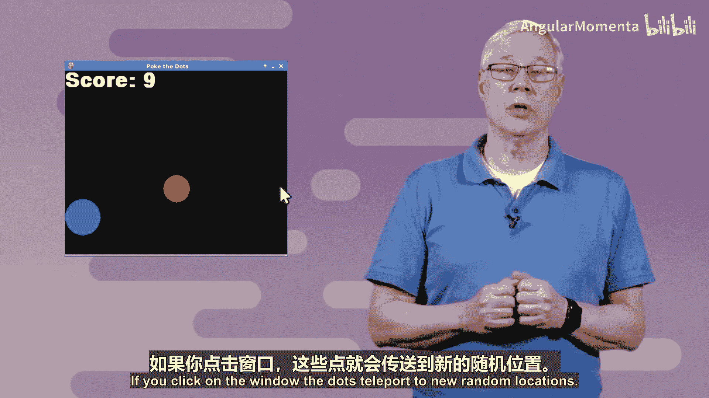
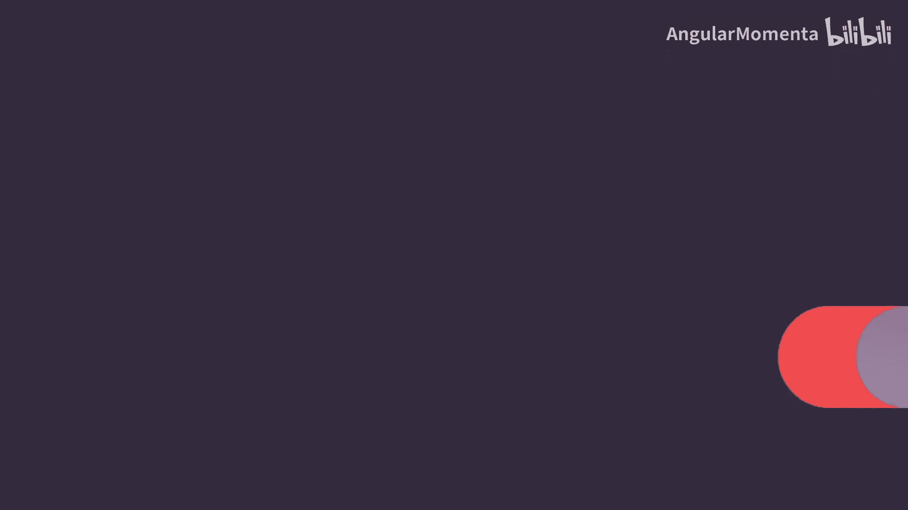
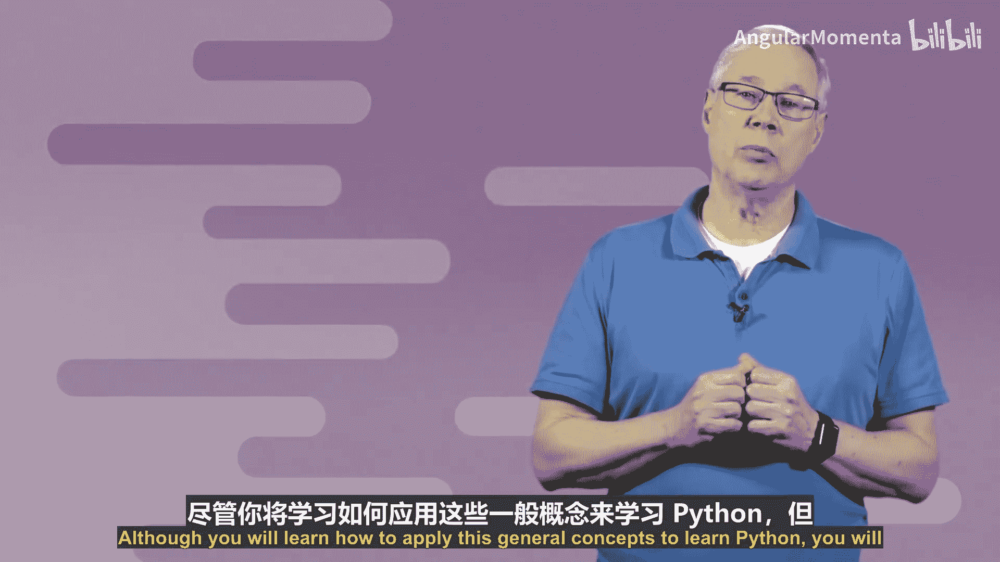
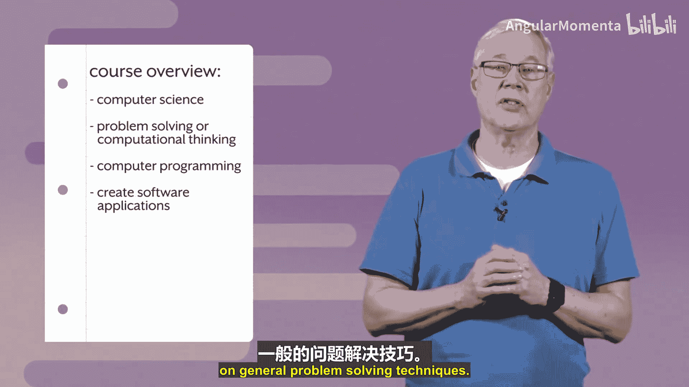

# 【阿尔伯塔大学】问题解决Python编程和电子游戏 ｜ Problem Solving, Python Programming, and Video Games p01 01_02_01_course-themes -BV1N5rLBWE1c_p1-

Welcome to problem solving programming and video games。 Were the instructional team for P V G。

 My name is Dwayne。 I'm a professor of computing science at the University of Alberta。

 I've been teaching introductory programming language courses for most of my life for fun。

 I play video games， watch baseball and enjoy woodworking。😊，My name is Paul。

 I am also a professor of computing science， and after all these years I still get a thrill when a student understands a new programming concept for fun。

 I like movies and taking my kids to air shows。Hi， my name is Elise。

 I'm a computing science graduate from the University of Alberta。

I have previously worked on an application that allows for beginner programmers to more easily interface with Arduino robots and create games I'm excited to introduce you to our course and hope you enjoy programming。

😊，My name is Emma， I have a degree in mathth and Comp science for the past few years I have been part of the instructional team for the Introductory Comput science course at the University of Alberta。

I enjoy mentoring people who are new to programming。

 and I hope this course will make computing science accessible to you。

You will learn four things in this course。How computer science applies computation to information。

How to use computational thinking or problem solving to solve computational problems？

How to program in Python。And how to create video games and more。

Here's a brief look at two video games you will create during this course。

We call the first game hacking。It is based on a miniga that appears in Bethesda Soft Work's popular fallout series。

Here is a video clip of the mini game as it appears in the game， Fall Out New Vegas。

The goal is to select one of the words on the screen as the correct password。

You have up to four guesses。After each guess， there's some feedback。

Here is a video of the hacking game that you will create in this course。

We call the second game pokeke the dots。 The goal is to prevent the dots from colliding。

If you click on the window， the dots teleport to new random locations。

Your score is the time before the dots collide。

In this course， we use the term video game to mean an interactive graphical application that can be played for fun。

Learning to create games is cool， but it is not the real goal of this course。

The process you will use to create a game will also work for most other kinds of software applications。

We picked video games for three reasons。 First， they are interesting and fun。😊，Second。

 even though the games are interesting， they're simple enough that they can be completed during this course。

Third， video games are graphical and interactive。This means that after the course。

 you will be able to create interactive graphical software applications。 For example。

 you could create an application that manages musical playlists or one that demonstrates chemical reactions。

Yeah。To create a video game， you must learn to write a program in some programming language。

 You will learn the Python programming language so you can use it to write the code for your game。😊。

In this course， we will use Python version 3。Here is some of the Python code for pokeke the dots。

Don't worry if you don't understand any of it yet， You will by the end of the course。

Learning to write Python programs is both fun and useful。 However。

 there are many programming languages。 If you focus too narrowly on the Python language。

 you may have difficulty learning other programming languages later。In this course。

 you will learn the general computing science concepts， Les， syntax， semantics， namespaces。

 and control structures。Although you will learn how to apply these general concepts to learn Python。

 you will also be able to use these concepts to learn other programming languages later。

You can't write meaningful code in a programming language until you understand what the code must do。

 Code is one end product or artifact of a problem solving process that begins with an idea。

Transforming an idea into a working solution is a process that is based on problem solving。

For example， if your idea is a new device， the artifact may include a physical object。

 design documents， the software it contains and user manuals。

Different problem solving techniques are used to create each of these artifacts。

When the artifact is a software application， computational problem solving is required。

In this course， you will learn to use computational problem solving。

 which is also called computationalal thinking to turn game ideas into game software。However。

 the same problem solving process can be used to create any kind of software。

 whether it's a game or not。Computer science is a systematic study of different kinds of information and different ways that computation can be applied to this information。

Perhaps the term computing science is more accurate than the term computer science。 For example。

 we call our university department， the Department of Computing Science to more closely reflect the nature of the discipline。

It is a scientific discipline that studies computation and information。

 in addition to computers and computer programming。

The next lesson provides an introduction to computer science。

We use games to make the course more fun， and we use Python。

 since it is a good language that is currently popular。😊，However。

 the computational problem solving process you will learn in this course can be used whether the software is a game or not。

 and whether the programming language is Python。Or some other language。After completing this course。

 you will be able to use the problem solving process and the computer science concept you have learned to transform most software ideas into actual software using most programming languages。

There are other courses that just focus on Python programming。

 or just focus on writing code for games。This course focuses on general computer science concepts and on general problem solving techniques。

Yes， it uses video games and Python。But it does so much more。

