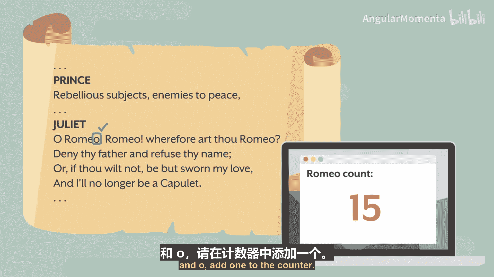
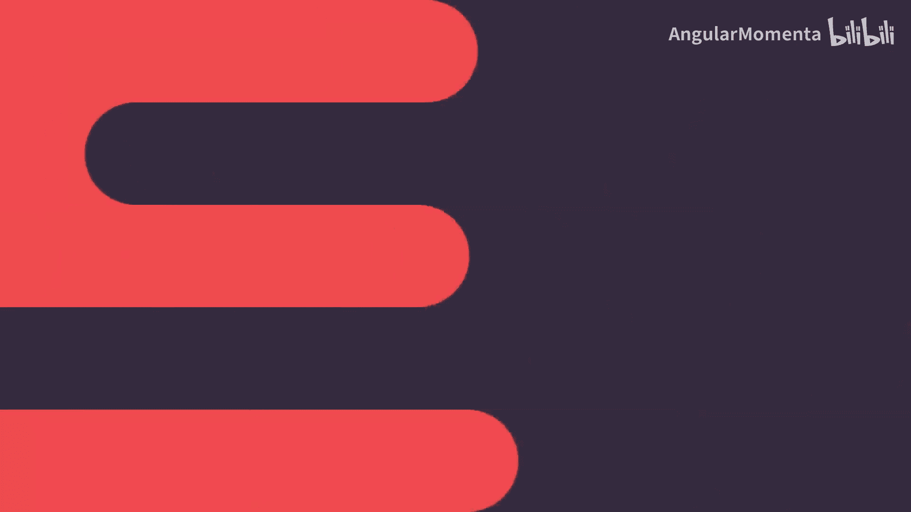
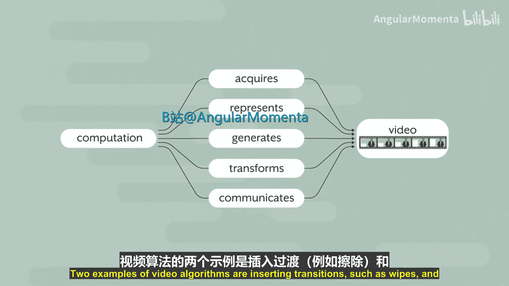
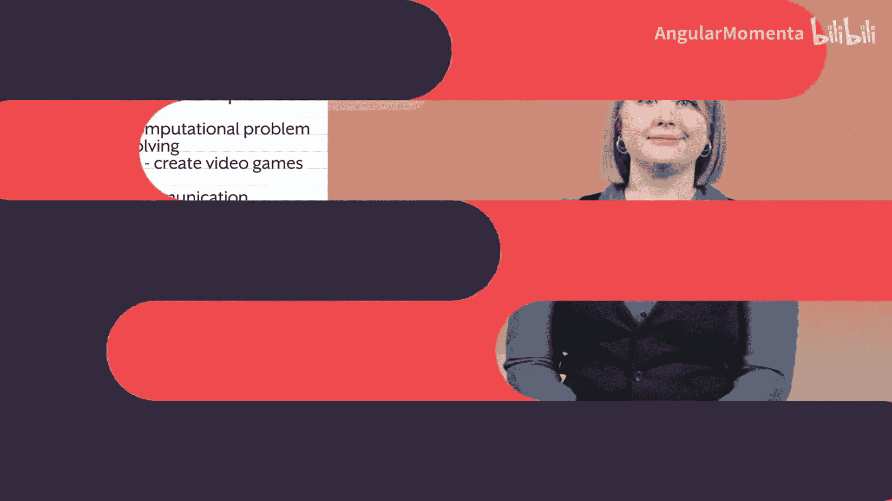
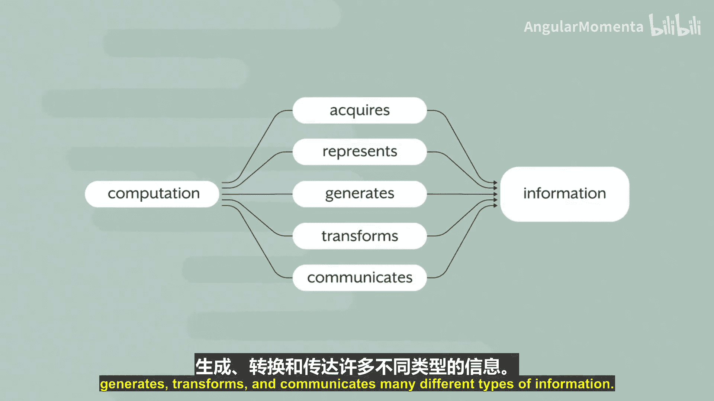

# 【阿尔伯塔大学】问题解决Python编程和电子游戏 ｜ Problem Solving, Python Programming, and Video Games p02 01_03_01_computer-science -BV1N5rLBWE1c_p2-

This video introduces computer science， computation， and information。

Here is a description of computer science。Computer science is the study of computation and information。

 it investigates the computational algorithms that can be applied to acquire， represent， generate。

 transform， and communicate knowledge that solves computational problems。

There are many types of information， a number is one type of information。

 there are many specific numbers such as 4 and 10。5。

Computation using numbers is often called calculation。In other words。

 calculation is a kind of computation that acquires， represents， generates， transforms。

 and communicates numbers。You can use your brain to perform calculations that process numbers by adding or multiplying them alternately。

 you can use a calculator， especially for complex calculations。

But numbers are only one type of information and calculation is only one kind of computation。

You can also apply computation to other types of information。在这个。

A string is another type of information which consists of a finite sequence of characters。

 for example， this four is a string rather than being a number。

You can use your brain to perform a computation on a string。

 such as generating a new string that has the same letters， but with each letter uppercase。

Alternativelynately， you can use a computer to do a computation on a string。

 such as computing the number of characters it contains。

There are many other computations that both you and a computer could perform on strings。 For example。

 both you and a computer could count the total number of times The word Romeo appears in the spoken text of the play。

 Romeo and Juliet。However， it would take you much longer than a computer。

 Comps can perform simple computations much faster than humans and provide the answer 128 in much less than one second。

An algorithm is the sequence of steps used to perform a computation。For example。

 here is an algorithm for counting occurrences of Romeo in Romeo and Juliet。Start counting at  zero。

Scan the text string for the character uppercase R。If the R is followed by the lowercase。

 characters O M， E and O， add1 to the counter。

A computation is a task you want to perform， such as computing the number of occurrences of the word Romeo。

 An algorithm is the way you perform the task， such as the algorithm used in this example。

Text is another type of information。Text is like a string， but in addition to its character content。

 it has other attributes such as font， color and size。 For example。

 this4 is text rather than being a string since it has a specific font color and size that the previous four string did not have。

A computer can process text by transforming attributes such as its font， color， and size。

Let's include two other kinds of information so we can illustrate the broad scope of information and computation。

An image is another kind of information。Instead of being a string or text。

 this4 is an image of the Four of clubs playing card。

A computer can transform an image by changing attributes such as size or resolution。Finally。

 video is the last kind of information I'll introduce for now。

The videos in this course are examples of video information。

 Two examples of video algorithms are inserting transitions such as wipes and adding animations。

Both of these computational processes and many more have been used to create the videos in this course。

You will encounter many different types of information during this course and many different algorithms for each type。

 For example， in your first game hacking， you will create algorithms to generate password strings in the second game。

 poke the dots。 you will create your own dot type and write an algorithm that ends the game when two dots collide。

The algorithm will check whether the distance between the dot centers is less than or equal to the sum of their radii。

You will also implement your algorithms in version 3 of the Python programming language and run these programs on a computer。

How can we use computation？Computation can be used for many purposes。

 but we will focus on one purpose， computational problem solving to create video games。

Some other common uses of computation are communication， information storage and retrieval。

 device monitoring and control， information encryption and decryption and simulation。

You can learn about these other uses of computations in future courses， however。

 this course will provide a solid foundation for understanding these topics。

 specifically types and algorithms are essential components of all of these other uses of computation。

In this video， you have seen that computer science is the study of computation and information。

During this course， you will see that computation acquires， represents， generates， transforms。

 and communicates many different types of information。

