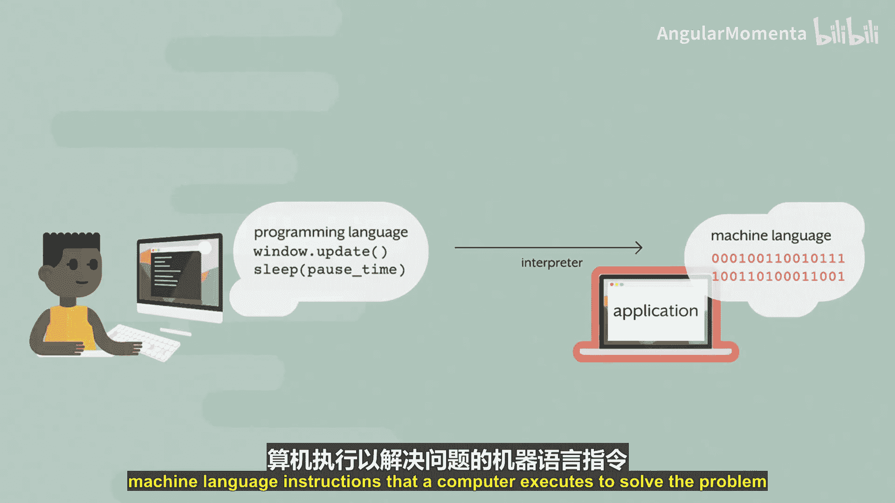

# 【阿尔伯塔大学】问题解决Python编程和电子游戏 ｜ Problem Solving, Python Programming, and Video Games p03 01_04_01_programming-languages -BV1N5rLBWE1c_p3-

🎼，This video introduces the concept of a programming language。

Computation is used for computational problem solving。

 Cating a video game or other application is one kind of computational problem solving。

We want a computer to perform appropriate computations for an application。

How can we get a computer to perform the appropriate computations？

One of the final steps in the application programming process is to write a computer program that a computer uses to perform the computations for the application。

One or more programmers use a programming language to express this computer program。However。

 modern programming languages do not contain machine instructions that can be directly performed by a computer。

Instead， the computer program is a high level representation of the steps the computer must perform。

A translator must translate the computer program into machine language instructions。

 which the computer can then use to perform the computation。For this course。

 you don't need to know anything else about machine language。

There are two kinds of translators， compilers and interpreters。

 This course uses the Python programming language， which is interpreted。

An interpreter translates one statement of a program into machine language by interpreting that line。

These few machine instructions are then executed by the computer to perform part of the computation。

The interpreter and computer then continue this interpret。

 execute cycle until every program statement has been translated。

 and all of the generated machine instructions have been executed。

We can use an analogy to better understand interpretation。

The Oxford Dictionary of English has this definition for interpreter。A person who interprets。

 especially one who translates speech orally or into sign language。

Consider the problem of translating between natural languages， such as English and sign language。

Interpretation occurs in real time since an interpreter translates speech。

 one phrase or sentence at a time as a speaker is speaking。

This kind of translation is sometimes called simultaneous interpretation and is analogous to interpretation of computer languages。

The only part of the translation process you need to understand for this course is that it happens。

 not how it's done。You have seen that a computer program represents a computation that solves a computational problem。

Then an interpreter translates this representation into machine language instructions that a computer executes to solve the problem。

