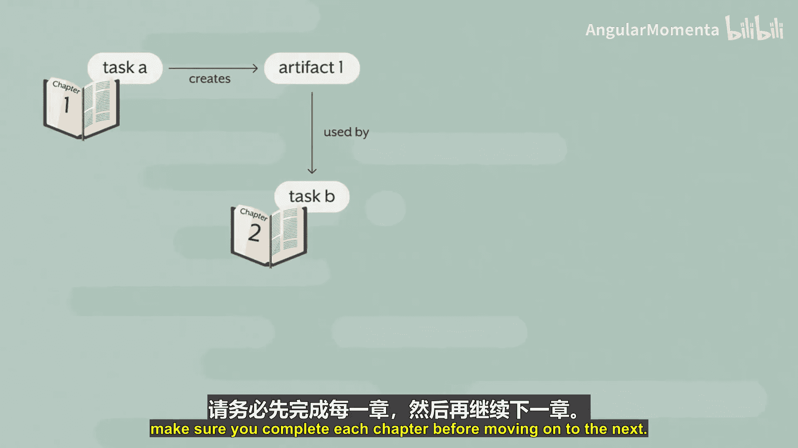
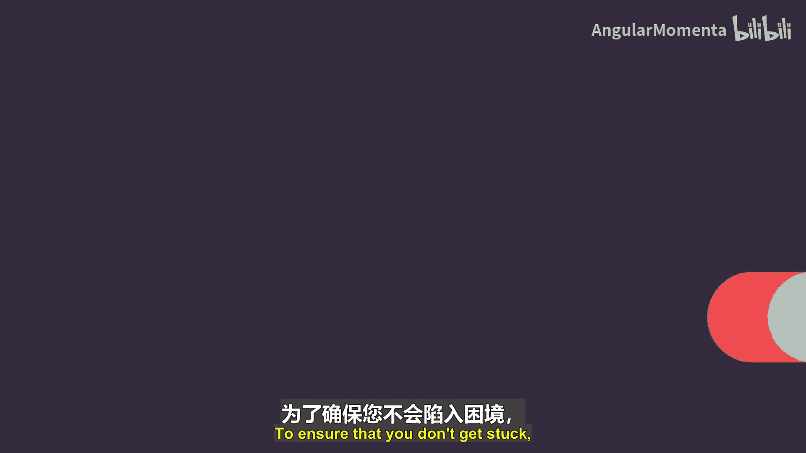
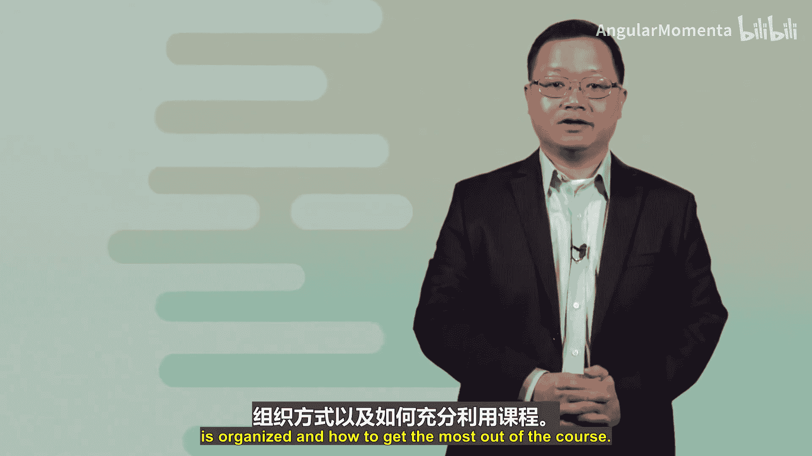

# 【阿尔伯塔大学】问题解决Python编程和电子游戏 ｜ Problem Solving, Python Programming, and Video Games p05 01_06_01_how-to-get-the-most-out-of-this-course -BV1N5rLBWE1c_p5-

In this video， I describe how PVG is organized and how to get the most out of the course。

 This course consists of 12 modules。 The modules contain instructional videos。

 design and coding activities， A activities， readings and enrichment material。

 There are two categories of instructional videos。 One category focuses on problem solving by designing and programming video games。

 The other category referred to as Python programming language videos or Python videos for short provides general instruction on the Python programming language that is independent of computer games。

This course uses problem based learning。 Therefore。

 the Python videos present Python concepts in the order that they are needed to create the video games。

The Python videos present Python using a conceptual framework that can be used to understand any programming language。

 This framework is based on several general programming language concepts that you will learn during the course。

 Les， syntax， semantics， namespaces and control structures。

 You do not need to recognize or understand these concepts。 Now。

 they will be explained in the programming language videos。

These general programming language concepts are complex。

 so youll probably need to watch each programming language video more than once and pause often as you watch。

 you may also want to return to a previous video when you need to use a language construct for the second or third time later in a course。

Other approaches to learning a programming language may be quicker。

 but they rely on mimicking simple examples without full comprehension。

 Many approaches are more narrowly focused on a single programming language。

 or on a few of the simplest aspects of programming languages。

If you embrace the approach used in this course， you will have a deeper understanding of programming languages。

 You will be prepared to learn additional Python language features and other programming languages after you complete the course。

In the real world， creating a game is a team effort。 Good design as a social activity。

 not a solitary one。 At the start of game creation。

 Some team members demonstrate a game to the rest of the team using words， sounds。

 concept art and story boards。 In this course， instead of seeing ideas for a game。

 you will watch a video of the complete game play and play a game yourself。 In other words。

 we have already created a version of the game， and your goal will be to create the same game yourself。

😊，Creating a video game is a complex problem， So a game is often created by first creating a simplified version of the game and then creating a sequence of increasingly more complex versions where the last version is the complete game。

 Each version adds some new features。😊，In the real world， after deciding on the game features。

 some experienced designers on the team break the game into versions。

 either using features or by some other criteria。 We will play the role of the experienced designers on your team by determining which features will be in each game version you create in the real world。

 The team divides each version into components。 and team members work together to create descriptions。

 Test plans， algorithms and code for each game component。😊，In this course， you will work alone。

 except for interactions you have in the course forums。 However。

 to simulate the real world game creation experience of working in a team。

 you will work with three interactive learning objects where I L Os， a description builder。

 a functional test plan builder and an algorithm builder。

These three I L Os mimic real world design by providing an explicit design partner and mentor for each of the three game design activities。

😊，During each task in a game creation process， you create or refine an artifact that is an integral part of the game to get the most out of this course。

 you should follow the game creation process closely and complete each activity in order。

 Each activity uses an artifact from a previous activity。 Therefore。

 you should make an honest effort to create or assemble each target artifact before moving on to the next activity。

😊，This course is like a story， make sure you complete each chapter before moving on to the next。

To ensure that you don't get stuck， a correct copy of the previous activities artifact is used as a starting point for each activity in a game creation process。

 During the design activities， you should take guidance from your I L O partner and mentor。

 but avoid blind guessing to force your partner to reveal the correct answers。 In general。

 guessing is not a good path to comprehension。In this video。

 I described how the course is organized and how to get the most out of the course。

