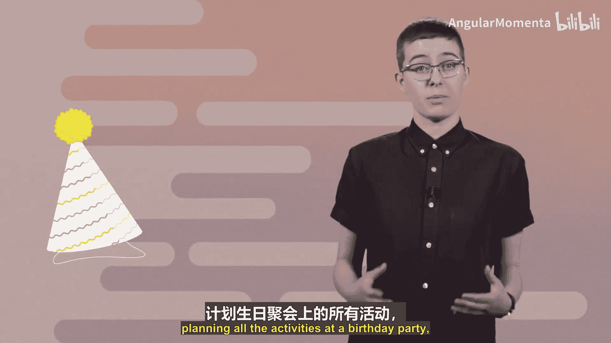
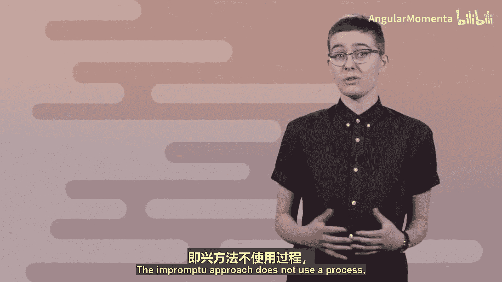
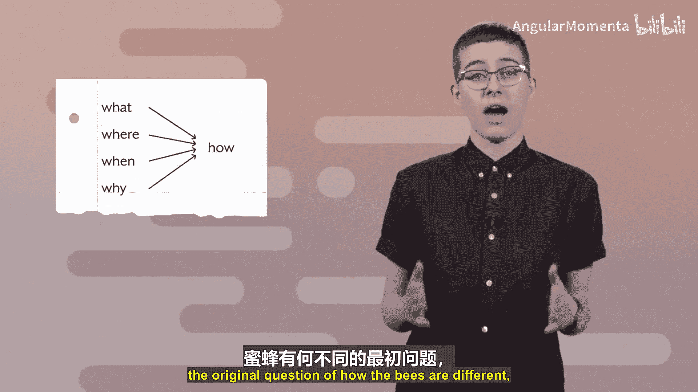
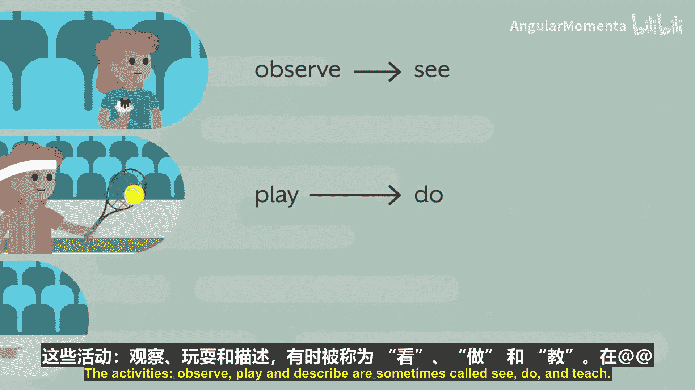
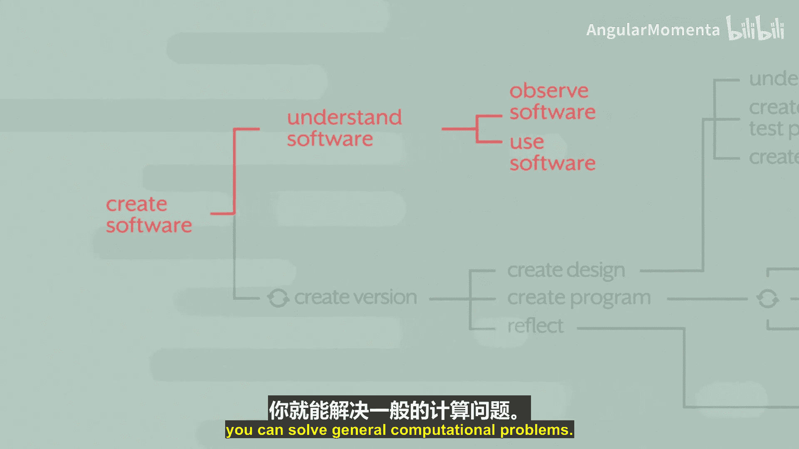

# 【阿尔伯塔大学】问题解决Python编程和电子游戏 ｜ Problem Solving, Python Programming, and Video Games p07 02_01_01_game-creation-process -BV1N5rLBWE1c_p7-

。Welcome to the game creation process In this video。

 I'll introduce some of the computational problem solving techniques you will use to create a game。

Computational problem solving， also called computational thinking。

 uses three kinds of techniques to solve problems， problem decomposition， algorithms。

 and abstraction。I'll introduce the first step of a new algorithm or process you will use to create a game This process is called the game creation process。

You will apply this process and problem decomposition to start creating your first game hacking。

Let's get started with the game creation process。A process or algorithm is a sequence of actions that solves a problem or creates something。

 which we call an artifact。Two examples of processes are planning all the activities at a birthday party and following a recipe to make cookies。

There are many different processes that can be used to solve a problem。For example。

 consider planning a birthday party。 One process is to choose a theme such as a movie。

 a season or a location， and use that theme to suggest costumes， food and activities。😊。

A second process is to ask each guest to wear their favorite costume， bring their favorite food。

 and tell you their favorite activity。Alternate， you can use no process at all。 Instead。

 you can make unplanned decisions during the party about costumes。

 food and activities and hope for the best。😊，Using a process to plan a party takes more initial effort。

 but usually results in a more fulfilling experience。

 The impromptu approach does not use a process and may result in unnecessary repetition or boredom。

Similarly， there are at least two ways to make cookies。

 One is to follow a recipe which has been tested before。 You gather a list of ingredients。

 Add the precise amounts specified and bake at the prescribed temperature for the stated time。

The other approach is to use whatever ingredients you have on hand in whatever amounts seem right。

 and look in the oven every once in a while to decide if they are done。In my experience。

 the first approach is usually more successful than the second。

The first approach uses a process or algorithm， and the second does not。

Here is a more detailed example of a process。 If you are asked to write an essay on the difference between different kinds of bees。

 you could sit down and write the whole thing from start to finish。This rarely works well。 Instead。

 you might use this process。 Think of ideas， outline the essay， Research the topic， Write a draft。

 edit， and repeat。Many processes include the idea of repeating some of the actions in the process several times。

This process decomposes the task of writing an essay into smaller， more manageable subtasks。

 so the task is easier to complete。Breaking a task into subtasks is called problem decomposition。

Problem decomposition is an important part of the game creation process C a commercial game involves many tasks。

 including artwork， music， voice acting， level design， gameplay and computation。

Game creation is so complex and involves so many specialties that a process is absolutely necessary。

The games in this course will not use artwork， music， voice acting or level design。

 so these games are considered computational problems。Even though this simplifies the games。

 they are still too complex to write from start to finish。Therefore。

 you will use a process to create your games。Fortunately。

 you have already seen how you can decompose a complex problem into simple subtasks using problem decomposition。

I've shown you how to use problem decomposition for planning a birthday party， baking cookies。

 and writing an essay。Now let's decompose the create game process。

This is the game creation process diagram。As you can see。

 even though create game is a computational problem， there are still a lot of pieces to this puzzle。

Each piece is a subtask you must complete， I'll introduce each subtask in order。

The first subtask is understand game。You need to understand what game you're trying to make。

 This is true of any problem you are trying to solve。

Understanding means you need to know what happens， where it happens。

 when it happens and why it happens。 This will help you determine how to create the game。

While writing the outline and doing research for the BSA， you needed to understand the problem。

I would ask these questions。 What does each kind of bee look like， Where do they live。

When does each kind of bee exhibit its daily behaviors and why do these bees do what they do？

Gathering this type of information will let you answer the original question of how the bees are different。

 which will allow you to write your essay。

Understand game is a complex task since it requires you to understand the what， where， when。

 and why of a game。Let's apply problem decomposition to divide understand game into two subtasks。

These new subtasks are observe game and play game。Both subtasks will deepen your understanding of the what。

 where， when， and why of hacking。Observe， play and describe are the subtasks in a kind of problem decomposition called experiential decomposition。

Experiential decomposition uses three levels of engagement to understand a problem。

Observe is the passive first level of understanding。

 It provides a broad but superficial knowledge of the problem by watching。

When presented with a new problem， observing lets you create an initial impression about that problem。

For example， observing two people playing tennis allows you to casually learn the actions and rules of the game。

Play is the active second level， where you achieve a deeper personal understanding of a problem by engaging with it。

This step integrates the new knowledge about the problem with your own experiences。 For example。

 playing tennis increases both your knowledge and skills in a way that would not be possible without doing it yourself。

Describe as the interactive third level where you explain the problem to others。

Explaining a problem is a social interaction。 As you explain the problem to different people。

 you gain understanding of the problem in many different contexts。

This provides you with the deepest understanding of the problem。For example。

 coaching tennis allows you to understand the game from a different perspective。

When you teach someone a skill， you must often ask yourself how and why you do something in a particular way。

It can also force you to adapt your knowledge to suit others。For example。

 if you hold the racket in your right hand， you must revise your knowledge to teach a left handed player。

The activities observe， play and describe are sometimes called see， do and teach。

You will observe and play the hacking game in the next two lessons。

 You will not describe the hacking game as part of the understand game process。 Instead。

 you will learn how to describe versions of hacking elsewhere in the game creation process。

The computational techniques you learn using the game creation process can be applied to other computational problems。

If you can create games， you can solve general computational problems。

