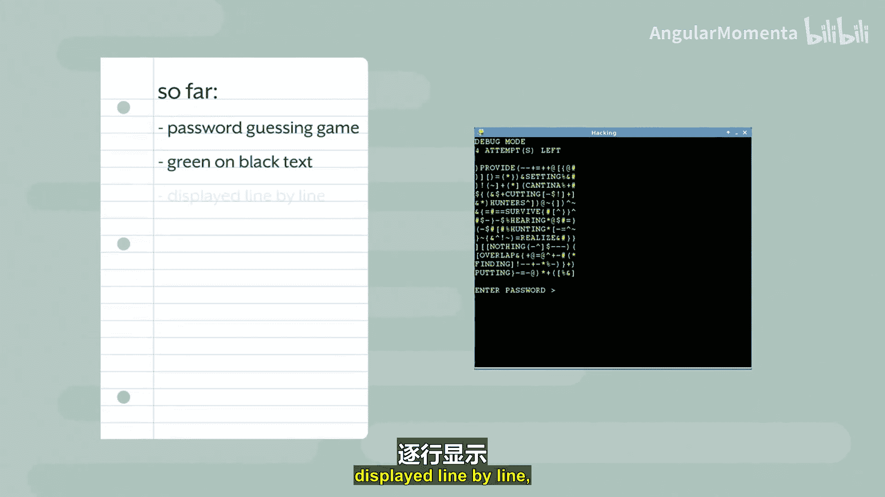
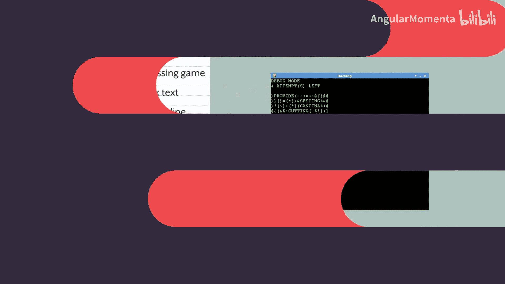
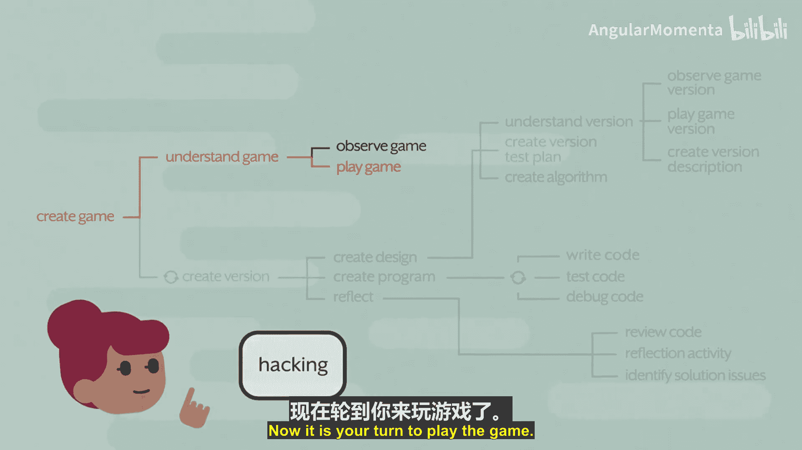

# 【阿尔伯塔大学】问题解决Python编程和电子游戏 ｜ Problem Solving, Python Programming, and Video Games p08 02_02_01_observe-hacking-game -BV1N5rLBWE1c_p8-

In this video you will observe the complete hacking game your goal is to understand the game。

Pay attention to the details， what appears in the window， what does it look like。

 where does it appear， when do the different game objects appear， and when do they change？

Keep these questions in mind as you watch the hacking video。

The game starts， a window opens， itss title is hacking， and it has a black background。

Green lines of text are displayed on the left side of the window。

This simulates a vintage computer terminal。The text indicates that the computer is in debug mode and that there are four attempts left。

 It looks like the debug mode allows players to make four attempts at something。

Beneath this text is a list of words embedded in symbolic characters。Under this list。

 the player is prompted to enter a password。What do you know about the game so far。

You can tell that you will be making a password guessing game played in a window。

 The text will be green on black， displayed line by line。

And the player will have four attempts to guess the password。

Let's see what happens when I enter a password。 I will guess。

 survive since it is a word in the window。On the right side of the window。

 you can see a two line hint。 Sur is incorrect， but two of the seven letters in the guest match letters in the same positions of the secret password。

The number of attempts has decreased by one。I will guess the password pudding。

This guess is also incorrect， but now five of seven letters are in matching positions。

Now I'll try hunting。The window is erased， and four lines of text are displayed in the middle of the window。

 one line at a time。The text displays the password I entered。

 It then indicates that the game is exiting debug mode。

 The login was successful and that the player should press enter to continue。😊，When I press enter。

 the window closes。 You are done observing the game。What did you observe。

 The game asks the player to guess a password。 There are a maximum of four guest attempts。

 The game checks the exact placement of letters in the guess against the secret password and displays a hint。

 If you are successful， the game congratulates you。😊，What else did you see。

 Can you think of a situation that didn't happen in the video but could happen in the game。

 For example， what happens when the player makes too many incorrect guesses？

Now it is your turn to play the game， play several times to gain a deeper understanding of hacking。

