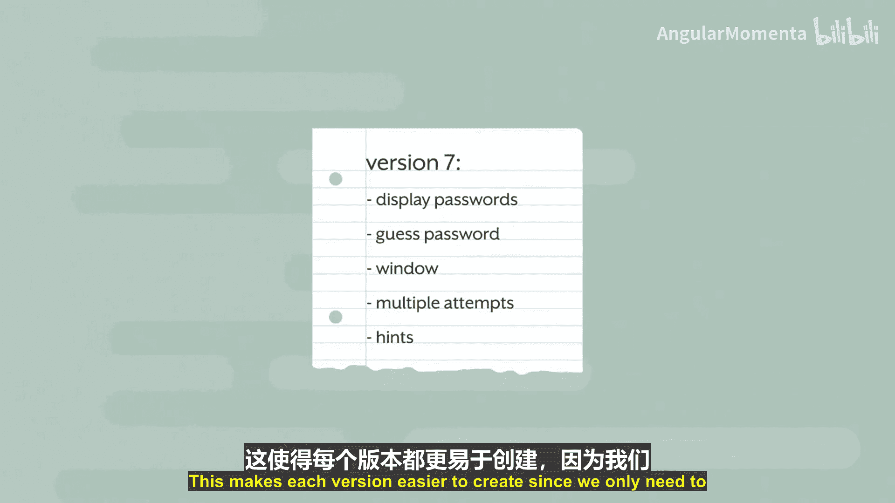
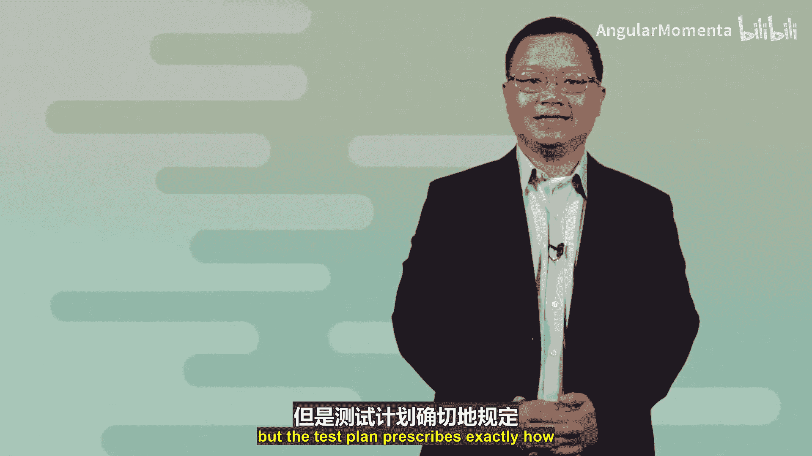
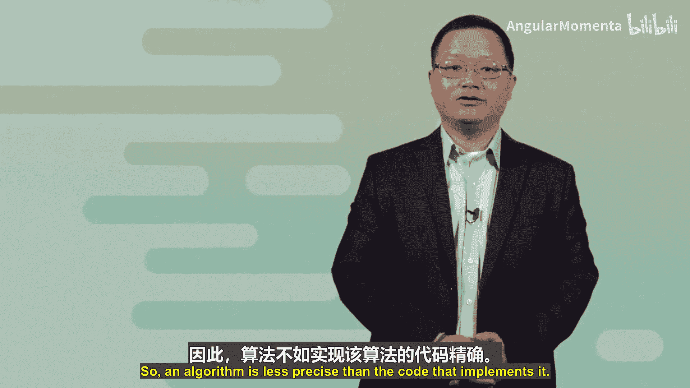
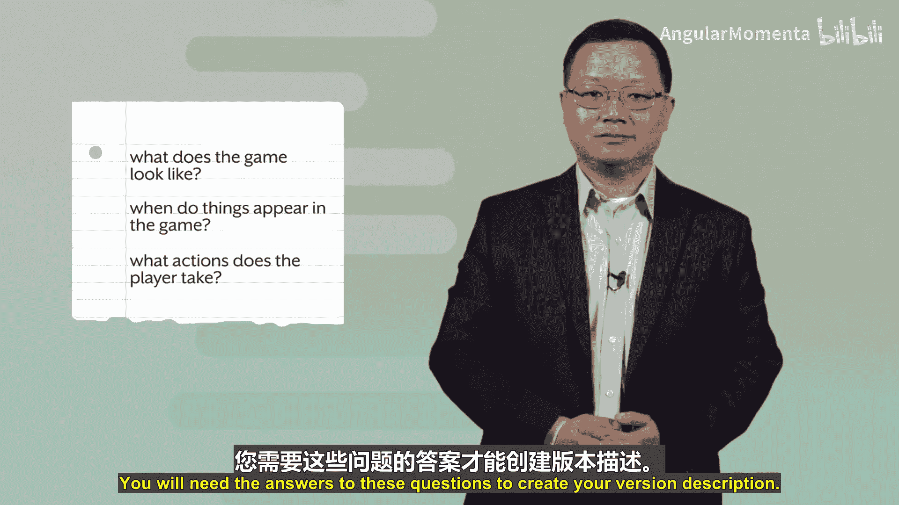

# 【阿尔伯塔大学】问题解决Python编程和电子游戏 ｜ Problem Solving, Python Programming, and Video Games p09 02_03_01_game-versions -BV1N5rLBWE1c_p9-

。You have completed the observed game and play game subtasks of Understand game。

Let's reveal the next task and game creation process。

 Cate version The circular arrow next to create version indicates that you must do this task one or more times。

 We need to divide our game into versions because big problems are hard to solve。

 So we break a big problem into several smaller problems called versions that are easier to solve。

 previously， we use experiential decomposition to decompose understand game into two subtasks Ober game and play game based on the criteria called level of engagement。

 level of engagement is how much interaction a person has with a problem。

 Observing has the least interaction。 playing has more interaction and describing or explaining has the most interaction。

😊，Instead of experiential decomposition， we will use a new kind of problem decomposition called feature selection to break our game into versions。

 The complete hacking game has a set of features that includes displaying passwords。

 guessing a password， using a window， supporting multiple password attempts and providing hints。

 It is easier to create a version of the game that only supports some of the features instead of trying to develop all of the features at once。

 The first version starts of a few features， and each subsequent version adds a few more until the last version has all of the required features。

 This makes each version easier to create since we only need to focus on a few changes at a time。😊。

Feature selection is used when you learn most new skills。 For example， if you learn a new language。

 you don't start by writing an essay or delivering a speech。

 These activities require many linguistic features such as difficult words and complex grammar。

 Instead， you start by learning simple words and short phrases before adding more complicated language features。

Feature selection determines the feature set that each version must implement。

Implementation effort should be balanced across the versions。 Therefore。

 one of the criteria for feature selection is balance feature sets。

 You should select features for each version that require approximately the same amount of effort to implement。

 For example， the window feature alone as about as much effort as both displaying passwords and guessing a password together。

Sometimes it is useful to split a single feature into multiple features to help balance the feature sets。

 For example， using a window involves both opening a window and closing a window。 However。

 the second criteria for feature selection is feature dependency。

 since some features depend on other features。 A window cannot be closed if it has not been opened。

 Unfortunately， it can be difficult to estimate feature effort without experience。Therefore。

 in this course， we will select aversion feature sets for you。

 You will learn to recognize good feature sets as you use them。 After dis course。

 you can use your experience to create your own feature sets for your own projects。

Let's look at Cate version and game creation process。

 Create version is too complex to treat as a single task。 Therefore。

 I will apply a third form of problem decomposition called problem refinement to create appropriate subtasks。

Problem refinement solves a problem by decomposing a complete problem into a sequence of increasingly detailed solutions。

 The criteria for problem refinement is level of detail， also called precision。

The first solution is complete， but has the least detail。 For example。

 drawing a smiley face has a few details， but it is a complete solution for the problem of drawing a face。

The rest of the solutions are increasingly precise。

 The last solution is just as complete as the first solution， but has all of the details。

 For example， details can be added to the smiley face until the final sketch is the most detailed。

Here is another example of problem refinement。 Let's plan a trip from the University of Alberta。

 U of A to the University of British Columbia， UBC。

 I can write detailed directions to start at the U of A and end at UBC。

 This would be like writing a program one line at a time from start to finish。

 There are over 10 detailed instructions just to get from the U of A to the Edmonton Airport。However。

 after creating these detailed directions， I may decide to take the trains instead are flying。

 All the details or instructions are now useless。 I have wasted time by focusing on details too soon。

Instead， I would use problem refinement to create an imprecise but complete plan。 First。

 drive from the U of A to the Emmonton Airport， then fly from the Edmonton Airport to the Vancouver airportport and then drive from the Vancouver Air to the UBC campus。

 We can then test this plan by researching costs and time before committing to it。

 If we want to try different plan such as taking the train from Emmonton to Vancouver。

 it is easier to make changes to this short plan than to change a long list of detailed directions。

 After researching to costs and time required， I can refine a plan by using it to create more precise directions by air or by train。

Similarly， it is unwise to write code before you know the general form of your solution。

 You should plan your solution before you write the details as code in software。

 development plans are called designs。 Therefore， I will divide， create version into three tasks。

 create design， create program and reflect。 Each task creates a problem solution that is more precise than the previous one。

Create design produces an imprecise solution， which is an outline for one version of hacking。

Create program converts this imprecise outline into a precise program for that version of hacking。

The reflect task assesses your knowledge of the programming language techniques you applied。

 evaluates your solution and identifies improvements for the next version。

 Ref is refinement since reflecting， refines your understanding of your solution。

 Your knowledge and your skills to the highest level of detail required for this version。

 In addition， reflection is similar to the explain or describe component of experiential decomposition。

 Since your reflection is like explaining these ideas to yourself。

 This highest level of engagement leads to the most detailed understanding for this version。

This is the last refinement， since after reflecting， you will have the most precise design。

 code and understanding of your solution。Let's return to create design。

 How should we accomplish this task， What about trying something new。

 We could decompose it into subt。 I know that's not really new， but it works。

 Our goal is to keep subdividing our tasks until the final sub tasks are so easy to solve that the solution is obvious。

 Let's use problem refinement to create three subt。 Understand version。

 create version test plan and create algorithm。Understand version probably looks familiar to you since you have already seen the understand game task。

 In fact， if we expand the understand version task。

Observe game corresponds to observe game version and play game corresponds to play game version。

Remember that experiential decomposition has three components， observe， play。

 and describe or explain。Create version description corresponds to describe。

It is a new task that produces a written description of the game version。

This description is an artifact。 that explains what the game does。

 including its features and player actions。 The description is imprecise because it provides the goals of our implementation。

 but not the details of the implementation itself。The next task in C design is create version test plan。

 This task creates a test plan that checks if the feature set is implemented correctly。

 This artifact is more precise than the game description because it more explicitly considers multiple game play scenarios。

 The description describes all possible outcomes， but the test prescribe which sequence of player actions result in which game outcomes。

 For example， the description indicates that a success or failure outcome may be displayed。

 but the test plan prescribes exactly how the game must be played to experience each outcome。

You really。

The create algorithm task produces the most precise artifact of the design。

 An algorithm is a sequence of steps that prescribe how the code should be written。

 It is more precise than a test since the algorithm is closer to the code。

 Each step corresponds to a few lines of code。 However。

 an algorithm should be independent of any specific programming language。

 So an algorithm is less precise than the code that implements it。

Now that all of the tasks in C design have been introduced。

 it's time for you to return to the game creation process。To start， understand version。

 watch a gameplay video for the first version of hacking。

 Ask yourself the same questions you ask when you watch the fullux game。

 What does the game look like， When do things appear in the game and what actions does the player take。

 You will need the answers to these questions to create your version description。

