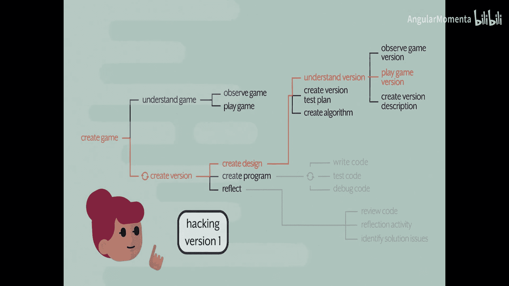

# 【阿尔伯塔大学】问题解决Python编程和电子游戏 ｜ Problem Solving, Python Programming, and Video Games p10 02_04_01_observe-hacking-version-1 -BV1N5rLBWE1c_p10-

。In this video， you will observe gameplay for the first version of hacking。

 Remember to ask yourself questions like。 What does the game look like。

 When do things appear in the game， What actions does the player take When the program starts。

 text is displayed using a default operating system font。 Each line is below the previous line。

 This is different from the final version of hacking in the previous video you saw that the complete final version has green on black text that appears in various locations of a game window with its own title。

The header indicates that only one attempt is allowed instead of four。

 The passwords are also printed without any symbolic characters。

The player is still prompted to enter a password， I'm going to enter hunting。

Which we already know is the correct answer for the complete hacking game。

A message is printed below my guess。 It indicates that my guess is incorrect。

 even though I entered the correct answer。I'll press Enter to end the game。

That's all for observing hacking version 1。Now， it's your turn to play hacking version 1。

 You can play it as many times as you like to gain a deeper understanding of this version of the game。

