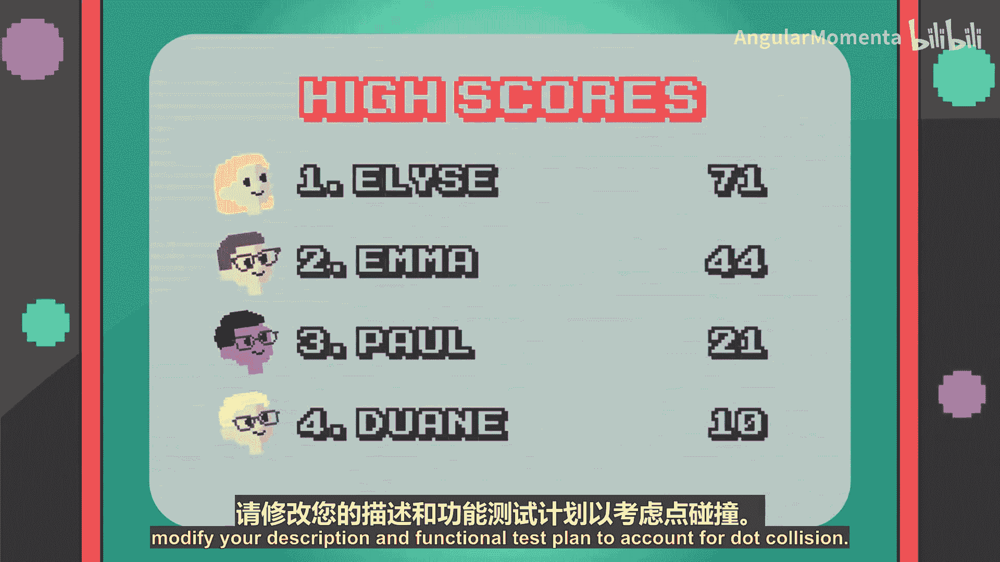

# 【阿尔伯塔大学】问题解决Python编程和电子游戏 ｜ Problem Solving, Python Programming, and Video Games p100 12_02_01_observe-poke-the-dots-version-5 -BV1N5rLBWE1c_p100-

Let's observe the final version of Pokta dots。I'll start the game。

Nothing seems different from the previous version。 The dots are red and blue。

 They move at the same speed as version 4， and they bounce when they hit the edge of the window。

The scoreboard is still white and tallies a number of seconds since the game was started。

I'll press the mouse button a few times， and the dots still teleport to random locations around the window。

When the dots collide， something new happens。 the dots immediately stop and a game over a message appears in a corner of the screen。

Notice that the text has the color of the small dot， and the background has the color of the big dot。

Finally， we have some challenge in the gameplay for Po to dots。I'll click the Close icon。

 which still closes the window。When you play the game， what is the highest score you can get。

 Our highest scores were 71，44，21 and 10。For your next activities。

 modify your description and functional test plan to account for dot collision。

