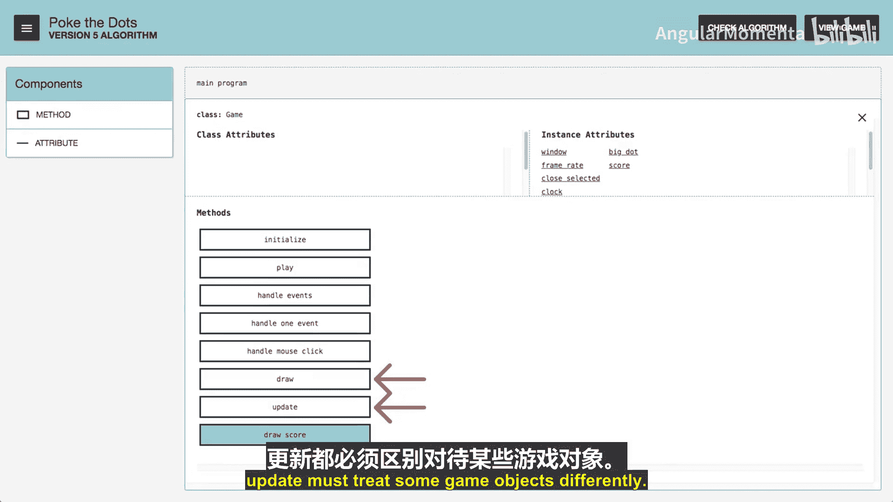

# 【阿尔伯塔大学】问题解决Python编程和电子游戏 ｜ Problem Solving, Python Programming, and Video Games p101 12_03_01_create-algorithm-for-poke-the-dots-version-5 -BV1N5rLBWE1c_p101-

In the final Poke algorithm， you must add steps for the only remaining game feature。Dot collision。

 You must check for dot collision， every frame。Dot collisionition is not the result of a player event；

 it is the result of moving game objects。Add a new attribute to the game class to keep track of whether the game should continue after the dots collide。

Use this attribute to select the appropriate actions when drawing and updating the game。For example。

 when the game is over， both draw and update must treat some game objects differently。

