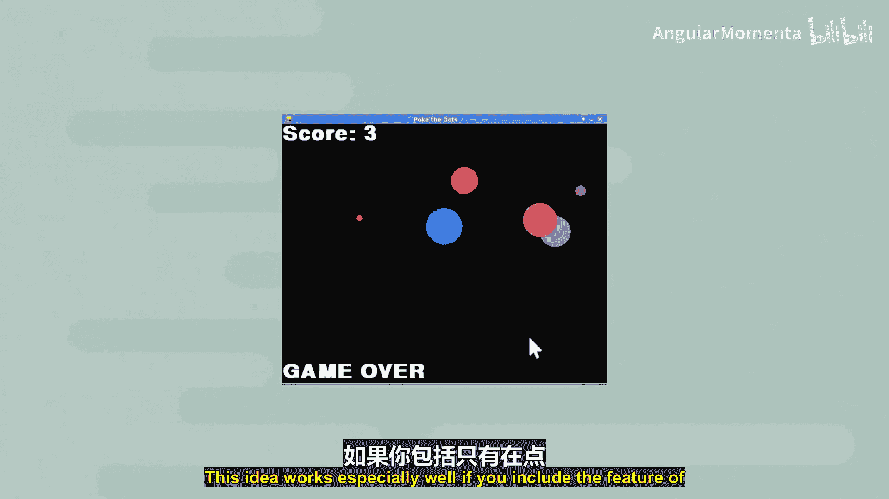
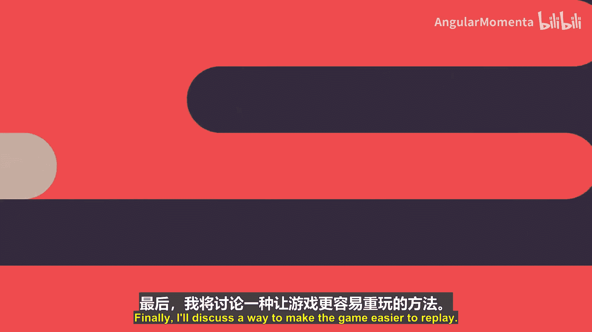
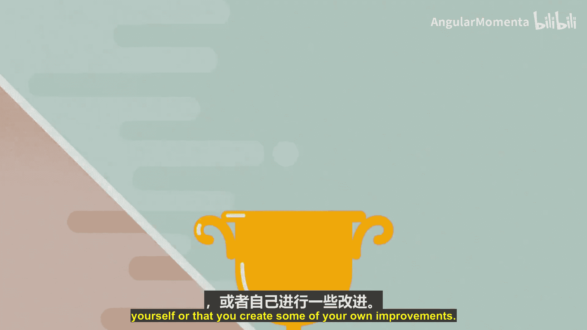

# 【阿尔伯塔大学】问题解决Python编程和电子游戏 ｜ Problem Solving, Python Programming, and Video Games p103 12_05_01_solution-issues-in-poke-the-dots-version-5 -BV1N5rLBWE1c_p103-

🎼。Welcome to the final reflection for Poke the Dots。

I won't be performing a trace on the pokeke the dots version 5 solution。

 since there are no new language features to trace。 Also。

 there are no new software quality tests for this version。Instead。

 since this is the last version of pokeke the dots。

 we only have one more task in the game creation process diagram to finish。

Let's explore some of the potential solution issues that could be solved to improve pokeke the dots。

You can still improve your game even though there aren't any further formal course requirements。

Let's investigate some of the improvements that can be made to poke the dots。

Pooke the dots is not a visually interesting game， one small modification would be making an addition to the mouse up event handler。

Every time you click the mouse button， you could randomly change the colors of the dots。

Poke the dots can be kind of boring since it isn't very challenging。

 You could make the game more interesting by making it more challenging。

 Here are three ways to increase the difficulty to hopefully， increase enjoyment。

Every time you press the mouse button you could increase the speed of the dots。

 this would force the player to be very careful about when they press the mouse button。

 as pressing too often will make the dots very fast。This game is called pokeke the dots。

 and yet you can click anywhere in the window to teleport the dots。

 a more accurate and challenging rendition of the game could be created by modifying your mouse up event handler to only teleport if the mouse cursor is inside a dot when clicked。

Another way to increase the difficulty of poke the dots is to add a new dot whenever the mouse cursor is clicked outside of the dot。

This idea works especially well if you include the feature of only teleporting the dots when the mouse is clicked inside the dot。

Instead of doing nothing if the player clicks outside of the dot。

 you could add a punishment that every misstimed click adds a new dot with a random color and size to the screen。

You might want to make the window a bit larger if you try this improvement。

Finally， I'll discuss a way to make the game easier to replay。Currently。

 you must close the window and then restart the game。Alnate。

 you can add an additional event handler that checks if the game is over and a replay key is pressed。

 If so， the game can be restarted by setting continue game to true。😊，However。

 you must figure out a way to reset the score to zero each time you do a restart。

These are only a few of the many improvements that could be made to pokeke the dots。

 I hope that you try to implement some of these improvements yourself or that you create some of your own improvements。

Congratulations， you've completed pokeke the dots。

The course is complete， we hope that you enjoyed it and that you have learned how computer science can be used to apply computation to many different forms of information。

Computer science is more than just Python programming and computer games。

Computer science relies on precise concepts and notation。

 such as the lexical syntax and semantic rules and diagrams used in this course。

Computer science also uses many processes， such as the game creation process that supports iterative software design and development。

There's much more to programming than just writing code。

You can use the problem solving skills you have gained in this course to solve many computational problems in the future。

 both in video games and other problem domains。We know that the game creation process you used in this course will directly apply to any computational domain。

We hope you will enjoy writing Python programs， but we also know that you will be able to learn other programming languages quickly by just applying the rules of these new languages。

We wish you all the best in your future studies， and we hope these studies will include more computer science。

