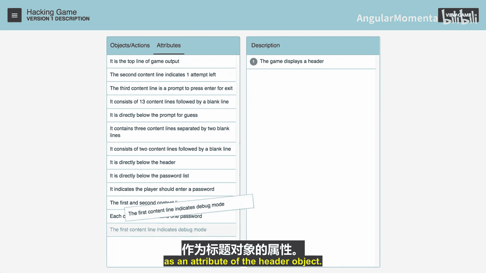
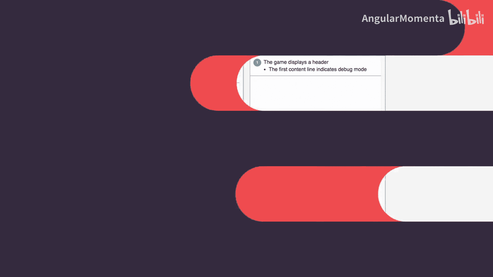
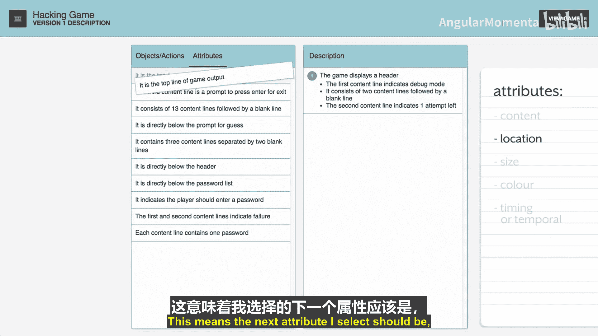
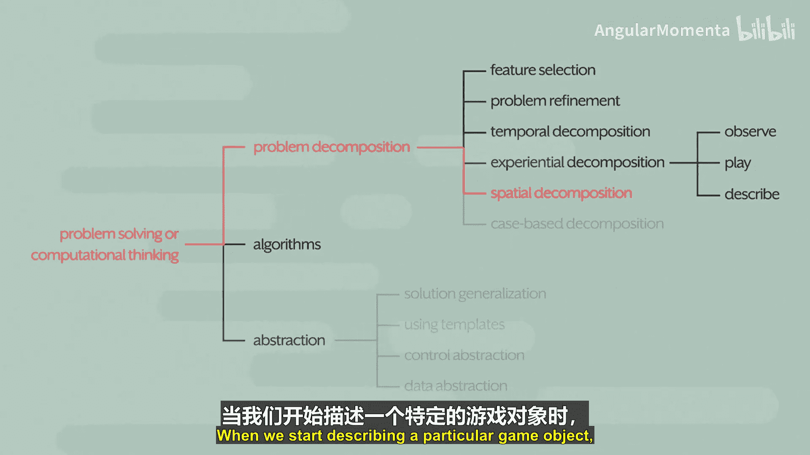

# 【阿尔伯塔大学】问题解决Python编程和电子游戏 ｜ Problem Solving, Python Programming, and Video Games p11 02_05_01_describe-hacking-version-1 -BV1N5rLBWE1c_p11-

。Now that you have observed and played hacking version1。

 you are ready to move on to the next task of describing the game。

Create version description is the last subtask of Under version。

A description of a game is an explanation of what happens as the game is played。

The description includes aspects such as what the game looks like， how it changes。

 and how it responds to player actions。Essentially。

 a description prescribes the features that must be included in the game and how these features interact。

Reading your game description should give the reader a complete idea of how to play the game。

The description does not tell you anything about how the game is implemented。

 but it does describe everything that happens as the game is played and all the possible outcomes of the game。

开始。Let's create a description for hacking version  one using the description builder。

The description builder is a tool that mimics a collaborative team environment。

In a real team environment， each member observes the game and suggests descriptive attributes。

Other team members provide feedback and guidance， and together the team creates a complete description of the game。

The description builder provides phrases that describe all aspects of the current version。

Your task is to assemble these phrases into a comprehensive description that accurately describes the version。

To guide you， the description builder also provides valuable feedback that simulates a teammate or mentor。

Let's take a look at the description builder。The title of the current activity is in the top left corner of the window。

 The title is Haing version 1 description。Beside the title is the menu button。

 there are several menu options you can save your description， open a save description。

 or download a PDF of your current description。You can reset the exercise to start over。

The reset option permanently deletes whatever you have added using the builder and cannot be undone。

You can also view a small tutorial of how to use a description builder at any time。

If you click the button in the top right corner， you can observe a gameplay video for the current version of the game。

The builder contains two main panels。 The left panel has two tabs。

 and each tab contains description phrases。 One tab is labeled objects and actions。

 The other tab is labeled attributes。These phrases describe three kinds of game concepts；

 the concepts are objects that are displayed such as a header or message。

Actions by the player or game， such as entering a guest or clearing the window。Attributes of objects。

 such as the location of an object。To create an accurate description。

 you must describe all the objects， actions， and attributes of the game by adding the relevant descriptions to the right panel。

You can add objects and actions to the right panel in any order as long as you position the concepts correctly relative to what you have already added。

You must place a new object or action below everything that occurs before it in the game and above everything that occurs later in the game。

For example， since the password list is displayed before the player enters a guess。

 the description of the password list must be above the description of entering the password。

As you add objects， actions and attributes to your description。

 you will get feedback from the builder if you make a mistake。

 these feedback messages will appear in the bottom right corner。

I will add the first few phrases to the hacking version 1 description。

 I will also show you the different kinds of feedback you may encounter。

 You will finish adding the rest of the phrases， after watching this video。

When I start a new description， I ask myself what happens first？In hacking version 1。

 the text debug mode is displayed。In the objects and Act tab。

 there is no phrase that describes the debug mode line of text。 I'll switch to the attributes tab。

 which contains the phrase。 The first content line indicates debug mode。That seems appropriate。

 I'll try adding it to the description。It doesn't work， and the attribute returns to the left panel。

Feedback appears in the bottom right corner of the builder that says an attribute must belong to an object or action。

This is the first kind of feedback and it describes the relationship between attributes and objects。

An attribute cannot exist without an object， so it cannot be placed in the description without the object or action it describes。

I need a phrase that indicates an object is displayed before I can use the debug mode attribute。

There are six phrases in the Object Act tab that I can use。 Four of them are objects。

 a password list， a header， a failure outcome， and a prompts for a guess。Two objects are messages。

 which are one or more lines of text that are displayed for a single purpose without player actions。

Two are prompts， which are one or more lines of text that wait for the player to enter some text and press the enter key。

Two of these six phrases are actions， the player presses the enter key to end the program。

 and the player enters a guess and presses the enter key。

The debug mode attribute is part of the first two lines of text When hacking is started。

 We'll call these lines the header。Therefore， I'll select the game displays a header and add it to the description。

Since it stays in the right panel， it must be in the right place。

 Now I can try the first content line indicates debug mode as an attribute of the header object。

Yes， it is an attribute。

Yeah。I'm not done describing the header because every display object has five attributes。

These attributes are content， location， size， color and timing or temporal。

The content of the header is its subject。 The content is partially described by the object itself。

 but attributes are used to further describe the subject。

The header consists of two content lines and a blank line。

 so I will add it consists of two content lines followed by a blank line to the description。

I have already added the debug content line as an attribute。To complete the content。

 I must find an attribute that describes the attempts left content line and add it to the header object。

The location of the header is the top output line。 This means the next attribute I select should be。

 it is the top line of game output。

Since this version does not use its own window， all objects are textual。

 we will use the default operating system， text size and color。

 so we won't specify these attributes for each object。

The timing or temporal attribute of an object describes when it is displayed， altered orsed。

 All objects in this version of hacking are displayed in the order that we describe them from top to bottom。

 and none are erased。 Since this version is textual。

 the spatial order also defines the temporal order。In this version。

 the term below means both below in the spatial sense and after in the temporal sense。

In future versions and games， we will include explicit temporal attributes for some objects。Great。

 the header is finished。The passwords are displayed next in the game。

 so the next object I'll add to the description is the game displays a password list。

There are several places I can add this object。 It belongs below the header since it is displayed after the header。

But let's see what happens if I add it above the header。

The feedback I get is this concept should be placed higher or lower in the description。

This is the second kind of feedback which describes the position of concepts in the description。

When adding a new object or action to the panel， it must be correctly positioned higher or lower than the objects and actions already in the panel。

 based on their temporal order in the game。This feedback is expected in this case。

 the password list should be lower since the game displays the password list after the header。

In this version， the temporal order matches the spatial order。

 But when the temporal and spatial orders don't match。

 the description order must follow the temporal order。 For example。

 if an object is added above the password list in the window but is displayed later than the password list。

 it must be below the password list in the description。

Let's see what happens if I try to make the password list an attribute of the header。

The description builder won't let me add it to the header。

The password list is not an attribute of any other display object because it is a display object。

Let's put the password list where it belongs below the header。It worked。

Let's add the password list attributes attributetris can be added in any order。

The first attribute kind is content， which is the subject of the password list text。 The attribute。

 it consists of 13 content lines followed by a blank line， belongs to the password list。

 There is a second content attribute for the password list， but I will leave it for you。

The second attribute kind is location， so I will add it is directly below the header to this object。

To show you the third kind of feedback， I'll try to add the attribute。

 it indicates the player should enter a password to the password list。This is incorrect。

 so the builder displays the new feedback， which is this attribute does not belong to this concept。

The enter password attribute is not really an attribute of the password list；

 it is an attribute of the password prompt。I'll leave the rest of the description to you。

 including the other password list attribute。The description builder uses two new kinds of problem decomposition。

 temporal decomposition， and spatial decomposition。

They allow us to decompose the C description task into object action and attribute descriptions。

Temporal decomposition divides a task into subtasks based on the order that they must be performed。

We actually use temporal decomposition in our trip planning example。

 since each direction must follow the appropriate previous direction in time。

You cannot fly to Vancouver before you drive to the airport。

Temporal decomposition is applied to creating a version description by describing the objects's actions and attributes in the order that they occur in the game。

Spatial decomposition divides a task into subtasks based on their spatial location。

All of the details that affect a single object are grouped together。

When we start describing a particular game object， we describe all of its attributes together。

Now it's your turn， add the other attribute to the password list and finish the rest of the version description yourself。

If you change your mind about adding an object or action to the description。

 you can simply drag it back to the objectss and Actions panel。

If duplicate phrases appear in the description builder， they must be used multiple times。

Your completed description must list all objects and actions in the order they will occur in the game。

 You must add all the appropriate attributes to each object， but you can add them in any order。

