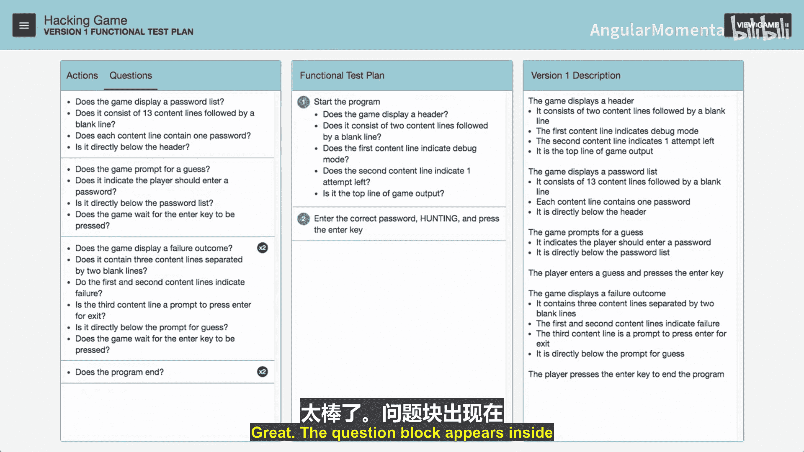
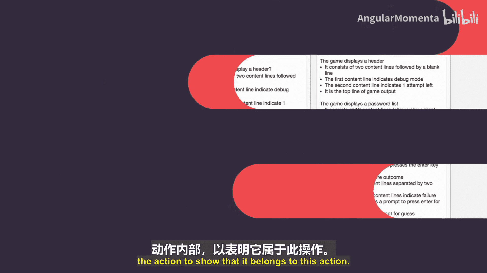
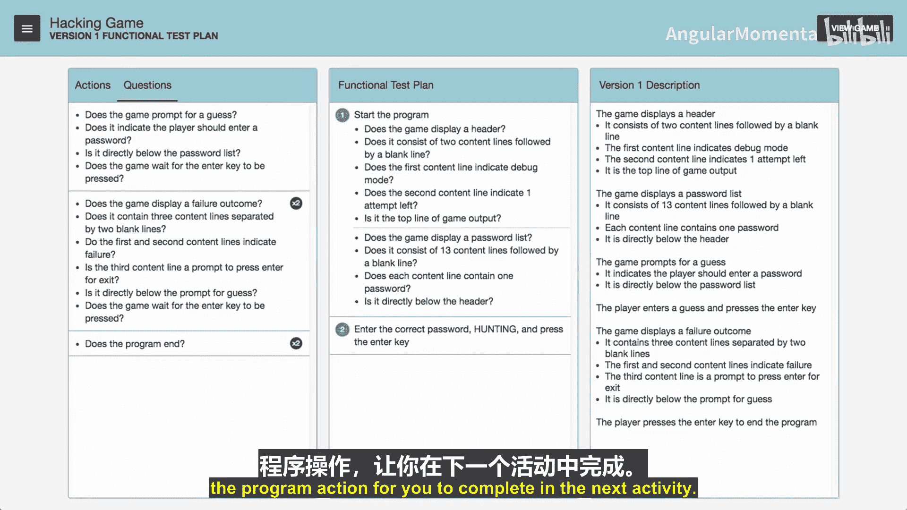
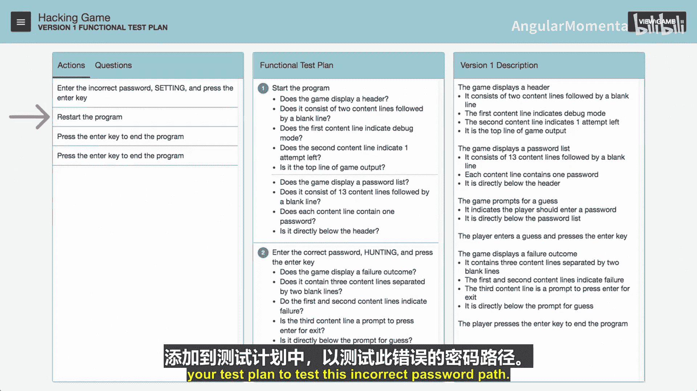
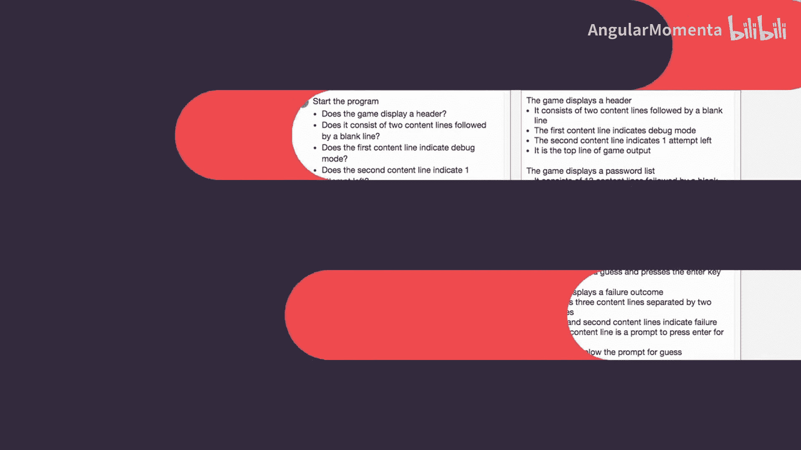
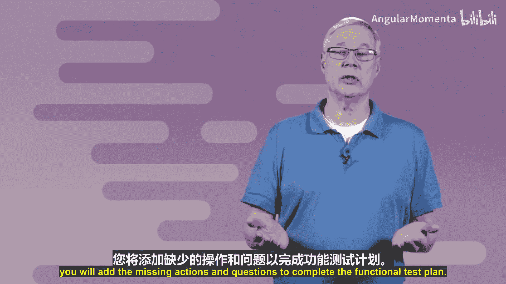

# 【阿尔伯塔大学】问题解决Python编程和电子游戏 ｜ Problem Solving, Python Programming, and Video Games p12 02_06_01_create-test-plan-for-hacking-version-1 -BV1N5rLBWE1c_p12-

。Now that you've completed the hacking version 1 description。

 let's revisit the game creation process diagram。You just finished the Under version subtask of Cre design。

 so let's work on the next subtask which is createate version Test plan。

A test plan is a group of tests that are performed on a program to make sure that it performs as expected。

To start， our test plans will only contain functional tests。

We will introduce non functional tests later。Each functional test consists of an action。

And a group of questions。The tester manually performs the action and uses the group of questions to evaluate whether the game responds to that action。

 as described in the game description。Each test is phrased as a yes or no question。

All answers must be yes for the program to be completely correct。

We test our games to ensure that the game we create matches the game we are supposed to create。

We create the test before we create our program to provide an extra level of precision between the description and the code。

Creating tests before you program forces you to plan the behavior of your game before you code。

In industry， creating your tests before writing code is often called test driven development or TDD。

However， TDD often uses a testing program that tests an application automatically。

 rather than using manual Tester actions。Problem refinement prescribes that we slowly increase levels of precision as a useful way to simplify problems。

Tests allow us to introduce logic into our design by explicitly describing the potential actions that the player can take。

And how the game should respond to each action before we need to code this logic。

The tests also indicate what can go wrong。It is useful to know this information before we start writing code so that the code can handle these potential error situations。

Each version will modify the previous version's test plan。By the final version。

 your test plan will test all of the features and most of the logic of a game。

As the complexity of a game increases， complete testing of all combinations of all possible player actions becomes impractical。

For example， consider a video game with eight quests that the player can complete in any order。

This results in eight factorial or more than 40，000 different game paths。

Testing for each of these Quet completion orders is impractical。

A test plan allows anyone to quickly find errors or missing features in a game。

No specialized knowledge of the program is necessary。In fact， in commercial games。

 the quality assurance team that does the testing is usually different than the programming team。

Since our games are not complex， you will be able to make tests for all representative game paths。

Okay。This is the functional test plan builder。 You will use it to make the test plan for hacking version 1。

The activity title Haing Ver 1 functionalal Test plan is in the top left corner of the builder。

Like the description builder， you can press the button on the right to view a gameplay video。

If you want to save， load， or restart your exercise， you can use the menu button on the left。

There are three panels。 The left panel contains two tabs， labeled actions and questions。

When you select the actions tab， you can see the actions a tester can take to test the game。

When you select the Ques tab， this panel contains questions that a tester can use to evaluate whether the game responds correctly to the actions。

You will create your functional test plan by adding actions and questions to the middle panel。

The right panel contains a description for the current version。I will begin with an action。

The functional tests must be listed in the order that the action should be performed by the tester。

These actions must form one or more complete game paths from beginning to end。

Positioning actions in test plans is like positioning objects and actions in a description。

As you work， you can add any action to your test plan at any time。However。

 you must place every action below all positioned actions that must be tested before it and above all positioned actions that must be tested after it。

The first action that any tester must take is to start the game。

Let's see if I can find an action that matches that sentiment。

I will add start the program to the test plan。From the version description。

 you can tell that the first three objects appear as soon as the player or tester starts the game。

I will add some questions to test the start the program action later。

 but first I'll add another action。The first tester action after starting the game should be entering a password。

In the Actions panel， there are two sentences related to entering a password。

Enter the correct password hunting and press the enter key。

And enter the incorrect password setting and press the enter key。I could use either one。

 but I will add the correct password action to the test plan。

If I add this action above start the program， it returns this action to the action list。

 and feedback tells me that I must place the actions in a different order。

This is the first kind of feedback for the functional test plan builder。

 Act must be placed in a temporal order that creates a valid test plan。

 You can't test a correct password before the program even starts。

I will place the correct password action below start the program。 that's better， it stays in place。

Let's look at the questions to view the questions， select the questionss tab。

All the questions in the Que tab are about the objects described in the version description。

Questions related to a specific object are organized into a group， which we call a question block。

 You will select these question blocks， rather than individual questions。

This is an example of spatial decomposition since all properties of a single object are tested together。

The format of our functional tests requires that every question block belongs to the action that the questions are testing。

There is a block of questions that starts with，Does the game display a header？

This block also tests each attribute of the header。

I will add the header question block to the start the program action since it tests the results of this action。

Great， the question block appears inside the action to show that it belongs to this action。

To show you the second kind of feedback for the test plan builder。

 I will try to add a question block outside in action。 I will add。

 does the program end to the end of the test plan。As expected。

 the question block returns to the left panel， and you see the second kind of feedback for this activity。

Just like the attribute feedback in the description builder。

 this kind of feedback informs us that a question block must belong to an action。Yeah。

Let's look at the version description again。 The next feature that needs to be tested is the password list。

 So I will add the question block that starts with。 does the game display a password list。

The order of the question blocks is just as important as the order of the actions。As you work。

 you can move any question block to the assembly panel at any time。

 as long as you place it into an action。 However， you must place it below all position question blocks that must be tested before it and above all position question blocks that must be tested after it。

If I try to add the password list question block above the header。It returns to the question panel。

 and you see the third kind of feedback。This question block should be placed higher or lower in the action。

In this case， it should be lower since the password list appears after the header when the game is played。

Now I will add the password list question block below the header questions。 It stays in place。

 so I've made the right choice。I'll leave the last question block for the start the program action for you to complete in the next activity。

Now let's look for questions related to theEnter the correct password action that I added earlier。

The version description indicates that a failure outcome is displayed after the player enters a password guess。

So the correct question block is， does the game display a failure outcome？Excellent。

 it stays under the enter the correct password action。Earlier。

 you saw that there were two tester actions related to entering a password。

 I tested the correct password action， but an incorrect action must also be tested， why。

A test plan differs from a description。 Testing requires the game to be played several times to check for correct behavior under all possible game conditions。

The version1 description indicates that after the player enters a guess。

 the game displays a failure outcome。This happens no matter what guess the player enters。

So in this version， both correct and incorrect passwords must result in the same failure behavior。

For example， my code would be wrong if entering the correct password displayed the failure outcome。

 but entering an incorrect password caused the game to display no outcome or end abnormally。

Therefore， the test plan must test both actions， which requires me to play the game twice。

The description does not differentiate between entering a correct and incorrect guess。

The test plan is more precise because it explicitly tests two specific gameplay scenarios。

While there are many different kinds of incorrect guesses in this version。

 you only need one incorrect and one correct guess to represent the two most common gameplay paths。

In the next activity， you must add the restart the program action to your test plan to test this incorrect password path。

Here's an example of the fourth kind of feedback。Each question block belongs to a specific action。

 so I can't add a question block to the wrong action。Notice that there are some duplicate actions。

 such as press the enter key to end the program。And duplicate question blocks。

An action or question block is duplicated if it must be used more than once in the test plan。However。

Also， notice that there are no duplicates for the header。

 the password list or the guest prompt tests， even though you will test the program twice。

This is because you don't need to retest anything before the player makes a guess。

 since this game always behaves the same way until then。

You must retest the failure outcome and end prompt。

 since entering an incorrect password can potentially affect all gameplay that comes after the different player action。

In general， each attribute in the description will generate a question in the test plan。In addition。

 there may be extra questions that test the gameplay。

 but are not represented by a particular attribute。For example， the game prompts for a guess。

 has two attributes which must be tested。 However， there's an additional question that asks。

 does the game wait for the enter key to be pressed。

It is important to test this extra weighting functionality that is not represented in the description。

 by any attribute。In the next activity， you will add the missing actions and questions to complete the functional test plan。

