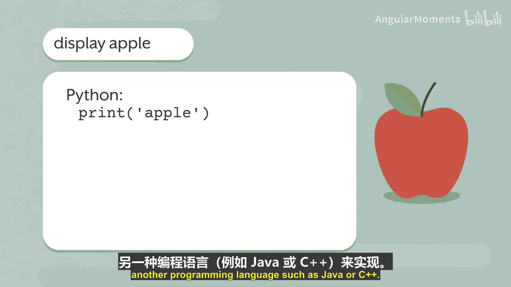
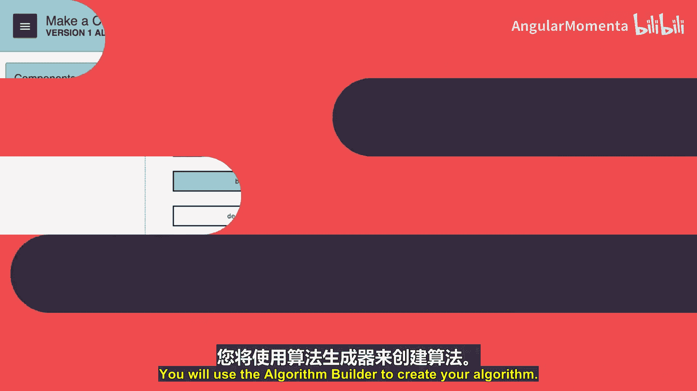
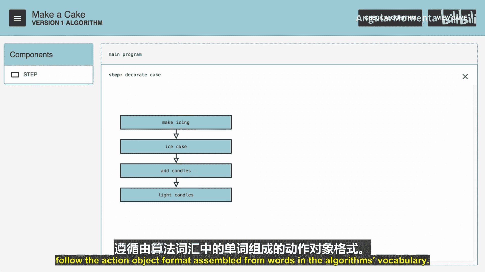
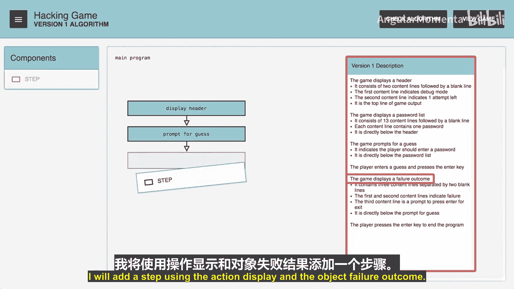
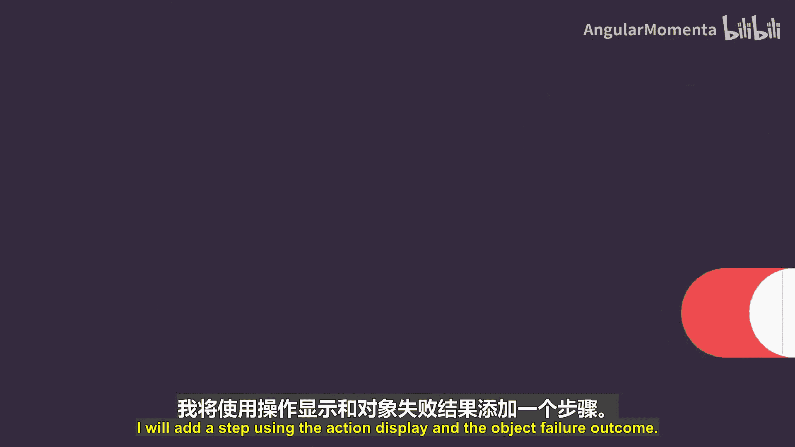
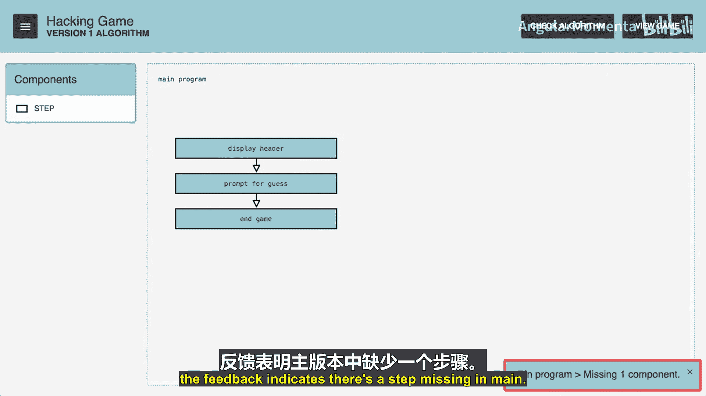

# 【阿尔伯塔大学】问题解决Python编程和电子游戏 ｜ Problem Solving, Python Programming, and Video Games p13 02_07_01_create-algorithm-for-hacking-version-1 -BV1N5rLBWE1c_p13-

。Let's look at where we are in the game creation process。First。

 you completed the Understand game task by observing and playing the game。

 Then you moved on to the first two subtasks of create design。

 You completed Understand version by observing， playing and describing version 1。 Next。

 you created a version test plan， which you will use to test your version 1 code。

You are now ready to tackle Create algorithm， the final subtask of Cre design。

 your algorithm will be the most precise artifact of your design。

An algorithm is a sequence of steps that solves a problem。

 An algorithm is more precise than a test plan because its steps define the logic of the solution。

 solutionl logic accounts for all potential situations that may occur in a problem and prescribes how to handle them。

The algorithm refines the test plan。Since our problem is creating a game。

 each situation is a sequence of game events that can occur as the result of player actions。

Therefore， the algorithm steps must accommodate all of these game event sequences。

Although an algorithm is more precise than a test plan， it is less precise than code。

 it is less precise since it is more human readable than code， and it ignores unimportant details。

For example， let's create an imprecise list of steps for the task of eating an apple。

I start with an imprecise step such as pick up Apple， rather than the more precise step。

 move your hand 10 centimeters towards the apple， grasp it with your fingers。

 and lift the apple5 centimeters。Pick up Apple is more general since it ignores the details of moving your hand a certain distance。

 closing your fingers around the apple， and lifting it up。

I can complete this algorithm with a second and third step， eat Apple and discard core。

The steps of an algorithm are performed in sequential order from first to last。

 This means the algorithm steps must be listed in the order they should be performed。

An algorithm uses temporal decomposition to divide the problem into its steps。

There are mechanisms to enable an algorithm to selectively skip or repeat some steps。

 You will discover the first of these mechanisms in version 3。

Order is important in an algorithm because otherwise the algorithm may cause an error or may not solve the problem。

If the two steps eat apple and discard core were reversed， the algorithm would not solve the problem。

 You cannot eat the apple after discarding it。In this course。

 all algorithms are programming language independent。

 This means the algorithm you create is a general solution that does not rely on a specific programming language。

 You will write a Python program that implements your algorithm later。

This same algorithm could be implemented in another programming language such as Java or C++。

You will use the algorithm builder to create your algorithm。

This tool differs from the other builders you've seen so far。

 since it is based on connecting various graphical shapes together instead of arranging lines of text。

Each shape will contain one algorithm step。The steps are connected using arrows to indicate the step order when the algorithm is performed。

 Each step in your algorithm will ultimately translate into a few lines of code when you write your program。

Let's explore the algorithm builder with an example algorithm。In the top left corner。

 you see a game title and version number， make a cake versionsion 1 algorithm。

The algorithm builder has a main panel where you will create a complete but imprecise solution to the problem。

Let's take a look at an algorithm for making a cake。 The steps in the main panel are make batter。

 bake， cake， decorate cake。Each of these steps is in its own rectangle。

The components palette to the left of the main panel consists of a shape for each kind of step you can add to an algorithm。

In later versions， you will see other shapes， but there is currently only one shape in the pallet。

 a rectangle labeled step。A rectangle represents a sequence of one or more precise program statements。

Each step in a rectangle consists of an action and an object。 make， bake and decorate our actions。

 Bater and cake are objects。 When you add a step， you must choose appropriate action and object words to name the step。

The main algorithm for the make a cake algorithm is already complete。 Now。

 I will increase the position of one of these steps by adding detail。

 It isn't obvious how to perform the decorate cake step。

The details of a step in the main panel can be viewed and edited by clicking on its shape。

This will create a new panel that expands a single step into more precise steps。

These steps are also represented by connected shapes。I'll expand the decorate cake step。

A panel for decorate cake opens， and you can see its detailed steps。 make icing， ice cake。

 add candles， blank candles。These steps use the additional actions， ice， add， and light。

 and the additional objects， icing and candles。All of these steps are in individual rectangles connected by arrows and follow the action object format assembled from words in the algorithm's vocabulary。

I'll clear the algorithm builder to start building the hacking versionion 1 algorithm。

The first sentence of the version1 description is the game displays a header。

 so I will create the algorithm step for this part of the game。

I will add a step to the main panel to complete this step。

 I must select an action and an object from the vocabulary provided。

The vocabulary contains objects you used in the hacking version 1 description and test plan。

 such as game and guess and actions such as display and Pro for。

You should consult your description to select an appropriate action and object from the vocabulary for each rectangle。

I will choose Dis from the Actions L。Header from the object list。

 and I'll click the add step button to complete the step。

The description includes many details about the header， which will be in the code。

 but are not included in the algorithm。Most attributes of objects are not described in an algorithm。

The next object in the description is the password list。

 You will add a step to display the password list in the next activity。

The description then indicates that the game prompts for a guess。

 so I will add a step for the prompt。I will choose the action prompt for and the object guess。

You can check whether your algorithm is correct and complete any time you want by pressing the check algorithm button。

The feedback indicates that the main program is missing two components。

 You already know that you must add a step for displaying the passwords。

 So there is one more step as well。The next description action is the player enters a guess and presses the enter key。

This action will not become an algorithm step because an algorithm cannot prescribe player actions。

Some algorithm steps respond to player actions， but no algorithm step translates to a code that makes a player action。

Therefore， the last algorithm step should display a failure outcome；

 I will add a step using the action display and the object failure outcome。

With the exception of the step that displays the password list， the algorithm should be complete。

 However， the display failure outcome step has two important parts displaying the outcome and prompting the player to end the program。

I will expand the display failureil outcome step and add these two steps。

 I will use display Fail outcome and prompt for end。However。

 it will cause an error if I use the same name for the general display failure outcome step in Maine。

 and the more specific display failure outcome step that it contains。

I will rename one of them to avoid this error。In general。

 don't use the same name for two steps that perform different actions。In mainine。

 I will delete the display failure outcome step and replace it with a new step called End game。

 Deleting a step also deletes all steps inside its panel。

 End game is a good general name since both displaying the outcome and prompting for end are parts of ending the game。

😊，In general， there are many ways to correctly decompose an algorithm。For example。

 it is possible to move both display failure outcome and prompt for end from the end game panel to the main panel and preserve the correct step order。

However， it is better to keep these two steps in the end game panel。 as algorithms get larger。

 they are easier to understand if each panel only contains a handful of steps。

 The point of decomposition is to break each task into a small number of manageable subtasks。

 and that is what the algorithm panels allow you to do。If we did not use panels。

 the algorithm for the final version of hacking would look something like this。

Since there are many ways to decompose a problem， each algorithm you make is only one of many possible correct algorithms。

In this course， the algorithm builder will guide you to one specific algorithm for each version。

You may need to experiment to discover the specific algorithm for each version。

The algorithm  builder feedback will guide you towards this specific algorithm。

I'll check the current state of the version 1 algorithm。

The feedback indicates there is a step missing in Maine。

Now it's your turn。 you must fix this error by adding the missing step。

You must also expand the end game step and read the two steps needed to end the game。

After completing this activity， you will complete several lessons about Python before you translate your algorithm into Python code。

那。