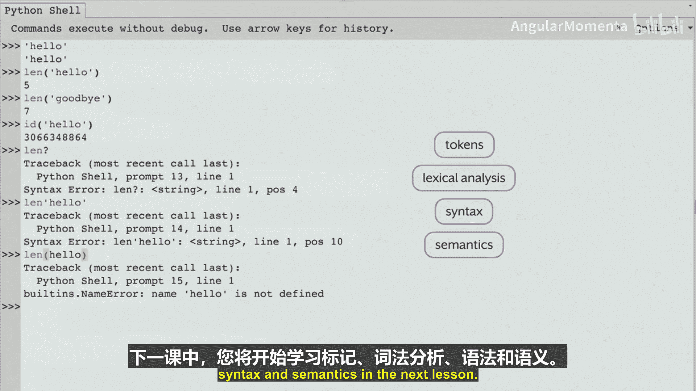

# 【阿尔伯塔大学】问题解决Python编程和电子游戏 ｜ Problem Solving, Python Programming, and Video Games p14 03_01_02_python-evaluation-examples -BV1N5rLBWE1c_p14-

In this video， I'll evaluate two kinds of simple Python expressions， literal strings。

 and function calls。I'll use a Python shell to evaluate some Python expressions。

Here's our first expression。What just happened？I typed hello， and pressed enter。

 The Python interpreter responded by displaying the same characters that I typed。

Does this always happen， I'll type Le of hello。This time， you see a5。Python computed something。

 What actually happened here。In each case， I typed a simple Python expression。

The Python interpreter evaluated the expression to obtain a result object and displayed a human readable form of the result object in the Python shell。

The Python interpreter then displayed the greater， greater。

 greater prompt on the next line to indicate that it was ready to evaluate another Python expression。

The Python expression hello is called a literal string。

 literal strings can be enclosed in single or double quotes。

Single quotes are used in this course for brevity， we say quote instead of single quote。

The second Python expression，L of Paren hello， Paren， is called a function call in computing science。

 a function is like a machine that has inputs and outputs。

The L function has one input or argument object。It also has one output or result object。

The argument is a string object， and the result is an integer object that represents how many characters are in that string。

As an analogy， think of placing an order at a drive through restaurant。

The input is your verbal order， and the output is the meal you receive。

Functions are also used in mathematics， such as the squaring function and the square root function。

The square of3 is 9， and the square root of4 is 2。The L function I used earlier is a built in function where L is short for length。

The literal string was used as the function argument。

The L function computed the number of elements in its argument object， since Ho has five characters。

 Le computed5。How do you know what the built in function lens does and are there other built in functions you can use？

The official documentation for Python is on the official Python website。

Python has a standard library that contains built in functions。

 and the standard library documentation describes what built in functions are available and what those functions do。

The length function returns the length， the number of items of an object。

 The argument may be a sequence such as a string， bitetes， tuple， list or range。

Or a collection such as a dictionary， set or frozen set。So far。

 the only sequence type you have seen is string。I'll apply the L function to a different literal string。

 goodbye。What should happen after I press enter。The integer 7 appeared。

 That makes sense since there are7 elements in the string。 Good bye。 By analogy。

 if you place a different order at the same restaurant， you receive a different meal。

 The output depends on the input。 In addition， if you place the same order at a different restaurant。

 you also receive a different meal， The output depends not only on the input。

 but also on the function itself。For example， when you apply a different built in function ID to the same input object。

 hello。You get a different result object。The meaning of the ID function will be discussed later。

 The point here is that a different function yields a different result。

Will Python recognize every character sequence you type？

I'll type L question mark and press enter to evaluate it。嗯。😊。

The Python shell has reported a syntax error。Python recognizes L as a valid token。

 but question mark is not part of any valid Python token。This is actually called a lexical error。

 but this Python interpreter reports all lexical errors as syntax errors。Tokens， lexical errors。

 and syntax errors are explained in future lessons。Why do I need parentheses？

What happens if I leave them out by entering Le quote quote？

Although this expression contains two valid Python tokens。

 they do not form a valid Python expression。For you to understand why this error occurred。

 you must understand the syntax of Python。Before defining the syntax of Python。

 it's useful to look at more examples。Why does quote hello quote have quotes and Len doesn't？

Recall that quote Hello quote is called a literal string。

 L without quotes is called an identifier or name。I'll put the parentheses back。

 but change hello from a literal string to an identifier by removing its quotes。This time。

 the Python shell has reported a name error， which is a kind of semantic error。

This error indicates that the name hello is not defined for you to understand why this error occurred。

 you must understand the semantics of Python。You have just seen some successful Python evaluations and three different kinds of errors。

 lexical， syntax， and semantic。Recognizing these three kinds of errors is important。

 since the way you fix each of these errors is different。You will begin learning about tokens。

 lexical analysis， syntax， and semantics in the next lesson。

