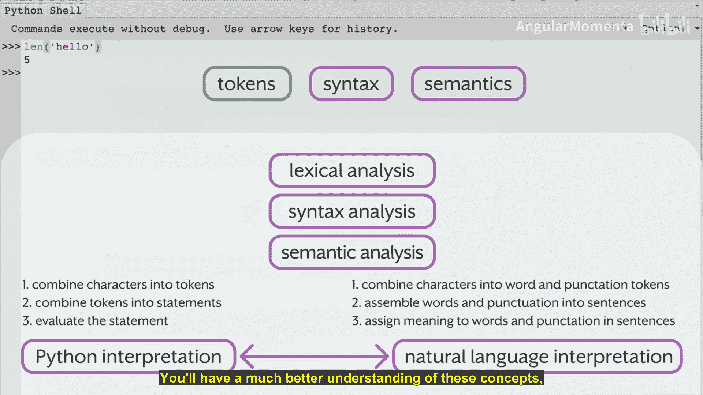

# 【阿尔伯塔大学】问题解决Python编程和电子游戏 ｜ Problem Solving, Python Programming, and Video Games p15 03_02_01_python-interpretation -BV1N5rLBWE1c_p15-

。This video introduces the three step Python interpretation process that is used to evaluate Python code。

A Python program is composed of statements； the simplest kind of statement is an expression statement which contains one or more expressions on one line。

For example，L of Ho is an expression statement that contains a single expression， Le of Ho。

 when you enter a character sequence into a Python shell and press the enter key。

The Python interpreter tries to interpret the character sequence as one line of a Python statement。

What process does the Python interpreter use to interpret a character sequence as a Python statement in a Python shell？

Python uses an analogous process to the one used by natural languages。

Natural languages are languages such as English， French， and Mandarin。In natural language。

 text is divided into basic units such as words and punctuation。

These are assembled into syntactic constructs called sentences。

Meaning is then assigned to the words and punctuation in the sentences。

The first step of interpretation is called lexical analysis In this step。

 a character sequence is translated into a sequence of basic units called tokens when you think。

 read， write or speak using a language， you do so in terms of tokens such as Mary。

 rather than individual characters such as MAR and Y。In Python。

 the interpreter combines characters into tokens。There are several definitions of the term token；

 here's a definition in the context of language。A token is a sequence of characters that has meaning as a basic language unit。

In many natural languages， there are two kinds of tokens。 One kind of token is words such as Mary。

 is and I， and the other is punctuation symbols， such as question mark and comma。

Natural languages use tables to list each token kind。 For example。

 English has 14 different punctuation symbols。In programming languages。

 there are several kinds of tokens。Python has five different kinds of tokens， delimiter， literal。

 identifier， operator， and keyword。Dlimiters in programming languages are analogous to punctuation in natural language；

 for example， left preen and right parnne are delimiter tokens in Python。

The other kinds of programming language tokens are analogous to words。In natural languages。

 words are divided into groups called parts of speech， such as noun， verb， and pronoun。

 so each of these parts of speech is a different kind of word token。Although Mary is and I are words。

 they are more specifically a noun， verb， and pronoun respectively。

Literals and identifiers in programming languages are analogous to different parts of speech in natural language。

A noun refers to a specific object， such as Alberta。

A literal string in a programming language is analogous to a noun。

 since a literal string also refers to a specific object such as hello。

A pronoun refers to different people at different times。 For example。

 I refers to me Dwayne when I'm referring to myself。However。

 I refers to me Elise when I'm referring to myself。

An identifier in a programming language is analogous to a pronoun。

 since you will discover that the same identifier can refer to different objects in different parts of a program。

For example， you have seen that the identifier L refers to the length function object in the lens of Ho expression；

 however， it is possible to use the same identifier L。

 elsewhere in a program to refer to a different object。

What happens when an invalid token is used in natural language， for example。

 how is the English character sequence its snus interpreted？In natural language。

 the table that lists all valid word tokens is called a dictionary。

If a sequence of characters is not in the dictionary， they do not form a valid token。

 so they cause a lexical error。It is a valid English word token。

 but snubbs is not in an English dictionary， so it causes a lexical error， an invalid token。

Similarly， if a programming language interpreter encounters an error when it is creating tokens from characters。

 it is called a lexical error； however， this Python interpreter reports lexical errors as a kind of syntax error。

Remember what happened when I entered the character sequence L question mark？

Question mark is not a valid Python token， just like snubs is not a valid English word。

If I enter the character sequence， quote hello， with a quote at the beginning， but not at the end。

 the Python interpreter reports a syntax error， which is really a lexical error。

 since quote helllo is not a valid literal string token without its ending quote。

The second step of interpretation is called syntax analysis。In this step。

 tokens are combined into English sentences or Python statements。

Here is a definition of syntax that applies to both natural and programming languages。

Syntax defines the format or structure of sentences and statements。

How do people assemble natural language tokens， words and punctuation into syntactically correct sentences？

A natural language uses a grammar。Consider a very small subset of English that contains one punctuation symbol。

 the question mark， and six words， the verbs was and is the nouns Maryrry and school。

 and the interrogative adverbs when and how。Syntax diagrams define a grammar that represents the valid format of natural language sentences；

 for example， here is a syntax diagram for a sentence called a question for our small subset of English。

You can use this diagram to check whether a token sequence forms a syntactically valid question。

A token sequence is syntactically valid if there are exactly four tokens that match the four diagram token states in order。

Does this token sequence form a syntactically valid question？How is Mary question mark？

This token sequence has four tokens。 The token how is an adverb， which matches the adverb state。

 The token is is a verb which matches the verb state。 The token Mary matches noun。

 and the token question mark matches question mark。Since there are no more tokens。

 this token sequence is a syntactically valid question。This token sequence。

 when Mary was question mark， is syntactically invalid。 It starts with an adverb。

 which matches the first state of the syntax diagram。 The next token is a noun。

 which does not match the verb state。 This mismatch is a syntax error in our small subset of English。

Similarly， if the Python interpreter encounters an error when it is combining tokens into statements。

 it reports a syntax error。Recall the Pythons successfully evaluated Le of hello enclosed in Pares and quotes。

 however， when the parentheses were left out， a syntax error occurred。

Although this expression has two valid tokens， Ln and quoted hello。

 there is no Python's syntax diagram that contains these two token kinds， identifier and literal。

 in order as a valid expression。A sequence of tokens may have valid syntax and still not make sense。

 For example， the token sequence when is Mary question mark is syntactically valid in our simple English grammar。

 It consists of the adverb when followed by the verb is followed by the noun Mary and ends with the question mark。

Although this sentence has valid syntax， its meaning or semantics is not valid。To be useful。

 both natural language sentences and Python statements must be semantically valid in addition to being syntactically valid。

The third step of interpretation is called semantic analysis。

 where the interpreter assigns meaning to syntactically valid sentences and statements。

Semantics defines the meaning of sentences and statements。

How do people assign meaning to natural language sentences？

You can use a dictionary to interpret the meaning of individual words in a syntactically correct sentence。

Many words can be used as different parts of speech， and most have multiple meanings。 Therefore。

 the meaning of a word in a sentence depends heavily on context。For example。

 the wordcho can be used as a noun with at least two different meanings。

 How is school or a school of fish， It can also be used as a verb in， I can school my brother。

This context dependence means that no set of simple semantic rules can describe the meaning of all syntactically valid natural language sentences。

In programming languages， tokens are less context dependent；

 a set of simple semantic rules can define the meaning of all syntactically correct statements。

To accomplish this， programming language syntax and semantic rules must be very precise。

 This means that great care must be taken to express Python statements correctly。 For example。

 in Python， you can write L of quoted hello， but you cannot write L of unquoted hello or hellello's L。

English is less structured， you could say either the phrase the length of a string or the phrase the string's length。

 and they both have the same meaning。If there is no error during the semantic analysis phase。

 the Python interpreter successfully computes an object as the result of evaluating the expression。

If the expression was evaluated in a shell， then the Python interpreter usually displays its result object in the shell in human readable form。

In this video， you have seen the three step interpretation process， lexical analysis。

 syntax analysis and semantic analysis。 Python uses this process to evaluate an expression by computing a result object。

To understand how the interpreter computed these result objects。

 you must learn more about Python tokens， syntax and semantics。

 You will have a much better understanding of these concepts after viewing the following videos。

