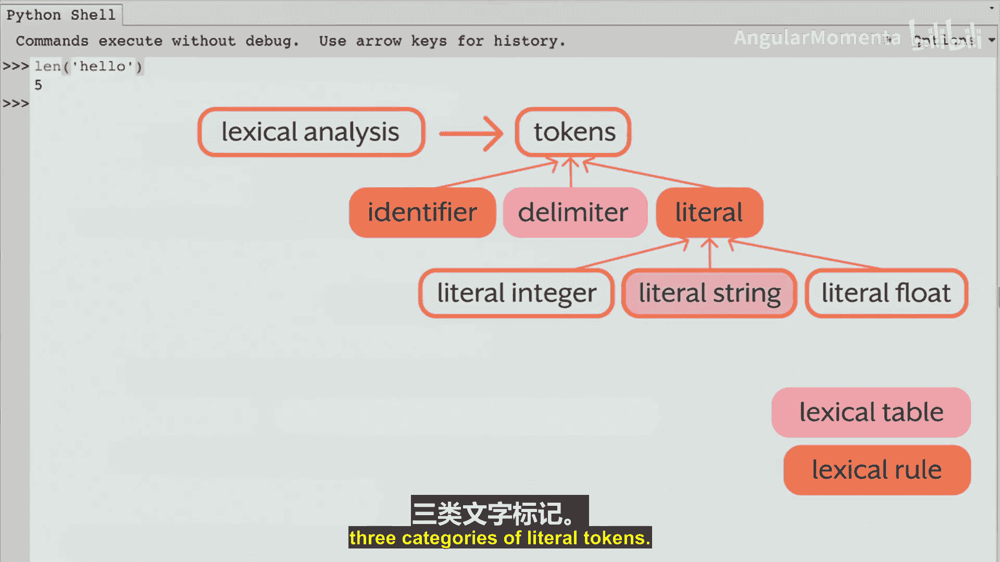

# 【阿尔伯塔大学】问题解决Python编程和电子游戏 ｜ Problem Solving, Python Programming, and Video Games p16 03_03_01_python-lexical-analysis -BV1N5rLBWE1c_p16-

。This video describes how lexical analysis creates three different kinds of Python tokens。

 Idententifier tokens， delimiter tokens and literal tokens。

Recall that the Python interpreter uses a three step process， lexical analysis， syntax analysis。

 and semantic analysis。How does the lexical analysis step combine characters into basic units called tokens？

Previously， we evaluated the expression， Le of Ho。This expression contains four tokens， Le。

 left paren， Ho， and right paren。How does the Python interpreter perform this lexical analysis？

A token is constructed from one or more characters where each character can be a letter， a digit。

 a symbol， a special character or white space。 White space is a space。

 a tab or a page break character， also called a form feed。

Recall that Python has five different kinds of tokens。 Idententifier tokens， delimiter tokens。

 literal tokens， operator tokens， and keyword tokens。

Each kind of token is either described by a simplified lexical rule or defined by a lexical table。

Python translates characters into tokens from left to right。 The first token is L。

 an identifier token。An identifier is a name that we use in Python code to refer to an object in memory。

Len refers to a function object that computes the length of a sequence， such as a string。

Python recognizes identifier tokens using a simplified lexical rule。

Starts with a letter or underscore and is followed by0 or more letters， underscores or digits。

Identifiers are case sensitive， so R2 D2 with upper case letters is a different identifier than R2 D2 with lower case letters。

The second token is left Per， a delimiter token。A delimiter is used to separate other tokens the same way that punctuation is used in natural language。

We use a lexical table to define the Python delimiter tokens。Each delimiter consists of one， two。

 or three symbolic characters。Some delimiters like comma and star equal， appear alone。

Other delimiters appear in pairs such as left and right paren。

 which appear in the lens of Hello expression。The third token iso。This is a literal token。

There are several categories of literal tokens， And hello is in the category， literal string。

The simplified rule for literal string is。Starts with a quote。

 followed by0 or more non characters and ends with a quote。Another literal category is literal float。

 which represents a non negative， rational number。The simplest rule for literal float is one dot。

 one or more digits， and no other characters。A third literal category is literal integer。

 which represents non negative whole numbers。The simplified rule for literal integers is one or more digits。

For example。27 and 0 are literal integers。 Well 4。5，0。0 and 0。3 are literal floats。However。-52。

3 are not literal integers or literal floats。 Since -5 has a minus sign， and 2。3 has quotes。In fact。

 2。3 quote is a valid literal string。You will find out later that-5 actually consists of two tokens。

 the minus operator and the literal integer 5。Python must evaluate both tokens to create an int object whose value is negative 5。

Why does Python create a single token 27 instead of creating two tokens 2 and 7。

Both choices satisfy the lexical rule for literal integers。

The lexical analyzer uses this longest token rule。When creating a token。

 create the longest token possible。Therefore， given a choice between creating 2 or 27。

 the lexical analyzer creates the longer token，27。Given the character sequence 4。 5。

 the Python interpreter uses the longest token rule to create a single float token，4。5。

Instead of creating a literal integer 4， followed by a literal float 05。Or creating a literal float。

4 point， followed by a literal integer 5。Similarly。

 the character sequence last chance would be interpreted as a single identifier token。 Last chance。

 rather than two identifier tokens， last。And chance。In addition to a longest token rule。

 lexical analysis also has a white space rule。For white space， not at the start of a line。

 If white space is inside a literal string， it is part of the literal string。Otherwise。

 it ends the current token and no token is created for it。

White space at the start of a line has a special meaning that we will discuss in a future lesson。

A literal string is a token that we use in Python code to refer to an object in memory that represents a sequence of characters。

Python uses quote characters to distinguish a literal string token from an identifier。

The token L is an identifier， and the token Le is a literal string。In the expression， Le of Ho。

 the identifier L was bound to a function object that computed the length of the string。 Ho as 5。

Using a valid token that is the wrong token kind。Can cause a syntax error or a semantic error。

For example， what will happen if I use a literal string lend quote instead of the identifier L in this expression。

This expression contains four valid tokens， so there is no lexical error。Python reports a type error。

 which is a kind of semantic error。The error message indicates that Python was expecting a function object as part of a function call and encountered a string object instead。

Now let's return to the expression Len of Ho。The fourth and final Python token in this expression is also a delimiter token。

 right perin。Therefore， this python expression consists of the identifier then。

 the delimiter left paren， the literal string hello and the delimiter right paren。F valid tokens。

In this video， we used a lexical table to define delimiter tokens。

 We also used simple lexical rules to describe identifier our tokens and three categories of literal tokens。

 literal strings， literal integers and literal floats。

