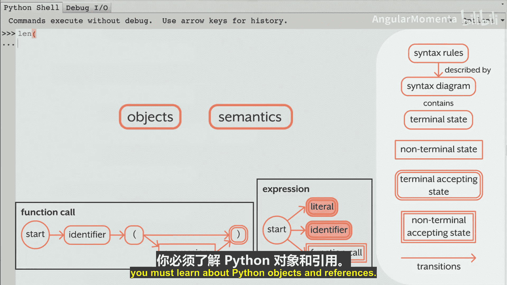

# 【阿尔伯塔大学】问题解决Python编程和电子游戏 ｜ Problem Solving, Python Programming, and Video Games p17 03_04_01_python-syntax-analysis -BV1N5rLBWE1c_p17-

This video introduces the Python programming language syntax of literal expressions， identifiers。

 and function call expressions。A Python program is composed of statements。

 recall from the lexical analysis lesson that the Python interpreter first uses a process called Lexical analysis to decompose code into basic units called tokens。

Syntax prescribes the format of each statement。So the format of a statement specifies the order of the tokens in that statement。

We use syntax diagrams to define which tokens are in a statement and what order they are in。

There are many kinds of Python statements。An expression statement contains one or more expressions on a line。

In this lesson， we only consider expression statements that consist of a single expression。

There are many different kinds of expressions。 We will investigate three kinds， literals。

 identifiers and function calls。Previously， we evaluated the literal string expression， quote。

Ho quote。This expression contains one token， the literal string hello。

Does every Python token form a valid expression by itself？Let's try the identifier L。

 which is a valid token。Len evaluates to an object whose human readable output is built in function L。

Let's try a right parentn， which is a valid token。No， this single token is not a valid expression。

How does the Python interpreter recognize which single tokens are valid？More generally。

 how does Python recognize which sequences of valid tokens form valid expressions？

In the lexical analysis lesson， you saw that the function call expression Le of hello evaluated to five。

This expression contains four tokens， the identifier lens， delimiter left parn， literal string hello。

 and delimiter right parn。How does the Python interpreter recognize that the syntax of these tokens also forms a valid expression？

The Python interpreter uses rules to recognize valid syntax。

We use syntax diagrams to describe these rules。A syntax diagram contains states and transitions。

Here is a syntax diagram for an expression that includes literals， identifiers， and function calls。

The start state is drawn as a circle。 A terminal state is a state that represents a single token from a set of tokens。

 such as one delimiter token from the set of all delimiter tokens。

A terminal state is drawn as a rounded rectangle and matches one token。Literal is a terminal state。

 which represents one token from any literal category， including string， antigenteger， and float。

Identifier is also a terminal state that represents one identifier token。

A state that does not represent a single token from a set of tokens is called a non terminal state。

It is drawn as a rectangle and must be expanded using its own syntax diagram。

A function call is a non terminal state。A state that has a double border is called an accepting state。

Literal， identifier and function call are accepting states， which I will explain momentarily。

The arrows are called transitions and by connecting states that transitions to paths through the diagram。

Can I use the diagram to recognize that the token sequence， quotehelo quote， is a valid expression？

This is a single token。 How does this token match the syntax diagram？Begin at the start state。

 The start state has three transitions。 The first transition leads to the literal terminal state。

The second transition leads to the identifier terminal state。

 and the third transition leads to the non terminal state function call。

Since you have seen that quote，Hello， quote is a literal token。

 I can match this token to the terminal literal state。To validate the syntax of an expression。

 you must find a path from the start state to an accepting state that matches all the tokens to the terminal state in order。

An accepting state is any state in a syntax diagram that can be used to match the last token of the sequence of tokens you are trying to match。

The token sequence consists of a single literal token。

It matches the terminal literal accepting state denoted by a double border。Therefore。

 quote hellello quote is a valid expression。To show that a token sequence is invalid。

 you must show that no path exists that leads to an accepting state。

You have seen that the right par is a single delimiter token。But it is not a valid Python expression。

Why not。From the start state， you have a choice of three transitions。

 The first two transitions lead to the terminal literal and identifier states that do not match the delimiter token。

The third transition leads to a non terminal state。 Remember。

 every state is either a terminal state that matches a single token or a non terminal state that must be expanded using its own syntax diagram instead of matching a single token。

Here is the simplified syntax diagram for function call that has either one argument。

 expression or no argument。Begin at its start state。

There is only one transition and it leads to the terminal identifier state。

Since the delimiter token is not an identifier token， there is no match。

Since there are no more paths to try， a single delimiter is not a valid Python expression。

I will now try to matchL of hello to the syntax diagram。

Recall that there are four tokens in this token sequence for Le of Ho。

I will begin at the start state。The start state has three transitions， literal， identifier。

 and function call。Since the first token Le is an identifier。

 it does not match the literal terminal state， so I cannot use that path。

The second transition leads to the identifier terminal state。 However。

 there are no transitions out of this state， and I still have tokens to match。

If it was a non terminal state， I would expand it to match more tokens。However。

 it is a terminal state， so I can only match one token instead of expanding it。I'll try another path。

The third transition leads to the function call non terminal state， so I must expand it。

Following the single transition from start state of the function called diagram。

 I will match the token L to the terminal identifier state。

Since there is only one transition leaving the identifier state， I will try to follow it。

The next token left pren matches the left pren state。So far so good？

The next token is the string literal， hello。This token does not match the right parent state。

So do not follow this transition。Instead， follow the transition to the expression non terminal state。

Expand this state using the expression syntax diagram。

The definition of expression is a recursive definition， since an expression can be a function call。

 which itself contains an expression。There are three transitions from the start state for expression。

 One leads to the literal terminal state。 One leads to the identifier terminal state。

 and one leads to the function call non terminal state。This time。

 if I follow the transition to the literal state， it matches the third token。

 the literal string hello。I still have tokens left。

 and there is no transition leaving this state to match the remaining tokens。What should I do now？

Recall how I got here， I was trying to match the expression non terminal state in the function called syntax diagram。

Since I am in an accepting state in the expression diagram。

 I have successfully matched an expression， so I can return to the path in the function called diagram。

😊，The next transition matches the right paren token with the right paren terminal state success。

 since I have matched all four tokens and the right paren is an accepting state。

 The original expression， Le of Ho is syntactically valid。😊，Remember， the Eval examples video。

Evaluating L hello without hers caused a syntax error。

How did the Python interpreter detect this syntax error？

The interpreter begins at the start state of an expression and tries to find any valid path。

Since the first token Le is an identifier， it does not match the transition from start to literal。

You have already seen that lead matches the identifier state。

 but there are remaining tokens to match with no transitions to follow。Therefore。

 the interpreter tries to match the function call state。

The syntax diagram for Fun has a single transition from the start state to the identifier state。

 which matches the L token。However， the only transition leaving the identifier state is to the left Par state。

 which does not match the hello literal string token。Therefore。

 there is no path in the syntax diagram that matches the token sequence， Len。

 followed by quoted hello。So this toecon sequence is not a valid expression。

Let's try one more token sequence。 Len， followed by a left parent。

The interpreter begins at the start state of expression and tries to find any valid path。

As we have seen before， Le， followed by Paren， does not match literal art or identifier。

 but it does match the first two states of function call。

There are no more tokens and the current state is not an accepting state， so this path is invalid。

Since the interpreter has failed on all paths， the toeken sequence is invalid as an expression。

Notice that an error is not reported。 In some cases。

 the interpreter recognizes the current progress in the syntax diagram and waits for more tokens。

However， if no other tokens are provided。It is a syntax error。

You have used syntax diagrams to recognize the format of valid Python literal， identifier。

 and function call expressions。Our next step is to study Python semantics。 however。

 before we do this， you must learn about Python objects and references。

