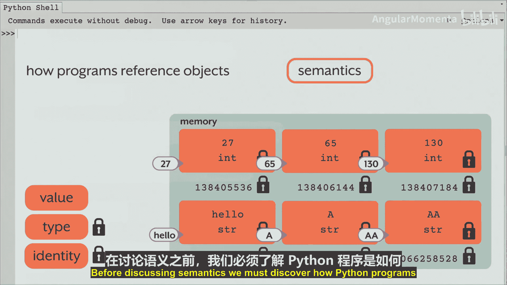

# 【阿尔伯塔大学】问题解决Python编程和电子游戏 ｜ Problem Solving, Python Programming, and Video Games p18 03_05_01_python-objects -BV1N5rLBWE1c_p18-

。This video introduces the programming language concepts related to the objects that represent data in a Python program。

The Python interpreter creates objects to represent data in computer memory。

Each object has an identity， a type， and a value。An object's identity is determined when the object is created。

 Once it is created， it is unique and immutable， which means it cannot be changed。

Think of an object's identity as its location in computer memory。

We can obtain an object's identity by applying the built in ID function to it。For example。

 ID of 27 gives us this identity。This identity may be different for your Python interpreter。

We can view the documentation for the built in ID function in the Python Standard Library。

Return the identity of an object。This is an integer which is guaranteed to be unique and constant for this object during its lifetime。

An object's type determines its format or shape in memory and how it is interpreted during computations。

Each type defines a memory format。 Each different memory format may require a different amount of computer memory。

Once we create an object of a particular type， its type is immutable。

 we cannot change its type since changing its shape would disrupt adjacent objects in memory。

For simplicity， we will use the same representation for objects of all types。

 even though the types's formats require different sizes and shapes and memory。Int。

 which is short for integer， is a Python type that represents a whole number。

In support operations such as addition and multiplication。String called STR in Python。

 is a type that represents a sequence of characters。

Python provides operations such as computing the length of a string or concatenating two strings together。

We can obtain an object's type by applying the built in type function to it。

Let's look at the documentation in the Python standard Library。With one argument。

 return the type of an object。For example， type of 65 displays Class int and type of string A displays class STR。

The terms type and class are used interchangeably in Python。

 So this function is telling us that the type of 65 is int and the type of string A is S T R。

The type defines the memory format of all objects that share that type。

Most modern computers store all data using binary digits or bits for short。

Each bit is either a 0 or a  one。 The value of an object is the bit sequence that is used to represent it。

 For example， the integer 65 has this binary representation。

Since the values of the integers 65 and 27 are different。

 they must have different binary representations for these values。

Since different values have different binary sequences， why do we need types？

The type of an object defines how the binary digits are interpreted。For example。

 in many programming languages， both the integer 65 and the string A use the same binary sequence for their value。

The type of an object determines how these two objects will be interpreted。

 One as a string and one as an integer。For example。

 65 plus 65 evaluates to 130 string A plus string A evaluates to string A A。

 which is string concatenation in Python。Even though we started with objects that had the same binary sequence for their values。

 because the types were different， the resulting binary values were different。

Every object has an immutable identity and type， as well as a value。

 which is represented by a sequence of bits。 In our diagrams。

 we use 16 bit sequences to represent both integers and strings。In fact。

 Python does not use fixed length binary sequences to represent either of these types。

Many other programming languages represent integers with a fixed number of bits， such as 32 or 64。

 which limits the size of an integer to 2 billion with 32 bits or 9 billion billion with 64 bits。

This means that if we want to represent a larger number in other languages。

 we would need a different type than integer， such as the type big integer in the Java programming language。

The number of atoms in the universe is between 10 to the power of 78 and 10 to the power of 82。

 which is 10 billion billion billion， billion billion billion， billion billion billion。

The number 10 to the 82 can be represented in Python as a single object of type int。

The particular bit sequence used for memory representation of object values varies between different Pythonic implementations。

Therefore， Python does not have a built in value function in the standard library to display the bit representation of an object。

Fortunately， we don't need to know the memory representation of Python types to write Python programs。

 since the Python interpreter translates between memory representations and human displayable formats。

Therefore， in our diagrams， we will denote the value of objects in a more human readable format instead of using bit sequences。

 we replace the binary digits of integers and strings by decimal digits for the int type or an unquoted sequence of characters for the S R type。

We have seen that every object in memory has an identity， type and value。 We have seen two types。

 int and STR。 We will encounter many other types。Before discussing semantics。

 we must discover how Python programs reference these objects。

