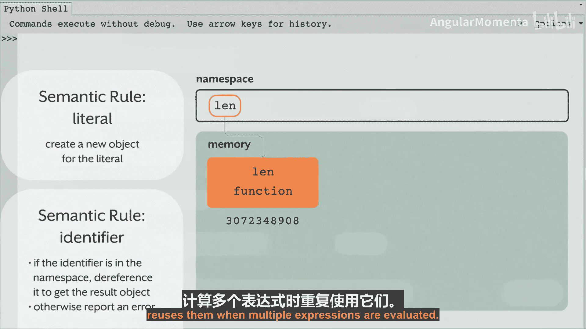

# 【阿尔伯塔大学】问题解决Python编程和电子游戏 ｜ Problem Solving, Python Programming, and Video Games p19 03_06_01_python-semantics-of-literals-and-identifiers -BV1N5rLBWE1c_p19-

This video introduces the Python programming language semantics of literals and identifiers。

Recall the interpretation process that Python uses to evaluate a statement。

Lexical analysis creates tokens。Syntax analysis validates the token order。

And semantic analysis defines the meaning of a statement by evaluating it。

We will use simplified semantic rules to define the meaning of Python statements。

Recall that an expression statement consists of a single expression that can be either a literal。

Identifier or a function call。We have already defined literal， and identifier our tokens。

We have also defined the syntax of an expression that consists of a single literal token or a single identifier token。

To define the semantics of literals and identifiers。

 we need to first examine why they are used in Python expressions。

Human readable representations of objects are used in expressions so that people can understand these objects。

The interpreter must translate these human readable object representations into objects in the computer memory。

 so computations can be performed on them。The simplest way to represent an object in an expression is to use a literal。

A literal represents an object by describing it。The literal contains all of the information necessary to create an object。

The semantics of a literal expression are simple。Create a new object for the literal。For example。

 when the interpreter evaluates the literal token 300。It creates a new integer object。

A literal in an expression is analogous to a coupon or voucher in the real world。

That can be exchanged for an item。The coupon is just a representation of the item。

 It is not actually the item。Once the coupon is exchanged for the item。

 the coupon is no longer necessary。Similarly， a literal is not an object。

It just represents that object in the expression。Once the literal is used to create an object in memory。

 the literal is no longer necessary。Only the object is needed。

If the interpreter encounters the literal token 300 in another expression。

It creates another integer object。Recall that the ID function returns a different identity number for each different object。

The I D function can be used to determine whether another use of the same literal actually creates another object or reuses the object that was previously created。

For example。Using the literal 300 twice。Creates two different objects， since their Is are different。

Each Python interpreter has its own strategy for reusing objects created for literals。

And the strategy depends on the literal。For example。

 this interpreter reuses the integer objects for all literal integers between  -5 and 256。

But creates new objects each time any other literal integer is used。

To simplify the semantics of literals， we ignore whether or not a particular interpreter reuses the same object for multiple appearances of the same literal。

We define the semantics of a literal as creating a new object each time the literal is evaluated。

Reusing objects for literals only affects how fast Python code is evaluated。

 It does not usually affect the code results。In addition to literals， Python uses identifiers。

 also called names to represent objects in an expression。

An identifier represents an object in an expression by referencing that object。

We say that an identifier is bound to an object and use an arrow to denote the binding。For example。

 the identifier L。Represents a function object。An identifier in an expression is analogous to the name or role of a person。

People refer to us by name， or role。But the name or role is just a label。

 It is not actually a person。Just as people can use a name or role to refer to the same person more than once。

 An identifier can refer to the same object， more than once。

An identifier is a persistent representation of an object。

 While all of the expressions in a shell or program are evaluated。

A literal is only a temporary representation until the object it represents is created。

Python uses a namespace to allow identifiers to persist during evaluation。

A name space associates each name that appears in a Python expression with the object that it is bound to。

Thus， the land identifier is associated or bound to a function object。

A name space is like a dictionary， except instead of looking up a word and finding a definition。

 the interpreter looks up a name and finds the object it is bound to。

This step is called dereferencing。Dereferencing is the act of translating an identifier into the memory object it is bound to during Python code evaluation。

This process is like looking for a restaurant name online。

You enter the name of the restaurant in your browser or app， and you are given its location。

Which you use to find the restaurant in the real world。

When we open a Python shell or run a Python program。

 the interpreter creates a namespace and prebinds many identifiers before evaluating our code。

For example， the interpreter creates a function object that computes the length of a sequence。

It then adds the name L to the name space and binds this name to the function object。

The interpreter prebinds the names of all the built in functions。For example。

 it binds the I D and type function names as well。If the names of the built in functions weren't prebound。

 we would have no way to refer to them。So we could not use them。

The interpreter also prebinds the name of each built in type to a type object。

And prebins many other identifiers， as well。You can use the built in function DIR to see all of the built in identifiers。

Notice the built in function names L and ID。And the built in tight names， S R， int and float。Also。

 notice the names of some familiar errors， such as syntax error and name error。In our diagrams。

 we won't show all of the prebound identifiers。 We will only show the prebound names that we will use for a particular Python shell example。

 or program。Here are the semantics of an identifier expression。If the identifier is in the namespace。

 dereence it to get the result object。Otherwise， report an error。For example。

If we evaluate an expression containing the identifier then。

The interpreter finds L in the name space and dereences it to obtain the function object。

Let's evaluate an identifier Ho that is not in the namespace。This expression contains one token。

 the identifier hello。The interpreter applies the semantic rule for identifier expressions。

It checks if the identifier hello is in the namespace。

Since Ho is not prebound to a built in function， type or any other kind of object。

 it is not in the namespace。The interpreter reports a semantic error。Since there is no result object。

 only the error is displayed。We will discuss how to bind identifiers that are not prebound in later lessons。

A name tag can be worn by one person and then worn by a different person later。For example。

 while driving a bus， a person may wear a driver named tag to represent their role。

When a different person replaces the first driver， the driver name tag can be detached from the first person and used by the second person。

An identifier is like a name tag， since we will discover in a future lesson that an identifier can be bound to different objects at different times。

However。An identifier in a namespace cannot be bound to two different objects at the same time。

As an analogy， there cannot be two people with the same driver role on one bus。

 There is only one driver name tag on the bus， and it can only be attached to one person at a time。

This video introduced the Python programming languagengu semantics for literals and identifiers。

Python places identifiers in a name space and reuses them when multiple expressions are evaluated。

