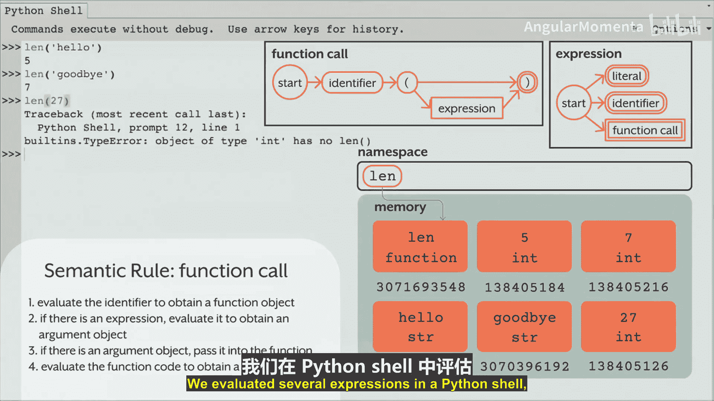

# 【阿尔伯塔大学】问题解决Python编程和电子游戏 ｜ Problem Solving, Python Programming, and Video Games p20 03_07_01_python-semantics-of-function-calls -BV1N5rLBWE1c_p20-

。This video introduces the Python programming language semantics of function call expressions。

Recall that an expression statement consists of a single expression that can be either a， literal。

 identifier， or a function call。We introduced the semantics of literal expressions and identifier expressions in the previous lesson。

Let's define the semantics of a function call。Recall that a function is applied to an argument object to obtain a result object。

Evaluate the identifier to obtain a function object。If there is an expression。

 evaluate it to obtain an argument object。If there is an argument object， pass it into the function。

Evaluate the function code to obtain a result object。In the syntax lesson。

 you discovered that this expression has valid syntax as a function call。

It starts with the identifier lens。 It is followed by a left paren and an expression。

 which is the literal string Ho。 It ends with the right paren。

Before the Python interpreter evaluates this expression。

 the identifier L is prebound to the built in L function object。

The Python interpreter applies the semantic rule for function call expressions。

It applies step one to evaluate the identifier lens。

The semantic rule for an identifier expression looks for L in the namespace。

Since L is prebound to a built in function， it finds it and dereferences L to obtain the length function object。

In step2， the interpreter evaluates the expression， quote hello， quote。

The semantic Rule for litals evaluates this expression by creating a new string object。In step3。

 we pass this argument object into the length function。In step4。

 the interpreter evaluates the code in the length function， which we cannot see。

This code is evaluated using the same interpreter process that you are currently learning。

This function returns the integer 5 object， even if you do not yet understand how that function code is evaluated。

This five object is displayed in the shell。The expressionL of goodbye consists of a single function call to the same function。

 but with a different argument， the literal string goodbye。

The function call uses the same semantics to compute the integer 7 object， which is displayed。

Let's evaluate L of 27。When the interpreter tries to interpret this expression。

 it reports a type error。How and why does it fail。The interpreter successfully completes steps 1 through3。

 but an error occurs in step 4 when it tries to interpret the function code for L using the argument object integer 27。

Len cannot compute the number of elements in an integer since integers don't actually have any elements。

The Python shell reports this error。This video introduced the Python programming language semantics of function call expressions。

We evaluated several expressions in a Python shell。

 and the shell displayed the result objects in human readable form。

