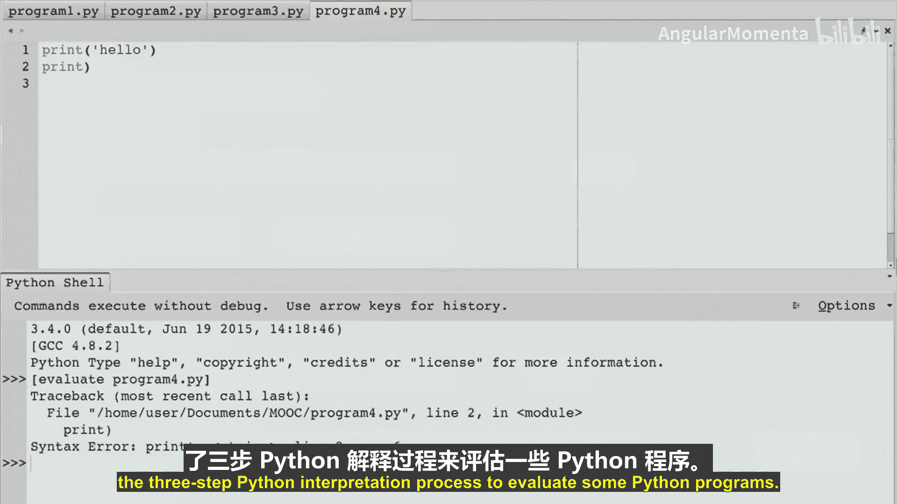

# 【阿尔伯塔大学】问题解决Python编程和电子游戏 ｜ Problem Solving, Python Programming, and Video Games p21 03_08_01_python-program-interpretation -BV1N5rLBWE1c_p21-

This video introduces Python programs a way to evaluate multiple Python statements sequentially。

 instead of evaluating one statement at a time in a shell。

An application usually computes many objects in an order that is appropriate for that application。

 For example， a game often creates and displays a welcome at the start。

 It then creates and displays moving game objects during the game and other objects at game end。

 such as a score or leader board。How can you create and display several objects in a particular order？

You can use multiple statements that the Python interpreter evaluates in sequential order。

These multiple statements are called a program。The Python interpreter uses lexical analysis to create tokens for the entire program。

It then checks the syntax of each statement in order from the first statement to the last statement。

Finally， it uses semantic analysis to evaluate each statement in order。Actually。

 there are some statements that change this default sequential order of evaluation。

 but they will be introduced in future lessons。Python allows us to invoke the interpreter on a program that is stored in a file。

Here is a program that computes the length of hello， the length of goodbye。

 and the I D of Ho in that order。This program has three expression statements that were evaluated individually in a Python shell during a previous lesson。

If I run this program， its output will be displayed in the Python shell。

Why weren't the expression result objects displayed？

When these expressions were evaluated in a Python shell， the results were displayed。

The interpreter uses the same semantic rules to evaluate program statements and statements that are entered into a Python shell。

 However， in a Python shell， after an expression statement is evaluated。

 the result object is displayed immediately in the shell。 When a program is interpreted。

 the expression statement results are not automatically displayed。

The shell displays each evaluated expression so you can view the result。 However， in most programs。

 you do not want to display the result of every computation。

 So result objects are not automatically displayed。

To explicitly display an object when a program is evaluated。

 you need to use the built in function print that displays its argument object and then moves the cursor to the next line。

Unfortunately， the documentation for print is hard to understand For now。

 it is enough to know that the print function displays a human readable form of its argument object。

To selectively display two of the three objects in my program。

 I will use the first and third objects as arguments in print function calls。When I run this program。

 each expression statement is evaluated in order， and the print function calls explicitly display the first and third result objects in human readable form。

The print function is a function， so it must return a result object。

The print function returns a unique object whose type is none type。

 This object is returned by any function that does not return a useful object。

When I evaluate type of print of Ho， the Python interpreter first displays the output from the print function callHello。

Since I evaluated this expression in a shell， the interpreter then displays the type of the object returned by the print function call。

 which is the nun type object。The print function displays information in the program。

How does a program get information from a user？You can use the built in function input to translate user key presses into an object of type STR。

The Python Standard Library has this entry for input。

There is some new notation in this documentation。 The square brackets around the prompt argument mean that this argument is optional。

 It can be included， or left out。If the prompt argument is present。

 it is written to the shell without a trailing new line。If the argument is left out。

 nothing is displayed。The function then reads a line from input， converts it to a string。

 strips the trailing new line and returns that string object。What is this prompt argument for。

 If the program needs the user to enter some information。

 it should prompt the user and then wait for a response。After displaying the prompt。

 the input function leaves the cursor on the same line。

 So the user input is to the right of the prompt。 The user signals that the input is done by pressing the enter key。

Then the function translates the user key presses into a single string object that does not include a new line character for the enter key。

I'll run a program to show how the input function works。

Notice that the color appears on the prompt line as it is type。

The print function call then displays this color string on the next line as well。

The Python interpreter checks the syntax of the entire program before it evaluates any statements when I run this program。

The hellello string argument in the first line is not displayed by the print function call。

 Even though the first line has valid syntax and semantics。

 This is because a syntax error occurred on the second line。

If your program contains any syntax errors， no statements are evaluated。In this video。

 I applied the three step Python interpretation process to evaluate some Python programs。

