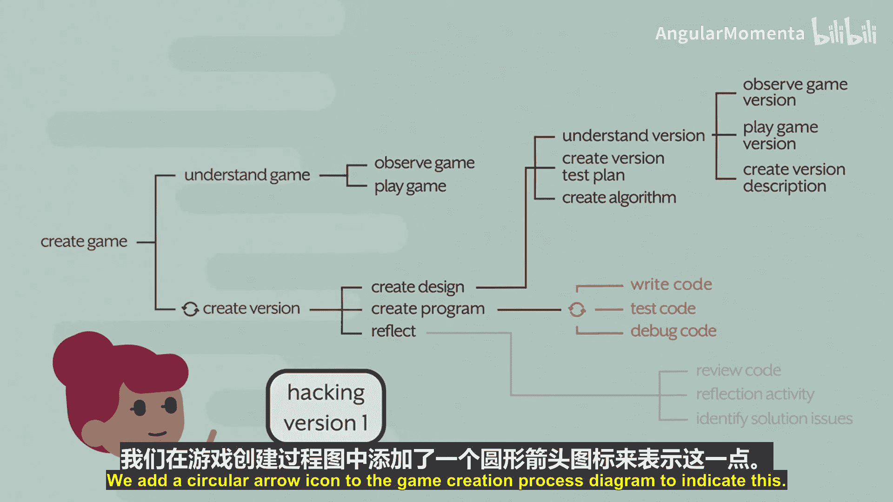
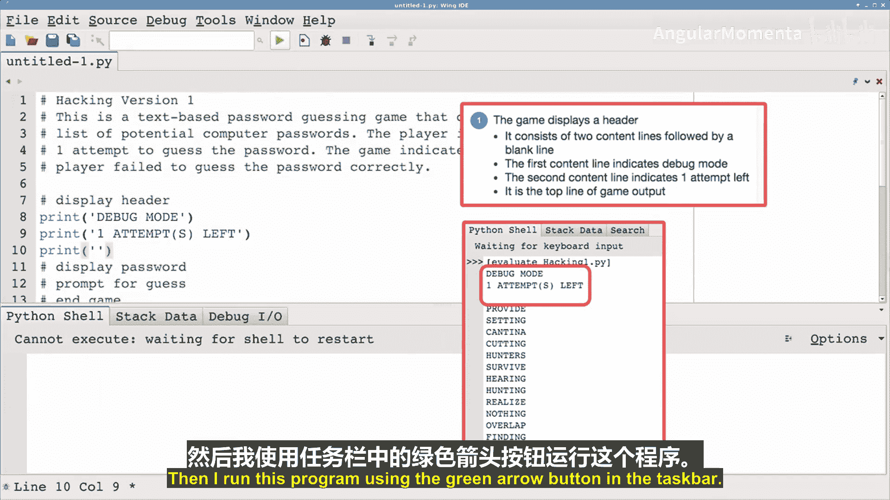
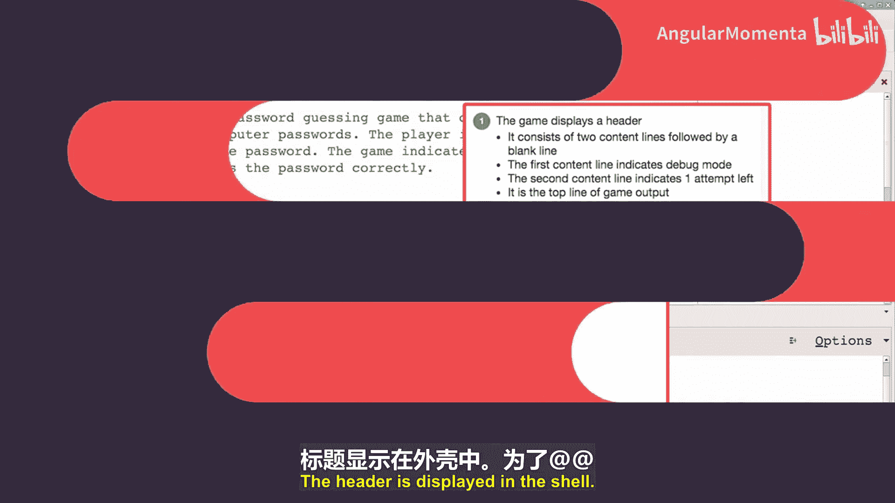
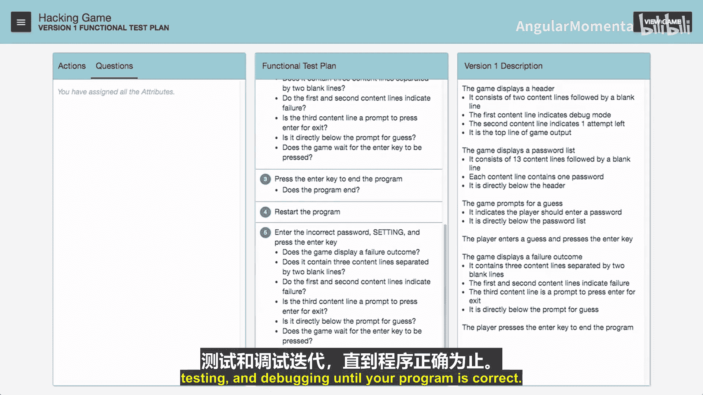

# 【阿尔伯塔大学】问题解决Python编程和电子游戏 ｜ Problem Solving, Python Programming, and Video Games p22 03_09_01_program-hacking-version-1 -BV1N5rLBWE1c_p22-

。Let's check the status of our game using the game creation diagram。

 You've completed the design for version 1， consisting of a version description。

 a functional test plan， and an algorithm。The next subtask in Cre version is create program。

Now that you have a robust design， it is time to implement that solution。

Writing code is refinement because it is more precise than your algorithm。

Let's use our cake algorithm as an example。I can't use the cake algorithm by itself to bake a cake。

 I need more details for each step。 For example， to follow the algorithm step， make batter。

 I need to know the batter ingredients， the amount of each ingredient and how to combine them。

To follow the baked cake step， I need a baking temperature and time。

We can create a recipe from the algorithm by adding details。

 The recipe is an implementation of the algorithm， just like code is an implementation of a software algorithm。

We need a process to translate algorithms into code。

The three subtasks of create program are write code， test code， and debug code。

Writing code is the process of translating your algorithm into a programming language。

 Each step of the algorithm will become one or more sequential statements in some programming language。

In this course， you're using Python。Once you have some code written， you need to test it。

You test code by running it and determining what errors have occurred。

You will make many errors when you write a Python program。Don't be discouraged。

 making errors is a very important part of the learning to program。

Debugging is the process of discovering exactly what part of the code caused the error and deciding how to fix it。

Learning to debug is just as important as learning to write code。

Testing and debugging are not the same process。 Testing is running your code to determine which errors exist in the program。

Debugging is discovering which program statements cause the errors and analyzing how to fix those statements。

Once you know how to fix an error， you must edit your code。

This may involve changing existing statements or adding new statements naturally when you write new statements。

 you will need to test and possibly debug them as well。

So you will need to repeat the right test debug process multiple times we add a circular arrow icon to the game creation process diagram to indicate this。

In this course， we write our code using an integrated development environment or I DE for short。

 We will use a free version of the wing I DE。An IDE is used to write， run， and debug code。😡。

Writing code using an IDE is analogous to using a text editor such as Microsoft Word or Google Docs to write an essay。

Before we start coding， let's look at the panels of the winging IDE。To start a new program。

 I can either select fileile new or press the Blue Page button on the taskbar。

A new program called Untitled-1。tyy appears in the panel directly below the taskbar。

The panel now has line numbers on the left hand side。

 which will help you determine the locations of errors in statements Below the program is a panel with tabs。

 search， stack data and Python shell。 The search tab is for findinging and replacing words in your program。

We'll discuss the stack data tab when we use some related debugging features in a later version of hacking。

The Python Shell tab should be familiar to you from the programming language lessons。

You may see other tabs configurations in your IDE。All right， let's start coding。

One of the challenges of programming is making sure that your code is easily understood and well documented。

 not only for other people to use， but for yourself as well。

We often think that we'll remember exactly how our code works after weeks or months have passed。

 Unfortunately， returning to a poorly documented project after an extended period of time leads to frustration and delays。

Good documentation includes descriptive identifier names and comments that indicate the intent of the code。

You make a comment line using the number sign key at the start of the line。

Comments are intended for human use and are ignored by the Python interpreter。

I'll start by adding comments that include the title of this game version and a short summary of the game。

All right， now let's translate our algorithm into code。

The first step of our algorithm is display header。 Let's add a comment called display header。In fact。

 I'll add each algorithm step as a block comment that describes the block of program statements that you will write to translate that step。

I start with the main panel and include the four steps， display header， display password list。

 prompt for guess and end game。I then add the comments， display failure outcome。

 and prompt for end under the end game comment， since they are parts of end game。However。

 I put extra spaces in the comments to indicate that they are sub steps of end game。

This makes it pretty easy to see all the algorithm steps we must translate。As we've said before。

 each algorithm step will be translated to a block of one or more Python statements。

Now let's translate the first algorithm step， display header into Python code。

We saw in the programming language videos that Python uses the print function to display a string。

What should the argument strings be？From the version description， you must output debug mode。

 one attempt left， and a blank line。You can find the exact strings by rerunning the program。

I typed the print function calls beneath the display header comment。

 then I run this program using the green arrow button in the taskbar。

The header is displayed in the shell。

I ran the program after translating only the first algorithm step to make errors easier to find。

If testing finds an error， you need to use debugging to locate the statements that cause the error。

If you test after only making a few additions or changes。

 it's easier to identify the statement where the error occurred。For example。

 I will remove the right paren from the last print function call of drawaw header。

 but I won't test the program。Instead， I'll translate more algorithm steps。

I'll leave the display password list translations for an activity and translate the prompt for guests instead。

A prompt displays some text and captures user key presses as a string。

We can translate our prompt step into a call to the Python input function。

The same algorithm step will be translated to other function calls in other languages。

 such as Readline in Java and getS in C。I'll write the input function call with an argument string that starts with enterter a password and ends with a greater than sign。

I'll run the program again using the green Run button。The Python shell reports。A syntax error。

On the input function call line， even though we know that the error is on the print function call line。

The reported line number is not always where the error actually occurred。

We run our program after translating each algorithm step to make debugging simpler。

In the next activity， you will fix this error and translate the rest of the algorithm into code。

You must apply the test plan to your completed code to ensure that your code functions correctly。

Make sure that you perform all of the tester actions from start the program through enter an incorrect answer and press the enter key to exit。

Ensure that the answers to all the questions are yes。 If the answer to any question is no。

 then you must apply more iterations of writing， testing and debugging until your program is correct。

