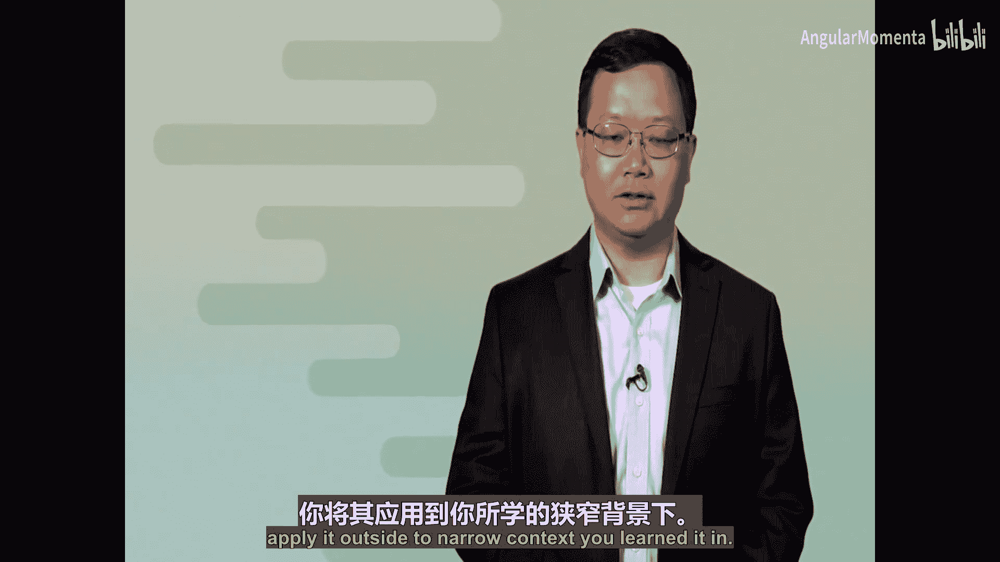

# 【阿尔伯塔大学】问题解决Python编程和电子游戏 ｜ Problem Solving, Python Programming, and Video Games p23 03_10_01_the-reflection-process -BV1N5rLBWE1c_p23-

At this point it might seem like you have finished the application creation process after all you have a working program。

 you first design a solution and then you implemented it。However。

 you're not finished the application creation process。

 let's take another look at the game creation diagram。

There is one more important subtask in to create version task， reflect。

Reflection is an important step in the game creation process。

 Learning a new skill usually involves a narrow focus on a specific situation。

 It is necessary to generalize the skill so it can be applied to new situations。

 solution generalization replaces a solution to a specific problem with a solution to solve a group of related problems。

 including that specific problem。It is one form of a new problem solving technique called abstraction。

For example， I can bake my first cake by creating a chocolate cake recipe from the cake algorithm。

 as discussed in a programming and coding lesson。 After baking a single cake。

 I won't necessarily be able to make a different kind of cake。

 I want to use the knowledge that I gained when I created a chocolate cake recipe to create a recipe for any kind of cake。

 such as a cheesecake or coffee cake。😊，This is an example of solution generalization。

 where a general cake recipe would replace separate recipes for different kinds of cake。

 The algorithm steps such as making a batter and baking the cake remain the same。 However。

 I need to identify what details correspond to parameters that I will change when I switch recipes and what details remain the same。

 For example， turning on the oven will not change。 but the oven temperature will change。

You must learn to generalize the code statements you write by changing the functions。

 literals and other objects you use to solve different problems。 For example。

 you printed specific password strings during your coding activity。 However， more generally。

 the print function can be used to print any string。 Even more generally。

 you can perform a different action by using a different function call such as input。

Reflection takes a skill you learned and lets you apply it outside the narrow context you learned it in。

