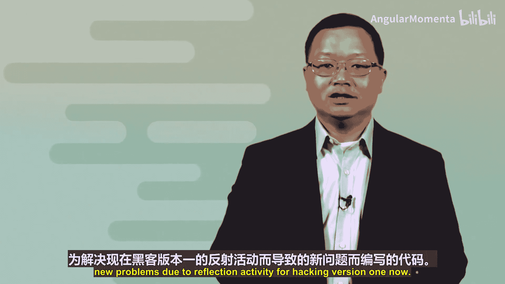

# 【阿尔伯塔大学】问题解决Python编程和电子游戏 ｜ Problem Solving, Python Programming, and Video Games p24 03_10_02_review-code-for-hacking-version-1 -BV1N5rLBWE1c_p24-

🎼。Reflection has three subtask。 review code， Ref activity and identify solution issues。

 The first subt of reflect is review code。To gain a deeper understanding of the program you wrote。

 you should inspect your program statements when at a time in the order that they are run。

 Your goal is to understand how the statements work together to implement the game。

 We can use the debugger to trace the way that the Python interpreter runs a program to start tracing。

 I press the start debugging button， which is also called the step into button。

 This button has an arrow into a box icon。The debugger highlights the first statement of the program to indicate which statement will be evaluated first。

It is an expression statement containing a print function call to evaluate this statement。

 I will press the step over button， which has an arrow over a box。As expected。

 when this function call is evaluated， it displays its argument string in the Python shell。

 Each time I pressed this button， the next Python statement is evaluated in sequence。

 I can a red stop button any time to stop the bugging and return to the program。

Let's see what happens when the interpreter evaluates an input function call。

Notice that the next statement is not highlighted， and all the buttons are dimmed。

 except the stop the bugging button。 This is because the input function has not finished being evaluated。

 The input function is waiting for the user to provide an input string。

I will click in the Python shell and enter a password gas。

Since the interpreter has finished evaluating the input function call。

 it now highlights the statement that follows the input function call。

 I can finish the statement by statement tracing the program by continuing to press the step over button one statement at a time。

Tracing shows the sequential statement by statement evaluation that the Python interpreter does by default in future lessons。

 we will introduce statements that change this default sequential evaluation。

 and we will use tracing to follow the non sequential evaluation order。

To ensure that you understand how to trace a program。

 you should try a complete trace of your program yourself。If while you are tracing。

 you accidentally press the step into button instead of the step over button that the bugger may highlight a line that is not in your program。

 For example， this will happen if you press the step into button on an input function call line。

 In this case， you will see code that is part of the implementation of this library function。

To get back to your program code， press the step out button， which has an arrow out of the box icon。

Now that you understand what your code does， let's discuss the quality of your code。

Code quality is enforced using software quality tests。

 These tests are applied in conjunction with the functional tests that you have already created and used。

 Funal tests demonstrate that the code works as intended。

The software quality tests ensure that you've made good coding choices and used best programming practices。

You will not create your own software quality test。

 instead we will provide specific software quality tests for each game version。

For this version of hacking， you will only use one software quality test to check your comments。

You must test two kinds of comments， program comments and block comments。

A program comment is a summary of what your program does。

 it must be included at the start of your program。A block comment appears on one line。

 A block comment must appear above each group of statements that comprise a logical task。

 It must provide a short explanation of the code that follows it。

Here is our solution for hacking version 1。 The game title is at the top of the program and is followed by a short summary。

 We have satisfied the two software quality tests for program comments。

The rest of the comments are block comments。 They were added as algorithm steps during the programming demonstration。

 As written， they satisfied to software quality test for block comments。

Each is at the start of a block of statements that forms a logical task。

We will add more software quality tests as we introduce new coding concepts to the course。

Use these evolving software quality tests as a series of style guides to write your code。

The second subtask of reflect is a reflection activity。

Each reflection activity will enhance your understanding of tokens， syntax， semantics。

 object types and how to generalize the code you have written to solve new problems。

Due to reflection activity for hacking version 1 now。

