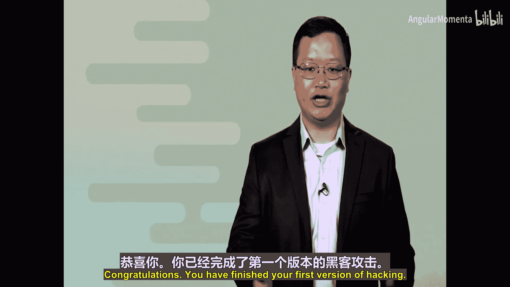

# 【阿尔伯塔大学】问题解决Python编程和电子游戏 ｜ Problem Solving, Python Programming, and Video Games p25 03_10_04_solution-issues -BV1N5rLBWE1c_p25-

The third and final subtask of reflection is identify solution issues where we discover parts of our solution that can be improved。

For example， one solution issue of hacking version 1 is that we use multiple print function calls for each of the display sections。

 header， passwords and outcome。This is the most obvious way to display multiple lines of text。

Another way of printing multiple lines of text is to combine all of the text we want to print in one single string and add new line characters between each line。

A new line character is a special character that can be included inside a literal string using a backslash followed by the letter N。

To display a new line character， the print function starts a new line。Let's run this program。

This program has the same behavior as the program with multiple print function calls。

Both of these solutions are valid， but each has advantages and disadvantages。

 The multiple print call solution is a much longer program。 so requires more typing。

 It repeats the identifier print many times。 The single print call solution is shorter。 However。

 it is hard to read。 In addition， in future versions。

 we will need to manipulate individual passwords from this string。

 We will draw individual passwords graphically。 Check the correct password against the player guess。

 and embed each password in symbolic characters。 If we use a single string。

 It will be difficult to manipulate individual passwords。When multiple solutions are possible。

 you should compare the advantages and disadvantages of each。In future versions。

 we will identify solution issues when we introduce the game version that will address them。

You've now completed two of the reflection subtasks， Ref activity and review code。

 and you have been introduced to the identifydent solution issues subtask。

 This subtask will be completed at the beginning of the next module since it will motivate version 2 of hacking。

Congratulations， you have finished your first version of hacking。

