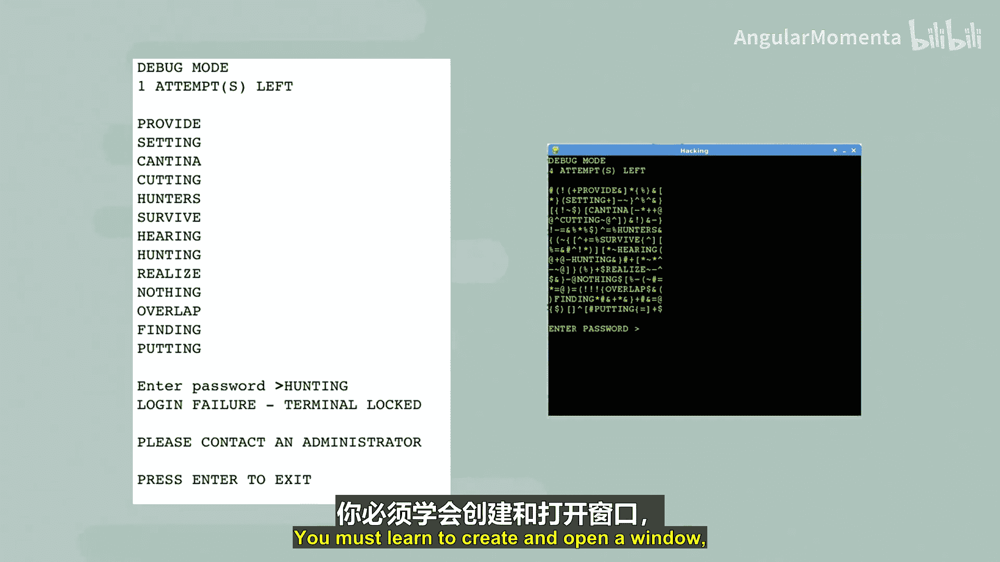

# 【阿尔伯塔大学】问题解决Python编程和电子游戏 ｜ Problem Solving, Python Programming, and Video Games p26 04_01_01_solution-issues-in-hacking-version-1 -BV1N5rLBWE1c_p26-

Every time you finish a game version， you need to decide what to add or improve upon for your next version。

 This process is called identify solution issues。Solution issues are disparities between the solution you are seeking and the design and code you have written。

Identifying these solution issues is key to improving your code and adding or modifying features in a measured and systematic way。

Hack in version 1 is not very exciting and only has a few similarities to the complete game you need to produce。

It displays the heading and the passwords in a black and white textual format。

Although it allows you to input a guess， it only displays unadorned passwords in a Python shell instead of using its own window。

As well， you only have one chance to guess a password。 And no matter whatgan you pick。

 the game reports that you failed。We can recognize at least five different solution issues。

 with hacking version 1。First， code quality is an important facet of identifying solution issues。

In the previous lesson， we discussed some of the disadvantages of using multiple calls to the print function。

 We need to remove these duplicated statements， since repetition makes the program longer than necessary。

 We will solve this problem in hacking version 4 by introducing a language mechanism called a repetition control structure。

Second， when you input the correct password， the game displays that you have failed。

 boring to solve this issue， you need a mechanism to compare passwords to guesses。

You then need to choose whether success or failure needs to be reported to the player。

 You will learn how to do this， in hacking version 3。Third。

 you were only allowed to make one guess before the gay mans。In future versions。

 you must be allowed to make at most four guesses to do this。

 You must be able to consistently repeat steps and statements in your algorithms and code。

 You will learn how to do this in hacking version 5。4th。

 your passwords do not contain any of the symbolic character decorations of the final version to make this improvement。

 You must be able to manipulate the password strings。

 You must add symbolic characters in a random way。 You will learn how to do this in hacking version 7。

😊，Finally， your game is text based instead of graphics based。

 You must learn to create and open a window and draw graphical objects in the window。😊。

For the second version of hacking， the only solution improvements you will make are replacing text of graphics and displaying the player's guess。

The other improvements require you to learn and practice several new design components and Python statements。

To use a graphical window， you must master some new library functions。

 Games that use a graphical window can't use the print function to display text in that window。

 Pri only displays in a terminal window or Python shell。

 It doesn't allow you to specify the location， the color or the font of the text you want to display。

For hacking， you need to display green text in the top left， top right， bottom right。

 and the center of the screen。To do this， you must use a graphics library to display text。

 The functions you have used so far are built in functions included in the Python standard Library。

Unfortunately， the standard library doesn't support graphics。

 You can't use it to open up a window or draw circles or print different colored text。

 So we will use an external library， an external or third party library is a compilation of code provided by the Python community。

 It contains functions in other code that augment the standard library。

Using libraries is an example of using templates。 Using templates is an abstraction technique that uses previously creative solutions and adapts them to solve new problems。

 Re tracing the code of hacking version 1。 If you stepped into the input function。

 you would see the underlying code that implemented it。

This code for the input function was written by someone one else。

 and it can be used by others without rewriting it。

 Consider how difficult it would be to write the games in this course if you had to implement all the built in functions of Python before implementing hacking。

 It would take so long that you would never have time to write the game code that uses these functions。

 Don't spend your time reinventing the wheel using templates。

 builds on the work of others to create solutions more quickly。For this course。

 you'll use a library we created called U A game。 It is a simple library to let you create a window and draw strings in it。

 It is based on a popular Python graphics library， called Piyga。

We use this simpler graphics library to implement all versions of hacking。

 You will use pie game itself in a second game of the course。 Pol the dots。

 Let's add graphics to hacking。

