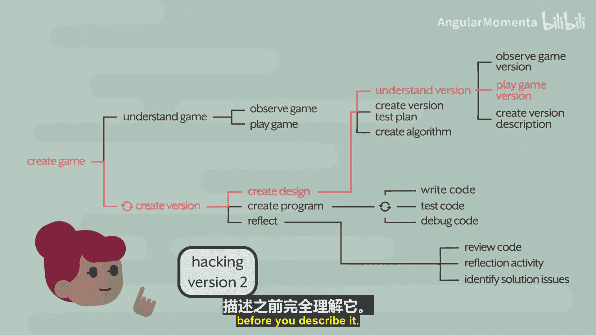

# 【阿尔伯塔大学】问题解决Python编程和电子游戏 ｜ Problem Solving, Python Programming, and Video Games p27 04_02_01_observe-hacking-version-2 -BV1N5rLBWE1c_p27-

In this video， you will observe gameplay for the second version of hacking。

While observing a game you are building， you should ask yourself several questions。

 What does the game look like， When do things appear on the screen。

 What actions does the player take。The game starts Immedialy。

 you can see that hacking version 2 looks quite different from hacking version 1。

A new graphical window opens with the title hacking and a black background。The text is green。

 but the content of the text is the same as hacking version 1。

I'll use the same actions I performed while playing hacking version1。

When I'm prompted for a password， I'm going to enter huntinging the correct password。Unfortunately。

 like the first version of hacking， a failure message appears。 Don't worry。

We'll fix this in the next version。At least the screen clears and the guesses displayed just like in the final version of hacking。

The failure message is correctly displayed in the middle of the screen。In fact。

 hacking version 2 has almost the same functionality as hacking version 1。

 but it has the same graphics and style as the final version。In the next activity。

 you will play hacking version 2 to ensure you fully understand it before you describe it。

