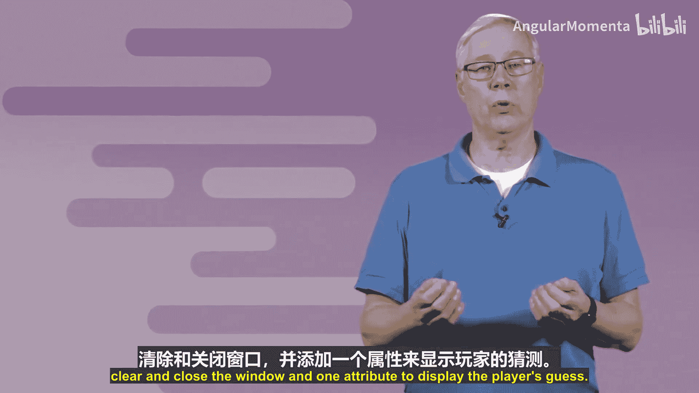

# 【阿尔伯塔大学】问题解决Python编程和电子游戏 ｜ Problem Solving, Python Programming, and Video Games p28 04_03_01_describe-hacking-version-2 -BV1N5rLBWE1c_p28-

🎼。Now that you have observed and played hacking version 2， you're ready to describe it。

 This process of observe， play， describe should become automatic to you as you progress through this course。

Recall that this is a form of experiential decomposition。 It enforces your understanding of a topic。

 which is why these three subtasks form the understand version task。Just as you did in version 1。

 you will be using the description builder to create a description for hacking version 2。 However。

 because the second iteration of your game builds from the first， instead of starting from nothing。

 you're going to modify your version 1 description to create your version 2 description。

With this in mind， the first task in creating the description for hacking version 2 is to get rid of anything from the version 1 description that is no longer relevant。

I will open the version 1 description so I can find the objects。

 attributes and actions that should be deleted。The version 1 description indicates that the location of the header is the top line of game output。

This may seem like it is still true in version 2， since the header is displayed at the top of the window。

 However， location must be specified differently in a graphical window。Therefore。

 this attribute must be deleted from the description。

Since the player's guess is now displayed as part of the failure outcome。

 attributes for the failure outcome must also be changed。

The guess is part of the failure outcomes's content。

This means the content attributes must be removed so they can be replaced with appropriate content attributes for version 2。

Let's close version 1 and open version 2。The description builder has the concepts from version 1 description already loaded in the assembly panel。

However， the inappropriate concepts have been removed。

The functionality in version 2 is the same as version 1。

The two things that have changed are the appearance of the game。

 which uses a graphical window instead of a text based shell。

And the player's guess must be displayed。In version1， after starting the program。

 everything was displayed in the shell。For this version。

 a window appears before anything is displayed。In the left panel， a new object is described。

 the game opens a window。This is our new first object of the game。

 so I will drag this object to the assembly panel above the game displays the header。

If I would have placed it below the header， feedback would have informed me that I had added an object out of order。

Like the previous description activity， I can either add new objects or I can add attributes。

 Let's look at the header attributes。 You will add the window attributes in an activity。😊。

Recall that every display object has five attributes， content， location。Size。Color and timing。

The content of each object does not change when we go from text to graphics。

 So the description of the content attributes will remain the same。When making a graphical game。

 you must describe the location of all objects in the window because you will need to specify these locations in your program。

In the text based game， each print call argument was displayed on a consecutive line without specifying location。

In our description， we will use general terms to indicate window locations such as top left corner or center of the window or directly below some other text。

Since the header is in the top left corner， let's add this attribute to the header。

The next attribute is size for text。 This means font size。 Let's use small。

 medium and large in our descriptions。 in hacking。 all the text is the same size。

 so I'll use small font size。I will add that attribute to the header。

All text in hacking is green on black， so I will add it is green on black to the header。

The last attribute is about timing。In version 1， we address the temporal order in which objects are displayed。

Version 2 introduces a new temporal attribute。 It has a point3 second pause。

 after displaying each line。I will add this attribute to complete the header。In the next activity。

 you will add all of the window attributes and the location。

 size and color to the rest of the objects。You will also add two new actions in the appropriate temporal order to clear and close the window。

And one attribute to display the player's guess。