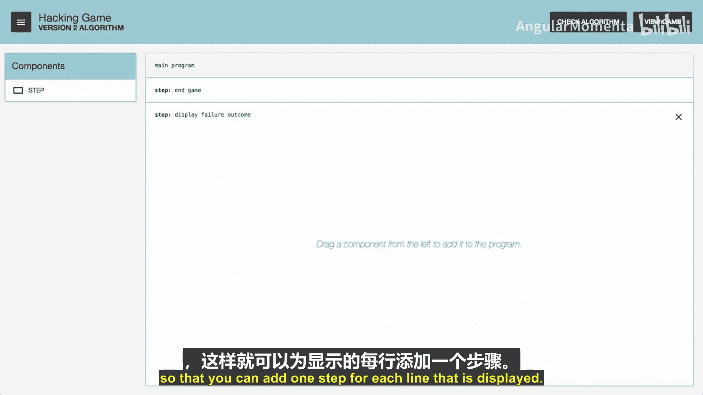

# 【阿尔伯塔大学】问题解决Python编程和电子游戏 ｜ Problem Solving, Python Programming, and Video Games p30 04_05_01_create-algorithm-for-hacking-version-2 -BV1N5rLBWE1c_p30-

🎼The algorithm for hacking version 1 is in the builder。

 Since version 2 of the algorithm includes all the algorithm steps from version 1。

 you don't need to determine which ones to delete。You are going to create your versionion 2 algorithm by adding steps。

Recall that feature selection is used to transform a complex problem into a sequence of problems called versions。

Feature selection is the process of identifying reasonable feature sets to use for each version。

In version 1， you created an algorithm for the smallest feature set。In version 2。

 you will add graphical features。You must use a graphics library instead of built in functions to display text。

Most graphics libraries have a number of common capabilities。 For example。

 you can use a graphics library to open and close a window to display objects in the window and to clear the window。

 You will add steps like these to your algorithm。 Details such as the color of the text are included in your description。

 but they are too precise to be included in any algorithm。 However。

 you will need these details when you write your code。

Your end game algorithm step includes the display failure outcome and prompt for end steps that were included in the previous version。

 You must add other steps to end game。 You must also expand the display failure outcome step to use its own panel so that you can add one step for each line that is displayed。

 This is necessary because the guess must be displayed， and the outcome lines must be centered。

Centering lines requires more complex computation than displaying left justified consecutive lines。

 such as the header and the passwords。Use your completed hacking versionion 2 description and test plan to create the version 2 algorithm from the version 1 algorithm。

