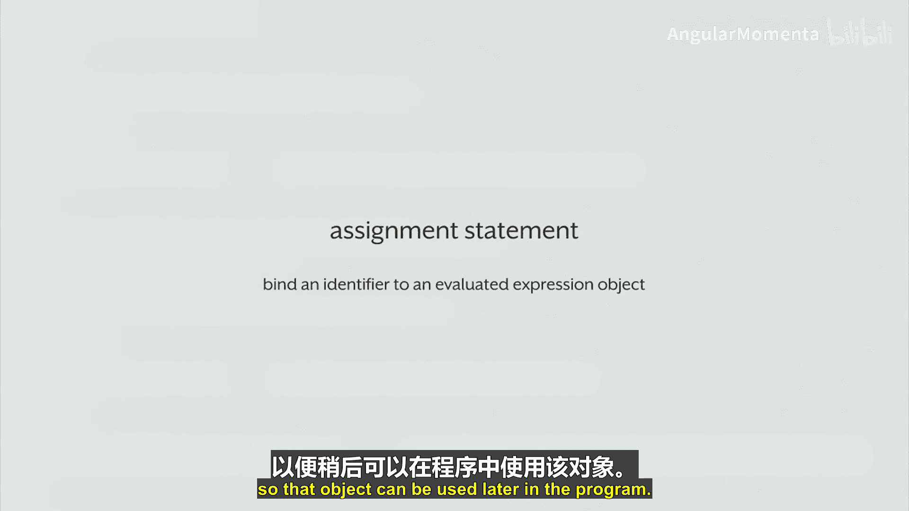

# 【阿尔伯塔大学】问题解决Python编程和电子游戏 ｜ Problem Solving, Python Programming, and Video Games p31 04_06_01_python-assignment-statement -BV1N5rLBWE1c_p31-

🎼。In this video， we introduce one new statement， the assignment statement。

 an assignment statement is used to evaluate an expression and bind an identifier to the result object。

Consider this program。This program prompts the user to enter a color。

Creates a string object that represents the color。Displays the color and then indicates that this is the user's pick。

Purple is my favorite color。 I want to display the color string later in the program。

 rather than right after it was input。I want to input two colors before I display either of them。

The program output should look like this。If we could bind an identifier to each color string returned by the input function call。

 we could use these identifiers any time later in the program to refer to these string objects。

The code would look like this。This code uses a new kind of statement called an assignment statement to bind the identifier favorite to the first color。

It uses a second assignment statement to bind the identifier's second favorite to the second color。

Since we have two kinds of statements， expression statement， and assignment statement。

 I will put them in a syntax diagram。Now I will show you the syntax and semantics of an assignment statement。

We will only discuss the simplest form of assignment statement。

 which binds a single target to an evaluated expression object。Here is the syntax diagram。

An assignment statement consists of a target， an assignment symbol， and an expression。

The simplest form of target is an identifier。We will discuss other kinds of targets in a future lesson。

The assignment symbol is a delimiter token consisting of a single equal sign。

It does not designate equality in Python and is usually pronounced assigned or gets rather than equals。

The semantics of an assignment statement whose target is an identifier are one。

 evaluate the expression to obtain a result object。2， if the identifier is not in the name space。

 add it to the name space 3， bind the identifier to this result object。

We will discuss how to bind targets that are not identifiers in a future lesson。

I will show you how the Python interpreter interprets this program。

The Python interpreter first uses lexical analysis to successfully create a sequence of tokens。

It then applies syntax analysis to combine these tokens into statements。

Statement 1 is an assignment statement whose target is the identifier favorite。

 followed by the assignment delimiter。And it ends with an expression。

 which is a function call to the built in function input。Statement 2 is also an assignment statement。

The other four statements are expression statements。Since the program is syntactically valid。

 the interpreter applies semantic analysis to evaluate the program， one statement at a time。

Here is a diagram of the namespace When the program starts， containing the prebound identifiers。

 input and print。To evaluate statement 1， the interpreter applies the semantics for an assignment statement。

First， it evaluates the expression。To evaluate the expression。

 the interpreter uses function called semantics。Let's skip the details of the function call semantics。

 The result is that the input function call displays its prompt string and returns a string that represents whatever keys the user typed before pressing the enter key。

In this case， the string is purple。The interpreter then continues with step 2 of the assignment statement semantics by looking for the identifier favorite in the namespace。

Since the identifier favorite is not in the name space， the interpreter adds it。

The interpreter then applies step 3 of the semantic rule to bind favorite to the string object purple。

Statement 2 is evaluated in a similar way。 So second favorite is bound to the return object of the second input function call the string red。

Statement 3 is an expression statement that calls the built in function print to display the literal string you picked。

Statement 4 is also an expression statement。 When the interpreter applies the function call semantics。

 it evaluates the function argument， which is an identifier。

Dereferencing the identifier favorite is exactly the same as dereencing the print identifier。

Recall the semantics for evaluating an identifier expression。

Since the identifier favorite is in the name space。

 it is de referenced to obtain the object it is bound to the string object purple。

Since this object is the argument to a print function call， purple is displayed。

Statement 5 is an expression statement that calls the built in function print to display another literal string and。

Statement 6 is similar to statement 4， except the interpreter dereferences the identifier's second favorite to obtain the red string and displays it。

An identifier that is bound can be rebound to a different object。

If the semantic rule for binding an identifier is applied to an identifier that is already bound。

 then the identifier is already in the name space， so it is not added。However。

 it is rebound to the object that the expression evaluated to。 The previous binding is gone。

Consider this program。When this program starts， the namespace contains three predefined identifiers。

 L， ID and print。Each bound to its own function object。This program has no lexical or syntax errors。

 Statement 1 is an assignment statement。When statement 1 is evaluated。

 the expression consisting of the identifier ID is evaluated。

The ID identifier is de referenced to obtain the ID function object。

The target identifier L is in the namespace， so it is not added。

 L is then bound to the I D function object。In statement 2。

 the expression consists of a function called print applied to an argument expression。

 which is a function called L with argument expression， the literal string hello。

The literal string evaluates to the string object， Ho。

The identifier L is then dereferenced in the namespace to obtain the ID function。

This I function is applied to the Hello string object to obtain the hard to remember identity object。

Notice that the length function is not applied since the L identifier was rebound to the ID function object。

This I D function returns the hard to remember identity object of the hello string。

The print function call displays this identity object in human readable form。

 I did this to show you that any identifier can be bound to any object。However。

 don't try this at home。You should never red an identifier that is prebound before our code is evaluated。

You can use the builtt in DIR function to examine the namespace as you evaluate Python expressions。

Remember， typing DIR of underscore， underscore， built ins underscore underscore。

Displays the names from the name space that are prebound to built in objects。

If I call D I R in a shell with no argument。It displays some names that start with two underscores and end with two underscores。

The names that appear depend on your Python implementation。If I bind an identifier and rebind then。

And then call the DIR function again。It now includes favorite to indicate that it has been bound。

It also includes L to indicate that L has been rebound to a different object than its pre binding object。

We won't investigate the other names that contain underscores in this course。In this video。

 I have described the syntax and semantics of the assignment statement。

An assignment statement can be used to bind an identifier to any object。

 so that object can be used later in the program。

