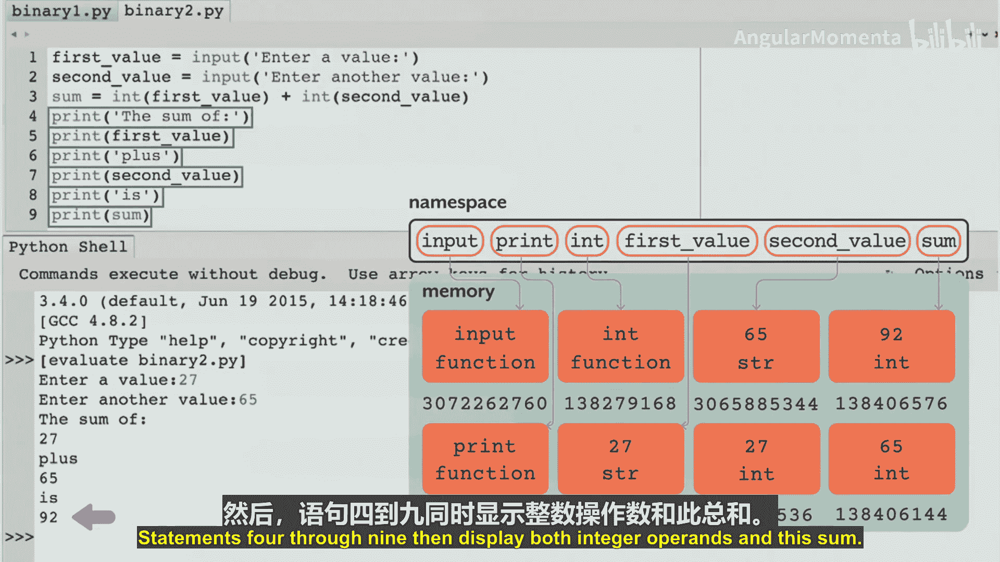

# 【阿尔伯塔大学】问题解决Python编程和电子游戏 ｜ Problem Solving, Python Programming, and Video Games p32 04_07_01_python-binary-expression-and-operator-token -BV1N5rLBWE1c_p32-

🎼。In this video， we introduce one new kind of expression， the binary expression。

 and one new kind of token， the operator token。We will add the binary expression to our expression syntax diagram。

We have already introduced three of the five kinds of Python tokens， delimiters， literals。

 and identifiers。In this lesson， we introduce the operator token。

Consider this program whose third statement contains a binary expression and an operator token called plus。

This program prompts the user to enter two values and binds the identifier's first value and second value to the two string objects returned by the input function。

I will run this Python program， I will enter 27。And 65。The answer is 2765。 What happened。

Every statement， except for statement 3， contains tokens and expressions that you have already studied。

 All of these statements have valid lexix and syntax。What about statement 3。

 Let's apply lexical analysis， syntax analysis and semantic analysis to statement 3。

Statement 3 contains these tokens。The identifier sum， assignment delimiter。

 and the identifier first underscore value。The next character is a plus and no token kind that we have described so far starts with a plus character。

The plus character is a new kind of token called an operator token。

An operator is used to compute a result object from one or more operas。

Since there are only 19 operator tokens， we list them in a lexical table instead of using a lexical rule。

Some mathematical operators are represented by the same operator token in Python。

Some are represented by different operator tokens， and some are not represented by any operator token。

Plus sine and minus sign are the same in Python as in mathematics。In mathematics。

 we use a product symbol or a dot to represent multiplication， and in Python we use the star symbol。

The mathematical comparison operator less than or equal sign。

 is represented by two symbols in Python， the less than sign followed by the equal sign。

In mathematics， exponentiation is denoted by a superscript， but in Python。

 the star star operator token is used。Equal sign is an equality operator in mathematics。

 but in Python， the equality operator is equal sign， followed by another equal sign。

Recall that equal sign by itself is actually the assignment de limititer token。

 not an operator token。It is a common programming error to use the assignment delimiter token when you should use the E operator。

The factorial operator uses an exclamation mark in mathematics。

 but there is no factorial operator token in Python。

You just saw that the operator token table contains both star star and star。

If the lexical analyzer encounters star star， does it create a single operator token， star star。

 or two operator tokens， star and star？We can apply the longest token rule to operator tokens。

 just like we applied it to literal integers and identifiers in the lexical analysis lesson。

 So the answer is one long token， star star。The last token in State 3 is the identifier second underscore value。

Statement 3 is an assignment statement where the expression is a new kind of expression。

 a binary expression。Here is the syntax diagram for a binary expression。

This syntax diagram contains a new non terminal binary operator。 For now。

 we will use this syntax diagram for the non terminal state binary operator。

Any operator token except for Tilda， can be used as a binary operator。In future lessons。

 we will generalize binary operator to include some other tokens that are not operator tokens。

The expression in statement 3 is a binary expression since first value matches the first expression as an identifier。

 the plus sign token matches the binary operator state。

 and the second value matches the second expression as an identifier。

A binary expression is used to apply an operator function to two operaand objects。

The function that is applied depends both on the binary operator and the type of the two opera。

The semantics of a binary expression are evaluate the left expression to get the first operaand object。

 evaluatevaluate the right expression to get the second operaand object。

 identifydentify the operator function based on the binary operator and the type of the two operarans。

 Apply the binary operator's function。In a future lesson。

 you will discover that some binary operator functions may ignore the second expression。

Before applying these semantics to State 3， I will quickly apply semantics to statements 1 and 2。

When the program starts， there is a namespace containing all of the prebound identifiers。

 In our case， the only prebound identifiers used in the program are the built in function names。

 input and print。Statements 1 and2 are assignment statements。

Statement1 prompts the user to enter a string In this example。

 the input function returns the string object 27。The interpreter。

Adds the identifier first value to the namespace and binds it to the string object。

Statement 2 adds the identifier's second value to the name space。

 and in this case binds it to the string object 65。Now。

 let's apply the assignment statement semantics for State 3。The expression is a binary expression。

 so I will apply the binary expression semantics to it。First。

 evaluate the left expression to get the first opera end object。

Since the left expression is an identifier expression， we use the semantics for an identifier。

Since the identifier first value is in the namespace。

 the interpreter dereferences it to obtain the string object 27。

The interpreter must evaluate the right expression to obtain the second opera end object。

Since the right expression is an identifier expression。

 the identifier's second value is de referenceferenced to obtain the string object 65。

The binary operator is a plus operator token， and the types of the two operarans are string。

 so the interpreter finds the operator function that implements plus for strings。

This function is string concatenation。When the string concatenation function is applied to the operarans。

 stringing object 27 and string Ob 65， the resulting string object 2765 is created。

To complete the semantics of the assignment statement。

 the identifier sum is added to the namespace and bound to this string object。

Statements 4 through9 display the program output。To compute the numerical sum of two numbers。

 I can use the built in function int， which creates an int object from a string object。

 Here is the Python documentation for the int function。And here is the revised program。

In this program， the binary expression in statement 3 contains two function call expressions。

The first call evaluates to the integer object 27， and the second call evaluates to the integer object 65。

When the binary expression semantics are applied， the interpreter finds the operator function that implements plus for integers。

This function is numerical addition。The interpreter applies this numerical addition function to obtain the integer Ob 92。

 It then binds the identifier sum to this object。Statements 4 through 9。

 then display both integer upperarounds and the sum。

In this video， we have introduced operator tokens and binary expressions。

