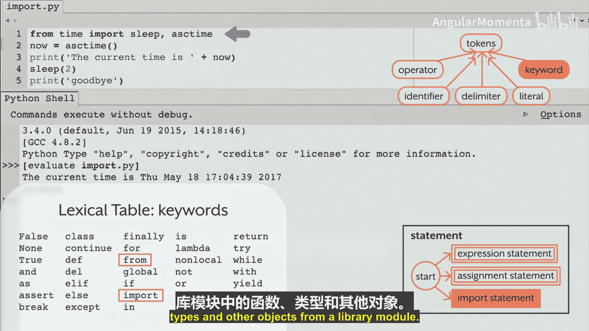

# 【阿尔伯塔大学】问题解决Python编程和电子游戏 ｜ Problem Solving, Python Programming, and Video Games p33 04_08_01_python-import-statement-and-keyword-token -BV1N5rLBWE1c_p33-

🎼，In this video， we introduce one new kind of statement， the import statement。

 as well as the last token kind， keyword。An import statement allows us to use functions， types。

 and other objects from a library module。So far， you have only used built in functions in your code。

 However， there are only a limited number of built in functions。

 If you want to add functionality to your code that is not supported by the built in functions。

 you need to use a module。A module is a Python program with its own statements and namespace。

 a module provides functions， types， and other kinds of objects that you can use in your program。

The standard library includes many modules。 For example， if you want to pause during a program。

 there' is no built in function that does this。 However。

 the sleep function in the time module of the standard library pauses。What went wrong。

 The names sleep is not in the program's namespace。

 It is not prebound like the function name L and the type name int。

 I can check the namespace using the built in D， I R function。To use objects from a module。

 I need to use a new kind of statement called importport。

It worked since there was a two second pause before the interpreter prompt was displayed for the next expression。

I will show you that sleep is now in the namespace。

Importing a module is like using an external resource in the real world。 When I' am preparing a meal。

 I use many local resources。 I may use vegetables from my fridge and bread from my cupboard。 However。

 sometimes I want to serve a food item from outside my home。 For example。

 I might pick up a birthday cake at the bakery。 I import the cake from another locale。😊。

I can customize this cake by adding birthday candles， but the cake itself is not a local item。

I will add import to the syntax diagram for statement。

An import statement imports identifiers from a module into your program's namespace so that you can use the objects the identifiers are bound to。

There are several different syntactic forms for an import statement。

 this lesson introduces the from form of the import statement。To understand this syntax diagram。

 I must first introduce the keyword token。There are 33 keywords in Python from and import are both keyword tokens。

A keyword looks like an identifier， but is a reserved word that cannot be used as an identifier。

Trying to use a keyword as an identifier results in a syntax error。 For example。

 if I tried to bind the keyword from using an assignment statement， a syntax error occurs。

Recall our lexical rule for identifiers starts with a letter or underscore and is followed by zero or more letters。

 underscores or digits。I must modify this identifier token rule to exclude keywords。

Let's apply synyntax analysis to this import statement。The first token is the keyword from。

 which matches the from terminal state in the syntax diagram for import statement。

The next token is the identifier time， and the next state is the non terminal state module。

In this lesson， we use the simplest version of the module non terminal state。

 which is a single identifier。The identifier time matches the identifier state in module syntax diagram。

The next token in an import statement must be the keyword import。

Following this keyword state are states that match one or more identifiers separated by commas。

Notice that there is no comma after the last identifier。

Since there are no more tokens in the statement and the current state identifier is an accepting state。

 this is a syntactically valid import statement。Before I show you the semantics of the import statement。

 let's run a program that uses it if I run this program。It displays the current time。

 pauses for two seconds， and then displays good。 The sleep and ask time functions are not built in Python functions。

 Instead， they are contained in a library module called time。

An import statement creates a name in your program's namespace for each module object that you want to use。

Here are the semantics of the import statement。I will apply these semantics to the import statement in our program。

In step 1， the interpreter uses the module named time to find the time module。In step 2。

 the interpreter evaluates the time module by evaluating its statements。

 We cannot see time statements， but they are evaluated the same way the interpreter evaluates our program。

 One statement at a time。Evaluating time statements creates objects in memory。

 adds some names such as sleep and ask time to time's namespace and binds the names to some of the created objects。

In step3， the interpreter de references the Sle and ask time names in Time namespace to obtain the two objects they are bound to。

In step 4， the interpreter looks in the program's name space and does not find either sleep or ask time。

 So it adds both names。 In step 5， the interpreter binds the name sleep and ask time in the program's namespace to the objects found using Times namespace from step 3。

When the program evaluates the second statement， it uses the semantics of an assignment statement。

 which you saw in the assignment statement lesson。It first evaluates the function call expression by looking for ask time in the program's name space。

 It binds ask time and dereences it to obtain the ask time function object。

 It evaluates this function object and returns a string object representing the current date and time。

Finally， it adds the identifier now to the program's namespace and binds it to this string object。

The third statement is an expression statement containing the print function call。

The interpreter evaluates this function call by looking for the name print in the program's namespace。

 It binds the name print and dereences it to obtain the print function。

 It then evaluates the argument binary expression by concatenating a literal string and the string object that the identifier now is bound to。

 It displays this string object as the current time and date。

The fourth statement is at an expression statement containing a function call。

 The interpreter evaluates this function call by looking for the names sleep in the programme's name space。

 It finds the name sleep D references it to obtain the sleep function and evaluates it with the argument object 2。

This function pauses the program for two seconds and returns an object whose type is none type。

 which is ignored。The fifth statement displays a goodbye string and the program ends。

You can use multiple import statements to import names from multiple modules。

These statements can be placed in any order as long as you import a name before you use it。

In this video， I introduced one new kind of statement， the import statement。

I also described the last token kind， keyword。An import statement allows us to use functions， types。

 and other objects from a library module。

