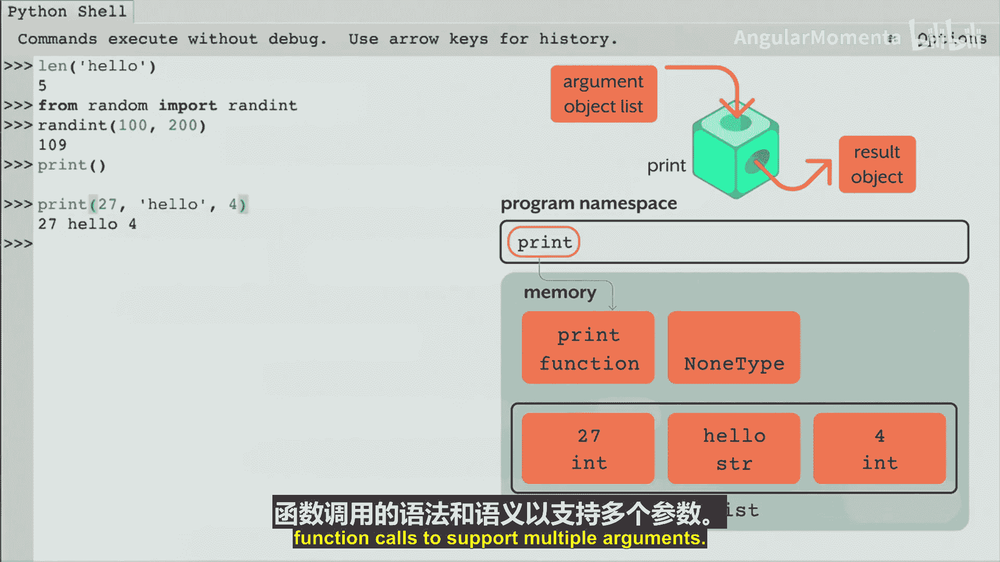

# 【阿尔伯塔大学】问题解决Python编程和电子游戏 ｜ Problem Solving, Python Programming, and Video Games p34 04_09_01_python-multi-argument-function-call -BV1N5rLBWE1c_p34-

In this video， we generalized the syntax and semantics of the function call expression to support multiple arguments instead of zero or one argument。

Here is the current syntax for a function call with zero or one argument that you have already seen。

Different functions actually support different numbers of arguments。 For example。

 the L function has exactly one argument。 The function Rant from the random module in the standard library has two arguments。

This function returns a random number between its two argument objects。

Many Python functions can accept a variable number of arguments。 For example。

 when the print function is called with no arguments， it displays a blank line。

When the print function is called with more than one argument。

It evaluates its argument expressions and displays all the result objects on one line separated by single blanks。

Here is the documentation for the builtt in print function。

The symbol star before the first argument objects indicates that this function accepts any number of arguments。

0 or more at this argument position。 That is why I could successfully call print with one argument。

 No arguments or three arguments。We will ignore the rest of the print function argument documentation until a future lesson。

 I will generalize the function call syntax to support more than one argument。

Here is a simplified syntax diagram for the non terminal argument list state that supports one or more argument expressions。

I will use these syntax diagrams to show that print of 27， hello， and 4 has valid syntax。

There are eight tokens in this line。From the start state。

 the identifier token print matches the identifier state。

 the left parentend delimiter token matches the left parent state。

The next state is the non terminal state argument list。

 Exp this non terminalmin state to reveal the expression state。

 Exp the expression state to reveal its literal identifier。

 function call and binary expression states。 The literal integer token 27 matches the literal accepting state。

 So the expression is valid。 The next token is the comma delimiter， which matches the comma state。

 The next token is the literal string token。 Hello， Exp the expression state。

 again reveals its internal state。 and hello matches the literal state。 So this expression is valid。

The next token is the comma delimiter， which matches the comma state。

 The next token is the integer literal4。 expandingand the expression state again finds a match with the literal state。

 So the expression is valid。The next token is the right par delimiter token。

 so the interpreter does not want to match any more expressions。

 Since the current expression state is an accepting state in the argument list non terminal state。

 Arment list is valid。 Reing to the syntax diagram for function call。

 The right par token matches the right Par state。 There are no more tokens。

Since the current state is an accepting state for the function call， the function call is valid。

Since function call is an accepting state in the expression syntax diagram。

 the entire expression has valid syntax。Since the syntax is valid。

 the interpreter can apply semantic analysis Here is the previous semantic rule for evaluating a function call with zero or1 arguments。

I will modify this semantic rule to support multiple arguments。Step1 is the same。Step2 becomes。

 if there is an argument list， evaluate it to obtain an argument object list。

 otherwise create an empty argument object list。Step 3 becomes pass the argument object list to the function。

Step 4 is the same。The semantics of the non terminalmin argumentless state are。

Evaluate each expression from left to right and add the result objects to an argument object list in order。

Let's apply these semantic rules to the multiar print function call。When the program starts。

 the name print is pre round to the print function object。

Step one uses the semantics of identifier to dereference print in the program's namespace to obtain the print function object。

Step2 checks if there is an argument list， since there is an argument list between the parentheses。

 the interpreter applies the semantics of an argument list。

Evaluate each of the three argument expressions using the semantics of literals。

Then add each result object to the argument object list， it will contain three objects， integer 27。

 string Ho， and integer 4。Step 3 passes this list of three objects to the print function object。

Recall that a function is like a box with an argument object as input and a result object as output。

 The input is actually a list that contains0 or more argument objects。

Step 4 evaluates the print function object to display the three argument objects，27。

 Ho and 4 in human readable form， each separated by a blank。

 The print function returns an object whose type is none type， and this object is ignored。

In this video， we generalize the syntax and semantics of function calls to support multiple arguments。

