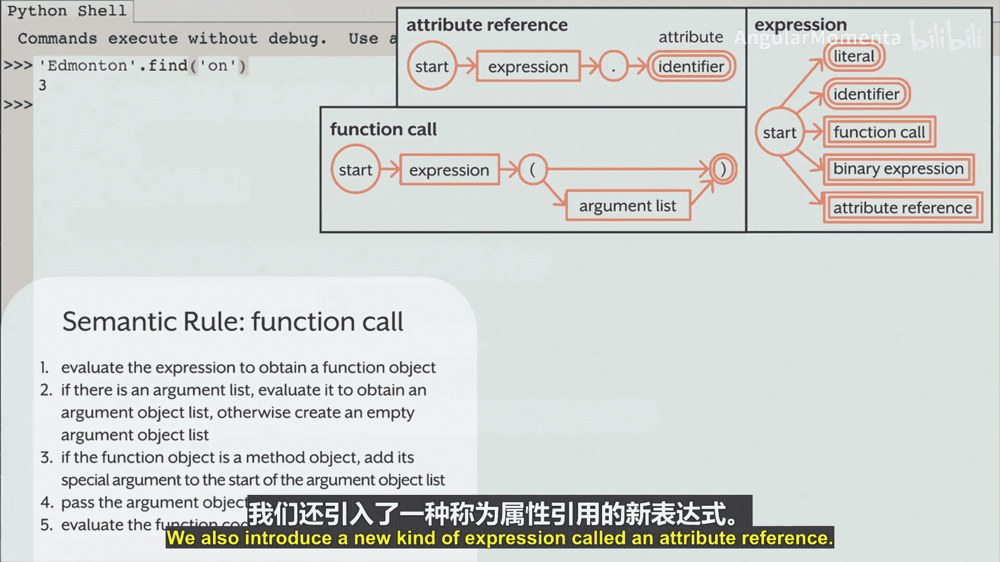

# 【阿尔伯塔大学】问题解决Python编程和电子游戏 ｜ Problem Solving, Python Programming, and Video Games p35 04_10_01_python-method-call-and-attribute-reference -BV1N5rLBWE1c_p35-

In this video， we generalize the syntax and semantics of the function call expression to include a special kind of function call named a method call。

We also introduce a new kind of expression called an attribute reference。

You have seen that every program has a namespace that binds identifiers to objects， in addition。

 most objects have their own namespaces。A name in an object's namespace is called an attribute。

A new kind of expression called an attribute reference is used to access an object whose name is in the object's namespace。

For example， every string object has an attribute named Lower that is bound to a method object。

In this course， we will assume that the name space of an object is created when the object is created。

In fact， the way namespaces are managed varies across Python implementations。

Here is a new syntax diagram for an expression that contains an attribute reference。

And here's the syntax diagram for an attribute reference。The attribute must be an identifier token。

 You can see from these syntax diagrams that R 2 D2 dot lower is a syntactically valid attribute reference whose expression is the literal string。

 R 2 D2 and whose attribute is the identifier lower。

 Here are the semantics of an attribute reference。 One， evaluate the expression to get an object。

 And then two， if the attribute is in the namespace of the object， return the object it is bound to。

 Otherwise， report an attribute。When I evaluate the attribute reference， R2D2。 lower。

The interpreter applies the attributes reference semantics。First。

 the expression is the literal string R2 D2。When the interpreter evaluates this literal。

 it creates the literal object R2 D2。Since this is a string object。

 its namespace contains the identifier lower with a binding to a method object。Second。

 the interpreter finds the identifier lower in the namespace of R2 D2。

 and dereences it to obtain the method object lower for this string object。

So every string has an attribute called lower that is bound to a method object。

What is a method object and what are methods used for？

A method is a function that operates on a particular type of object。

 We say the method is associated with the type。The object that the method is applied to is called a special argument。

Method application has different syntax than a normal function call。

 The special object is not an evaluated expression in an argument list like a normal function call。

 Instead， the method call uses the syntax of an attribute reference where the special object is an evaluated expression before a dot and the method name is placed after the dot。

😊，For example， the method lower operates on a string object。

And returns a similar string object with all uppercase letters converted to lower case letters。

If lower was an ordinary function call， the function call would look like this。

But lower is not an ordinary function call， so this syntax doesn't work。

There is no built in function called lower。 Instead。

 there is a built in method associated with the string type whose name is lower。

You can look at the documentation for the built in methods by looking at the type documentation。

Some methods require ordinary argument objects in addition to the special argument。 For example。

 the string method find also requires an ordinary string argument。

The find method returns the index of a string where the first occurrence of a sububstr starts。

In this case， the first occurrence of the substring ON is at index 3 of the string Edmonton。

In Python， string indexes are numbered from 0。 So 0 is E 1 is D。2 is M， and 3 is O。

 This O is the start of the first occurrence of O， N。

I will generalize the syntax of function calls to include method calls。

Here is the current syntax for a function call that you have already seen。

To generalize this syntax to include method calls， we replace the identifier state by the expression state。

So that any expression， including an attribute reference。

 can be used in the function call instead of using a single identifier as a function name。

I will use these syntax diagrams to validate the syntax of this method call expression before defining the semantics of method calls。

You have already seen that the first three tokens， R2 D2 dot and lower match the attribute reference。

 which is an expression。 The last two tokens match the left and right parent states in the function call diagram。

 so this sequence of tokens is a valid function call。

Since R2D2 dot lower evaluates to a method object instead of a normal function object。

 this expression is aethical。Now I will generalize the semantics of a function call to include the semantics of a method call。

Step one becomes evaluate the expression to obtain an object。Step two is the same。Step 3 is new。

 If the expression object is a method object， add its special argument to the start of the argument object list。

Step 4 is the previous step 3。Step 5 is the previous step 4。

Here is how the interpreter applies the function call semantics to Edmonton。findon。First。

 it evaluates the expression which consists of the attribute reference Edmonton。 Find。

Applying the semantics of an attribute reference， the first semantic step of attribute reference is to evaluate its expression by creating the string object。

 Edmonton。Since this is a streaming object， the interpreter creates its namespace as well。

The second step of attribute reference is to locate the attribute called find in the namespace of a Edmonton and dereference it to obtain the method object find。

Since the attribute reference has been evaluated， the interpreter returns to the semantic rule for function call and performs step2 if there is an argument list。

 etc。The argument list contains a single literal string expression O N。

 So a one element argument list is created that contains the string object， O N。In step 3。

 the interpreter evaluates the expression and identifies that find is a method object。

 so it adds the special argument Edmonton at the start of the argument object list。In step 4。

 the interpreter passes the argument object list to the function object。

 which is the method object find。In step 5， the interpreter evaluates the function code。

 which is the method code for find。This method computes and returns the integer object 3 as the first index in the string Edmonton that matches the string ON。

In this video， we generalize the syntax and semantics of the function call expression to include a special kind of function call named a method call。

 We also introduce a new kind of expression called an attribute reference。

