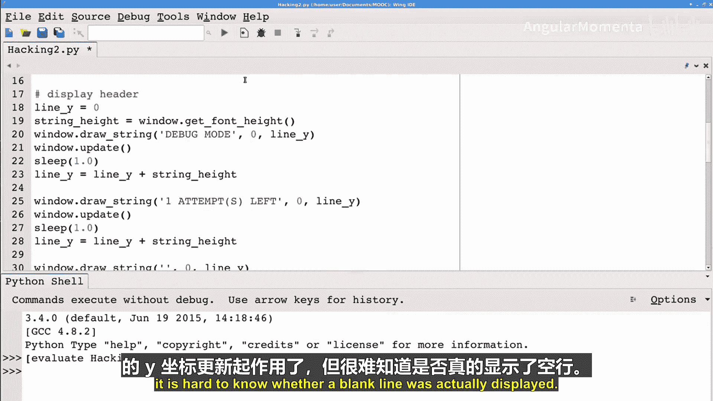
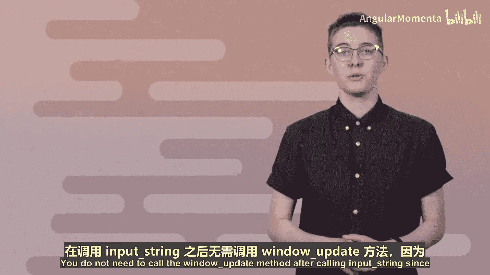

# 【阿尔伯塔大学】问题解决Python编程和电子游戏 ｜ Problem Solving, Python Programming, and Video Games p36 04_11_01_program-hacking-version-2 -BV1N5rLBWE1c_p36-

🎼。You're ready to program hacking versionion 2。Whenever I start a new version of a project。

 I save a copy of the previous version and modify a new copy。I'll do that now with hacking version 1。

 I will rename the new copy of my program， hacking2。

pyy since this copy will become the version 2 code。

I will start by adding descriptive block comments for each step of the version 2 algorithm。

Some of these comments are already in my program from version 1， so I will add the new ones。

Remember that we use extra spaces near the beginning of a comment to indicate that it is a sub step of a larger step。

Let's add the code for Cate window。I will consult the UA game library documentation to see what kind of window methods I can use。

Since I am creating a window object， I will choose an appropriate identifier to bind to my window object。

 How about window。Now I will use the window function from UA game to create a window object。

 The documentation indicates that I must pass three arguments， a title string， a width integer。

 and a height integer。I will get these values from the version 2 description。

The title should be hacking， the window should have a6 by5 aspect ratio。

This is an example of an imprecision in the description that must be made more precise in the code。

I will use a 600 by 500 pixel window。I don't need to add code one line at a time from the start of the program to the end。

I can add related features together。For example， to close the window at the end of the game。

 I will add the method called windowow。 close at the end of my program under the Close window comment。

I'm going to run my program right now to see what happens First。

 I will add an import statement so that I can use the UA game type called windowow。

This gives me access to all of the methods associated with window。A window opens。

But all the print function calls still display in the shell。

After I've entered a password and pressed enter to exitit， the window closes。

The print and input functions won't work in a window。Therefore。

 I'll delete all of the original program lines。The window type has a method called drawstring。

 Since this method displays a string in a window， I'll use it to display the first header line。

Drawstring takes three arguments， a display string。

 and two integers that indicate the top left corner of its location in the window。

Computer graphics use a coordinate system to define points in the window。

You may be familiar with coordinates from mathematics Think of the window as a graph。

The x axis is horizontal， and y axis is vertical。In mathematics。

 we would put the origin 00 at the lower left corner of the window；

 X would increase from left to right， and y would increase from bottom to top。In graphics。

 the origin is at the top left corner of the window。X still increases as we go to the right。

 but y increases as we go down a。10 pixels down from the top left corner is denoted 010。

The point in the bottom right of a 600 by 500 pixel window is at 600500。

To display the first line of the header in the top left corner。

 I will pass in the literal string debug mode， the literal integer 0， and another literal integer 0。

I will run the program again。That went by so fast that it was hard to see the window contents。

Since I know my program should pause after displaying each line。

 I will add in a pause now so that I can get a better look at the contents of the window before it closes。

To add a pause， I will use the sleep function from the time module introduced in the import lesson。

I will add the statement from time import Sleep with the window import statement。

Recall that sleep needs the number of seconds as an argument。

I will add a sleep call with argument literal floatat 0。3 after the call to drawstring。

Now we'll run the program again。That is much easier to see。

 You can keep the window open longer by increasing the number of seconds。

I expected to see debug mode displayed in the top left corner， but it isn't there。To see the string。

 I need to add another method call windowow dot updatedate after windowow dot Dis string。

I'll add it and run the program again。Most graphics libraries don't actually change the window until an update method is called if you wanted to display multiple strings at the same time。

 you could use multiple calls to draw string， followed by a single call to update。

The string formatting doesn't look quite right。 I will add some lines to change the text。

 font and color。And run it。This text matches the version 2 video text。

I used several methods to change some window attributes， font name， font point size， font color。

 and window background color。These window attributes are used for all displayed text。

 They have default values。The default font is the operating system font。

 The default font and background colors are white and black。

Since the default background color is black， we don't actually need to set it， but we will anyway。

Yeah。Now， I'm ready to display the second line of the header。

 I can use the same three lines of code again， but I need to change the drawstring arguments。 First。

 I'll replace the string。What literal integers should I use to display the second line below the first？

Since the second line should be displayed at the left edge of the window， X coordinate should be0。

I need to compute its y coordinate。 If I use 0， the second line will be displayed on top of the first line。

 I want the second line to display below the first。

 So my y coordinate should be the height of the first line。

How do I figure out the height of a line of text， Counting pixels would be tedious。

 and I might miscount。 It would be much easier if there was a function that could do this for me。

 Good news。 U A game has a method called git font height。

 which returns the height of my game font in pixels。😊。

I'll bind the result of this method called the Ientifier string height and use this identifier in drawstring。

The header ends in a blank line so I can use these three lines of code again and edit them。

What should the Y coordinate be？After drawing the first line。

 I update the Y coordinate to be the string height before drawing the second line。

I can do this again to get the Y coordinate for the third line。 I just add string height， again。

We will need to do this again for the other lines。 The next Y coordinate will be three string heights and so on。

However， let's think about the Y coordinate differently。

 Each new Y coordinate is the previous Y coordinate， plus the string height。

If I think about it this way， then I can use line Y gets line Y plus string height to update the Y coordinate。

This line updates the Y coordinate by rebinding it to a new value。Before I run the program。

 I need to initialize the identifier line y to0。 Otherwise。

 the first call to drawstring will cause a name error when line Y is dereferenced。

 Now run the program。This new Y coordinate update works。

 but it is hard to know whether blank line was actually displayed。

I will leave displaying the passwords to you。

The next thing that I want to do is get the player's guess We already know that the built in input function won't work in a window Instead UAga has a method called input string。

This method behaves like the input function， although it has a prompt argument that is displayed in the window。

 it also requires the display location like drawstring，2 integer arguments are used for the location。

I'll use the enter Pass prompt string，0 for the X coordinate， and line Y for the Y coordinate。

Since I need to display the player's guess as part of the outcome。

 I'll bind an identifier called guess to this object。

You do not need to call the window update method after calling input stringing。

 since the prompt must appear before a string is input。

I will leave clearing the window to you， look in the UA game documentation to find a method to clear the window。

The outcome text is centered in the window， so I must compute the location of each outcome line。

Displaying text on the left edge of the window won't work。 Let's start with the X coordinate。

I want each outcome line to be centered in the X direction。Let's look at a picture。

If I want a line to be centered， I want the spaces on both sides of the line to be equal。

To compute the size of the equal space， I start with the window width and subtract the line width。

This yields the size of both spaces together。I will use the method git width to get the window width。

 and the method git string width to compute the guess string width。

To get the size of each individual space， I divide this distance by2。

I will use the integer division operator slash slash to divide two integers to obtain an integer result。

 This division discards any division remainder。I use this individual space distance as the x coordinate of this outcome line。

To calculate the Y coordinate， I use the same principle。

The space between the windows top edge and the top of the first outcome line should be the same as the space between the windows bottom edge and the bottom of the last outcome line。

I compute the height of the outcome line block by multiplying the total number of outcome lines。

 including blank lines by string height。Now I'll subtract the height of the block of text from the height of the window using the get height method。

Finally， I'll divide the total space by two。I can use the two coordinates I've just calculated as arguments to draw the player's guess when I run the program again。

The guess is displayed where it's supposed to be， but the outcome text is displayed without erasing the previous game text。

 You'll fix this when you finish programming the game。

The last thing I'll do before you take over is display one password。

I already know what lines of code I need， one to display the string， one to update the window。

 one to pause and one to increment line Y。 I'll copy those lines。

 update the first password string and then run my program again。

The password is displayed where it's supposed to be。

 You will code the rest of the program in the next activity。 Remember to run and test often。

 Every error you make is an opportunity to learn。😊。

