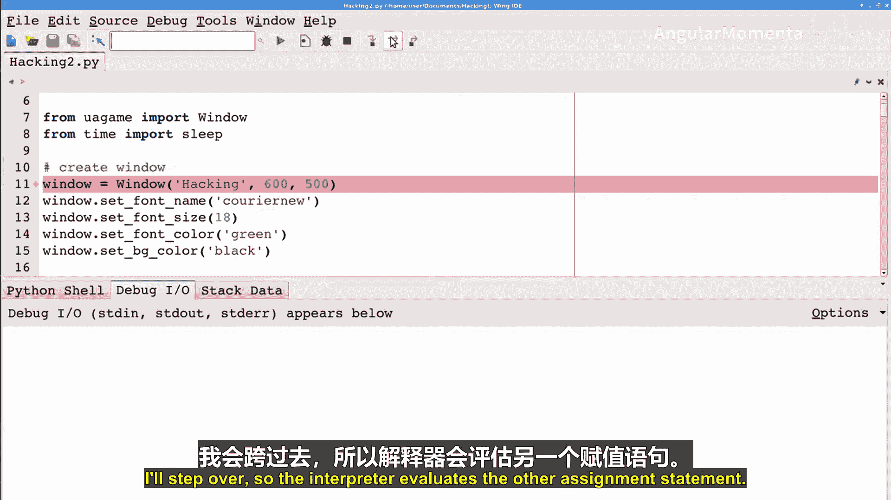
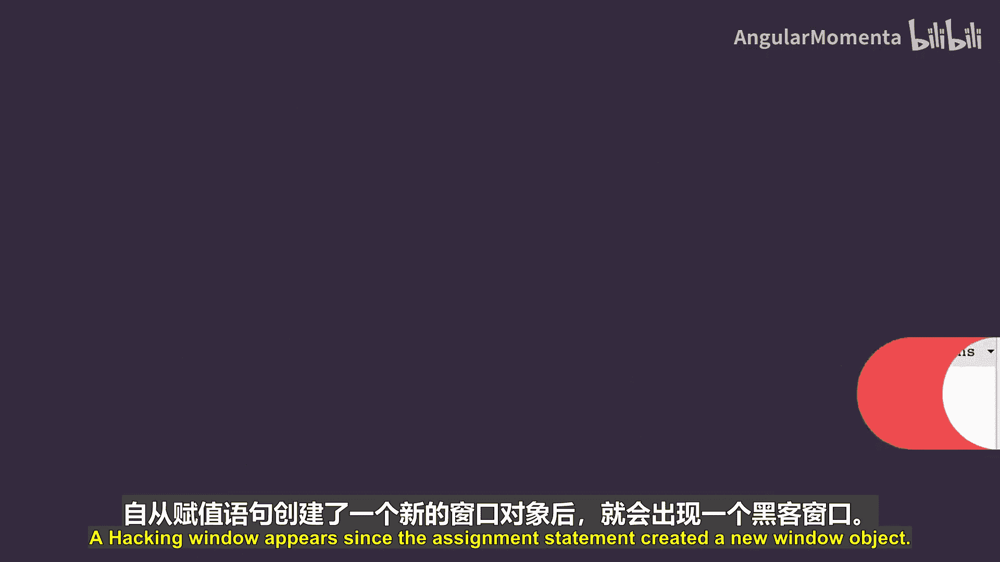
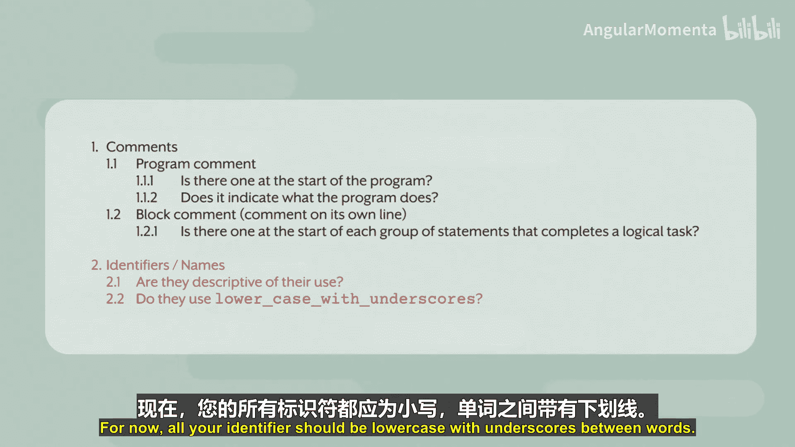

# 【阿尔伯塔大学】问题解决Python编程和电子游戏 ｜ Problem Solving, Python Programming, and Video Games p37 04_12_01_review-code-for-hacking-version-2 -BV1N5rLBWE1c_p37-

🎼，Welcome to the second reflection of the course。In the last reflection。

 we showcased some of the power of the debugger。It was pretty simple since there weren't any assignment statements。

For this version of hacking， I'll be using the debugger to show you that assignment statements are used to bind identifiers to objects。

 and that identifiers are dereferenced to obtain objects。Here is the solution for hacking version 2。

It starts with a program comment that describes the version details。The first statement is an import。

To begin， I'll press the step In2 button to start the debugging process。

The first statement highlighted is from UA game Import window。Like the previous reflection。

 I'll be using the step over button instead of the step In2 button from now on。

It's not necessary to step into any statement to see code that is not explicitly in the program。

I'll press the step over button and the next statement highlighted is another import statement from time Im sleep。

I'll step over this import statement， so the next highlighted statement is a window assignment statement。

I'll step over so the interpreter evaluates the assignment statement。

A hacking window appears since the assignment statement created a new window object。

Below the code is the stack data panel。 This panel has two bolded words， Locals and globals。

 and each has a number of words beneath that are book ended with underscores。

The local section of this panel serves as the namespace for your program。As we trace the program。

 each assignment statement will affect one identifier。Unfortunately。

 the names of built in functions and imported names are not added to this local section。

 even though they are added to the namespace。At the bottom of the locals section is the new Ientifier window。

 If I click on the arrow beside it， you see the namespace of the window object。

The window has a number of attributes， including the background color， the font name。

 and the font color。The highlighted statement is a method call that sets the font name when I step over it。

You can see that font attribute has changed from the empty string to courier new。

The next three statements in the code bind the font size。

 font color and background attributes of the window。 When I step over these statements。

I can see that the font color attribute changes from white to green。

 and that the background color attribute has remained the same。

This attribute did not change because it was actually rebound to this black string object。

I'll collapse the window identifier since no other program statements affect its attributes。

The next statement is another assignment statement。

Stepping over this assignment adds line Y to the local's namespace and binds it to 0。

 The next statement adds string height and binds it to 19。The string height is 19 pixels。

 even though the font point size is 18。The string height is usually a few pixels larger than the point size。

I'll step over the next three statements since they don't update the local's namespace。

The next statement is an assignment statement that rebinds line Y to a different object。

 You can see that line y is bound to 0 and string height is bound to 19。

When I step over this statement。You can see that line Y is rebound to 19。

 which is the sum of0 and 19。I'll step over the next few statements until I come to the next assignment statement that reds line Y。

Stepping over this assignment statement。Rebinds line y to 38。

 which is the old binding 19 plus the string height， also 19。

Hopefully you have a better understanding of how the debugger can be used to track your identifierr bindings。

Now that we're done tracing， let's talk about the quality of the code。

In the first version of hacking， we had one software quality test。

 Your program must have a descriptive comment at the beginning。

 and it must have in line comments at the start of each logical block of code。For version 2。

 we're adding a second software quality test that deals with the names of your identifiers。

There are two tests for your identifiers。 First， the names you use must describe the objects they are bound to。

For example， using the identifier S would not be very descriptive of the stringing height object。

The next test assesses the format of your identifiers For now。

 all your identifiers should be lowercase with underscores between words。

For example， stringing underscore height is acceptable， but string height is not。

This is a Python style convention that allows anyone who views your code to more easily understand what you have written。

Some imported type names such as window may contain uppercase letters。

 but we will discuss this convention later。In this lesson。

 we reflected on using the assignment statement to bind identifiers to objects。Congratulations。

 version 2 of Haing is complete。