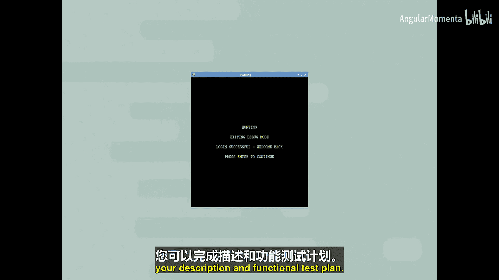

# 【阿尔伯塔大学】问题解决Python编程和电子游戏 ｜ Problem Solving, Python Programming, and Video Games p39 05_02_01_observe-hacking-version-3 -BV1N5rLBWE1c_p39-

The game starts so far， it looks the same as hacking version 2。

 I will enter the correct password hunting。This time， the game displays a different outcome。

 After the correct guess， it displays a success message and then prompts me to press enter。

Play the game a few times yourself。 make sure you see both outcomes。

 note the difference between them so that you can complete your description and functional test plan。

