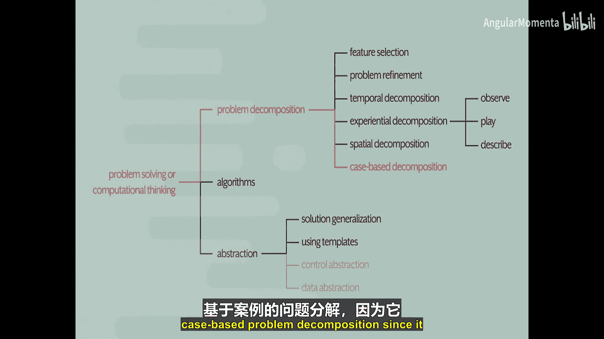
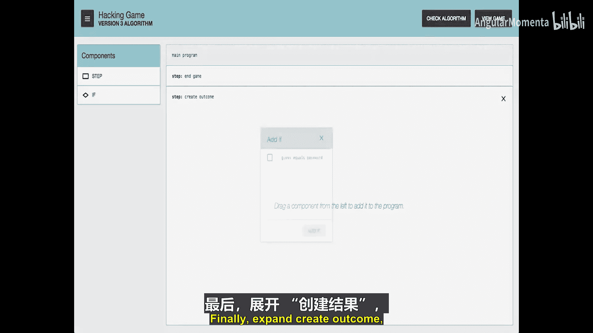

# 【阿尔伯塔大学】问题解决Python编程和电子游戏 ｜ Problem Solving, Python Programming, and Video Games p40 05_03_01_create-algorithm-for-hacking-version-3 -BV1N5rLBWE1c_p40-

To create the algorithm for hacking version 3， you will modify your version 2 algorithm。

Version 3 includes multiple paths through the game。 The outcome of the game depends on player input。

 In your previous algorithms， there was only one path and one possible outcome。

Adding the ability to select a game outcome based on the player's actions requires a control structure。

Recall that a control structure dictates when an algorithm step is performed。

 including whether it is performed at all。Each control structure you learn about will have its own shape in the algorithm builder。

Selection is represented by a diamond。 I will show you a small example to illustrate how the diamond is used。

I'll create an algorithm for wearing a sweater。 First， I'll add a diamond。

I need to select the action of wearing a sweater based on some computation。

 A computation used to select an outcome is often called a condition。

 The condition for selection is placed in the diamond。

The condition for my algorithm will be the temperature is less than 10 degrees Celsius。

 so I'll choose temperature less than 10 degrees from the vocabulary。The condition。

 the temperature is less than 10 degrees Celsius， will either be true or false。

Either the temperature is less than 10 degrees Celsius， so the condition is true。

 or the temperature is greater than or equal to 10 degrees Celsius， so the condition is false。

Every selection control structure in the algorithm builder has two rectangles associated with it。

The true rectangle contains the algorithm step that is performed If the condition in the diamond is true。

 Conversely， the false rectangle contains the algorithm step that is performed if the condition in the diamond is false。

The condition you choose for the selection control structure must always evaluate to true or false so that you can use it to select one of the true or false rectangles。

There must always be an algorithm step in the true rectangle。

 It doesn't make sense to include selection in your algorithm。 if there is no step to select。However。

 there doesn't always have to be an algorithm step in the false rectangle。For example。

 in the algorithm for wearing a sweater， if the temperature is less than 10 degrees。

 I will wear a sweater， so I put wear sweater in the true rectangle。

If the temperature is greater than or equal to 10 degrees， I won't do anything。

 there's nothing I need to put in the false rectangle。

A selection control structure usually gets its own panel。

If more than one algorithm step is required in the true or false case。

 then you can expand the true or false rectangle to use its own panel。 You could expand both。

 if necessary。A selection control structure supports case based pro decomposition since it allows each part of the solution to be created independently。

Let's modify a copy of the hacking version 2 algorithm to create the versionion 3 algorithm。

You already have the steps needed to display the failure outcome message。

 You could create a display success outcome panel that is almost the same as the display failure outcome panel。

 except for the outcomes that are displayed。 You could then select which of these algorithm step sequences to use based on the user guess。

Theres a software development principle called Don't Repeat yourself or D R Y。

 If you find yourself writing the same algorithm steps more than once。

 you should stop and see if you can change your algorithm to write the common steps only once。

In this case， the only difference between these algorithm steps are the messages being displayed。

 display failure outcome line 2 and 3 versus display success outcome， line 2 and 3。 Instead。

 you could create a different outcome message for failure or success。 depending on the player guess。

 Then just display this outcome message。 This is an example of solution generalization。

 Since the common parts of the success and failure outcomes are generalized and used in one place to complete the version 3 algorithm modify display failure outcome to be the more general display outcome。

 Then add a step called create outcome prior to the display outcome step。Finally， expand。

 create outcome， and use selection to create the appropriate outcome message。

