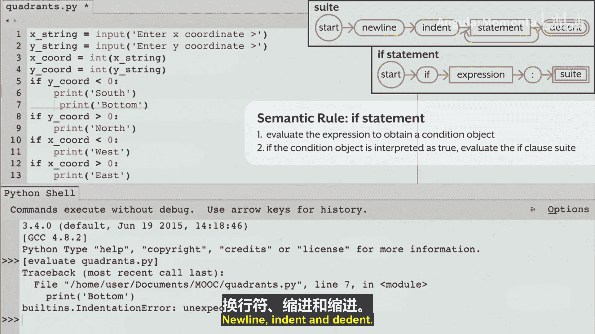

# 【阿尔伯塔大学】问题解决Python编程和电子游戏 ｜ Problem Solving, Python Programming, and Video Games p41 05_04_01_python-if-statement-and-boolean-type -BV1N5rLBWE1c_p41-

In this video， we introduce a new kind of statement called an if statement。

 a new Python type called Bool， which is short for Boolean and three individual tokens， new line。

 indent and dedent。Consider a map that also contains x and Y axes for map coordinates。

 where x increases to the right and y increases upwards。When a user enters an X and Y value。

 a program should display whether the coordinates are in the northwest， northeast， southwest。

 or southeast quadrant。The solution to this problem depends on whether the x and y values are each greater than 0 or less than 0。

If the x value is less than 0， the quadrant is in the west， and if the x value is greater than 0。

 the quadrant is in the east。Similarly， a y value less than 0 designates a south quadrant。

 and a y value greater than 0 designates a north quadrant。So far。

 all the Python statements we have seen have been evaluated in order from first statement to last statement。

To solve this problem， we need our program to display or not display a combination of these words north。

 south， east or west。To conditionally evaluate a statement。

 we introduce a new kind of statement called an if statement。

And if statement can either evaluate a statement。Or skip it。

We can use an if statement to either display a direction or not。Here is the program solution。

I will run the program and enter 100 for x and minus 50 for y。The program displays south and east。

 which is the correct answer。An if statement is a statement that has another statement inside of it。

For example， the first if statement starts on line 5 and finishes on line 6。

 where line 6 is a print function call expression statement inside the if statement。

A statement that includes another statement is called a compound statement。

A statement that does not include another statement is called a simple statement。

The if statement is a compound statement， and the expression。

 assignment and import statements are simple statements。

I will modify the syntax diagram for statement to include simple and compound statements and add syntax diagrams for these statement categories。

The new line token at the end of each simple statement is a new token that will be discussed later in this lesson。

In Python， it is possible to write some uncomplicated compound statements on a single line。However。

 in this course， all compound statements will be written on more than one line。

Here is a simplified syntax diagram for the if statement。The keyword token if， the expression。

 and the colon together are called a header。And the expression is often called a condition。

A suite is an indented block of statements that starts on a new line。

Here is the syntax diagram for S。New line， indent and Ddent are the three individual Python tokens that are not in any of the token categories。

 operator， identifier， delimiter， literal or keyword。

These tokens are used to separate statements and to delimit where a suite starts and where it ends。

When the lexical analyzer encounters an end of line character created by pressing the enter key。

 it creates a new line token to separate statements。To mark the start of a suite。

 I place a new line after the colon and then use white space at the start of the next line。

The lexical analyzer translates all of this white space into a single indent token。

 regardless of how much white space occurs at the start of this line。

Aid Aunt token identifies the end of a statement suite。

The statement following the suite must use the same indentation as the header line of the if statement that contains the suite。

The lexical analyzer translates this indentation into a single dedentt token。

All four of the if statements in this program have valid syntax。For example。

 the if statement on lines 5 and 6 is valid， since the lexical analyzer creates this sequence of tokens for lines 5 through the first token of line 7。

First is the keyword if。Followed by the three tokens that form an expression， identifier Y co。

Operator less than。And literal 0。The if header ends with a delimiter colon。

The suite starts with a new line， followed by an indent。In this case。

 the statement is a simple statement， an expression statement。

The expression statement consists of the identifier print。The delimiter left parn。

The literal string south and the delimiter right perin。The simple statement ends with a new line。

The suite ends with a dedentt， which ends the if statement。

The if statement uses a new Python type called Bool， which stands for Boolean。

There are only two objects whose type is Boolean， and they are referred to as true and false。

Many Python expressions evaluate to one of these objects。 For example。

 the expression on line 5 of the programme， Y co less than 0 evaluates to the true object or the false object。

 depending on what int object that y cohort is bound to。For convenience， Python uses two keywords。

 true and false to refer to the two Boolean objects。Even though they are keywords。

 they behave like literals。When the interpreter encounters one of these keywords。

 it uses the appropriate Boolean object in memory。Recall that if， import and from are also keywords。

 but they are used as delimiters to punctuate a statement。 They are not replaced by objects。

Here are the semantics of the if statement。And here are the semantics of a suite。

I will apply the if statement semantics to the if statement on5 and6 of the program。

When line 5 is evaluated， the namespace contains prebound identifiers and the four identifiers bound in the assignment statements on lines 1 through4。

In the if statement semantics， step1 evaluates the expression Y cohort less than 0。

Since y cohort is bound to negative 50， the expression evaluates to the Boolean object true。

In step 2， since the condition object is true， the suite is evaluated。

The suite contains a single expression statement that calls the print function to display south。

The interpreter is done evaluating the if statement on lines 5 and 6。

The interpreter next evaluates the statement that starts on line 7。

I will apply the if statement semantics to the if statement on line 7 and 8。In step 1。

 the expression， Y co greater than 0 is evaluated。 Since y co is bound to negative 50。

 the expression evaluates to the Boolean object false。In step 2。

 since the condition object was false， the suite is not evaluated。

 The interpreter next evaluates the statement that starts on line 9。Similarly。

 the interpreter evaluates the if statement on lines 9 and 10 to skip the print West function call and evaluates the if statement on lines 11 and 12 to evaluate the print East function call。

The program is done。If we run the program and enter0 for x and 0 for y。There is no output。

This is because the expressions in all four， if statements evaluate to false。

 So no statement in any statement suite is evaluated。

The syntax and semantics of an ifff statement supports multiple statements inside the suite of an if statement。

For example， if the program is changed to this。And run with input 100 and-50。

The output contains both south and bottom。In addition to east。

 since both statements in the suite On line 6 and 7 and the single statement in the S On line 13 are evaluated。

Notice that there is exactly one indent token at the start of a statement suite。

And one dent token at the end of a statement suite。

The lexical analyzer does not create indent or dedent tokens between the statements in a suite。

You should use a standard number of spaces when you indent。

 If you do not use the same number of spaces for all indents。

 you will probably see this indentation error。This lesson introduced the syntax and semantics of a simple。

 if statement。As well as the Boolean type。And three individual tokens， new line， indent and dedent。

