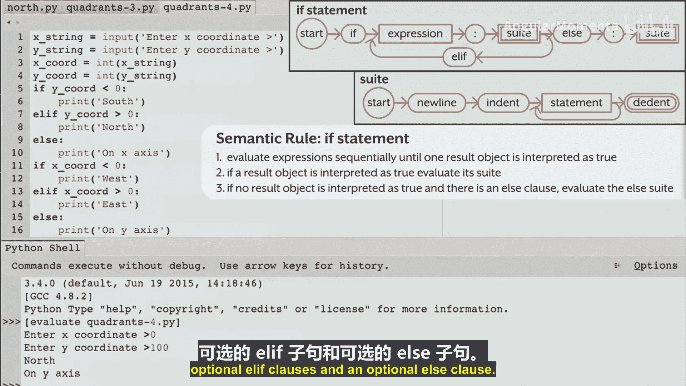

# 【阿尔伯塔大学】问题解决Python编程和电子游戏 ｜ Problem Solving, Python Programming, and Video Games p42 05_05_01_python-elif-and-else-clauses -BV1N5rLBWE1c_p42-

🎼。In this lesson， we describe what happens when an expression in an if statement evaluates to a non Boolean object。

 we also generalize the if statement to include optional L if clauses and an optional L clause。

What happens if the expression in an if statement does not evaluate to a boolean？

Let's run this program to find out。H it printed north， even though hello is not the true object。

 Let's check if hello is somehow equal to true。No， Ho is not equal to true。

 but the if statement treated Ho as if it was true in its condition。In Python。

 when the expression in an if statement is evaluated to an object。

 the object is always interpreted as a boolean， even if it is not a boolean。

Most objects are interpreted as true， even though they are not equal to true。

 Only a few objects are interpreted as false， including the false object， the empty string。

 the int object 0， the float object 0。0， the nu type object。

 and a few more objects whose types we haven't encountered yet。

Since the string object hallo was interpreted as true。

 the suite was evaluated and printed north in computing science。

 an expression that evaluates to a boolean is called a condition。

 Since all objects are interpreted as true or false in a Python if statements expression。

 regardless of their type， the if expression is called a condition。

If I want to evaluate one suite of statements， if a condition is true and a different suite if it is false。

 I can use the else form of an if statement。 For example。

 we can rewrite the quadrant program from the previous lesson as this program。

 This program behaves almost the same as the last program。 except now。

 when 0 is entered as an X coordinate， it prints east。 and when 0 is entered as a y coordinate。

 It prints north。😊，I will run the program and enter 100 for x and minus 50 for y。

The program displays south and east， which is the correct answer。

 When an else keyword is used in an if statement， we say that the if statement has two clauses。

 the if clause and the else clause。The if clause has a condition and a suite of statements。

 The L's clause has a suite of statements， but no explicit condition。😊。

Here is the revised syntax for an if statement that includes an optional else clause。

The syntax for S does not change。The program contains two syntactically valid if statements each with an else clause。

Here are the revised semantics for an if statement that includes the optional E clause。

The semantics of a suite do not change。I will apply the revised if statement semantics to the if statement on lines 5 through8。

When line 5 is evaluated， the name space contains prebound identifiers and the four identifiers bound in the assignment statements on lines 1 through4。

In step 1， the expression Y chord less than 0 is evaluated。 Since y co is bound to negative 50。

 the expression evaluates to the Boolean object true in step 2， since the condition object is true。

 the if suite is evaluated。 The suite contains a single expression statement that calls the print function to display south。

😊，In step 3， since the condition object is not false。The L suite is not evaluated。

 The interpreter next evaluates the if statement on lines 9 through 12。In step 1。

 the expression X chord less than 0 is evaluated。 Since x chord is bound to 100。

 the expression evaluates to the boolean object false。In step2， since the condition object is false。

 the if suite is not evaluated。In step3， since the condition object is false。

 the L suite is evaluated。The suite contains a single expression statement that calls the print function to display east。

And the program is done。There is an even more general form of the if statement that uses LF clauses。

L if clauses can be used to check multiple conditions in the same if statement， for example。

 if I want to identify points on the axes as well as in the quadrants。

 I can change the program to this。And run it using coordinates 0 and 100。

So the answer is north on Y axis。Here is the revised syntax for an ifF statement that includes optional LF clauses。

This program contains two syntactically valid if statements。

 each with one LF clause and one else clause。Here are the revised semantics for an ifF statement that includes optional LF clauses as well as the optional Es clause。

These semantics mean that if there is an else clause。

 exactly one suite of the if statement will be evaluated， the rest of the suites will be skipped。

If there is no else clause and at least one of the conditions is true。

 exactly one of the suites will be evaluated。If there is no else clause and none of the conditions are true。

 no suite will be evaluated。I will apply the revised if statement semantics to the if statement on lines 5 through 10。

When line 5 is evaluated， the namespace contains prebound identifiers and the four identifiers bound to the assignment statements on lines 1 through4。

In step 1， the expression y chord less than 0 is evaluated。 Since y chord is bound to 100。

 the if clause expression evaluates to false， so the next expression is evaluated。

The LF clause expression evaluates to true since y chord is greater than0。In step 2。

 since the Elf condition object was true， the suite of the Llf clause is evaluated。

 which prints north。In step 3， since a condition result object was true。

 the suite in the else clause is not evaluated。 The interpreter is done evaluating the if statement on lines 5 through 10。

The interpreter next evaluates the if statement on lines 11 through 16。In step 1。

 the expression x chd less than 0 is evaluated。 Since x chord is bound to 0。

 the expression evaluates to the Boolean object false。

 Since the if expression result object is not true。 The next expression is evaluated。

The expression x chd greater than0 is evaluated to obtain false。

There are no more expressions to evaluate in the if statement。In step 2。

 since none of the expressions evaluated to true， none of the corresponding sweets are evaluated。

In step three， since none of the condition objects were true， and there is an L clause。

 the L suite is evaluated， which prints on Y axis。And the program is done。In this lesson。

 we described what happens when an expression in an if statement evaluates to a non Boolean object。

 We also generalized the if statement to include optional L if clauses and an optional L clause。

