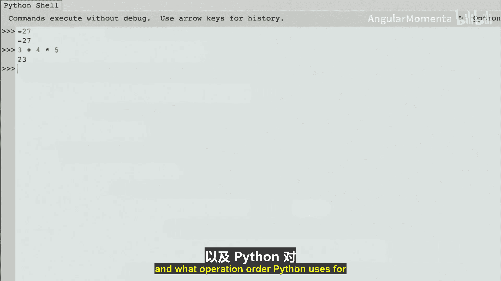

# 【阿尔伯塔大学】问题解决Python编程和电子游戏 ｜ Problem Solving, Python Programming, and Video Games p43 05_06_01_python-keyword-operator-short-circuit-evaluation-unary-expression-and-o -BV1N5rLBWE1c_p43-

In this lesson， we introduce four concepts。 First， we describe keywords that behave as operators。

 Second， we describe a special evaluation technique used by Boolean operators called short circuit evaluation。

😊，Third， we introduce a new kind of expression called a uninary expression。 Finally。

 we describe the operation order Python uses for computations that contain more than one operator。

Recall that operator tokens such as plus and less than are used in binary expressions to apply an operator function to two opera。

There are 19 operator tokens。Some Python keywords can also be used as operators。

Let's look more closely at all of the keywords。 You have seen that some keywords。

 such as from import and if are used as delimiters to punctuate statements。 In fact。

26 of the 33 keywords are used as delimiters to separate different parts of statements。

You have also seen that some keywords， such as true and false。

 are used as literals that are bound to specific objects。In fact。

 none is also used as a keyword literal， and it is bound to an object whose type is none type。

 which is returned by function calls that don't really need to return a meaningful object。

The other four keywords and is not and or are used as operators。

 and the keyword in can actually be used as an operator or delimiter， depending on context。

I will revise the syntax diagram for binary operator by adding the keyword operators that can be used as binary operators。

Notice that in addition to and in is and or there are two keyword operator pairs。

 not in and is not that can each be used as a single binary operator。

I have added some new binary operators， but the semantic rule for binary expressions does not change。

For example， I will apply the binary expression semantics to the expression， false and unbound。

In step 1， the left expression is the keyword literal false。

 which evaluates to the Boolean object false In step 2。

 the operator is and while the type of the first operant is Boolean， since the operant is false。

Normally， both the operator and operant type are needed to identify the operator function。 However。

 when the operator is and the type of the first operant is actually ignored。

 The and operator always invokes the same operator function， regardless of the first operant type。

In step 3， the interpreter applies this operator function and。

The operator function and uses a technique called short circuit evaluation。

 where the result object may not depend on the second opera。

Here are the semantics of the and operator function。 One， if the first opera is interpreted as false。

 the first opera is the result object。Two， otherwise evaluate the second expression as the result object。

In step 1， the first operant is false。 So this first opera object， false is returned。

 Step 2 is skipped， so the second expression is not even evaluated。

If the second expression was evaluated， it would have displayed a semantic name error。

 since I did not bind the identifier unbound to any object。

The and operator function has another interesting property。In step1。

 the first opera is the empty string， which you may recall is interpreted as false in an if statement condition。

The and operator function semantics interpret non Boolean objects the same way。

 So the empty string is interpreted as false。 Therefore， the empty string is the result object。

 If I had used 0 or 0。0， instead of the empty string， the expression would evaluate to 0 or 0。

0 respectively。Again， step two is skipped， so the second expression is not evaluated and no semantic name error is displayed。

If the first opera is not interpreted as false， the second expression is evaluated。For example。

 if I evaluate hello and good bye， the interpreter returns good bye In step 1。

 the first opera is the string Ho， which is interpreted as true。

 since it is not interpreted as false。 the second step is applied。In step 2。

 the second expression evaluates to the string good bye， which is used as the result object。

The ore operator function also uses short circuit semantics。

 If the first operant is interpreted as true， the first operant is the result object。 Otherwise。

 evaluate the second expression as the result object。

Notice that neither the operator token Tilda nor the keyword operator， not by itself。

 can be used as a binary operator。 Instead， both are unary operators that act on a single opera。

Here is the syntax diagram for a uninary expression。

And here is a more general syntax diagram for expression that now includes uninary expressions。

The plus and minus operator tokens can be used either as binary or uninary operators。

 The semantics of uninary expressions is similar to the semantics of binary expressions。

 except that there is only one operant to evaluate。 For example。

 I will apply the uninary expression semantics to -27。In step 1。

 the expression is the literal integer 27， which evaluates to the int object 27 in step 2。

 the uninary operator minus and the type int are used to identify the numerical negation function。

 which reverses the sign of its integer operant object In step 3。

 the numerical negation function is applied to the int object 27。

 to obtain the int object negative 27。Notice that negative 27 is not a literal integer。

 It is a unary expression that applies the minus operator to an integer object to obtain a result object。

If more than one operator appears in an expression。

 the Python interpreter must select an order for the operations。 For example。

 in the expression 3 plus 4 star 5。 There are two operators plus and star。

If the Python interpreter applies these operators in order from left to right， then 3 plus 4 is 7。

 and 7 times 5 is 35。35 is not the correct answer。23 is Python applies the star operator before applying the plus operator。

 analogous to the order of operations in mathematics。

Python has an operator precedence table that defines the order that should be used to apply multiple operators in the same expression。

Operators that are below in the table have higher precedents and are applied before operations that are above in the table。

For example， star is applied before plus， since it is below plus in the table。

 That is why 3 plus 4 star 5 evaluates to 23， instead of 35。

You should recognize many of the operators in this table。

 such as the operator tokens plus times and less than， and the keyword operators and and or。

In this lesson， we described keywords that behave as operators。

 We also described a special evaluation technique used by Booleing operators called short circuit evaluation。

 A new kind of expression called a uninary expression。

 And what operation order Python uses for computations that contain more than one operator。😊。

