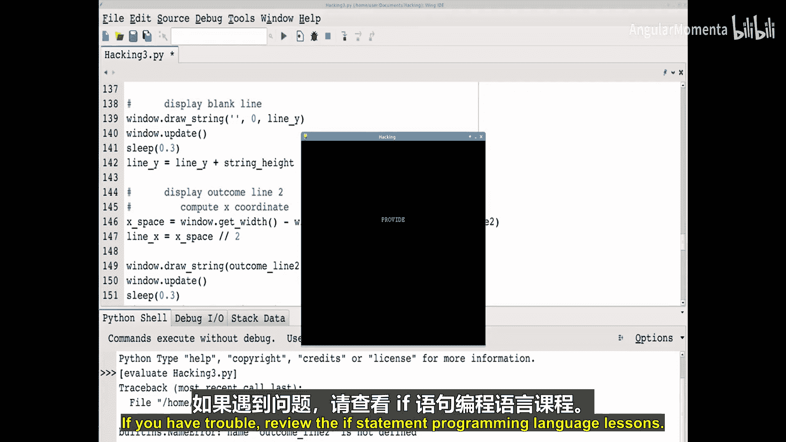

# 【阿尔伯塔大学】问题解决Python编程和电子游戏 ｜ Problem Solving, Python Programming, and Video Games p44 05_07_01_program-hacking-version-3 -BV1N5rLBWE1c_p44-

We are at the Cate program task in the game creation process。

The first step in programming hacking version 3 is adding comments that correspond to the new algorithm steps。

I will add a placeholder comment for the selection diamond。

 but you will replace it with header of the if statement when you translate the algorithm。

I will use check guess equals password as a comment for the guess equals password diamond。

When you add the if header， if guess equals hunting， you should remove it since it will be redundant。

We use Python if statements to implement selection。

 The true box from your algorithm corresponds to the statement suite of the if clause。

The false box corresponds to the statement suite of the al clauseuse。

You will create a comment for the C success step and another comment for the Cate failure step。

 since each rectangle in your algorithm should have a comment in the code。In the next activity。

 you'll use selection to choose which outcome message should be displayed。

Use good identifier names for your outcome strings。 I'll choose one for you to get you started。

The first line of the outcome message is always the player's guess。

 The second line will either be exiting debug mode for successful guess or login failure terminal locked for a failure guess。

Let's call the second line outcome line2， since it is general enough to apply to either case。

In version 2， it was sufficient to just display the literal string login failure terminal Lo In this version。

 the appropriate string must be referenced by outcome line 2。

 I'll update the code to use this identifier。I'll replace the literal login failure by the identifier outcome line2 in both the computation that calculates its x coordinate。

And in the drawstring function call。This block of code will now display whatever string outcome line2 is bound to。

Note that if I run the program now， it will produce an error since outcome line2 is unbound。

You will create the if statement， bind outcome line2。

 and translate the rest of the display outcome steps of the algorithm in the next activity。

If you have trouble， review the ifF statement programming language lessons。

