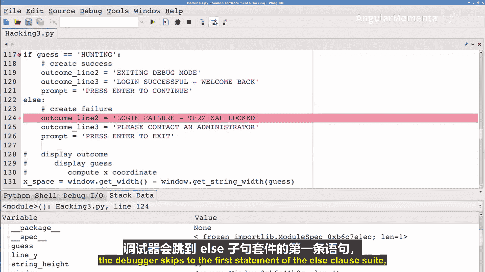
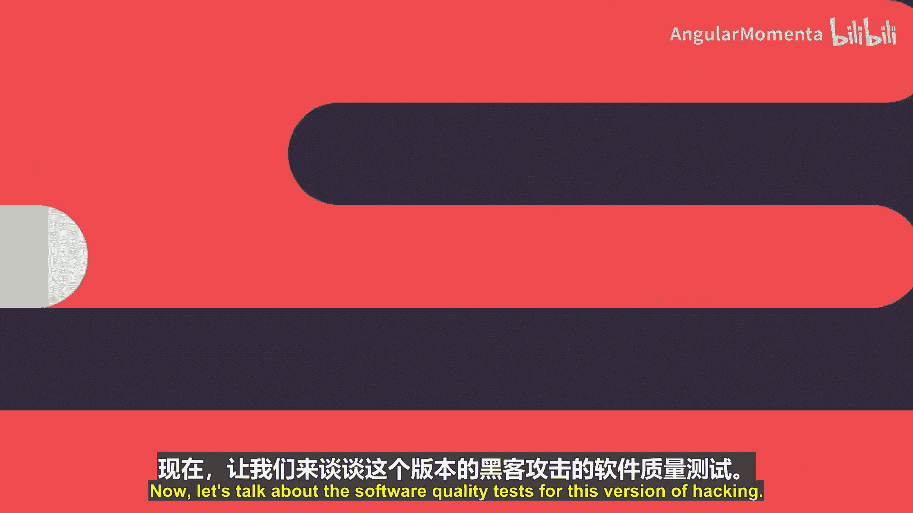
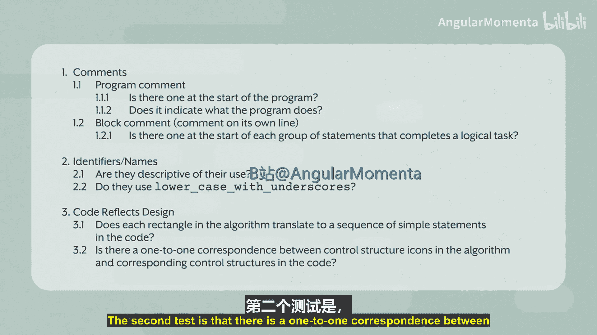

# 【阿尔伯塔大学】问题解决Python编程和电子游戏 ｜ Problem Solving, Python Programming, and Video Games p45 05_08_01_review-code-for-hacking-version-3 -BV1N5rLBWE1c_p45-

🎼。Welcome to the third reflection。 Heres the code for version 3。

The purpose of this review is to show you how an if statement is evaluated。

The if statement is near the bottom of the program。

Instead of stepping over each statement to reach the if statement。

 I am going to show you a new debugging technique。 I'll add a break point beside the if。

 so I don't need to evaluate one statement at a time。

This adds a red dot beside the line number as a visual cu。

A break point is a debugging feature that stops the debugger at a desired line and waits for another debugging action。

This allows you to use the debugger without tracing each line。

Now I'll press the Bu button in the toolbar， which runs the program normally until it reaches a breakpoint or statement that requires user input。

Hacking displays the header， password list， and password prompt。

 and then pauses to allow me to input a password。Normally。

 if the program is running and I enter a password， the game will immediately display the outcome。

Yeah。I will input hunting。The debugger evaluates clear window and stops when it reaches the break point at the if。

It pauses to let me decide what I want to do next。The if statement will check if my guess is equal to the secret password。

Notice that in the stack data panel， guess is bound to hunting。Since guests and hunting are equal。

 when I press the step over button， the next statement that is highlighted is the outcome line2 assignments statement in the if clause。

I'll press the step over button twice more until the prompt assignment statement is highlighted。

Notice that in the Sta data panel， outcome line 2 and outcome line 3 have been added to the local namespace as identifiers bound to the success strings。

The next time I press the step over button， the debugger will not highlight the else clause。

 even though it is on the next line。 at most， one suite in an if statement is evaluated。

 Whenever a condition of an if statement is true， the suite associated with that condition is evaluated。

 All other conditions and sweets are ignored。😊，So when I press the step over button。

The debugger completely skips the El clause and it suite and highlights the X space assignment statement。

Let's look at the second case of our case based decomposition by tracing the program with an incorrect password。

I'll stop the trace with the stop button and press the Bu button again。 This time。

 when hacking reaches the password prompt， I'll input an incorrect guess。

The F statement is highlighted。In the stack data panel。

 guess is bound to the incorrect password I entered。 Since the guess is not equal to hunting。

 the condition statement evaluates to false。 When I press the step over button again。

 the debugger skips to the first statement of the else clause suite。

 Since else does not need to be evaluated。

Now let's talk about the software quality tests for this version of hacking。Previously。

 we introduced how to make good comments and descriptive identifiers。

 The new software qualityual test section is called code Reflex design。😊。

There are two tests for code reflectslex design。 The first is that each rectangle in an algorithm translates to a sequence of simple statements in the code。

The second test is that there is a one to one correspondence between control structures in the algorithm and corresponding control structures in the code。

A one to one correspondence between algorithm control structures and code control structures means that there is exactly one control structure in the code per control structure in the algorithm。

An algorithm rectangle can be translated into multiple lines of code。

 but an algorithm diamond is always translated to one line of code in a program。

Your code should reflect your design so that changes to the algorithm in the next version can be implemented by translating only the sections of the algorithm that have changed。

Congrats， you finished your third version of hacking。

