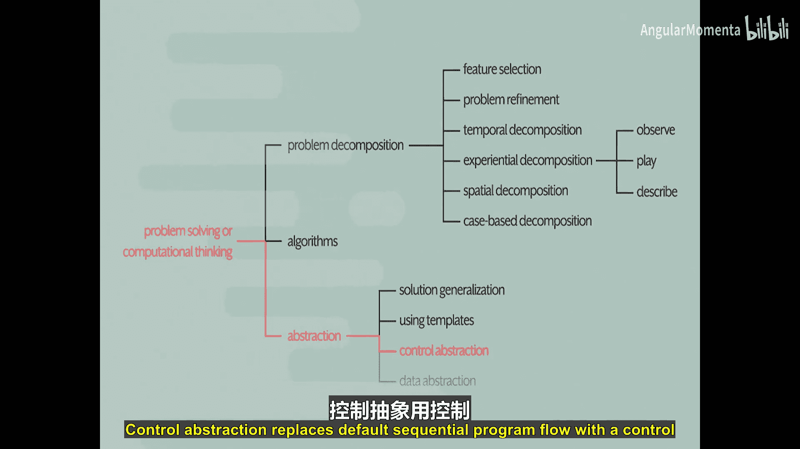
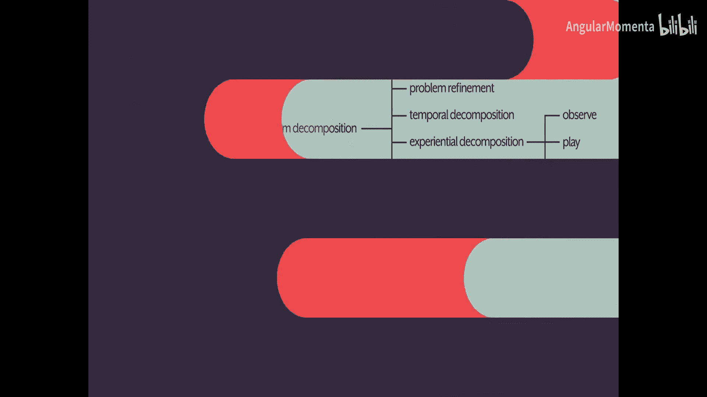
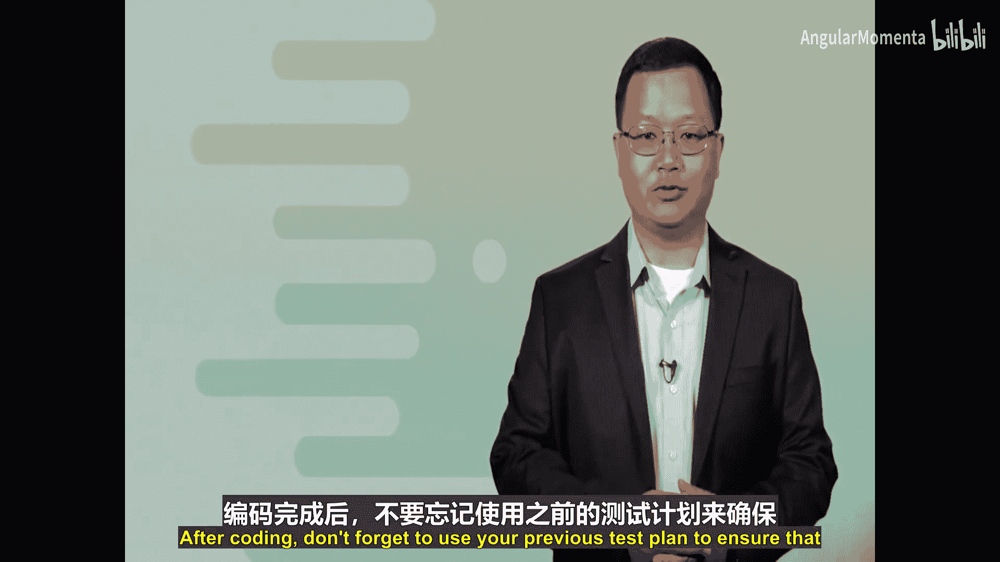

# 【阿尔伯塔大学】问题解决Python编程和电子游戏 ｜ Problem Solving, Python Programming, and Video Games p46 06_01_01_solution-issues-in-hacking-version-3 -BV1N5rLBWE1c_p46-

Welcome to hacking version 4。 This version will be different from the previous three。

 since you will only be focusing on improvements to the quality of your code instead of introducing new game features。

 you will address two solution issues， duplicate code and duplicate data。

Here is the solution code for hacking version 3。There are many duplicated statements displaying to header。

 the passwords and the outcome messages required to same four lines of code over and over again with only tiny differences。

At first， this seemed convenient。 You had the solution to display a string。

 and you could reuse it to display each subsequent string by copying and pasting。 However。

 this resulted in almost 200 lines of code。This is another example of violating the don't repeat yourself software development principle。

 In general， if you find yourself writing the same code statements more than once。

 you should change your program to write the common statements only once。

We call consecutive identical or very similar statements adjacent duplicate statement groups in this version of hacking。

 you will learn how to eliminate adjacent duplicate statement groups using a new construct called a repetition control structure or loop。

A loop is a sequence of code statements that will be repeatedly evaluated until a specific condition is met。

Using repetition control structures make your code shorter， so it is easier to write and read。

 in this version， you will use these control structures to replace the almost 200 lines of code by fewerer than 90。

Using a repetition control structure to replace duplicate lines is a new form of abstraction called control abstraction。

Control abstraction replaces default sequential program flow with a control structure to reduce repetition。

The second solution improvement is eliminating duplicate data。 For example， the literal float 0。

3 is duplicated 23 times in the program。This is an issue， since if I want a shorter delay。

 I need to change the argument and 23 individual sleep function calls。Similarly。

 if I want to change the X coordinates of the passwords。

 I need to change the second argument of 13 different drawstring function calls。

If I want to change all of the sleep delays， I could just use a single find and replace action on all occurrences of 0。

3。 That's pretty simple。 however， if I try to change the X coordinate of the passwords using find and replace to change 0 to some other value。

 it will not only change the 13 calls to drawstr but 36 other zeros in the program。Instead。

 I must have some way of specifying that the intent of 0 in the password drawstring calls is different than the intent of the other 36 zeros to solve this problem。

 I can use an identifier to represent the X coordinate of the passwords and bind it to 0。 Now。

 to change the X coordinate of the password， I only need to change the one assignment statement that binds it。

In general， if a literal is used multiple times for the same purpose。

 an identifier should be bound to it so that the literal can be changed in one place。

Can you find other repeated literals and Diversion 3 code that should have an identifier bound to them。

Since the changes you are going to make in this version only affect code quality。

 you don't need to observe or play hacking version 4。

 There are also no changes to the description or test plan。

You just completed five tasks in a game creation process and only a few seconds， congrats。

After coding， don't forget to use your previous test plan to ensure that the game functionality is still correct。

