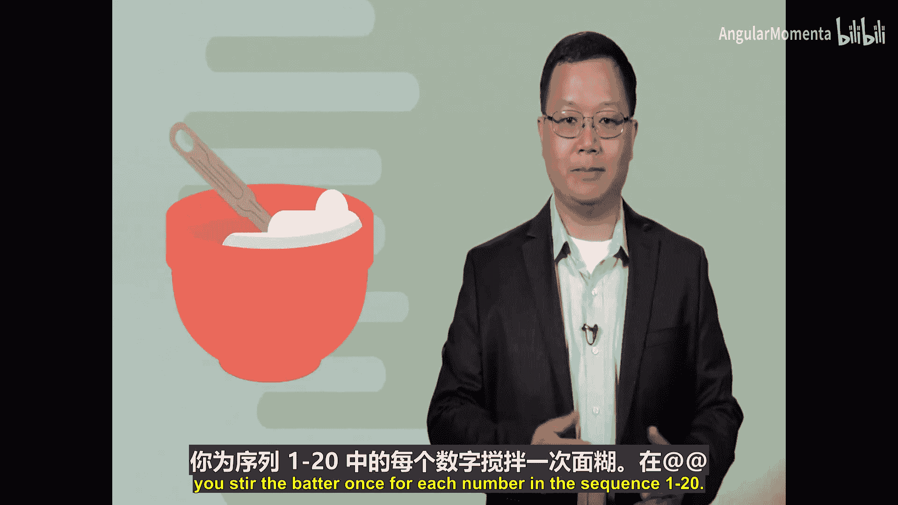

# 【阿尔伯塔大学】问题解决Python编程和电子游戏 ｜ Problem Solving, Python Programming, and Video Games p47 06_02_01_create-algorithm-for-hacking-version-4 -BV1N5rLBWE1c_p47-

Let's take a look at the game creation process diagram。 You are working on the Cate algorithm task。

 We're introducing a new control structure in version 4 called definite repetition or definite iteration recall that a control structure controls when an algorithm step is performed Definite repetition performs an algorithm step or sequences steps over and over again a specific number of times。

Since the step is performed repeatedly， it's called repetition。

Definite repetition means that the number of times the step is repeated is prescribed before the repetition starts。

For example， while making a cake， if the recipe tells you to stir a batter 20 times。

 that is definite repetition。 If the recipe tells you to stir the batter until there are no lumps。

 that is not definite。 You don't know how many times you will stir before you stop mixing。

Think of definite repetition as repeating an algorithm step for each item in a sequence。

If you have a basket of clean laundry for each shirt in the basket， you will put the shirt away。

In the cake mixing example， you stir the batter once for each number into sequence 1 to 20。

Definite repetition is represented in the algorithm builder by a four icon。

The four icon has two words in it already， for and in as well。

 There is a regular rectangle connected to the four icon by an arrow。

The step in the regular rectangle is the step that will be repeated。

The four icon indicates how many times that step should be repeated。

I will add a definite repetition control structure to the algorithm。To complete the four icon。

 you need to select two items from the vocabulary。The first item is the target element that you want to use in the repeated step。

In the laundry example， this would be the shirt you want to put away。

 so I will add shirt from the vocabulary。The second item is the sequence that contains the target element。

In the laundry example， this is the laundry basket， so I will add it。

My four icon contains for shirt in laundry basket。 Now I will add put away shirt to the regular rectangle under the four icon。

This algorithm will performed a step， put away shirt for every shirt in the laundry basket。

 Each time the step repeats the next target shirt into sequence is used。In a cake mixing example。

 the target is a stir， and the sequence consists of the numbers 1 to 20 for each stir in a sequence 1 to 20。

 you stir a batter。You can expand the regular rectangle using a new panel if you want to repeat a sequence of steps。

I am expanding the repeated step put away shirt by creating a sequence of steps， full shirt。

 open dresser drawer， play shirt， clothes dresser drawer。

I could do something even more complicated and add a selection control structure to determine whether each shirt should be folded or ironed。

I'll now use definite repetition in hacking version 4。In your previous algorithm。

 display outcome required six rectangles， one for each outcome line。

I am going to delete all six rectangles and use definite repetition instead。

Now I'll fill in the four icon by picking a target and sequence。The game displays each outcome line。

 so outcome line is the target element。Since each outcome line is part of the complete outcome。

 the outcome is the sequence。The four icon says for outcome line in outcome。Now。

 I need to fill in the step。 I want to repeat。 I want to display each outcome line。

 so I could add display and outcome line to the regular rectangle。 But this isn't quite right。

 The outcome lines are specifically positioned in the center of the window。

 So I need to add display and centered outcome line to the rectangle。Now it's your turn。

 replace the steps for display header and display password list with definite repetition control structures。

 Add one extra step in the display password list panel that chooses the correct password from the list。

