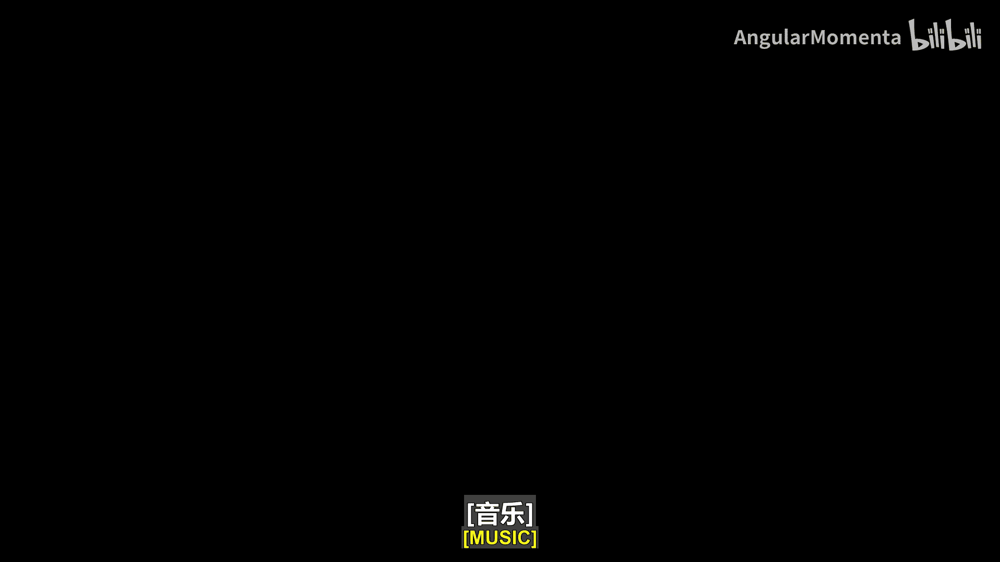
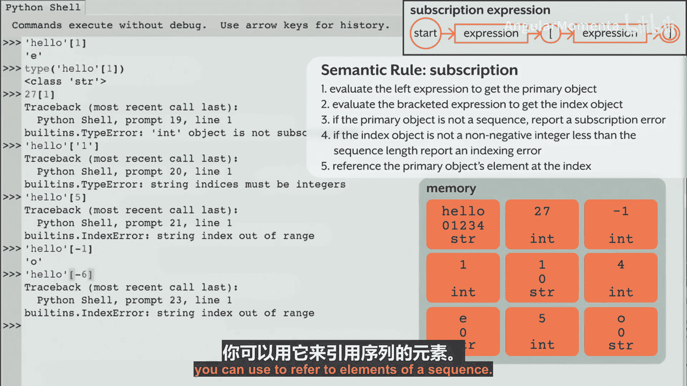

# 【阿尔伯塔大学】问题解决Python编程和电子游戏 ｜ Problem Solving, Python Programming, and Video Games p48 06_03_01_python-sequences-and-subscription -BV1N5rLBWE1c_p48-

🎼。In this video， I introduce a category of types called sequence types。

 This category includes the string type and other types， which will be introduced in future lessons。

I also introduce the subscription expression， which is a mechanism for referring to elements of a sequence。

A sequence is a finite ordered group of elements where each object has a numerical index between 0 and one less than the number of elements in the sequence。

There is no sequence type in Python。 Instead， sequence is a category that includes several different Python types。

The Python STR type is one kind of sequence。Each string is a finite ordered group of indexed characters。

For example， the string object Ho is a sequence of characters where H is element 0。 E is element 1。

L is both element 2 and element 3， and O is element 4。

Remember that Python always starts its indexes at 0 instead of one。

I can use a new kind of Python expression called a subscription expression to reference an element of a sequence。

Subscription uses two delimiters， left bracket and right bracket。

Python subscription is analogous to using subscripts in mathematics。For example。

 I can reference the string element of hello at index 1 using this expression。

Which is pronounced Ho of one。In many programming languages。

 the elements of a string are objects whose type is char， which is short for character。However。

 there is no char type in Python。Let's find out what type of elements Python uses in a string。

The type STR was displayed。It appears that the elements in a Python string are one element string objects。

However。Python string elements are characters that have an internal representation that do not have a Python type。

When you use subscription to reference one of these characters。

 the interpreter returns a one element string object。

This is a simplified syntax diagram for the subscription expression。

And here is a generalized syntax diagram for expression that includes subscription。

The simplified semantic rule for subscription is。Evaluate the left expression to get the primary object。

Evaluate the bracketed expression to get the index object。If the primary object is not a sequence。

 report a subscription error。If the index object is not a non negative integer less than the sequence length。

 report an indexing error。Reference the primary objects element at the index。

The expression hello of one is lexically and syntactically correct。

I will apply the semantic rule for subscription。In step 1。

 the left expression is evaluated to obtain the primary object， ho。In step 2。

 the bracketed expression evaluates to the object1。In step 3， the primary object has type STR。

 which is a sequence， so no subscription error is reported。In step 4。

 the int object 1 is a non negative integer that is less than the string length 5。

 So no indexing error is reported。In step 5， the primary object is hello。

 so the interpreter returns the element at index 1。This is the single element string E， not H。

 which is at index 0。This expression is also lexically and syntactically correct。

I will apply the semantic rule for subscription。In step 1。

 the left expression is evaluated to obtain the primary object 27。In step 2。

 the bracketed expression is evaluated to obtain the index object1。In step 3。

 the primary object has type int， which is not a sequence。

 So a semantic type error reports that the integer is not subscriptible， and evaluation stops。

Here is another lexically and syntactically correct subscription expression。

I will apply the semantic rule for subscription。In step 1。

 the left expression is evaluated to obtain the primary object， Ho。In step2。

 the bracketed expression is evaluated to obtain the index object 1。In step 3。

 the primary object has type STR， which is a sequence， so no subscription error is reported。

In step 4， the string object 1 is not a non negative integer。

 So a semantic type error reports that the index must be an integer， and evaluation stops。

Here is yet another lexically and syntactically correct subscription expression。

I will apply the semantic rule for subscription。In step 1。

 the left expression is evaluated to obtain the primary object， Ho。In step2。

 the bracketed expression is evaluated to obtain the index object 5。In step 3。

 the primary object has typed STR， which is a sequence， so no new subscription error is reported。

In step 4， the int object 5 is a non negative integer。But it is not less than the string length。

 which is also 5。 So a semantic indexing error reports that the index is out of range。

 and evaluation stops。The reason the largest index must be strictly less than the length instead of less than or equal to the length is that sequences are indexed from 0 to one less than the sequence length。

I know I have discussed indexing from 0 instead of one several times。

 but you will probably make indexing errors anyway。I still make indexing errors。

In the subscription semantics， step 4 indicates that the interpreter reports an indexing error for all negative integers。

However， the built in sequence types can handle some negative indexes。In this expression。

The last element， O is returned。This is done by adding the index negative  one to the string length 5 to obtain the index 4。

And returning the element O at this index。Using an index of negative n yields the nth last element。

This can sometimes be useful。However。If you use a negative index whose magnitude is too large。

 you will still get an indexing error。For example， hello of negative 6 is an error because there is no sixth last element of Hello。

 which has only five characters。In this video， I introduced a category of types called sequence types。

This category includes the string type and other types that will be introduced in future lessons。

I also introduced the subscription expression， which you can use to refer to elements of a sequence。

