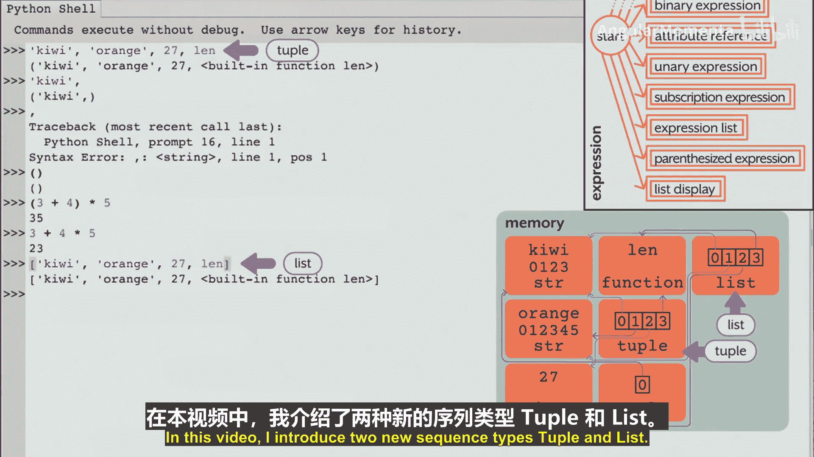

# 【阿尔伯塔大学】问题解决Python编程和电子游戏 ｜ Problem Solving, Python Programming, and Video Games p49 06_04_01_python-tuple-and-list-types -BV1N5rLBWE1c_p49-

In this video， I introduce two new sequence types， Tupo and list。

 I also introduce a new kind of expression called a parenthesized expression。

You have already used one kind of sequence to string type。

 The elements of a string must all be characters。 A tuple is a sequence whose elements can be any type。

 For example， here is a tuple that contains the strings kiwi and orange， the integer 27。

 and the function L。Although a string can be created using a string literal token。

 there is no literal token for creating a tuple。Instead。

 I create a tuple using an expression list that can contain multiple expressions separated by commas。

 Here is an expression list that creates the kiwi orange tuple in memory。

Here is the revised syntax diagram for expression。 that includes expression list。

And here is the syntax diagram for expression list。

The semantics of an expression list are evaluate each expression from left to right to obtain expression objects。

If there is no comma， the single expression object is the result object。If there is a comma。

 the result object is a tuple that contains all of the evaluated expression objects。

I'll apply this semantic rule to create the kiwi orange tuple。In step1。

 each of the four expressions is evaluated to create four objects， string kiwi， string orange。

 integer 27， and function L。Step 2 is skipped since there is a comma in the expression list。

In step 3， a tuple object is created that contains the four objects，  Kiwi， O，27， and L。

A one element tuple is created using a single expression with a trailing comma， for example。

 this expression。Creates a tupo whose single element is to string kiwi。In step1。

 the single expression is evaluated to create the key we stringing object。

Step 2 is skipped since there is a comma in the expression list。In step3。

 a Tupo object is created that contains the single kiwi object。

I will try to create an empty tuple by using a comma by itself。A syntax error occurred。

I need a different way to create an empty tuple。To do this。

 I will introduce another kind of expression called a parenthesized expression。

I will add parenthesized expression to the syntax diagram for expression。

Here is the syntax diagram for parenthesized expression。And here are its semantics。

 If there is no expression list， the result object is an empty tuple。 If there is an expression list。

 it is evaluated to obtain the result object。I can use empty parentheses to create an empty tuple。

I can also use parentheses to change the normal precedence of Python operators。

Prenheses appear in the bottom of the Python operator precedence table。

So they could be used to give any operation the highest precedentnce the same way they can be used in mathematics。

 For example， to perform addition before a multiplication。

 I can put the addition operator and its operarans in parentheses。To obtain 35。

You have seen in a previous lesson that without parentheses。

 this expression would evaluate to 23 instead of 35。

I have shown you the tuple sequence type and parenthesized expressions。

 which are used to create an empty tuple。 Now， I will introduce the list sequence type。

A list is like a tupo in that its elements can be any type。 For example。

 here is a list that contains the strings， kiwi and orange。 the integer 27， and the function lens。

Just as there is no literal token for creating a tuple。

 there is no literal token for creating a list。 Instead。

 there is an expression called a list display that uses the comma delimiter and left and right bracket delimiters。

Here is a list display expression that creates the kiwi orange list in memory。

Here is the revised syntax diagram for expression that includes list display。

And here is a simplified syntax diagram for list display。

To simplify semantic rule for list display is if there is no expression list。

 the result object is an empty list。If there is an expression list。

 evaluate it and return a list object that contains all of its objects in order。

I'll applied this semantic ruleuel to the kiwi orange list display。In step 1。

 there is an expression list。 So the result object is not an empty list。 In step 2。

 the four expressions evaluate to a kiwi string， an orange string， a 27 integer。

 and a lens function object。 A list object is created that contains these four elements in order。

You might be wondering why Python has two different types， Tuple and list that seem the same。

 except for the way they are created。 The answer to this question is， in the next lesson。

In this video， I introduce two new sequence types， Tupo and list。

 I also introduce parentheized expressions。

